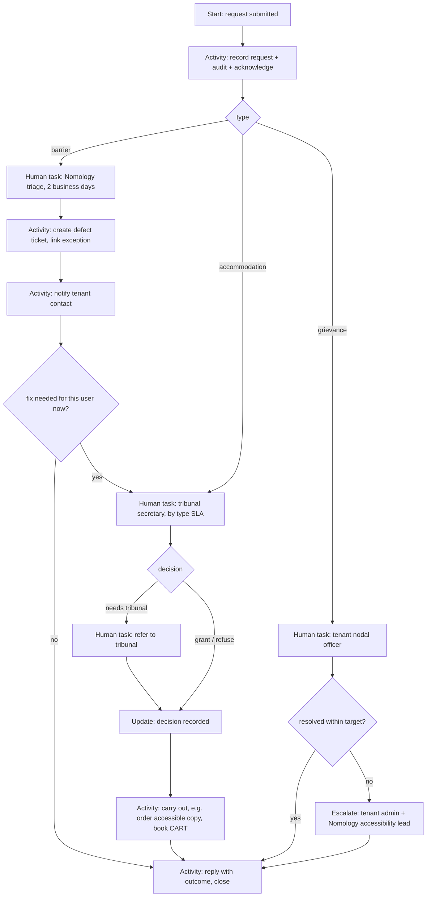

# 2.4.1.5 Accessibility feedback, accommodation and grievance

<!-- Generated layout: edit text between the markers; keep the markers and the front matter. -->

> Report-a-barrier channel, tenant nodal officer routing, accommodation requests to the tribunal secretary, response targets

<!-- section:purpose -->
## Purpose and outcome

Gives every user a way to report an accessibility barrier, ask for an accommodation in their case (accessible copy, extra time, interpreter or CART, alternative channel, assisted filing), or raise an accessibility grievance, and makes sure each one reaches the right person and is answered within a target time. **Done** means: the requester has a recorded outcome (fixed, accommodation granted or refused with reasons, grievance resolved or escalated), the outcome is communicated in their chosen channel, and barrier reports are linked to a defect or exception.

<!-- section:trigger -->
## Trigger and inputs

| Trigger | Where | Request type |
|---|---|---|
| "Report an accessibility problem" link (consistent help location on every page) | any route group | `barrier` |
| "Request an accessible copy" on a document row | portal, tribunal | `accommodation.accessible-copy` |
| "Ask for an adjustment" in a case (extension, interpreter, CART, alternative channel, assisted filing) | portal requests page | `accommodation.*` |
| Email or phone to the tenant's accessibility contact, logged by staff | secretariat console | any |
| "Make a complaint about accessibility" from the accessibility statement | `(public)/accessibility` | `grievance` |

Inputs: type, description (free text), page or document reference (route template plus entity reference captured automatically), preferred contact channel and format, optional AT used, case reference (for accommodations). Disability details are optional and never required.

Workflow ID: `{tenantId}-a11y-request-{requestId}` (task queue `cases` for accommodations, `platform-support` for barriers).

<!-- section:actors -->
## Actors

| Actor | Interaction |
|---|---|
| Requester (party, counsel, neutral, staff) | starts via Server Action; receives updates; can add information (Signal `requesterReplied`) |
| Tribunal secretary / case manager | human task for accommodations; decides or refers to tribunal (Update `decideAccommodation`) |
| Tribunal (neutral) | decides extensions of time or procedural adjustments when the rules require (Update via secretariat task) |
| Tenant accessibility contact / nodal officer | owns grievances; sees barrier reports for their tenant (Update `resolveGrievance`) |
| Nomology accessibility triage | triages barrier reports, links defects (Update `triageBarrier`) |
| System | notifications, timers, audit, defect ticket creation |

<!-- section:steps -->
## Step sequence

Accommodation decisions that affect a deadline do not change the deadline automatically; extending a deadline is a procedural decision taken through the case workflow ([[DOM-cases]]), and this workflow records the link.

<!-- section:timers -->
## Timers and SLAs

Proposed targets, to be set per tenant through a decision table `a11y-response-policy` in [[PKG-rules-and-decision-engine]] and confirmed against any regulator requirement:

| Timer | Default | Source | At breach |
|---|---|---|---|
| Acknowledgement | immediate (automatic) | platform standard | — |
| Barrier triage | 2 business days | platform standard | escalate to accessibility lead |
| Accessible copy of a document | 3 business days | platform standard; tenant may shorten | escalate to case manager's supervisor; requester told of delay and of the right to ask for more time |
| Interpreter / CART booking | at least 2 business days before the hearing, or within 2 business days of request | tenant setting | escalate to case manager; hearing secretary alerted |
| Other accommodation decision | 3 business days | tenant setting | escalate |
| Grievance resolution | 30 days (assumption; regulated tenants may have a fixed period — to be confirmed by legal) | tenant setting / regulation | escalate at 75% elapsed and at breach |
| Barrier fix | by severity: blocker 5 business days, serious 20, moderate next release | platform standard | listed in ACR exceptions |

Business days use the tenant seat's holiday calendar ([[PKG-calendars-and-deadline]]).

<!-- section:signals -->
## Signals, updates and queries

| Name | Kind | Payload | Validation |
|---|---|---|---|
| `requesterReplied` | Signal | `{ message, attachments[] }` | requester only |
| `triageBarrier` | Update | `{ severity, criterion, defectRef?, userImpact }` | Nomology triage role |
| `decideAccommodation` | Update | `{ decision: grant | refuse | partial | refer, reasons, actions[] }` | tribunal secretary for the case; `refer` only if procedural |
| `resolveGrievance` | Update | `{ outcome, response }` | tenant nodal officer |
| `withdraw` | Signal | `{ reason? }` | requester |
| `status` | Query | → `{ stage, assignee role, due, history }` | requester sees own; staff by role |

<!-- section:activities -->
## Activities

| Activity | Side effect | Idempotency | Timeout / retry |
|---|---|---|---|
| `recordRequest` | insert `accessibility_requests` row (tenant-owned, RLS), audit event | request ID | 10 s, 5 attempts |
| `notify` | email / SMS / in-app via [[PKG-notifications]] in requester's format | `{requestId}:{event}` | 30 s, 10 attempts |
| `createHumanTask` | task in [[WF-human-tasks]] | `{requestId}:{stage}` | 10 s |
| `createDefect` | ticket in engineering tracker with route template, criterion, AT | `{requestId}` | 30 s, retries 1 h then manual |
| `requestAccessibleCopy` | starts OCR / remediation or manual remediation task ([[DOM-accessible-documents-and]]) | `{requestId}:{documentVersionId}` | 30 s |
| `bookCaptioning` | creates CART / interpreter booking task | `{requestId}:{hearingId}` | 30 s |

<!-- section:failure -->
## Failure, cancellation and compensation

If notifications fail after retries, the request stays open and appears on the tenant's accessibility dashboard as 'requester not reached'. If defect creation fails, a manual task is created for the accessibility lead. Withdrawal cancels pending tasks and records the reason; nothing needs compensation.

<!-- section:versioning -->
## Versioning

Response targets are read from the decision table version current at start and stored in the workflow memo; a change applies to new requests only. Workflow code changes use patching ([[WF-separation-of-concerns-temporal]]).

<!-- section:observability -->
## Visibility and monitoring

Search attributes: `tenantId`, `requestType`, `stage`, `nextDeadline`, `caseRef` (accommodations). Metrics: requests by type, time to acknowledge, time to outcome, breaches, by tenant. Monthly report to each tenant's accessibility contact and to the accessibility lead; feeds ACR exceptions.

<!-- section:questions -->
## Open questions

- [ ] Grievance response periods required by SEBI-regulated tenants or by law (owner: legal)
- [ ] Is the requester's disability information ever needed? Proposed: never required; if volunteered, stored as sensitive personal data with case-level restriction (owner: privacy)
- [ ] Who remediates inaccessible documents uploaded by another party: the platform (OCR, conversion) or the filing party on direction of the tribunal? (owner: legal with institutions)

<!-- checks -->
## Template checks

<!-- check:tenancy -->
### Tenancy and residency

Workflow ID `{tenantId}-a11y-request-{requestId}`, `tenantId` search attribute, every activity opens its own tenant transaction; barrier reports visible to Nomology triage carry route templates and description, not case documents.

<!-- check:security -->
### Access to workflow controls

Only the requester can signal `requesterReplied` and `withdraw`; `decideAccommodation` is validated against the tribunal-secretary role for that case in an update validator and in the API before calling Temporal.

<!-- check:audit -->
### Audit and legal record

Request, decisions, reasons and actions are audit events with actor and rule version; accommodation decisions are part of the case record visible to the tribunal but protected as sensitive personal data.

<!-- check:compliance -->
### Regulatory timelines

Response targets come from a versioned decision table per tenant; regulated-tenant periods (to be confirmed) are set there, not in code; breaches are reported monthly.

<!-- check:humantasks -->
### Human tasks

Each human wait names the role, assignment rule (case manager of the case; tenant nodal officer for grievances), notification channel, reminder at 50% and 75% of the target, escalation at breach, and reassignment if the assignee leaves the case.

<!-- check:testing -->
### Testing

Time-skipping tests for every timer and escalation; tests for each request type end to end; test that a party of case A cannot query requests of case B.

<!-- end -->
