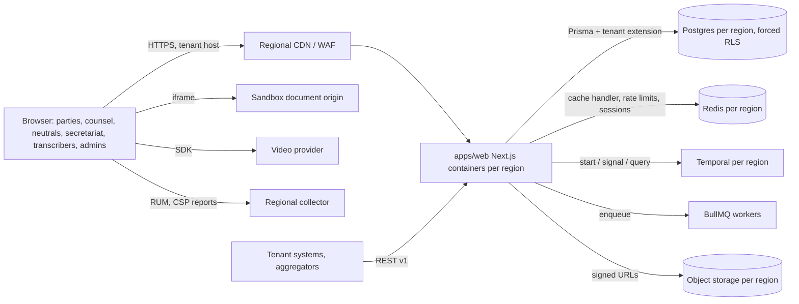

# 2 Next.js App

<!-- Generated layout: edit text between the markers; keep the markers and the front matter. -->

> The single Next.js App Router application (apps/web) that serves every persona, its API layer and the frontend standards all screens inherit

<!-- section:purpose -->
## Purpose and scope

The Next.js App area owns the one browser-facing application of the platform, `apps/web` in the Turborepo ([[FND-monorepo]]). It serves all seven persona route groups (public, party / counsel, neutral, secretariat, transcriber, tenant admin, platform admin) for CORD, TERES and HKIAC CMP tenants from the same codebase, deployed as a self-hosted `standalone` container per region ([[ADR-next-js-hosting]], [[INF-compute]]). It also owns the internal and external API surface that the app exposes and the repo-wide frontend standards (accessibility, content, performance, errors, client state).

**In scope**
- App Router configuration, `proxy.ts`, route groups and layouts per persona ([[APP-app-configuration]] and children)
- Rendering, caching and version-skew strategy ([[APP-rendering-and-caching-strategy]])
- Browser security headers, CSP and CORS ([[APP-security-headers-csp-cors]])
- API style, tRPC routers, Server Actions, versioning, rate limiting, idempotency and the shared error catalogue ([[APP-api-layer]] and children)
- Approved framework libraries and upgrade policy ([[APP-framework-dependencies]])
- Frontend standards: accessibility conformance and reporting, responsive design, error and loading states, document viewer, performance budgets, client state, voice and content ([[APP-frontend-standards]] and children)

**Out of scope (and where it lives)**
- Shared UI components, tokens and Storybook: [[PKG-ui-design-system]]
- Authentication and authorisation mechanisms (sessions, MFA, SSO, permission matrix): [[PKG-authentication]], [[PKG-authorization]]
- Tenant resolution logic and tenant directory: [[MT-tenant-resolution]], [[MT-data-residency-2]]
- Domain rules, state machines and workflows that the UI triggers: [[DOM-cases]], [[WF-entity-state-machines]], [[WF-separation-of-concerns-temporal]]
- Public API resource contracts and webhooks: [[INT-public-api-and-webhooks]] (this area sets the shared rules they follow)
- Real-user monitoring pipeline and collectors: [[OBS-frontend-real-user-monitoring]]
- Hosting, CDN and WAF: [[INF-networking]], [[INF-orchestration]]

<!-- section:goals -->
## Goals and non-goals

**Goals** (proposed targets, confirmed at the Phase 3 boundary)
1. Every persona route group meets WCAG 2.2 AA, with an issued Accessibility Conformance Report per release ([[APP-accessibility-wcag-2-1-aa]], [[APP-accessibility-conformance]]).
2. Core Web Vitals "good" at p75 for every route group in every region: LCP ≤ 2.5 s, INP ≤ 200 ms, CLS ≤ 0.1, measured by RUM ([[APP-frontend-performance-budgets]]).
3. Zero cross-tenant exposure through rendering or caching: the two-tenant diff test ([[APP-rendering-and-caching-strategy]]) passes on every release in every region.
4. Strict CSP (no `unsafe-inline`, no `unsafe-eval`) on 100% of HTML responses in production, verified by an automated header test against each deployed preview.
5. Every API error, in every API family, is an RFC 9457 problem from one catalogue ([[APP-api-error-catalogue-problem]]); no unregistered problem type reaches production.
6. A rolling deploy causes no lost work: zero "Failed to find Server Action" or chunk-load errors above 0.1% of sessions during a deploy window.

**Non-goals**
- A separate Next.js app per persona or per product. One app, route groups per persona; split only if a Decision record shows the bundle or release cadence needs it.
- Native mobile apps. The app is responsive and mobile-first ([[APP-responsive-mobile-first]]); native apps are not planned.
- Offline-first operation. Drafts survive network drops; full offline working is not offered.
- Hosting on a vendor edge platform. Rendering stays in the tenant's region on our own containers.

<!-- section:principles -->
## Principles

1. **Tenant from the host, never from input.** The tenant is resolved in `proxy.ts` from the request host via [[MT-tenant-resolution]] and checked against the session's memberships on the server; no route, query string or request body can choose the tenant.
2. **Every server entry point authorises itself.** Pages, Server Actions, Route Handlers and tRPC procedures each check session, tenant, case role and case stage through the server-only data access layer ([[PKG-data-access]]); layouts never act as the only check.
3. **All database access goes through the tenant-scoped Prisma extension** ([[MT-prisma-client-extension-wraps]]); forced RLS ([[MT-rls-enabled-and-forced-on]]) is the last line, not the only one.
4. **Nothing user- or tenant-specific enters a shared cache without the tenant in its key.** Authenticated HTML is `Cache-Control: private, no-store`.
5. **Not-found and no-access look identical** to the user and to the API caller ([[APP-error-message-catalogue]]).
6. **Strict CSP everywhere**: nonces on dynamic authenticated routes, hashes on static public shells ([[APP-security-headers-csp-cors]]).
7. **Accessibility is inherited from components**: screens use [[PKG-ui-design-system]] components and may not re-implement interactive patterns without an accessibility review.
8. **All browser telemetry stays in the tenant's region** and carries route templates, never case content or personal data ([[OBS-frontend-real-user-monitoring]]).
9. **Copy comes from the message catalogue**, never hard-coded, so tenant terminology and translations apply ([[APP-voice-tone-and-content-style]], [[I18N-i18n]]).

<!-- section:context -->
## Context and boundaries

| Neighbour | What crosses the boundary | Contract node |
|---|---|---|
| Multi-tenancy (MT) | Tenant resolution from host, tenant context per transaction | [[MT-tenant-resolution]], [[MT-prisma-client-extension-wraps]] |
| Platform Packages (PKG) | Sessions, permission checks, design system, notifications, settings, flags | [[PKG-authentication]], [[PKG-authorization]], [[PKG-ui-design-system]], [[PKG-settings]], [[PKG-feature-flags]] |
| Domain Modules (DOM) | Domain commands and queries called from procedures and actions | [[DOM-cases]], [[DOM-documents]], [[DOM-hearings]] |
| Tasks and Workflows (WF) | Workflow starts, signals, updates, queries | [[WF-separation-of-concerns-temporal]] |
| Integrations (INT) | Public REST API, webhooks, embedded vendor SDKs | [[INT-public-api-and-webhooks]], [[INT-video-conferencing-for-hearings]], [[INT-third-party-component]] |
| Observability (OBS) | OpenTelemetry traces, RUM, client errors, CSP reports | [[OBS-foundations]], [[OBS-frontend-real-user-monitoring]] |
| Infrastructure (INF) | Container image, CDN, WAF, secrets | [[INF-compute]], [[INF-networking]], [[INF-secrets-and-keys]] |
| Localisation (I18N) | Message catalogues, locale formatting | [[I18N-i18n]], [[I18N-l10n]] |

<!-- section:decisions -->
## Key decisions

| Decision | How it shapes this area |
|---|---|
| [[ADR-next-js-hosting]] | Self-hosted `standalone` containers per region: we own the cache handler, version-skew handling and CDN rules that a managed host would otherwise provide. |
| [[ADR-tenant-isolation]] | Every data read in a Server Component, action or procedure runs inside a tenant-scoped transaction; the app role cannot bypass RLS. |
| [[ADR-orm]] | Prisma is the only data access path from the app; raw SQL needs an exception ([[APP-framework-dependencies]]). |
| [[ADR-workflow-engine]] | Long-running steps triggered from the UI start Temporal workflows and return immediately; the UI shows progress, never blocks on them. |
| [[ADR-container-orchestration]] | ECS (or Azure Container Apps) rolling deploys drive the version-skew rules in [[APP-rendering-and-caching-strategy]]. |
| Pending: rendering mode per route group | Decided in [[APP-rendering-and-caching-strategy]] (nonce CSP with dynamic rendering for authenticated groups; static shell with hash CSP for public). To be recorded as an ADR once accepted. |

<!-- section:map -->
## Capability map

| Child | Owns |
|---|---|
| [[APP-app-configuration]] | Parent for app-wide configuration: next.config, proxy, route groups, headers, rendering |
| [[APP-app-router-next-config]] | `next.config.ts`, `proxy.ts`, `instrumentation.ts`, root layout, build output |
| [[APP-route-groups-per-persona]] | Route-group map, URL prefixes, defaults every persona group inherits |
| [[APP-party-and-counsel-portal]] · [[APP-hearing-room-in-browser]] | `(counsel)` group; in-browser hearing room |
| [[APP-neutral-workspace]] · [[APP-secretariat-console]] · [[APP-transcriber-workspace]] | `(neutral)`, `(secretariat)`, `(transcriber)` groups |
| [[APP-tenant-admin-console]] · [[APP-platform-admin-and-support]] · [[APP-public-and-sign-in-surfaces]] | `(tenant-admin)`, `(platform-admin)`, `(public)` groups |
| [[APP-security-headers-csp-cors]] | Header set, CSP builder, CORS policy |
| [[APP-rendering-and-caching-strategy]] | Rendering mode per group, cache keys, shared cache handler, version skew |
| [[APP-framework-dependencies]] | Approved libraries and versions |
| [[APP-api-layer]] and children | API style, tRPC routers, Server Actions, versioning / limits / idempotency, problem types |
| [[APP-frontend-standards]] and children | Accessibility, responsive, errors, document viewer, budgets, client state, voice and tone |

Gaps noted: offline draft storage is covered only partly (in [[APP-client-state-and-data-fetching]]); visual regression per tenant theme has no owner node yet (proposed: [[TST-accessibility-testing]] or a new testing node).

<!-- section:phasing -->
## Phasing

| Phase ([[PLAN]]) | Children landing | Exit condition |
|---|---|---|
| 0. Foundations | [[APP-app-router-next-config]], [[APP-framework-dependencies]], [[APP-security-headers-csp-cors]] (baseline), [[APP-frontend-performance-budgets]] (CI wiring) | App builds as `standalone` image; header test and bundle-size check green in CI |
| 1. Core platform | [[APP-route-groups-per-persona]], [[APP-public-and-sign-in-surfaces]], [[APP-platform-admin-and-support]], [[APP-tenant-admin-console]] (users only), [[APP-rendering-and-caching-strategy]], [[APP-api-error-catalogue-problem]], [[APP-route-handlers-trpc-for-internal]], [[APP-server-actions-and-mutation]], [[APP-client-state-and-data-fetching]] | Two-tenant diff test green in all three regions; sign-in journey passes WCAG 2.2 AA manual review |
| 2. Shared services | [[APP-error-boundaries-loading-and]], [[APP-error-message-catalogue]], [[APP-voice-tone-and-content-style]], [[APP-responsive-mobile-first]] | Design-system components used by all shells; message catalogue linted |
| 3. First domain slice | [[APP-party-and-counsel-portal]], [[APP-secretariat-console]], [[APP-document-viewer-and-sandbox]], [[APP-internal-api-trpc-routers-per]], [[APP-api-versioning-rate-limiting]], [[APP-party-and-counsel-portal-2]] | First ACR draft for counsel portal; budgets met in RUM for one pilot tenant |
| 4. Extended domain | [[APP-neutral-workspace]], [[APP-hearing-room-in-browser]], [[APP-transcriber-workspace]], [[APP-secretariat-console-and-neutral]], [[APP-accessibility-feedback]] | Hearing room tested with AT matrix; feedback workflow live |
| 7–8. Compliance, hardening | [[APP-accessibility-legal-obligations]], [[APP-accessibility-conformance]] (published ACR and statements) | Independent audit for SEBI-regulated tenants done |

Accessibility, CSP and tenant-isolation tests are cross-cutting from Phase 0 and are never deferred.

<!-- section:risks -->
## Risks and open questions

- [ ] One app for seven personas may grow the shared client bundle; mitigated by per-group budgets, but a split may be needed (owner: frontend lead, review at Phase 4).
- [ ] Nonce-based CSP rules out static shells for authenticated pages, raising server CPU per request; capacity must be load-tested per region (owner: platform engineering).
- [ ] Next.js major upgrades (for example 15 to 16, middleware renamed to proxy) and React Server Components security advisories need a fast patch path (owner: frontend lead, see [[APP-framework-dependencies]]).
- [ ] Accessibility legal obligations differ by tenant type and are partly in draft; register must be signed off by legal ([[APP-accessibility-legal-obligations]]).
- [ ] Platform-admin route group shares the codebase with tenant surfaces; host separation and network controls must make it unreachable from tenant hosts (owner: security).
- [ ] Who is the single accountable owner for the APP area (proposed: CTO delegate, frontend lead)?

<!-- checks -->
## Template checks

<!-- check:boundaries -->
### Scope and boundaries

Out-of-scope items each have an owner: components in [[PKG-ui-design-system]], auth in [[PKG-authentication]] / [[PKG-authorization]], tenant resolution in [[MT-tenant-resolution]], RUM pipeline in [[OBS-frontend-real-user-monitoring]], public resource contracts in [[INT-public-api-and-webhooks]]. Two overlaps are resolved explicitly: the document viewer UI controls belong to [[PKG-document-viewer-controls]] while rendering and the sandbox origin belong to [[APP-document-viewer-and-sandbox]]; the hearing room's accessibility requirements belong to [[DOM-hearing-room-accessibility]] while its browser architecture belongs to [[APP-hearing-room-in-browser]]. The app shares no tables of its own; every write goes through domain packages.

<!-- check:principles -->
### Principles and enforcement

| Principle | How it is enforced |
|---|---|
| 1 Tenant from host | Unit tests on `proxy.ts`; ESLint rule bans reading `tenantId` from `params`, `searchParams` or form data in `apps/web` |
| 2 Each entry point authorises | ESLint rule: every exported Server Action and tRPC procedure must call `authorize()` from `@nomology/authz`; Playwright negative tests per persona |
| 3 Prisma through extension | Turborepo boundaries: `apps/web` may not import `@prisma/client` directly, only `@nomology/data-access` |
| 4 Tenant in cache keys | Lint rule on `'use cache'` functions requiring a `tenantId` argument; two-tenant diff test |
| 5 Identical not-found | Contract test comparing body and status for unknown and forbidden IDs |
| 6 Strict CSP | Header assertion test against each preview deployment |
| 7 Inherited accessibility | axe on Storybook and Playwright journeys; jsx-a11y; review checklist |
| 8 Telemetry in region | Collector URL per region from config; CSP `connect-src` allow-list per region |
| 9 Copy from catalogue | `i18next/no-literal-string`-style lint rule on JSX text |

<!-- check:decisions -->
### Decisions linked

Accepted decisions that constrain the area: [[ADR-next-js-hosting]], [[ADR-tenant-isolation]], [[ADR-orm]], [[ADR-workflow-engine]], [[ADR-container-orchestration]]. Open decisions that block children: (a) rendering mode and CSP type per route group, drafted in [[APP-rendering-and-caching-strategy]], blocks every persona node's rendering section; (b) whether the platform-admin group stays in `apps/web` or moves to its own app, blocks [[APP-platform-admin-and-support]]; (c) the video provider per region, blocks [[APP-hearing-room-in-browser]]. Each should be recorded as an ADR before Phase 3.

<!-- check:regions -->
### Tenancy and residency

The app runs as an identical container in each region (India, Singapore, US, plus Azure Container Apps deployments where a client requires Azure). Nothing in the app is global except the static marketing site, which holds no tenant data. Per-region configuration: database and Redis endpoints, Temporal namespace, RUM and CSP-report collector URLs, CDN host, sandbox document origin. Tenant-level variation comes only from tenant settings, theme and feature flags read at request time. A request arriving at the wrong region for its tenant host is redirected by `proxy.ts` to the home region, never served.

<!-- check:quality -->
### Quality targets

Targets inherited by every child (proposed): availability 99.9% per month per region for authenticated pages; Core Web Vitals good at p75 (LCP ≤ 2.5 s, INP ≤ 200 ms, CLS ≤ 0.1); server response (TTFB) p75 ≤ 600 ms for authenticated pages and ≤ 200 ms for static public pages measured in region; WCAG 2.2 AA; OWASP ASVS Level 2 for the browser-facing controls. Measured through RUM dashboards per route group and region ([[OBS-frontend-real-user-monitoring]]) and synthetic journeys per persona ([[OBS-uptime-synthetic-monitoring]]).

<!-- check:phase -->
### Phasing

Phase mapping is in the Phasing section and follows [[PLAN]]. Cross-cutting items that must exist from Phase 0: CSP and header tests, accessibility checks in CI, tenant-scoped cache key lint, structured logging. Deferred deliberately: published ACRs and accessibility statements until Phase 7 (risk: SEBI-regulated tenants may need evidence earlier, which would pull [[APP-accessibility-conformance]] forward).

<!-- end -->
