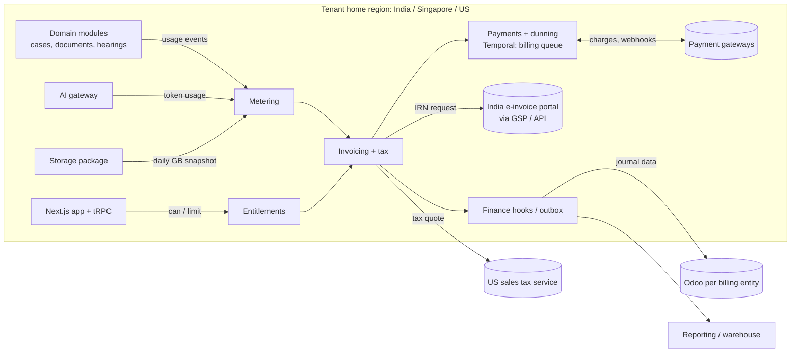

# 10 Billing and Subscription

<!-- Generated layout: edit text between the markers; keep the markers and the front matter. -->

> How Nomology prices, meters, invoices, taxes and collects for platform use, per billing entity (NTPL, TAPL, US entity), and the hooks finance uses to close the books

<!-- section:purpose -->
## Purpose and scope

Billing and Subscription is how Nomology earns money from the platform: which plan a tenant is on, what that plan allows, how usage is counted, which Nomology entity invoices the tenant, which tax applies, how payment is collected and how the result reaches finance. It also supplies the shared payment-gateway plumbing that tenants use when they collect case fees from parties.

**In scope**
- Feature catalogue, plans, price books and per-tenant contract terms ([[BIL-plans-entitlements-and-usage]])
- Entitlements read by both the application (allow / block) and the billing engine (price)
- Usage metering: active cases, seats, storage, AI tokens, API calls
- Subscription invoices, credit and debit notes per billing entity, with India GST and e-invoicing, Singapore GST and US sales tax ([[BIL-invoicing-taxes-gst-singapore]])
- Payment collection, dunning and refunds through payment gateways, including the gateway adapter reused for case-fee collection ([[BIL-payment-gateway-integration]])
- Finance hooks: ledger posting events, revenue recognition data, MRR / ARR feeds ([[BIL-revenue-reporting-hooks-for]])

**Out of scope (and where it lives)**
- Case fees, deposits, neutral fees and transcriber bills that a *tenant* charges or pays inside a case: [[DOM-invoices-and-vendor-bills]] and [[DOM-invoices-and-vendor-bills-schema]]. Billing provides the gateway adapter and tax engine they reuse, not the domain rules.
- The general ledger, bank reconciliation and statutory accounts: the accounting system (Odoo), reached through [[INT-accounting-sync]]
- Bespoke development contracts (for example a client-specific platform build) priced outside the platform: invoiced manually in the accounting system; Billing only records them as a "contract" line if the tenant also has a platform subscription
- Intercompany and transfer-pricing charges between NTPL, TAPL and the US entity: finance, outside the platform
- Cost controls that stop AI spend: [[AI-cost-controls]] (Billing consumes its token counts)

<!-- section:goals -->
## Goals and non-goals

**Goals**
1. Every invoice line can be recomputed from stored usage events and the price-book version that applied, with zero unexplained difference (checked by a nightly recompute job).
2. Invoices for every entity are legally valid when issued: correct entity, tax registration, tax treatment and sequential number; for NTPL, an Invoice Reference Number (IRN) where e-invoicing applies, obtained before the invoice is sent.
3. Usage meters agree with independent counts from source tables within 0.5% per tenant per month (proposed target); any larger gap alerts finance before invoices are issued.
4. Billing, ledger and gateway totals reconcile per entity per day, with mismatches visible on a dashboard the next working day.
5. No tenant is ever billed for another tenant's usage, and no limit ever blocks a procedural deadline action.
6. A plan, price or custom contract term can be added by configuration, without a code release.

**Non-goals**
- Building a general-purpose billing product for other companies.
- Holding money on behalf of institutions (we prefer each institution's own merchant account; see [[BIL-payment-gateway-integration]]).
- Real-time revenue recognition inside the platform; recognition is done in the ledger from data we supply.
- Consumer self-serve checkout for individuals in Phase 5; institutional tenants are on contracts.

<!-- section:principles -->
## Principles

1. **One entitlement source.** Enforcement and pricing read the same entitlement record ([[BIL-plans-entitlements-and-usage]]). No feature check may read plan names directly.
2. **Money is exact.** Amounts are integers in minor units (`bigint`) or `numeric` with fixed scale, always stored with an ISO 4217 currency code. No floating point anywhere in billing code (lint rule `no-float-money` on `packages/billing`).
3. **Append-only facts, immutable documents.** Usage events, price-book versions and issued invoices are never updated in place; corrections are credit or debit notes that reference the original.
4. **Exactly-once effects.** Every usage event, gateway call and ledger post carries an idempotency key enforced by a Postgres unique constraint.
5. **Tenant from context.** `tenant_id` on billing rows comes from the transaction's tenant context ([[MT-prisma-client-extension-wraps]]), never from a request body; billing tables have forced RLS like all tenant tables ([[MT-rls-enabled-and-forced-on]]).
6. **Entity by contract, data by region.** The billing entity is chosen from the tenant's billing account, not from its hosting region; billing records stay in the tenant's home region ([[MT-data-residency-2]]).
7. **Never block due process.** Limits, unpaid invoices and suspension never stop a party from meeting a procedural deadline on an open case; they may stop new cases and non-essential features.
8. **Long money flows run in Temporal** on the `billing` task queue ([[WF-separation-of-concerns-temporal]]); short side jobs (PDF render, email) on BullMQ ([[WF-background-jobs-and-queues]]).

<!-- section:context -->
## Context and boundaries

| Neighbour | What crosses | Contract |
|---|---|---|
| Multi-tenancy ([[MT-tenant-model]], [[MT-tenant-lifecycle]]) | Tenant created / suspended / offboarded events; billing account created at onboarding | Domain events; tenant lifecycle workflow calls billing activities |
| Settings and feature flags ([[PKG-settings]], [[PKG-feature-flags]]) | Flags control rollout; entitlements control commercial access. A feature is visible only if both allow it | `@nomology/entitlements` API |
| Domain modules ([[DOM-cases]], [[DOM-documents]], [[DOM-hearings]]) | Usage events from the outbox | Metering event schema in [[BIL-plans-entitlements-and-usage#metering]] |
| AI ([[AI-cost-controls]]) | Token counts per tenant and model | Usage event `usage.ai.tokens` |
| Case fees ([[DOM-invoices-and-vendor-bills]]) | Reuses gateway adapter, tax engine and invoice numbering service | Package APIs |
| Integrations ([[INT-accounting-sync]], [[INT-kyc-and-sanctions-screening]]) | Ledger posts; payee screening | Integration nodes |
| Reporting ([[RPT-internal-mis]], [[RPT-cases]]) | MRR, ARR, unpaid invoices | Warehouse feed ([[BIL-revenue-reporting-hooks-for]]) |
| Observability ([[OBS-business-events]], [[OBS-usage]]) | Invoice, payment and dunning events | Business event names |

<!-- section:decisions -->
## Key decisions

- [[ADR-tenant-isolation]]: billing tables are tenant-owned with forced RLS; finance cross-tenant views use the reporting role ([[MT-cross-tenant-reporting-via-a]]), never the app role.
- [[ADR-workflow-engine]] and [[ADR-temporal]]: invoice runs, payment collection and dunning are Temporal workflows per region; [[WF-workflow-engine]] already lists "payment and dunning flows" under Temporal.
- [[ADR-queue-technology]]: PDF rendering, invoice email and webhook delivery are BullMQ jobs.
- [[ADR-orm]]: money uses Prisma `BigInt` (minor units) or `Decimal`; never `Float`.
- **Decisions still to record** (proposed new ADRs): build versus buy for the rating engine (in-house versus Lago / Stripe Billing); gateway per currency; US sales tax service; whether case-fee collection uses institution-owned merchant accounts only.

<!-- section:map -->
## Capability map

| Child | Owns |
|---|---|
| [[BIL-plans-entitlements-and-usage]] | Feature catalogue, plans, price books, contract overrides, entitlement store and enforcement API, usage events and aggregation |
| [[BIL-invoicing-taxes-gst-singapore]] | Billing entities and accounts, invoice run, invoice and note documents, numbering, tax determination (India GST / e-invoice, Singapore GST, US sales tax), currency |
| [[BIL-payment-gateway-integration]] | Gateway adapters, payment intents, mandates, inbound gateway events, dunning workflow, refunds, settlement reconciliation; adapter reused for case fees |
| [[BIL-revenue-reporting-hooks-for]] | Ledger posting events, revenue schedule data, finance exports, MRR / ARR metrics |
| Neighbours | Case fees and payouts: [[DOM-invoices-and-vendor-bills]]; ledger sync: [[INT-accounting-sync]]; payee screening: [[INT-kyc-and-sanctions-screening]] |

Gap: there is no node yet for **tax registration and rate reference data** (GSTINs, SAC codes, state codes, Singapore GST rate history). Proposed: a child of [[PKG-reference-and-seed-data]].

<!-- section:phasing -->
## Phasing

[[PLAN]] places Billing in **Phase 5 (Commercial)**. Proposed split:

| Phase | What lands | Exit condition |
|---|---|---|
| 1–4 (before) | Domain modules emit outbox events that will become usage events; `tenant_id` and timestamps already present | Event schema for `case.status_changed` and storage snapshots stable |
| 5a | Feature catalogue, plans, entitlement store and enforcement API; manual invoices per entity with correct tax; NTPL e-invoicing | First real invoice issued by each live entity; nightly recompute shows zero difference |
| 5b | Automated metering (cases, seats, storage, AI tokens); invoice run; gateway collection, dunning and refunds; ledger sync to Odoo | One full month closed with gateway, billing and ledger reconciled per entity |
| 7 | Revenue dashboards, MRR / ARR in reporting | Finance signs off one quarter-end close from platform data |

Must not be deferred: entitlement checks wrapping the AI and public API features (otherwise those features ship unmetered), and the "never block due process" rule.

<!-- section:risks -->
## Risks and open questions

- [ ] Name the accountable owner for Billing (engineering) and the finance counterpart per entity (NTPL, TAPL, US entity).
- [ ] Build or buy the rating and invoicing engine (in-house on Postgres versus Lago or Stripe Billing); affects every child node.
- [ ] Which payment gateway(s) per currency (INR, SGD, USD), and whether Nomology ever collects funds on behalf of institutions (payment aggregator rules in India).
- [ ] Tax adviser review of the entity and tax table in [[BIL-invoicing-taxes-gst-singapore#tax]] before the first invoice from each entity.
- [ ] US entity: in which states economic nexus exists, and which sales tax service to use.
- [ ] Risk: PLAN puts integrations framework in Phase 5, but billing needs gateway and accounting adapters at the same time; framework must land first in Phase 5.
- [ ] Risk: suspension for non-payment colliding with live proceedings; legal to confirm the policy in [[BIL-payment-gateway-integration#lifecycle]].

<!-- checks -->
## Template checks

<!-- check:boundaries -->
### Scope and boundaries

Tenant-to-party money (case fees, deposits, neutral and transcriber payouts) lives in [[DOM-invoices-and-vendor-bills]]; Nomology-to-tenant money lives here. The overlap is deliberate and limited to three shared services owned by Billing: the gateway adapter, the tax engine and the per-entity invoice numbering service. Ledger, bank reconciliation and statutory accounts sit in Odoo, reached only through [[INT-accounting-sync]]. AI spending limits are owned by [[AI-cost-controls]]; Billing only prices the token counts. No billing table is written by another area; domain modules contribute only by emitting outbox events.

<!-- check:principles -->
### Principles and enforcement

Enforcement per principle: (2) lint rule banning `number`/`Float` types for fields named `*amount*`, `*price*`, `*tax*` in `packages/billing`, plus a Prisma schema check that no money column is `Float`; (3) app role has no `UPDATE`/`DELETE` grant on `usage_event`, `invoice` (issued), `price_book_version`; (4) migration lint requires a unique constraint on every `idempotency_key` column; (5) cross-tenant isolation tests ([[MT-automated-tests-that-prove-one]]) cover all billing tables; (7) a Playwright test files a document on a suspended, over-limit tenant and expects success; (8) review checklist item on PRs touching `packages/billing`.

<!-- check:decisions -->
### Decisions linked

Accepted decisions that constrain the area: [[ADR-tenant-isolation]], [[ADR-workflow-engine]], [[ADR-temporal]], [[ADR-queue-technology]], [[ADR-orm]]. Open decisions that block children: rating engine build-or-buy (blocks all of 10.1–10.3), gateway per currency (blocks 10.3), US tax service (blocks US invoicing in 10.2), Odoo topology per entity (blocks [[INT-accounting-sync]] and 10.4). Each should be recorded as an ADR before Phase 5a starts.

<!-- check:compliance -->
### Regulatory and control mapping

Obligations carried here: India CGST/IGST Acts and e-invoicing (NTPL), Singapore GST Act (TAPL), US state sales tax (US entity), FEMA and the RBI export-of-services direction for NTPL foreign-currency receipts, record retention for books of account per entity, PCI DSS scope minimisation (no card data touches our systems), and ISO 27001 / SOC 2 controls on financial data integrity and change. Evidence: invoice ledger and numbering audit ([[BIL-invoicing-taxes-gst-singapore]]), daily reconciliation reports ([[BIL-payment-gateway-integration]]), ledger sync reconciliation ([[INT-accounting-sync]]). All figures and applicability in child nodes are marked as assumptions until the tax adviser and legal review them.

<!-- check:regions -->
### Tenancy and residency

Billing runs per region: usage events, invoices, payments and gateway events for a tenant stay in the tenant's home-region database. The only global parts are platform-level reference tables replicated identically to every region (billing entities, feature catalogue, plan and price-book versions), which contain no personal data. Finance's cross-entity view is built from per-region exports into the accounting system and the reporting warehouse ([[RPT-report-infrastructure]]); billing contact data that reaches Odoo is limited to the tenant's business billing contact. Azure deployments use the same code; only the secrets-manager and queue endpoints differ ([[INF-secrets-and-keys]]).

<!-- check:phase -->
### Phasing

See the phasing table: entitlements and manual invoicing in Phase 5a, automated metering, collection and ledger sync in 5b, finance dashboards in Phase 7. Prerequisites from earlier phases: outbox events in domain modules (Phase 3–4), audit trail ([[PKG-audit-trail]], Phase 1), integration framework (must be the first item of Phase 5). Not deferrable: entitlement wrapping of AI and public API features, and the due-process exemption.

<!-- end -->
