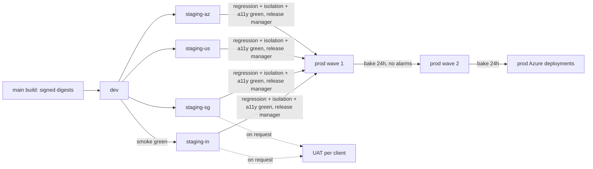

# 15.6 Environment promotion and multi-region rollout

<!-- Generated layout: edit text between the markers; keep the markers and the front matter. -->

> How a release moves dev → staging → UAT → production across India, Singapore, US and Azure deployments, with approvals and region ordering

<!-- section:purpose -->
## Purpose and scope

Specifies how a release moves from dev through staging and UAT to production in India, Singapore and US, and to Azure deployments where a client requires Azure: the gates and approvals at each step, the order in which regions receive it, bake times, how hotfixes skip the queue, and how version differences between regions are bounded. Environments themselves are defined in [[FND-environments]].

<!-- section:rules -->
## Rules

**Promotion path**

- **PROMO-1** Only digests produced and signed by the `main` build can be promoted; each environment's deploy job verifies the signature ([[DEP-ci-cd-pipelines-build-test]]).
- **PROMO-2** dev deploys automatically on every `main` build. Staging in all regions (including `staging-az`) deploys automatically once dev smoke tests pass, at least once per release candidate.
- **PROMO-3** Gate to production: in every staging region, the full regression suite, the tenant isolation suite ([[TST-multi-tenant-isolation-tests]]), journey accessibility checks and the security scans are green; open critical defects are zero; the release manager approves the release.
- **PROMO-4** Production rolls out in waves, one region per wave step, each region running its own migrations first (MIG-14) and then blue-green traffic shifting ([[DEP-blue-green-canary-releases]]). Proposed order: **wave 1 = the AWS region with the lowest case and hearing load in the release window; wave 2 = the remaining AWS regions; wave 3 = Azure deployments**. The order is recorded per release.
- **PROMO-5** Each wave bakes for 24 hours (proposed) with no rollback-level alarms before the next wave starts. A rollback in any wave stops all later waves.
- **PROMO-6** UAT receives a release candidate only on request of the implementation team for a named client, after staging in the client's region is green; UAT approval by the client is recorded on the change record when the release contains changes they asked to accept.
- **PROMO-7** Each GitHub environment has its own OIDC role and reviewers: `prod-*` requires the release manager; high-risk releases also require CTO and security ([[DEP-release-notes-and-change]]).
- **PROMO-8** No more than one release difference between any two production regions (N and N-1). Global components (tenant directory and request routing, [[MT-data-residency-2]]) must be compatible with N and N-1 of every regional stack.
- **PROMO-9** Hotfixes are commits on `main` (trunk-based), built and signed as usual, then promoted through dev and the affected region's staging with the minimum regression set, and to production as an emergency change. The hotfix is promoted to all regions within the next normal train.
- **PROMO-10** Region configuration differences (endpoints, providers, KMS keys) live only in runtime configuration; a release never contains region-specific code paths chosen by build flags.

<!-- section:rationale -->
## Rationale

- **PROMO-4** Starting with the least-loaded region limits who is affected by a defect that slipped past staging. Azure goes last because it has the fewest tenants and the most environment differences.
- **PROMO-5** Some defects (scheduled workflows, nightly reports, aggregator submissions) only show after a day of real operation.
- **PROMO-8** Tenants do not cross regions, but platform staff, the global tenant directory and shared documentation do; bounding skew keeps them simple.

<!-- section:tooling -->
## Tooling and configuration

- `promote.yml` GitHub Actions workflow with jobs per environment, using GitHub Environments for approvals and OIDC roles.
- `tooling/release` CLI to record wave order, bake start and end, and to block the next wave on alarms.
- Region health from [[OBS-alerting]] and synthetic checks per region ([[OBS-uptime-synthetic-monitoring]]).

<!-- section:enforcement -->
## Enforcement

| Rule | Enforcement |
|---|---|
| PROMO-1 | Signature verification step in every deploy job |
| PROMO-2, PROMO-3 | Workflow `needs:` dependencies; gate job reads suite results per region |
| PROMO-4, PROMO-5 | Release CLI refuses to start wave n+1 before bake end or while an alarm is open |
| PROMO-7 | GitHub Environment protection rules and IAM trust policies per environment |
| PROMO-8 | Pre-deploy check compares release IDs across regions; refuses a deploy that would create N-2 skew |
| PROMO-9 | Emergency label and incident ticket required; follow-up job flags regions not yet on the hotfix after 7 days |

<!-- section:examples -->
## Examples

Release 2026.11.04: staging green in all four staging environments on Tuesday; wave 1 prod-us Wednesday 10:00 IST; bake until Thursday 10:00; wave 2 prod-sg then prod-in Thursday; Azure deployment Friday after bake. A rollback in prod-sg on Thursday would hold prod-in and Azure on 2026.10.28.

<!-- section:exceptions -->
## Exceptions

A client-specific urgent fix may be promoted to that client's region ahead of the wave order as an emergency change, keeping PROMO-8. Skipping staging is never allowed.

<!-- section:questions -->
## Open questions

- [ ] Confirm the wave order rule with product and client success, including which region is wave 1 in practice.
- [ ] Bake time: 24 hours for all releases, or shorter for standard releases with no migrations?
- [ ] Does each Azure client deployment need its own UAT, and who approves production for it (client sign-off required by contract)?
- [ ] Release windows by time zone: a single global window or per region (India IST, Singapore SGT, US Eastern)?

<!-- checks -->
## Template checks

<!-- check:enforcement -->
### Enforcement

Each gate is a workflow dependency or GitHub Environment protection rule; wave order and bake are enforced by the release CLI; skew is checked before deploy. Approvals are recorded by GitHub and copied to the change record.

<!-- check:guardrails -->
### Security, tenancy and privacy guardrails

Signed digests only (supply chain), OIDC roles per environment (no static credentials), tenant isolation suite as a production gate in every region, and region configuration as runtime config only (residency).

<!-- check:compliance -->
### Compliance evidence

Supports ISO/IEC 27001:2022 change management and separation-of-environments controls: each production deploy shows the staging evidence in the same region and named approvers. Client UAT sign-off is recorded where contracts require it.

<!-- check:measurement -->
### Adoption measurement

Tracked per release: time from release cut to last region, number of waves halted, skew duration between regions, and hotfixes not yet in all regions.

<!-- check:ownership -->
### Ownership and change

Owner: DevOps lead; release manager role rotates weekly among senior engineers.

<!-- end -->
