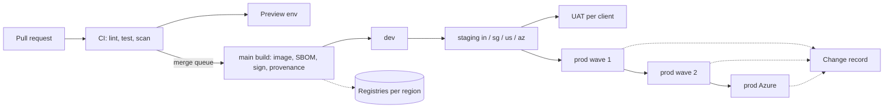

# 15 Deployment and Release

<!-- Generated layout: edit text between the markers; keep the markers and the front matter. -->

<!-- section:purpose -->
## Purpose and scope

Deployment and Release covers how a reviewed change becomes running software in every region: the pipelines that build, test and scan it, the short-lived preview environments used to review it, the rules that keep database changes safe while old and new code run side by side, the traffic-shifting and rollback mechanics, the promotion path from dev to production across India, Singapore, US and Azure deployments, and the change records and release notes that prove all of this to auditors and tenants.

**In scope**: CI/CD pipelines and supply-chain controls ([[DEP-ci-cd-pipelines-build-test]]); preview environments ([[DEP-preview-environments-per-pr]]); zero-downtime migrations ([[DEP-database-migration-strategy-zero]]); blue-green and canary releases and rollback ([[DEP-blue-green-canary-releases]]); change management and release notes ([[DEP-release-notes-and-change]]); environment promotion and region ordering ([[DEP-environment-promotion-and-multi]]).

**Out of scope**: what each environment is and what data it may hold ([[FND-environments]]); cloud accounts, clusters and networking ([[INF]]); test design and test suites ([[TST]]); feature flag mechanics ([[PKG-feature-flags]]); incident handling after a bad release ([[SEC-security-incident-response-and]], [[OBS-alerting]]).

<!-- section:goals -->
## Goals and non-goals

Proposed targets, measured with the DORA metrics [R1]:
1. Every production change is deployed from an image digest built once on `main`, signed and with build provenance; 100% of production deploys verify the signature.
2. Deployment frequency: at least weekly per region, with no planned downtime for routine releases.
3. Change fail rate below 15% of production deploys (a deploy needing rollback, hotfix or incident).
4. Rollback of the application tier in any region within 10 minutes of the decision, without a database restore.
5. Lead time from merge to production in all regions within 5 working days for a normal change.
6. Every production deploy has a change record traceable to ticket, pull request, approvals and CI results.

**Non-goals**: continuous deployment straight to production on every merge (regulated tenants need predictable windows); database rollback by restore as a release mechanism; per-tenant builds.

<!-- section:principles -->
## Principles

1. **Build once, promote the digest.** No rebuilds between environments or regions.
2. **Every schema change is backwards-compatible with the previous release** (expand, migrate, contract), so the application can roll back without touching the database.
3. **Regions deploy independently and in a fixed order**; a failure in one region stops the rollout to the next.
4. **Risky behaviour ships dark** behind a flag that can be enabled per tenant and per region ([[PKG-feature-flags]]).
5. **Pipelines hold no long-lived cloud credentials**; they assume short-lived roles through OIDC, scoped per environment.
6. **No deploy during a tenant's protected window** (live hearing day, regulatory submission deadline) without an emergency change.
7. **Automated gates decide, people approve**: tests, scans and health checks block; named approvers release to production.

<!-- section:context -->
## Context and boundaries



| Neighbour | What flows | Contract |
|---|---|---|
| [[FND]] | Repo layout, tasks, env schemas, environment set | [[FND-monorepo]], [[FND-environments]] |
| [[TST]] | Test suites run as pipeline gates | [[TST-unit-integration-contract-and]] |
| [[INF]] | ECS / Container Apps services, registries, IAM roles, Temporal clusters | [[INF-orchestration]], [[INF-temporal]] |
| [[MT]] | RLS policies in migrations, tenant directory compatibility | [[MT-prisma-migrations-include-rls]], [[MT-data-residency-2]] |
| [[OBS]] | Health and SLO signals that gate canaries | [[OBS-alerting]], [[OBS-uptime-synthetic-monitoring]] |
| [[SEC]] | Scan results, change evidence | [[SEC-vulnerability-management]], [[SEC-isms-controls]] |

<!-- section:decisions -->
## Key decisions

- [[ADR-next-js-hosting]] — self-hosted containers mean we own version-skew handling and asset retention during rollouts.
- [[ADR-container-orchestration]] — two deployment mechanisms (ECS and Azure Container Apps revisions) behind one pipeline interface.
- [[ADR-temporal]] — workflow code changes need Temporal worker versioning per region.
- [[ADR-tenant-isolation]] — every migration that creates a tenant table must carry its RLS policy.
- Proposed ADRs: CI platform (GitHub Actions assumed), deployment controller on ECS (native blue/green vs CodeDeploy), region wave order.

<!-- section:map -->
## Capability map

| Child | Owns |
|---|---|
| [[DEP-ci-cd-pipelines-build-test]] | Pipeline stages, required checks, image build, SBOM, signing, provenance, pipeline identity |
| [[DEP-preview-environments-per-pr]] | Ephemeral per-PR stack, seeding, access, teardown, cost limits |
| [[DEP-database-migration-strategy-zero]] | Expand / migrate / contract, migration linting, backfills, multi-region ordering |
| [[DEP-blue-green-canary-releases]] | Traffic shifting, canary analysis, rollback, version skew, worker versioning |
| [[DEP-release-notes-and-change]] | Change classes, approvals, change records, internal and tenant-facing release notes |
| [[DEP-environment-promotion-and-multi]] | Promotion path, approvals per environment, region waves, Azure deployments, hotfixes |

<!-- section:phasing -->
## Phasing

| Phase ([[PLAN]]) | Lands |
|---|---|
| 0 | CI pipeline with required checks, image build and signing, deploy to dev, migration linting |
| 1 | Staging in all three regions; expand/contract rules enforced; preview environments |
| 3 | Blue-green on ECS with automated rollback; change records; first UAT |
| 5 | Tenant-facing release notes; contractual change notices |
| 8 | Canary analysis tuned on real traffic; Azure production path rehearsed; DR-linked deploy drills |

Exit before first production tenant: a full release has been promoted through dev → staging (all regions) → prod wave 1 and rolled back once in staging, with evidence captured.

<!-- section:risks -->
## Risks and open questions

- [ ] Owner for this area to be named (proposed: DevOps lead).
- [ ] Region wave order and bake times need sign-off from product and client success (see [[DEP-environment-promotion-and-multi#questions]]).
- [ ] Client contracts may require advance notice of changes or maintenance windows; legal to confirm per client.
- [ ] Risk: Azure deployments lag AWS and drift; mitigated by a single pipeline interface and a staging-az environment.
- [ ] Risk: long Temporal workflows (multi-month cases) keep old worker versions alive; needs a retirement policy ([[DEP-blue-green-canary-releases#questions]]).

<!-- checks -->
## Template checks

<!-- check:ownership -->
### Ownership and governance

Proposed owner: DevOps lead; deputy: platform engineering lead. Reviewers: information security owner for pipeline identity, signing and scan gates; platform-data for migration rules; client success for release windows and tenant notices.

<!-- check:boundaries -->
### Scope and boundaries

What each environment is lives in [[FND-environments]]; how releases move is here. Test design lives in [[TST]]; this area only runs suites as gates. Flags are owned by [[PKG-feature-flags]]; this area uses them for dark launches. No shared tables except the change-record store, which this area owns.

<!-- check:principles -->
### Principles and enforcement

Principles 1, 2, 5 and 7 are tool-enforced (digest-only deploy jobs, migration linter and expand/contract classification, OIDC roles with no static keys, required checks and GitHub environment approvals). Principle 3 is enforced by the promotion workflow (next wave waits for the previous wave's health gate). Principle 6 is enforced by a calendar check step that reads protected windows from tenant settings. Principle 4 is a PR checklist item.

<!-- check:compliance -->
### Regulatory and control mapping

Supports ISO/IEC 27001:2022 Annex A change management, secure development and separation-of-environments controls, and SOC 2 change-management criteria; supply-chain practices follow NIST SSDF and SLSA build level 2 as a proposed target. Evidence: CI history, signed provenance, GitHub environment approvals and the change record per deploy, kept for at least the ISMS evidence retention period (to be set in [[SEC-isms-controls]]).

<!-- check:regions -->
### Tenancy and residency

Pipelines are global; deploy targets are per region, each with its own registry replica, IAM role, migration task and Temporal namespace. Azure deployments use the same pipeline steps with a Container Apps adapter. A new region needs a GitHub environment, registry replication, IAM role and a place in the wave order.

<!-- check:quality -->
### Quality targets

Targets: rollback within 10 minutes, zero planned downtime for routine releases, change fail rate below 15%, merge-to-production within 5 working days (all proposed). Shown on a DORA dashboard per region.

<!-- citations -->
## Citations

```json
[
  {
    "excerpt": "Change lead time, deployment frequency, change fail rate and failed deployment recovery time measure delivery throughput and stability.",
    "id": "R1",
    "kind": "web",
    "publisher": "DORA (Google Cloud)",
    "title": "DORA's software delivery metrics: the four keys",
    "url": "https://dora.dev/guides/dora-metrics-four-keys/"
  }
]
```

<!-- end -->
