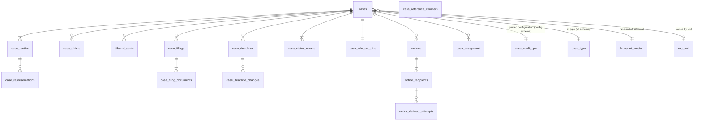

# 6.1.2 Cases schema

<!-- Generated layout: edit text between the markers; keep the markers and the front matter. -->

> Case, party, representative, tribunal membership, status events and rule-set references

<!-- section:purpose -->
## Scope and ownership

Physical schema for the Cases context ([[DOM-cases]]) including service of notices ([[DOM-service-of-notices-and-proof]]). Owned by the cases domain team. Lives in `packages/domain-cases/prisma/cases.prisma` (multi-file Prisma schema) and the Postgres schema `public` of each regional database.

Other contexts reference cases by `(tenant_id, case_id)` foreign key: Documents, Hearings, Invoices, Neutrals (appointments). They read case data through the cases service or the reporting views, never by writing these tables. Reporting reads through `nomo_reporting` on the replica ([[MT-cross-tenant-reporting-via-a]]).

**Conventions used by all domain schemas** (stated once here; other DOM schemas refer to this section):

| Item | Convention |
|---|---|
| Table names | Plural snake_case (`cases`, not `case`, which is a reserved word) |
| Primary key | `id uuid` generated in the application as UUIDv7 (time-ordered, RFC 9562 [R1]) |
| Tenant | `tenant_id uuid NOT NULL` first column after `id`; `UNIQUE (tenant_id, id)` on every tenant table so children can use composite foreign keys |
| Money | `amount_minor bigint` plus `currency char(3)` (ISO 4217) |
| Timestamps | `timestamptz`, stored UTC; `created_at`, `updated_at` default `now()` |
| Enumerations | `text` with a `CHECK` constraint (easier to extend in expand / contract migrations than Postgres enums) |
| Optimistic lock | `version integer NOT NULL DEFAULT 1` on mutable aggregate roots |
| Classification | Column comment `COMMENT ON COLUMN ... IS 'class=personal'` read by the data catalogue |

<!-- section:entities -->
## Entities and relationships



| Relationship | Cardinality | Notes |
|---|---|---|
| cases → case_parties | 1 to many (at least 2 after submission) | Aggregate child |
| case_parties → case_representations | 1 to many | `ended_at` null while active |
| cases → tribunal_seats | 1 to many | `neutral_appointment_id` references [[DOM-neutrals-schema]] |
| cases → case_filings | 1 to many | Own aggregate |
| case_filings → case_filing_documents | 1 to many | References `document_versions` in [[DOM-documents-schema]] |
| cases → case_status_events | 1 to many, append-only | History |
| cases → notices → recipients → attempts | 1 to many each | Service of notices |
| cases → case_assignment | 1 to many | Secretariat staff (or a group) assigned to the case with a case-level role; at most one active primary `case_manager` |
| cases → `config.case_config_pin` | 1 to 1 | Pinned blueprint, artefact and `case_start` setting versions, written in the same transaction as the case ([[PKG-settings-data-model#tables]]) |
| cases → `wf.case_type`, `wf.blueprint_version` | many to 1 | Case type and the blueprint version the case runs on ([[WF-process-definition-model#tables]]) |
| cases → `org_unit` | many to 0..1 | Owning unit: the `unit` scope for access and settings ([[MT-tenancy-and-identity-schema]]) |

All tables are tenant-owned. `case_reference_counters` is tenant-owned too (one row per tenant, series and year). Reference data used: rule sets and decision tables ([[PKG-rules-and-decision-engine]]), countries and currencies ([[PKG-reference-and-seed-data]]).

`case_rule_set_pins` stays the record of the rule set and decision-table versions the case is administered under (CASE-BR-6). The complete set of pinned configuration (blueprint version, forms, templates, decision tables and `case_start` settings) is `config.case_config_pin`, owned by [[PKG-configuration-and-customisation]]; the two are written in the same transaction and must agree (see questions). The process position (stage, active steps) is `wf.case_process` ([[WF-process-definition-model]]).

<!-- section:tables -->
## Tables and columns

Every table also has `tenant_id uuid NOT NULL`, `created_at timestamptz NOT NULL DEFAULT now()`; mutable tables have `updated_at` and `version`. Classification codes: P = public, I = internal, PD = personal, C = confidential, SPD = sensitive personal.

**cases**

| Column | Type | Null | Default | Meaning | Class |
|---|---|---|---|---|---|
| id | uuid | no | | UUIDv7 | I |
| case_reference | text | yes | | Assigned at registration (CASE-BR-5) | I |
| external_reference | text | yes | | Aggregator / MII reference | I |
| case_type_key | text | no | | Case-type blueprint key, for example `sebi_odr_conciliation`; FK to `wf.case_type` ([[WF-process-definition-model]]). Set at creation; changed only by a reviewed migration ([[WF-workflow-versioning]]) | I |
| blueprint_version_id | uuid | no | | Blueprint version the case runs on. Copy of `wf.case_process.blueprint_version_id`, kept for reporting joins and access filters; written only by case creation and the migration service, in the same transaction as `wf.case_process` | I |
| owning_unit_id | uuid | yes | | Unit (`org_unit`) that owns the case; set at creation by `access.case.unit_owns_case_by` ([[PKG-settings-access-control]]); drives unit-scoped access ([[PKG-rbac-abac-case-level-party]]) and unit settings | I |
| procedure_type | text | no | | `arbitration`, `expedited_arbitration`, `emergency_arbitration`, `conciliation`, `mediation` | I |
| status | text | no | `'draft'` | State machine status | I |
| resume_to | text | yes | | Status to resume to when `suspended` | I |
| outcome | text | yes | | `award`, `settlement`, `withdrawal`, `termination`, `non_settlement_referred` | C |
| rule_set_key | text | no | | e.g. `sebi-odr`, `inst-arb-2024` | I |
| seat_country | char(2) | yes | | ISO 3166-1 alpha-2 | I |
| seat_city | text | yes | | | I |
| seat_time_zone | text | no | tenant default | IANA zone, e.g. `Asia/Kolkata` | I |
| language_of_proceedings | text | no | `'en'` | BCP 47 | I |
| confidentiality | text | no | `'standard'` | `standard`, `confidential`, `sealed` | I |
| title | text | yes | | Short title, e.g. "A v B" | C |
| source | text | no | | `portal`, `public_api`, `aggregator`, `secretariat` | I |
| aggregator_key | text | yes | | e.g. `nse` | I |
| assigned_secretary_membership_id | uuid | yes | | **Deprecated.** Replaced by `case_assignment` (primary `case_manager` or `tribunal_secretary`); written in parallel until the contract step of migration 11, then dropped | I |
| submitted_at, registered_at, closed_at | timestamptz | yes | | Lifecycle timestamps | I |
| custom_fields | jsonb | no | `'{}'` | Validated against [[PKG-metadata-management-entity]] schema | C |
| version | integer | no | 1 | Optimistic lock | I |

**case_parties**: `id`, `case_id uuid`, `role text` (`claimant`, `respondent`, `additional_party`, `intervener`), `party_kind text` (`individual`, `organisation`), `display_name text` (PD), `name_latin text` (PD), `sequence smallint`, `membership_id uuid NULL` (when the party has an account), `email citext NULL` (PD), `mobile_e164 text NULL` (PD), `postal_address jsonb NULL` (PD, shape validated), `identifiers jsonb NOT NULL DEFAULT '[]'` holding `{scheme, value_ciphertext, last4}` (SPD; values encrypted, see Protection), `is_unrepresented boolean NOT NULL DEFAULT true`, `removed_at timestamptz NULL`, `version`.

**case_representations**: `id`, `case_id`, `case_party_id`, `representative_membership_id uuid`, `kind text` (`counsel`, `authorised_representative`, `guardian`), `is_service_address boolean`, `authority_document_version_id uuid NULL`, `started_at timestamptz`, `ended_at timestamptz NULL`, `end_reason text NULL`.

**case_claims**: `id`, `case_id`, `claim_kind text` (`claim`, `counterclaim`, `set_off`), `filed_by_party_id uuid`, `nature text`, `amount_minor bigint NULL`, `currency char(3) NULL`, `is_quantified boolean`, `superseded_by uuid NULL`.

**tribunal_seats**: `id`, `case_id`, `seat_role text` (`sole`, `presiding`, `co_neutral`, `emergency`, `conciliator`, `mediator`), `neutral_appointment_id uuid`, `seated_at timestamptz`, `unseated_at timestamptz NULL`, `unseat_reason text NULL` (`challenge_upheld`, `resignation`, `death_or_incapacity`, `removal`, `replaced`).

**case_filings**: `id`, `case_id`, `filing_type text` (from tenant filing-type catalogue), `filed_by_kind text` (`party`, `tribunal`, `secretariat`), `filed_by_party_id uuid NULL`, `filed_by_membership_id uuid`, `filed_at timestamptz NOT NULL DEFAULT now()`, `deadline_id uuid NULL`, `is_late boolean NOT NULL DEFAULT false`, `admission text NULL` (`admitted`, `rejected`, null = no ruling needed), `visibility text` (`all_participants`, `tribunal_only`, `tribunal_and_filer`), `corrects_filing_id uuid NULL`, `idempotency_key text NOT NULL`.

**case_filing_documents**: `case_filing_id`, `document_version_id`, `position smallint`, `content_sha256 bytea` (copied at filing for evidence).

**case_deadlines**: `id`, `case_id`, `rule_key text`, `description text`, `trigger_event text`, `triggered_at timestamptz`, `due_at timestamptz NOT NULL`, `time_zone text NOT NULL`, `status text` (`running`, `met`, `missed`, `extended`, `stayed`, `cancelled`), `responsible_party_role text NULL`, `stayed_remaining interval NULL`, `version`.

**case_deadline_changes**: `id`, `case_deadline_id`, `change text` (`extended`, `stayed`, `restarted`, `cancelled`), `old_due_at`, `new_due_at`, `ordered_by_filing_id uuid NULL`, `reason text NOT NULL`, `actor_membership_id uuid NULL`, `occurred_at timestamptz NOT NULL DEFAULT now()`.

**case_status_events** (append-only): `id`, `case_id`, `from_status text NULL`, `to_status text`, `command text`, `actor_kind text` (`user`, `system`), `actor_membership_id uuid NULL`, `on_behalf_of_party_id uuid NULL`, `reason text NULL`, `rule_set_version integer`, `workflow_id text NULL`, `request_id text`, `idempotency_key text NOT NULL` (unique per tenant; required by [[WF-entity-state-machines]]), `occurred_at timestamptz NOT NULL DEFAULT now()`.

**case_rule_set_pins**: `case_id` (PK with tenant_id), `rule_set_key`, `rule_set_version integer`, `decision_versions jsonb` (map of decision key to version), `pinned_at timestamptz`, `transition_order_filing_id uuid NULL`.

**case_assignment**: `id`, `case_id`, `assignee_kind text` (`membership`, `group`), `membership_id uuid NULL`, `group_id uuid NULL` (an `authz_group` used as a shared assignee, [[PKG-authorization-data-model]]), `role_key text` (case-level role: `case_manager` or `tribunal_secretary`), `is_primary boolean NOT NULL DEFAULT false`, `source text` (`manual`, `queue`, `automation`, `blueprint`, `migration`), `assigned_by_membership_id uuid NULL` (null when `source` is `automation` or `blueprint`), `assigned_at timestamptz NOT NULL DEFAULT now()`, `ended_at timestamptz NULL`, `end_reason text NULL` (`reassigned`, `case_closed`, `membership_ended`, `removed`), `version`. Each active membership assignment is projected into `authz_case_role` with `source_type = 'case_assignment'` ([[PKG-authorization-data-model#tables]]), so case access follows the assignment in the same transaction. Who may assign is the permission `case:assign` in [[PKG-permission-catalogue]].

**case_reference_counters**: `tenant_id`, `series_key text`, `period text` (e.g. `2026`), `next_value integer NOT NULL`, primary key `(tenant_id, series_key, period)`.

Notice tables (`notices`, `notice_recipients`, `notice_delivery_attempts`, `notice_evidence`) are specified in the Activities section of [[DOM-service-of-notices-and-proof]] and follow the same conventions.

<!-- section:keys -->
## Keys and constraints

```sql
-- pattern for every tenant table
ALTER TABLE cases ADD CONSTRAINT cases_pkey PRIMARY KEY (id);
ALTER TABLE cases ADD CONSTRAINT cases_tenant_id_id_key UNIQUE (tenant_id, id);
ALTER TABLE cases ADD CONSTRAINT cases_tenant_fk FOREIGN KEY (tenant_id) REFERENCES tenants (id);

-- composite foreign keys so a child can never point at another tenant's parent
ALTER TABLE case_parties ADD CONSTRAINT case_parties_case_fk
  FOREIGN KEY (tenant_id, case_id) REFERENCES cases (tenant_id, id) ON DELETE CASCADE;
ALTER TABLE tribunal_seats ADD CONSTRAINT tribunal_seats_appointment_fk
  FOREIGN KEY (tenant_id, neutral_appointment_id) REFERENCES neutral_appointments (tenant_id, id) ON DELETE RESTRICT;
ALTER TABLE case_filing_documents ADD CONSTRAINT cfd_version_fk
  FOREIGN KEY (tenant_id, document_version_id) REFERENCES document_versions (tenant_id, id) ON DELETE RESTRICT;
ALTER TABLE cases ADD CONSTRAINT cases_case_type_fk
  FOREIGN KEY (tenant_id, case_type_key) REFERENCES wf.case_type (tenant_id, case_type_key) ON DELETE RESTRICT;
ALTER TABLE cases ADD CONSTRAINT cases_blueprint_version_fk
  FOREIGN KEY (tenant_id, blueprint_version_id) REFERENCES wf.blueprint_version (tenant_id, id) ON DELETE RESTRICT;
ALTER TABLE cases ADD CONSTRAINT cases_owning_unit_fk
  FOREIGN KEY (tenant_id, owning_unit_id) REFERENCES org_unit (tenant_id, id) ON DELETE RESTRICT;
ALTER TABLE case_assignment ADD CONSTRAINT case_assignment_case_fk
  FOREIGN KEY (tenant_id, case_id) REFERENCES cases (tenant_id, id) ON DELETE CASCADE;
ALTER TABLE case_assignment ADD CONSTRAINT case_assignment_membership_fk
  FOREIGN KEY (tenant_id, membership_id) REFERENCES membership (tenant_id, id) ON DELETE RESTRICT;
ALTER TABLE case_assignment ADD CONSTRAINT case_assignment_group_fk
  FOREIGN KEY (tenant_id, group_id) REFERENCES authz_group (tenant_id, id) ON DELETE RESTRICT;

-- business rules in the database
ALTER TABLE cases ADD CONSTRAINT cases_reference_unique UNIQUE (tenant_id, case_reference);       -- CASE-BR-5
ALTER TABLE cases ADD CONSTRAINT cases_status_check CHECK (status IN ('draft','submitted','in_scrutiny',
  'returned_for_defects','registered','in_conciliation','awaiting_constitution','constituted','in_proceedings',
  'suspended','proceedings_closed','award_issued','settled','withdrawn','terminated','closed'));
ALTER TABLE cases ADD CONSTRAINT cases_reference_when_registered
  CHECK (status IN ('draft','submitted','in_scrutiny','returned_for_defects') OR case_reference IS NOT NULL);
ALTER TABLE cases ADD CONSTRAINT cases_resume_to_check CHECK ((status = 'suspended') = (resume_to IS NOT NULL));
CREATE UNIQUE INDEX tribunal_one_presiding ON tribunal_seats (tenant_id, case_id)
  WHERE seat_role IN ('presiding','sole') AND unseated_at IS NULL;
CREATE UNIQUE INDEX case_filings_idem ON case_filings (tenant_id, idempotency_key);
CREATE UNIQUE INDEX case_status_events_idem ON case_status_events (tenant_id, idempotency_key);
ALTER TABLE case_claims ADD CONSTRAINT claims_amount_check
  CHECK ((amount_minor IS NULL) = (currency IS NULL) AND (amount_minor IS NULL OR amount_minor >= 0));
ALTER TABLE case_representations ADD CONSTRAINT repr_period_check CHECK (ended_at IS NULL OR ended_at >= started_at);
ALTER TABLE case_assignment ADD CONSTRAINT case_assignment_assignee_check CHECK (
  (assignee_kind = 'membership' AND membership_id IS NOT NULL AND group_id IS NULL) OR
  (assignee_kind = 'group' AND group_id IS NOT NULL AND membership_id IS NULL));
ALTER TABLE case_assignment ADD CONSTRAINT case_assignment_role_check CHECK (role_key IN ('case_manager','tribunal_secretary'));
CREATE UNIQUE INDEX case_assignment_one_primary ON case_assignment (tenant_id, case_id, role_key)
  WHERE is_primary AND ended_at IS NULL;
CREATE UNIQUE INDEX case_assignment_no_duplicate ON case_assignment (tenant_id, case_id, role_key, membership_id)
  WHERE ended_at IS NULL AND membership_id IS NOT NULL;
```

`config.case_config_pin (tenant_id, case_id)` references `cases` from the config schema ([[PKG-settings-data-model#keys]]); it is created in the same transaction as the case, so every case has exactly one pin.

ON DELETE: aggregate children `CASCADE` from `cases` (only used by the retention job, never by the app, since `nomo_app` and `nomo_worker` have no DELETE on `cases`); references to other contexts `RESTRICT`.

**Left to application code (state machine)**: allowed transitions (CASE-BR-1 to -4, -9, -11, -13, -15), because guards need data from other contexts; enforced by [[WF-entity-state-machines]] on every writer. CASE-BR-1 (at least one claimant and respondent) is checked at `submitCase` in the same transaction under a `SELECT ... FOR UPDATE` of the case row. Also in application code: `blueprint_version_id` must be a version of `case_type_key` (checked at creation and by the migration service), and a `case_assignment` membership must be `kind = 'staff'` and hold a tenant role that may take the case-level role ([[PKG-roles-and-permission-sets]]).

<!-- section:tenancy -->
## Tenancy and RLS policies

All tables are tenant-owned. For each table:

```sql
ALTER TABLE cases ENABLE ROW LEVEL SECURITY;
ALTER TABLE cases FORCE ROW LEVEL SECURITY;
CREATE POLICY tenant_isolation ON cases
  FOR ALL TO nomo_app, nomo_worker
  USING (tenant_id = current_setting('app.tenant_id', true)::uuid)
  WITH CHECK (tenant_id = current_setting('app.tenant_id', true)::uuid);
```

If `app.tenant_id` is unset, `current_setting(..., true)` returns NULL, the comparison is NULL, and no rows are visible or writable; an empty string fails the `::uuid` cast and aborts the statement. Both fail closed [R2].

Append-only tables (`case_status_events`, `case_deadline_changes`, `notice_delivery_attempts`, `notice_evidence`) get separate policies `FOR SELECT` and `FOR INSERT` only, and `REVOKE UPDATE, DELETE ... FROM nomo_app, nomo_worker`.

Case-participant visibility (only parties, representatives, tribunal and assigned staff) is **not** in RLS: it is enforced by the authorisation layer ([[PKG-rbac-abac-case-level-party]]) so that RLS stays a simple, index-friendly tenant predicate. Revisit if a tenant contract requires database-level participant isolation.

Roles (canonical set, [[MT-isolation-strategy#matrix]]): `nomo_app` (web) and `nomo_worker` (Temporal and BullMQ workers), neither with BYPASSRLS; `nomo_migrator` (assumes the owner `nomo_owner`, migrations only, [[MT-separate-privileged-role-used]]); `nomo_reporting` (replica, read-only on curated reporting views); `retention_job` (DELETE on aggregate roots, still subject to RLS, run per tenant; see the open question on purpose-specific roles in [[PKG-retention-and-deletion-schedule]]).

<!-- section:indexes -->
## Indexes and access patterns

| Query (source) | Index |
|---|---|
| Secretariat queue: cases by status and assignee, newest first ([[APP-secretariat-console]]) | `case_assignment (tenant_id, membership_id, role_key) WHERE ended_at IS NULL` joined to `cases (tenant_id, status, submitted_at DESC)` |
| Cases assigned to a group | `case_assignment (tenant_id, group_id) WHERE ended_at IS NULL AND group_id IS NOT NULL` |
| Unit-scoped lists and the `authz.where` unit predicate ([[PKG-authorization-data-model#indexes]]) | `cases (tenant_id, owning_unit_id, status)` |
| Case-type scoped lists, access filter and reporting | `cases (tenant_id, case_type_key, status)` |
| Running cases per blueprint version (migration selection, [[WF-workflow-versioning]]) | `cases (tenant_id, blueprint_version_id)` |
| Look up by reference (search box, public API) | unique `(tenant_id, case_reference)` |
| Aggregator status pull by external reference ([[INT-aggregator-intake-api]]) | `(tenant_id, aggregator_key, external_reference)` unique partial `WHERE external_reference IS NOT NULL` |
| My cases (party / counsel portal) | `case_representations (tenant_id, representative_membership_id) WHERE ended_at IS NULL`; `case_parties (tenant_id, membership_id)` |
| Neutral workspace: my tribunal seats | `tribunal_seats (tenant_id, neutral_appointment_id) WHERE unseated_at IS NULL` |
| Deadlines due soon (dashboard, reminder sweeps) | `case_deadlines (tenant_id, status, due_at) WHERE status = 'running'` |
| Case timeline | `case_status_events (tenant_id, case_id, occurred_at)`; `case_filings (tenant_id, case_id, filed_at)` |
| Custom field filters | GIN on `cases.custom_fields` with `jsonb_path_ops`, only if a tenant enables filterable custom fields |

Full-text search over titles and party names is served by [[PKG-search]], not Postgres indexes.

<!-- section:history -->
## Status, history and concurrency

- `cases.status` mirrors the state machine in [[DOM-cases#lifecycle]]; every change inserts `case_status_events` in the same transaction (written by the state-machine package).
- Party and representation edits keep history through audit events with before / after values ([[PKG-audit-log-schema]]); the status event table is the legal source for lifecycle, audit for field edits.
- Deletes: the application never hard-deletes cases. Parties removed before submission are deleted; after submission `removed_at` is set. Withdrawn cases stay as `withdrawn` then `closed`.
- Concurrency: `version` checked in the `UPDATE ... WHERE id = $1 AND version = $2`; zero rows updated raises `ConcurrentModification` (HTTP 409 per [[APP-api-error-catalogue-problem]]).

<!-- section:protection -->
## Data classification and protection

| Data | Protection beyond RLS |
|---|---|
| `case_parties.identifiers[].value_ciphertext` (PAN, investor codes) | Field-level envelope encryption with the tenant's data key ([[PKG-encryption-utilities-key]]); only `last4` stored in clear for display |
| Party email, mobile, address | Plain columns, masked in support views; never in logs, Temporal payloads, BullMQ jobs or search index beyond name |
| `custom_fields` | Each field carries a classification in its definition; SPD custom fields are rejected unless the tenant enables encrypted custom fields |
| `title` | Treated as confidential (may contain names); excluded from analytics exports |

Never copied to: application logs, traces, Temporal history, the warehouse (party contact data and identifiers are excluded from reporting views).

<!-- section:retention -->
## Retention, archival and deletion

| Table | Clock starts | End of life |
|---|---|---|
| cases and all children | `closed_at` | Per tenant schedule in [[PKG-retention-and-deletion-schedule]]; hard delete of the aggregate, crypto-shred of identifier ciphertexts by key deletion on tenant offboarding |
| Draft cases | last `updated_at` | Hard delete after 90 days (proposed) |
| case_status_events, case_deadline_changes | with parent case | Deleted with case; audit copy kept per audit retention |
| case_reference_counters | tenant offboarding | Deleted |

Legal hold on a case blocks the retention job for its whole aggregate. No partitioning is needed at expected volumes (see Volume).

<!-- section:migrations -->
## Migrations and rollout

Ordered migrations (each in its own Prisma migration folder; raw SQL appended per [R3]):

1. `0001_cases_core`: `cases`, `case_parties`, `case_representations`, `case_claims`, `case_reference_counters` with keys, checks, RLS policies and grants in the same file.
2. `0002_cases_tribunal`: `tribunal_seats` (after `neutral_appointments` exists from the neutrals schema migration; ordering enforced by migration name prefix across packages).
3. `0003_cases_filings_deadlines`: `case_filings`, `case_filing_documents` (after `document_versions`), `case_deadlines`, `case_deadline_changes`.
4. `0004_cases_history`: `case_status_events`, `case_rule_set_pins`, append-only grants.
5. `0005_notices`: notice tables.
6. `0006_cases_indexes`: non-unique indexes created `CONCURRENTLY` in a separate non-transactional migration (empty tables at first release, but the pattern is kept for later index changes).
7. `0007_cases_type_unit_assignment` (expand): add nullable `case_type_key`, `blueprint_version_id` and `owning_unit_id` to `cases`; create `case_assignment` with keys, RLS and grants in the same file. Runs after the `wf` blueprint tables ([[WF-process-definition-model#migrations]]) and `authz_group` ([[PKG-authorization-data-model#migrations]]).
8. Backfill per tenant in batches of 1,000 (resumable BullMQ job): `case_type_key` and `blueprint_version_id` from `wf.case_process`, which holds a generated legacy blueprint version for cases created before blueprints; `owning_unit_id` from `access.case.unit_owns_case_by` (null where no rule applies); one primary `case_manager` row in `case_assignment` for each non-null `assigned_secretary_membership_id` (`source = 'migration'`).
9. Release N: the cases service writes `case_assignment` and, for one release, also `assigned_secretary_membership_id`; reads use `case_assignment`.
10. `0010_cases_type_constraints`: foreign keys and `CHECK (case_type_key IS NOT NULL AND blueprint_version_id IS NOT NULL)` added `NOT VALID`, then `VALIDATE CONSTRAINT`; indexes `CONCURRENTLY`.
11. Release N+2 (contract): stop the parallel write; drop `assigned_secretary_membership_id` and its index.

Every migration sets `SET lock_timeout = '3s'; SET statement_timeout = '60s';` [R4]. Later changes follow expand and contract: add nullable column, backfill per tenant in batches of 1,000 through a resumable BullMQ job, add `CHECK ... NOT VALID`, then `VALIDATE CONSTRAINT`, then make it required in the next release. Migrations run per region in the order set by [[DEP-environment-promotion-and-multi]]; roll-forward is the default plan.

<!-- section:prisma -->
## Prisma schema mapping

- Models `Case`, `CaseParty`, `CaseRepresentation`, `CaseClaim`, `TribunalSeat`, `CaseFiling`, `CaseFilingDocument`, `CaseDeadline`, `CaseDeadlineChange`, `CaseStatusEvent`, `CaseRuleSetPin`, `CaseReferenceCounter`, `CaseAssignment`, with `@@map("cases")` etc. and `@map("tenant_id")` style field mapping (camelCase in TypeScript).
- Relations use composite references: `case Case @relation(fields: [tenantId, caseId], references: [tenantId, id])`, with `@@unique([tenantId, id])` on every parent.
- Relations to `wf.case_type`, `wf.blueprint_version`, `org_unit`, `authz_group` and `config.case_config_pin` cross Prisma schema files; they use the same composite `(tenantId, …)` references (Prisma `multiSchema` for the `wf` and `config` Postgres schemas).
- Status and other enumerations are `String` in Prisma with TypeScript union types generated from the state-machine definition.
- Raw-SQL-only features: RLS policies and FORCE, CHECK constraints, partial unique indexes (`tribunal_one_presiding`, aggregator reference), column comments, grants and REVOKEs on append-only tables. Reviewers must read the migration SQL, not only `schema.prisma`.

<!-- section:seed -->
## Seed and reference data

- Rule sets and filing-type catalogues per tenant type (`inst-arb`, `sebi-odr`, `cord-default`) come from [[PKG-reference-and-seed-data]] as tenant-overridable defaults, loaded per region by the seed job and versioned.
- `case_reference_counters` rows are created on first registration, not seeded.
- Development fixtures (three demo tenants, one per type, with 50 cases each in assorted statuses) live in `packages/domain-cases/fixtures` and never run in production.

<!-- section:volume -->
## Volume, growth and performance

Proposed planning figures (to be replaced with sales forecasts):

| Table | Launch (all tenants, per region) | Year 1 | Year 5 | Notes |
|---|---|---|---|---|
| cases | 10k | 200k | 2M | SEBI ODR aggregator volume dominates in India |
| case_parties | 25k | 500k | 5M | |
| case_status_events | 100k | 2M | 25M | Hottest append table |
| case_filings | 50k | 1M | 12M | |
| case_deadlines | 40k | 800k | 10M | |

The largest tenant is assumed to hold 60% of India's rows. At 25M rows `case_status_events` is still well within single-table limits with the `(tenant_id, case_id, occurred_at)` index; revisit partitioning by `occurred_at` (yearly) above 100M rows or if retention deletes become slow.

<!-- section:questions -->
## Open questions

- [ ] Should case-participant visibility be enforced in RLS as well as in the authorisation layer for sealed cases? Owner: security lead.
- [ ] Do custom fields ever hold sensitive personal data (for example disability accommodations)? If so, encrypted custom fields are needed. Owner: product.
- [ ] Cross-package migration ordering (cases depends on neutrals and documents tables): one migration stream per region or per package? Owner: platform engineering.
- [ ] Assumption: volume figures are placeholders until sales forecasts for SEBI ODR and HKIAC CMP are available.
- [ ] Should `case_rule_set_pins` become a view over `config.case_config_pin` once every rule set ships inside a blueprint? Owner: DOM cases team with configuration lead.
- [ ] Group assignees: should a `case_assignment` to a group give every current group member the case role, or only make the case visible in the group's queue until a member takes it? Proposed: queue only. Owner: authz lead.

<!-- checks -->
## Template checks

<!-- check:tenancy -->
### Tenant isolation in the schema

Every table carries `tenant_id NOT NULL`, ENABLE and FORCE RLS, and a `FOR ALL` policy with USING and WITH CHECK (append-only tables: SELECT and INSERT only). All foreign keys between tenant tables are composite on `(tenant_id, id)`, so even `nomo_migrator` cannot create a cross-tenant reference. Unique constraints are per tenant (case reference, idempotency key, aggregator reference); counters are per tenant, so no global sequence reveals another tenant's volume. No views or SECURITY DEFINER functions are defined in this schema. Unset `app.tenant_id` returns no rows. Because RLS is forced, even the owner role `nomo_owner` (assumed by `nomo_migrator`) is subject to the policies; no role used by the app, Temporal or BullMQ workers has BYPASSRLS, and migrations do not read tenant rows.

<!-- check:integrity -->
### Invariants enforced by the database

Database-enforced: unique case reference per tenant (CASE-BR-5), reference present once registered, valid status values, `resume_to` consistency, one active presiding or sole neutral per case (partial unique index, prevents two concurrent seatings), filing idempotency, claim amount sign and currency pairing, representation period. Application-enforced through the state machine: transition guards that need other contexts (fees, appointments). Concurrent updates are caught by the `version` optimistic lock. `custom_fields` JSONB is validated against the tenant's field schema on write and limited to 32 KB by a CHECK on `pg_column_size`.

<!-- check:migration-safety -->
### Zero-downtime and reversible migrations

Each migration sets `lock_timeout` 3 s and `statement_timeout` 60 s so it fails fast rather than queueing behind traffic. New tables carry RLS and grants in the same file. Changes to populated tables use expand, backfill (resumable per-tenant BullMQ job, 1,000 rows per batch), `NOT VALID` then `VALIDATE` constraints, and contract in a later release so N-1 and N app versions both work. Indexes on populated tables are built `CONCURRENTLY` in non-transactional migrations, with a CI check for invalid indexes after failure. Rehearsed on an anonymised staging snapshot per region.

<!-- check:privacy -->
### Personal data, erasure and the legal record

Personal data columns are tagged by column comments (`class=personal` / `class=sensitive`). Identifiers are envelope-encrypted with the tenant key, allowing crypto-shredding on offboarding. An erasure request results in minimisation of contact columns after case closure where not needed for the record; names in filings and status events are kept under the legal-record exemption, recorded per request. Party contact data is excluded from reporting views, logs and workflow payloads. Backups retain deleted data for the backup window stated in [[INF-backup-and-disaster-recovery]], which the privacy notice must mention.

<!-- check:audit -->
### History, immutability and evidence

`case_status_events` and `case_deadline_changes` are append-only by grants (no UPDATE / DELETE for `nomo_app` or `nomo_worker`). Filed documents are referenced as immutable versions with their SHA-256 copied into `case_filing_documents` at filing. Status events carry actor, on-behalf-of party, request ID, workflow ID, rule-set version and the database clock. Field-level history of parties and representations comes from the audit log. A secretariat user can export the ordered case history (timeline query) without engineering help.

<!-- check:performance -->
### Query performance under RLS and growth

All list queries lead with `tenant_id` and match an index listed above; RLS adds only the tenant equality predicate, which uses the same leading column. Lists use keyset pagination on `(submitted_at, id)`, never OFFSET. The hottest write table is `case_status_events` (append-only, low update churn); default autovacuum is sufficient at the projected size. Heavy reads (ageing reports) go to the replica through `nomo_reporting`.

<!-- citations -->
## Citations

```json
[
  {
    "body": "IETF",
    "excerpt": "Defines UUID version 7, a time-ordered layout suitable for database keys.",
    "id": "R1",
    "ident": "RFC 9562",
    "kind": "standard",
    "title": "RFC 9562: Universally Unique IDentifiers (UUIDs)",
    "url": "https://datatracker.ietf.org/doc/rfc9562/"
  },
  {
    "excerpt": "When row security is enabled and no policy applies, a default-deny policy is used; FORCE ROW LEVEL SECURITY applies policies to the table owner too.",
    "id": "R2",
    "kind": "vendor",
    "title": "PostgreSQL documentation: Row Security Policies",
    "url": "https://www.postgresql.org/docs/current/ddl-rowsecurity.html",
    "vendor": "PostgreSQL Global Development Group"
  },
  {
    "excerpt": "Migration files can be edited to add SQL that Prisma does not generate.",
    "id": "R3",
    "kind": "vendor",
    "title": "Prisma documentation: Customizing migrations",
    "url": "https://www.prisma.io/docs/orm/prisma-migrate/workflows/customizing-migrations",
    "vendor": "Prisma"
  },
  {
    "excerpt": "lock_timeout and statement_timeout abort statements that wait or run longer than the set duration.",
    "id": "R4",
    "kind": "vendor",
    "title": "PostgreSQL documentation: Client Connection Defaults (statement_timeout, lock_timeout)",
    "url": "https://www.postgresql.org/docs/current/runtime-config-client.html",
    "vendor": "PostgreSQL Global Development Group"
  }
]
```

<!-- end -->
