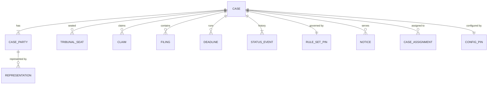
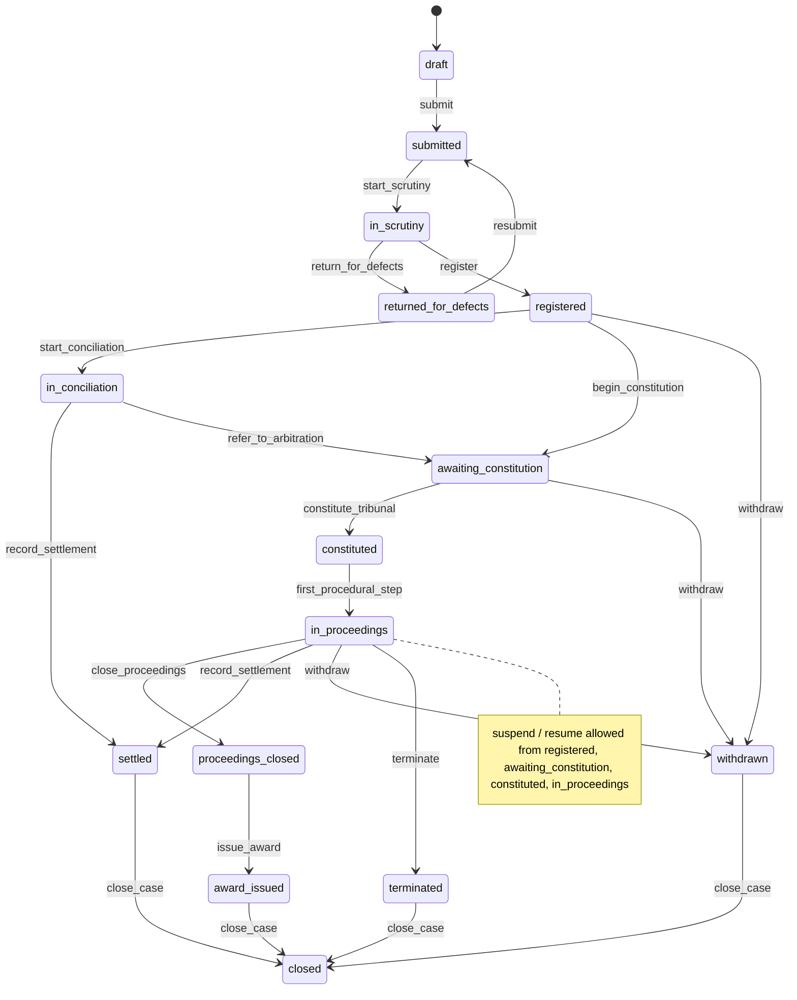

# 6.1 Cases

<!-- Generated layout: edit text between the markers; keep the markers and the front matter. -->

> Case intake, parties and representatives, pleadings and filings, tribunal composition, deadlines, timeline and the case status lifecycle

<!-- section:purpose -->
## Purpose and vision

The Cases context is the spine of the platform. It records that a dispute exists, who the parties are and who represents them, which rules govern it, who sits on the tribunal, what has been filed and when, which deadlines are running, and where the case stands. Every other domain hangs off a case: hearings are held in it, documents are filed into it, fees are charged against it, notices are served in it.

It matters because the case record is the legal record. If a party later challenges an award before a court, the institution must be able to show who was served with what and when, what the tribunal had before it, and that every step followed the applicable rules. The context must support three tenant types on one model: arbitral institutions (for example an institution using the HKIAC CMP build), SEBI-recognised ODR institutions receiving matters through MIIs, and CORD's own ODR service (tenancy, consumer and MSME disputes).

<!-- section:classification -->
## Strategic classification

| Aspect | Value |
|---|---|
| Domain type | **Core**: this is where the platform differs from a generic document or workflow product |
| Business role | Revenue (case volume drives tenant plans and case fees), compliance (SEBI ODR timelines, institutional rules), engagement (party and counsel portal) |
| Evolution stage | Custom built; the model is being unified from separate CORD and TERES implementations into one shared case model |
| Change rate | Lifecycle and rules change rarely; rule-set values (deadlines, thresholds) change per tenant several times a year and are held as data |

<!-- section:language -->
## Ubiquitous language

Internal terms are institution-neutral. Tenant-facing labels are configured in [[I18N-platform-glossary-and]].

| Term | Definition | Avoid in code / model |
|---|---|---|
| **Case** | One dispute administered by one tenant under one rule set, from first submission to closure. Includes arbitration, conciliation, mediation and expedited or emergency procedures. | matter, file, dispute (except in UI labels) |
| **Case type** | A published case-type blueprint (process definition plus forms, rules and templates), for example "SEBI ODR conciliation" ([[WF-process-definition-model]]). Every case has one case type and runs on the blueprint version pinned when it was created. | template, workflow |
| **Owning unit** | The part of the tenant (office, panel, programme or desk) that administers the case; it scopes unit-level access and settings. | department, team |
| **Procedure type** | The form of resolution: `arbitration`, `expedited_arbitration`, `emergency_arbitration`, `conciliation`, `mediation`. A SEBI ODR case may start as conciliation and continue as arbitration. | process, track |
| **Rule set** | The versioned set of rules the case is administered under (institution rules, SEBI ODR framework, CORD rules), with its decision tables. Pinned to the case at registration. | rules, regulation |
| **Party** | A person or organisation that is a claimant or respondent (or additional party) in the case. | client, litigant |
| **Party role** | `claimant`, `respondent`, `additional_party`, `intervener`. Tenant labels may differ (applicant, complainant, investor, member). | side |
| **Representative** | A person authorised to act for a party in the case: counsel, authorised representative, guardian. | lawyer, agent |
| **Neutral** | Arbitrator, conciliator, mediator or emergency arbitrator. Profile and appointment live in [[DOM-neutrals]]; the case holds tribunal membership. | judge, adjudicator |
| **Tribunal** | The neutrals currently seated in the case, with their roles (`sole`, `presiding`, `co_neutral`, `emergency`). Constituted when all required seats are filled and appointments confirmed. | panel (a panel is a list of empanelled neutrals) |
| **Secretariat** | The tenant's case-management staff (tenant role `secretariat`). On a case they act through a case assignment with the case-level role `case_manager` or `tribunal_secretary`. | admin, registry |
| **Filing** | A submission by a party or the tribunal into the case, of a filing type (statement of claim, response, counterclaim, application, procedural order, award), consisting of one or more document versions. | upload, pleading (pleading is one family of filing types) |
| **Scrutiny** | The secretariat's check of a submitted case for completeness and fees before registration. | review, vetting |
| **Registration** | The point at which the case is accepted, receives its case reference and its rule set is pinned. | acceptance, admission |
| **Deadline** | A date and time by which an act must be done, computed from a rule and a trigger event, in the seat's time zone. | due date (UI only), SLA (used for internal targets) |
| **Seat** | The legal place of arbitration; drives the deadline calendar and the governing procedural law. | venue (a venue is where a hearing is held) |
| **Outcome** | How the case ended: `award`, `settlement`, `withdrawal`, `termination`, `non_settlement_referred` (conciliation failed and moved to arbitration). | result |
| **Case reference** | The tenant's human-readable identifier for the case, unique per tenant (for example `ARB/2026/00123`). | case number (UI only), ID |

<!-- section:entities -->
## Entities and aggregates



| Entity | Aggregate | Key attributes | Tenant ownership |
|---|---|---|---|
| **Case** | Root of the Case aggregate | case reference, case type and pinned blueprint version, owning unit, procedure type, status, seat, language of proceedings, rule-set pin, confidentiality level, source (portal, public API, aggregator) | Tenant-owned |
| Case party | Case aggregate | role, party kind (individual / organisation), display name, contact points, identifiers (PAN, UEN, EIN, investor client code), sequence | Tenant-owned |
| Representation | Case aggregate | party, representative user, kind (counsel, authorised representative, guardian), authority document, from / to | Tenant-owned |
| Claim | Case aggregate | claim and counterclaim amounts (minor units + currency), nature of claim, quantified / unquantified | Tenant-owned |
| Tribunal seat | Case aggregate | seat role, neutral appointment reference (from [[DOM-neutrals]]), from / to | Tenant-owned; appointment is owned by Neutrals |
| Filing | **Own aggregate** (so concurrent filings do not lock the case) | filing type, filed by (party / tribunal / secretariat), filed at, document version references, deadline satisfied | Tenant-owned |
| Deadline | Own aggregate | rule key, trigger event, due at (UTC) and seat time zone, status (`running`, `met`, `missed`, `extended`, `stayed`), extension history | Tenant-owned |
| Status event | Append-only child of Case | from, to, command, actor, reason, rule-set version, occurred at | Tenant-owned |
| Rule-set pin | Case aggregate | rule set key and version, decision table versions pinned | Tenant-owned; rule sets themselves are tenant-overridable reference data in [[PKG-rules-and-decision-engine]] |
| Notice | Owned by [[DOM-service-of-notices-and-proof]] | see that node | Tenant-owned |
| Case assignment | Case aggregate | assignee (staff member or group), case-level role (`case_manager`, `tribunal_secretary`), primary flag, from / to | Tenant-owned |
| Configuration pin | Owned by [[PKG-configuration-and-customisation]] (`config.case_config_pin`) | blueprint version, artefact versions and `case_start` setting values fixed at case creation | Tenant-owned |

A user (party, counsel, neutral) is a platform identity with a tenant membership ([[MT-tenancy-and-identity-schema]]). The case refers to the membership, never to a user in another tenant. A counsel acting in an HKIAC CMP case and a CORD case has two memberships and the two cases cannot see each other.

<!-- section:lifecycle -->
## Lifecycle (state machine)



`suspended` is a state reachable from `registered`, `awaiting_constitution`, `constituted` and `in_proceedings`; it stores `resume_to` and returns there on `resume`. Draft cases that are never submitted expire (see Retention).

| Transition | Triggered by | Guards (rule IDs) |
|---|---|---|
| submit | Claimant or counsel in portal; public API; aggregator intake | CASE-BR-1, CASE-BR-2, CASE-BR-3 |
| start_scrutiny | Secretariat picks up the case (human task) | Case has an active primary `case_manager` assignment (`case_assignment`, [[DOM-cases-schema]]) |
| return_for_defects | Secretariat | Defect list non-empty; reason text required |
| register | Secretariat, or automatically for aggregator matters where the rule set allows | CASE-BR-4, CASE-BR-5, CASE-BR-6 |
| start_conciliation | Case workflow, when procedure type is conciliation | Conciliator appointment confirmed |
| refer_to_arbitration | Conciliator or secretariat records non-settlement | CASE-BR-14 |
| begin_constitution / constitute_tribunal | Secretariat; constitution confirmed by [[DOM-neutrals]] event `appointment.confirmed` | CASE-BR-8, CASE-BR-9 |
| first_procedural_step | First procedural order or directions filed | Tribunal constituted |
| close_proceedings | Tribunal (presiding or sole neutral) | No pending applications flagged as blocking |
| issue_award | Tribunal through award filing, after secretariat scrutiny where the rule set requires | CASE-BR-11, CASE-BR-12 |
| record_settlement | Neutral or secretariat with settlement document | Settlement document filed and signed |
| withdraw | Claimant (before constitution) or tribunal order (after) | CASE-BR-13 |
| terminate | Tribunal or secretariat per rule set (for example non-payment of deposit) | Reason and rule reference required |
| suspend / resume | Secretariat or tribunal | Reason required; running deadlines are stayed / restarted |
| close_case | Secretariat | CASE-BR-15 |

The machine is defined once in [[WF-entity-state-machines]] and enforced on every write, including the public API and admin console.

<!-- section:rules -->
## Business rules

| ID | Rule |
|---|---|
| CASE-BR-1 | A case cannot be submitted without at least one claimant and one respondent. |
| CASE-BR-2 | A submitted case must name a procedure type and a rule set that the tenant has enabled for that procedure type. |
| CASE-BR-3 | Every party must have at least one contact point valid for service (email, mobile or postal address) before submission, unless the rule set allows service through the secretariat. |
| CASE-BR-4 | Registration requires the filing fee to be paid, waived or deferred according to the rule set ([[DOM-invoices-and-vendor-bills]]). |
| CASE-BR-5 | The case reference is assigned at registration, is unique within the tenant, and never changes or is reused. |
| CASE-BR-6 | The rule set and the versions of its decision tables are pinned at registration; later changes to those tables do not affect the case unless the tenant publishes a transition rule and the tribunal orders it. |
| CASE-BR-7 | A party may have several representatives; at least one must be designated for service, or service goes to the party directly. |
| CASE-BR-8 | The number of tribunal seats and their roles come from the rule set (for example sole neutral below a claim-value threshold), via a decision table. |
| CASE-BR-9 | A neutral can be seated only after their appointment is confirmed and no unresolved conflict or challenge exists ([[DOM-neutrals]]). |
| CASE-BR-10 | A filing made after its deadline is accepted but flagged `late`; only the tribunal may admit or reject it. The platform never silently rejects a late filing. |
| CASE-BR-11 | An award can only be issued by the seated tribunal and, where the rule set requires it, after secretariat scrutiny is recorded. |
| CASE-BR-12 | Issued awards, orders and served notices are immutable. A correction or interpretation is a new filing linked to the original. |
| CASE-BR-13 | After tribunal constitution, withdrawal requires a tribunal order or the agreement of all parties, as the rule set states. |
| CASE-BR-14 | A SEBI ODR conciliation that does not settle within the rule-set period moves to arbitration only if the claimant elects it within the configured window. Assumption: period and window values to be taken from the current SEBI circulars and the tenant's ODR rules, confirmed by legal. |
| CASE-BR-15 | A case can be closed only when no fee invoice is open, or the secretariat records a write-off reason. |
| CASE-BR-16 | Deadlines are computed in the seat's time zone and calendar by [[PKG-calendars-and-deadline]]; a deadline ends at 23:59:59 local time on its due date unless the rule says otherwise. |
| CASE-BR-17 | Suspending a case stays every running deadline; resuming restarts each with its remaining duration, unless the tribunal sets new dates. |
| CASE-BR-18 | A representative's access ends when their representation ends; access to documents filed while they acted is retained only if the rule set allows it (default: no). |
| CASE-BR-19 | A party added after constitution must be served with the existing record as the tribunal directs. |
| CASE-BR-20 | A case's confidentiality level (`standard`, `confidential`, `sealed`) can only be raised by the secretariat or tribunal, and lowering it requires a tribunal order. |

Tables of thresholds (tribunal size, fee scale, response periods) live in decision tables under [[PKG-rules-and-decision-engine]], not here.

<!-- section:commands -->
## Commands and events

**Commands** (all accept an idempotency key; all checked against [[PKG-policy-engine-permission-matrix]])

| Command | Actor | Effect |
|---|---|---|
| `createDraftCase` | Claimant, counsel, secretariat, aggregator | New case in `draft` |
| `updateDraftCase`, `addParty`, `removeParty`, `addClaim` | Case creator, secretariat | Edits before submission |
| `submitCase` | Case creator | `draft → submitted`; starts the case workflow |
| `startScrutiny`, `returnForDefects`, `registerCase` | Secretariat | Scrutiny transitions |
| `appointRepresentative`, `endRepresentation` | Party, counsel, secretariat | Representation changes |
| `seatNeutral`, `unseatNeutral` | Case workflow on Neutrals events; secretariat | Tribunal changes |
| `recordFiling` | Party, counsel, tribunal, secretariat | New filing linked to document versions |
| `setDeadline`, `extendDeadline`, `stayDeadlines` | Case workflow; tribunal; secretariat | Deadline changes with reason |
| `suspendCase`, `resumeCase`, `withdrawCase`, `terminateCase`, `recordSettlement`, `closeProceedings`, `issueAward`, `closeCase` | Per lifecycle table | Lifecycle transitions |

**Queries**: `getCaseOverview`, `listCases` (secretariat queue with filters by status, stage, deadline, assignee), `getCaseTimeline`, `listMyCases` (per persona), `getDeadlines`, `getTribunal`.

**Domain events** (outbox, envelope per [[INT-webhook-event-catalogue]])

| Event | Payload summary |
|---|---|
| `case.submitted` | caseId, procedureType, ruleSetKey, source |
| `case.registered` | caseId, caseReference, ruleSetVersion, seat |
| `case.status_changed` | caseId, from, to, command, actorType |
| `case.party_added` / `case.party_removed` | caseId, partyId, role |
| `case.representation_changed` | caseId, partyId, representationId, kind, change |
| `case.tribunal_constituted` | caseId, seats (role, neutralProfileId) |
| `case.filing_recorded` | caseId, filingId, filingType, late |
| `case.deadline_set` / `case.deadline_extended` / `case.deadline_missed` | caseId, deadlineId, ruleKey, dueAt |
| `case.award_issued` | caseId, filingId |
| `case.closed` | caseId, outcome |

Payloads carry IDs and enumerations only, never party names or document content.

<!-- section:integrations -->
## Relationships to other contexts

| Context | Direction | Pattern |
|---|---|---|
| [[DOM-neutrals]] | Upstream for appointments | Customer–supplier: Cases requests appointments; Neutrals publishes `appointment.confirmed` / `appointment.ended` |
| [[DOM-documents]] | Supplier of document versions | Cases stores version IDs on filings; Documents owns content, hashes and access |
| [[DOM-hearings]] | Downstream | Hearings reference the case; Hearings require the case to be `constituted` or later |
| [[DOM-invoices-and-vendor-bills]] | Partnership | Fee events gate registration (CASE-BR-4) and closure (CASE-BR-15) |
| [[DOM-service-of-notices-and-proof]] | Child process | Cases decides what is served; the service workflow proves delivery |
| [[INT-aggregator-intake-api]] | Upstream (NSE via SMART ODR for SEBI matters) | Anti-corruption layer mapping aggregator fields to case commands |
| [[MT-tenant-model]] | Upstream | Conformist: memberships and roles as defined there |
| [[PKG-rules-and-decision-engine]] | Upstream | Conformist: decision tables keyed by rule set |
| [[RPT-cases]], [[RPT-example]] | Downstream | Published language: domain events and reporting views |

<!-- section:variations -->
## Tenant and jurisdiction variations

| Aspect | Arbitral institution tenant | SEBI ODR institution tenant | CORD tenant |
|---|---|---|---|
| Intake | Portal filing by counsel; secretariat-entered cases | Bulk intake from the MII / SMART ODR portal via [[INT-aggregator-intake-api]]; portal filing by investors | Portal filing by individuals and businesses, often unrepresented |
| Procedure types | Arbitration, expedited, emergency | Conciliation, then arbitration on election | Negotiation-assisted mediation, conciliation, arbitration |
| Scrutiny | Manual by secretariat | Largely automatic for MII-routed matters; manual exceptions | Manual light-touch |
| Tribunal size | By claim value and agreement (decision table) | By claim value (decision table, values from SEBI circulars, to be confirmed) | Sole neutral default |
| Language | English, Chinese and others per case | English and Indian languages | English, Hindi, regional languages |
| Reference format | Tenant prefix and year | MII-provided reference stored alongside ours | Tenant prefix |

All differences are configured through rule sets, decision tables, custom fields ([[PKG-metadata-management-entity]]) and labels; there is no tenant-type branch in code.

<!-- section:retention -->
## Data retention and confidentiality

- **Confidentiality tiers** ([[SEC-data-classification]]): case metadata is `case participants`; tribunal deliberation notes and draft awards are `tribunal-only`; KYC identifiers are sensitive personal data; a `sealed` case restricts metadata to the tribunal and named secretariat staff.
- **Retention clock** starts at `closed`. Proposed default: keep the full record for the period the tenant's rule set or regulator requires, configured per tenant in [[PKG-retention-and-deletion-schedule]]. Assumption: no single statutory period applies to private arbitration records; each institution sets its own, to be confirmed by legal per tenant type.
- **Drafts** never submitted are deleted 90 days after last edit (proposed).
- **Legal hold** (for example a pending setting-aside challenge) blocks every deletion path ([[PKG-data-retention-legal-hold-and]]).
- **Erasure requests** from a party: personal data in the legal record is retained under the legal-claims and legal-obligation exceptions; contact data not needed for the record may be minimised after closure. Decision recorded per request through [[SEC-data-principal-rights-requests]].

<!-- section:metrics -->
## Verification metrics

- Time from submission to registration, by tenant and procedure type
- Time from registration to tribunal constitution
- Share of deadlines missed and extended
- Case ageing by status (feeds [[RPT-cases]])
- For SEBI ODR tenants: share of matters concluded within the rule-set timeline (feeds [[RPT-example]])

<!-- section:questions -->
## Open questions and assumptions

- [ ] Confirm the generic status set with legal / operations for each tenant type, in particular whether `in_scrutiny` and `proceedings_closed` exist in SEBI ODR practice.
- [ ] SEBI ODR stage timelines and claim-value thresholds: obtain the current consolidated values from legal and record them in decision tables (assumption until then).
- [ ] Should orders and awards become their own context (drafting, approval, correction, interpretation), or remain filings with special rules here?
- [ ] Do representatives keep access to documents filed during their representation after it ends (CASE-BR-18)? Default no; confirm per tenant type.
- [ ] Multi-party and consolidated cases: model consolidation as a link between cases or as a merge? Needed for arbitral institutions.
- [ ] Emergency arbitration: separate case or a sub-proceeding of the main case?
- [ ] Do aggregator-originated cases need the MII reference to be unique per tenant, and is it shown to parties?

<!-- checks -->
## Template checks

<!-- check:tenancy -->
### Tenancy and residency

Every entity is tenant-owned with forced RLS ([[DOM-cases-schema#tenancy]]); there is no platform-owned case data. Rule sets are tenant-overridable reference data in [[PKG-rules-and-decision-engine]]. Cross-tenant participation (counsel at two institutions) is two memberships, never a shared row; the link exists only in the platform identity and is not visible to tenants. Case references are generated per tenant by a counter row locked inside the registering transaction (`UPDATE case_reference_counters ... RETURNING`), which needs no session state and is safe under PgBouncer transaction pooling. Workflows and activities run in the tenant's home region with the tenant set per transaction. On offboarding, cases are exported then deleted unless under legal hold ([[MT-tenant-lifecycle]]).

<!-- check:security -->
### Access and confidentiality

Access is relationship-based: a user sees a case only as a party, representative of a party, seated neutral, assigned secretariat staff, or tenant admin with case-access permission ([[PKG-rbac-abac-case-level-party]]). Field-level rules: tribunal-only filings (deliberation notes, draft awards) are hidden from parties; KYC identifiers are visible only to secretariat. Ending a representation or unseating a neutral revokes access in the same transaction (CASE-BR-18), and that revocation has a test. Conflicted neutrals are walled from cases where they declared a conflict ([[PKG-ethical-walls-conflict-based]]). Support access to case content requires tenant-approved break-glass ([[PKG-support-access-and-impersonation]]). Authorisation is enforced in the domain service on every command and query, not only in the UI.

<!-- check:audit -->
### Audit and legal record

Every lifecycle transition writes a `case_status_events` row and an audit event in the same transaction, capturing actor, acting-for (counsel for party), tenant, case, before / after status, reason text, rule-set version and database timestamp. Also audited: party and representation changes, seating and unseating of neutrals, deadline set / extended / stayed (with the rule key and the order that extended it), filings (with document version hashes), confidentiality changes, and reads of sealed cases and full case exports. The timeline query rebuilds the case as at any date from status events, filings and deadlines. Audit records outlive case anonymisation per [[PKG-audit-log-schema]].

<!-- check:privacy -->
### Personal data

Personal data: party and representative identity and contact data, identifiers (PAN, investor client codes, UEN), and whatever pleadings contain (possibly health or financial data). The tenant is the data fiduciary / controller and Nomology the processor for case data; for CORD tenant cases, NTPL is the institution and therefore the fiduciary (to be confirmed by legal). Legal basis is mainly performance of the dispute-resolution agreement and legal claims; under the DPDP Act the relevant legitimate-use grounds must be confirmed by legal [R1]. Erasure requests are answered with a reasoned partial refusal where the arbitral record must be kept, recorded through [[SEC-data-principal-rights-requests]]. Parties who are children or persons with disabilities act through a guardian representation (kind `guardian`) so verifiable consent can be recorded.

<!-- check:compliance -->
### Retention and regulatory rules

| Source | Rule | Where encoded |
|---|---|---|
| SEBI ODR circulars [R2] | Conciliation then arbitration through MIIs; stage timelines | Rule set `sebi-odr`, decision tables for timelines (values to be confirmed), case workflow timers, [[RPT-example]] |
| Institution rules (for example HKIAC Administered Arbitration Rules) | Scrutiny, tribunal size, deposit-driven suspension | Rule set per tenant, decision tables, CASE-BR-8, CASE-BR-17 |
| Arbitration and Conciliation Act (India) [R3] | Deemed receipt of communications (s.3); arbitrator disclosure (s.12) | [[DOM-service-of-notices-and-proof]], [[DOM-neutrals]] |
| DPDP / GDPR / PDPA | Retention, rights | [[PKG-retention-and-deletion-schedule]] |

Statutory time limits for making an award (for example under the Indian Act) are not encoded until legal confirms how they apply per seat; noted as an open question.

<!-- check:consistency -->
### Invariants and concurrency

Invariants inside the Case aggregate (checked at commit): CASE-BR-1, CASE-BR-5, CASE-BR-12, one active presiding neutral (partial unique index). Cross-aggregate rules are handled by events and the case workflow: CASE-BR-9 waits for `appointment.confirmed`; CASE-BR-4 waits for `invoice.paid` or `fee.waived`. Concurrency: `cases.version` is an optimistic lock checked on every update; filings and deadlines are separate aggregates so a filing at 23:59 does not conflict with a secretariat edit. Deadline closure and late-filing flag use the database clock (`now()` in the filing transaction) compared with the stored UTC due time. All commands carry idempotency keys; events are written to the outbox in the same transaction.

<!-- check:i18n -->
### Localisation and jurisdiction

One internal term set with tenant labels (claimant / applicant / complainant / investor). Language of proceedings is a case attribute (BCP 47 code) and may differ from users' UI language. Deadlines use the seat's IANA time zone and holiday calendar. Amounts are integer minor units with ISO 4217 currency. Party names allow any script, a separate `name_latin` transliteration is optional, and identifiers are typed by scheme (`IN_PAN`, `SG_UEN`, `US_EIN`, `IN_INVESTOR_UCC`) rather than a single tax-ID field.

<!-- check:ai -->
### AI assistance

AI uses on case data (case summaries for the secretariat, extraction of parties and claims from a statement of claim at intake) are advisory only: extracted values are shown as suggestions that a person accepts field by field; no AI output changes case status. Each use is a tenant setting (`ai.features.case_summary.enabled`, `ai.features.metadata_extraction.enabled`, both under `ai.policy.enabled`; [[PKG-settings-ai]], [[AI-tenant-ai-policy]]); feature flags hold only platform availability and `ai.killswitch` ([[PKG-feature-flags]]). Each use is recorded with model, prompt version and reviewer ([[AI-human-in-the-loop]]). Intake extraction treats filed documents as untrusted input against prompt injection ([[AI-guardrails]]). Neutral suggestion is out of scope for this context and would need an ISO 42001 impact assessment under [[AI-ai-governance-and-impact]].

<!-- check:testing -->
### Testing

Transition tests are generated from the state-machine definition (every allowed transition succeeds with its guards, every other pair is rejected). Each CASE-BR rule ID has at least one named test; rule coverage is reported in CI. Decision-table-driven rules (tribunal size, response periods) are tested from the tables at boundary values. Isolation tests run as `nomo_app` and `nomo_worker` through PgBouncer for every case table. Deadline tests cover daylight-saving changes in the US region, public holidays per seat and the 23:59:59 boundary. Acceptance scenarios are written with secretariat staff of each tenant type.

<!-- citations -->
## Citations

```json
[
  {
    "clause": "s.7",
    "excerpt": "Section 7 lists certain legitimate uses for which personal data may be processed without consent; applicability to arbitral records to be confirmed by legal.",
    "id": "R1",
    "issuer": "Government of India (MeitY)",
    "jurisdiction": "India",
    "kind": "regulation",
    "ref": "Act No. 22 of 2023",
    "title": "Digital Personal Data Protection Act, 2023",
    "url": "https://www.meity.gov.in/static/uploads/2024/06/2bf1f0e9f04e6fb4f8fef35e82c42aa5.pdf"
  },
  {
    "excerpt": "Framework for online conciliation and arbitration of securities market disputes through MIIs and empanelled ODR institutions.",
    "id": "R2",
    "issuer": "Securities and Exchange Board of India",
    "jurisdiction": "India",
    "kind": "regulation",
    "ref": "SEBI circular, 31 July 2023",
    "title": "Online Resolution of Disputes in the Indian Securities Market (circular dated 31 July 2023)",
    "url": "https://www.sebi.gov.in/legal/circulars/jul-2023/online-resolution-of-disputes-in-the-indian-securities-market_74794.html"
  },
  {
    "clause": "s.3, s.12",
    "excerpt": "Sections 3 and 12 on receipt of written communications and disclosure by arbitrators.",
    "id": "R3",
    "issuer": "Government of India (Ministry of Law and Justice)",
    "jurisdiction": "India",
    "kind": "regulation",
    "ref": "Act No. 26 of 1996",
    "title": "The Arbitration and Conciliation Act, 1996",
    "url": "https://www.indiacode.nic.in/bitstream/123456789/1978/1/A199626.pdf"
  }
]
```

<!-- end -->
