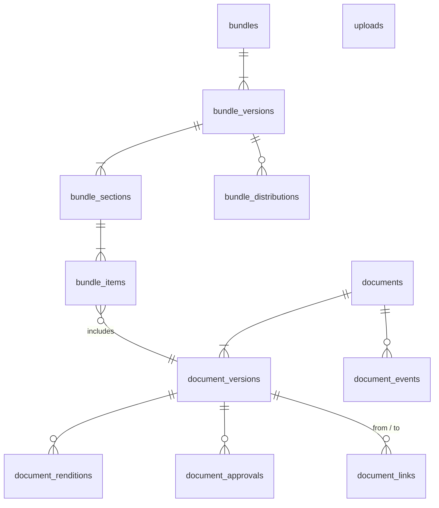

# 6.5.2 Documents schema

<!-- Generated layout: edit text between the markers; keep the markers and the front matter. -->

> Document metadata, immutable versions, content hashes, bundles, approvals and object-storage keys

<!-- section:purpose -->
## Scope and ownership

Physical schema for [[DOM-documents]] and [[DOM-ebundling]]. Owned by the cases and documents domain team. Prisma file `packages/domain-documents/prisma/documents.prisma`. Conventions as in [[DOM-cases-schema#purpose]].

Binary content is not in Postgres: rows hold object-storage keys managed by [[PKG-object-storage-abstraction-s3]]. Referenced by: `case_filing_documents`, `neutral_disclosures`, `transcript_versions`, invoice documents, notices.

<!-- section:entities -->
## Entities and relationships



All tables tenant-owned. Aggregate roots: `documents`, `bundles`. `uploads` tracks in-flight uploads.

<!-- section:tables -->
## Tables and columns

**uploads**: `id`, `tenant_id`, `case_id`, `requested_by_membership_id`, `declared_sha256 bytea`, `declared_size bigint`, `media_type text`, `object_key text`, `expires_at timestamptz`, `status text` (`pending`, `completed`, `expired`), `document_version_id uuid NULL`.

**documents**: `id`, `case_id`, `document_type text`, `title text` (C), `exhibit_ref text NULL`, `party_side_id uuid NULL`, `filed_by_membership_id uuid`, `visibility text` (`all_participants`, `tribunal_only`, `tribunal_and_filer`, `secretariat_only`, `filer_only`, `without_prejudice`), `sealed boolean NOT NULL DEFAULT false`, `language text NULL`, `current_version_id uuid NULL`, `version`.

**document_versions** (immutable): `id`, `document_id`, `version_no integer`, `original_filename text` (C), `media_type text`, `size_bytes bigint`, `sha256 bytea NOT NULL`, `object_key text NOT NULL`, `uploaded_by_membership_id uuid`, `uploaded_at timestamptz NOT NULL` (filing time, DOC-BR-13), `upload_id uuid`.

**document_version_states** (mutable status kept apart so `document_versions` can be fully immutable): `document_version_id` (PK with tenant), `scan_status text` (`pending`, `clean`, `infected`, `error`), `scanner text`, `scanned_at`, `processing_status text` (`pending`, `done`, `partial`, `failed`), `page_count integer NULL`, `lifecycle_status text` (per lifecycle), `withdrawn_reason text NULL`, `version`.

**document_renditions**: `id`, `document_version_id`, `kind text` (`pdf`, `ocr_text`, `thumbnail`, `page_images`, `tagged_pdf`, `accessible_copy`), `object_key`, `sha256 bytea`, `generator text` (tool and version), `created_at`.

**document_approvals**: `id`, `document_version_id`, `approval_kind text`, `required_role text`, `decision text NULL` (`approved`, `rejected`), `decided_by_membership_id uuid NULL`, `reason text NULL`, `decided_at timestamptz NULL`, `human_task_id uuid NULL`.

**document_links**: `id`, `kind text`, `from_version_id`, `to_version_id`, `authoritative_version_id uuid NULL`, `created_by_membership_id`, `created_at`.

**document_events** (append-only): `id`, `document_id`, `document_version_id NULL`, `event text` (`viewed`, `downloaded`, `visibility_changed`, `sealed`, `withdrawn`, `approved`, `rejected`), `actor_membership_id`, `detail jsonb`, `occurred_at`. Views and downloads are recorded here only for restricted documents (DOC-BR-14); other access is in the audit log sample.

**bundles**: `id`, `case_id`, `hearing_id uuid NULL`, `purpose text` (`hearing`, `core`, `authorities`, `tribunal`), `title text`, `pagination_scheme text` (`global`, `per_section`), `reissue_strategy text` (`insert_suffix`, `renumber`), `current_version_id uuid NULL`, `version`.

**bundle_versions**: `id`, `bundle_id`, `version_no integer`, `status text` (`assembling`, `draft`, `pending_approval`, `issued`, `superseded`, `failed`), `manifest_sha256 bytea`, `output_document_version_id uuid NULL`, `total_pages integer NULL`, `page_map_object_key text NULL` (JSON mapping bundle pages to source pages), `change_log jsonb NULL` (against previous version), `workflow_id text`, `issued_at`, `issued_by_membership_id`.

**bundle_sections**: `id`, `bundle_version_id`, `seq smallint`, `label text` (for example "C" for claimant's exhibits), `title text`.

**bundle_items**: `id`, `bundle_section_id`, `seq integer`, `document_version_id`, `start_page_label text NULL` (for example `C/123` or `C/123A`), `page_count integer NULL`, `included_pages int4range NULL` (when only part of a document is included).

**bundle_distributions**: `id`, `bundle_version_id`, `audience text` (`all_participants`, `tribunal`, named membership), `membership_id uuid NULL`, `distributed_at`, `notice_id uuid NULL`.

<!-- section:keys -->
## Keys and constraints

```sql
ALTER TABLE document_versions ADD CONSTRAINT dv_doc_fk
  FOREIGN KEY (tenant_id, document_id) REFERENCES documents (tenant_id, id) ON DELETE CASCADE;
ALTER TABLE document_versions ADD CONSTRAINT dv_no_unique UNIQUE (tenant_id, document_id, version_no);
ALTER TABLE document_versions ADD CONSTRAINT dv_sha_len CHECK (octet_length(sha256) = 32);
ALTER TABLE document_versions ADD CONSTRAINT dv_size_check CHECK (size_bytes > 0 AND size_bytes <= 2147483648);
ALTER TABLE documents ADD CONSTRAINT doc_case_fk
  FOREIGN KEY (tenant_id, case_id) REFERENCES cases (tenant_id, id) ON DELETE RESTRICT;
-- DOC-BR-4: exhibit reference unique per case and side
CREATE UNIQUE INDEX doc_exhibit_unique ON documents (tenant_id, case_id, party_side_id, exhibit_ref)
  WHERE exhibit_ref IS NOT NULL;
-- current_version must belong to the document
ALTER TABLE documents ADD CONSTRAINT doc_current_fk
  FOREIGN KEY (tenant_id, current_version_id) REFERENCES document_versions (tenant_id, id)
  DEFERRABLE INITIALLY DEFERRED;
ALTER TABLE uploads ADD CONSTRAINT up_completed_has_version
  CHECK (status <> 'completed' OR document_version_id IS NOT NULL);
ALTER TABLE bundle_items ADD CONSTRAINT bi_seq_unique UNIQUE (tenant_id, bundle_section_id, seq);
CREATE UNIQUE INDEX bv_one_issued ON bundle_versions (tenant_id, bundle_id) WHERE status = 'issued';
```

`doc_current_fk` is deferrable because a document and its first version are inserted in one transaction. `current_version_id` belonging to the same document is checked by the repository (a composite FK on `(tenant_id, id, document_id)` would need a wider unique key; open question whether to add it). Application-enforced: DOC-BR-3 (through the state machine), DOC-BR-5, DOC-BR-6, DOC-BR-7.

<!-- section:tenancy -->
## Tenancy and RLS policies

All tables tenant-owned, ENABLE + FORCE RLS with the standard policy ([[DOM-cases-schema#tenancy]]). Immutable tables (`document_versions`, `document_renditions`, `document_events`, `bundle_items` of issued versions) have INSERT and SELECT policies only and `REVOKE UPDATE, DELETE ... FROM nomo_app, nomo_worker`. Visibility filtering is done by the documents service and by a shared SQL fragment `documents_visible_to($membership)` used in repository queries; it is not an RLS policy, to keep RLS a tenant-only predicate.

<!-- section:indexes -->
## Indexes and access patterns

| Query | Index |
|---|---|
| Case document list by type and date | `documents (tenant_id, case_id, document_type, created_at DESC)` |
| Version history | unique `(tenant_id, document_id, version_no)` |
| Duplicate detection within a case | `document_versions (tenant_id, sha256)` plus join to documents for case |
| Pending approvals queue | `document_approvals (tenant_id, required_role) WHERE decision IS NULL` |
| Scan / processing backlog | `document_version_states (tenant_id, lifecycle_status) WHERE lifecycle_status IN ('scanning','processing')` |
| Bundle content | `bundle_items (tenant_id, bundle_section_id, seq)` |
| Where is this version used (bundles) | `bundle_items (tenant_id, document_version_id)` |

<!-- section:history -->
## Status, history and concurrency

Status lives in `document_version_states` so `document_versions` stays strictly immutable. Lifecycle changes write `document_events` and audit events in the same transaction. No soft-delete column: withdrawal is a lifecycle state. Bundle versions are append-only once issued; a re-issue is a new bundle version.

<!-- section:protection -->
## Data classification and protection

`title` and `original_filename` can contain names; treated as confidential, excluded from logs and the warehouse (reports use document type and counts). Object keys never contain names or titles. Sealed documents' titles are hidden by the visibility filter. Renditions and OCR text inherit the version's visibility.

<!-- section:retention -->
## Retention, archival and deletion

| Data | Clock | End |
|---|---|---|
| documents, versions, renditions, approvals, links, events | case closure | With case; objects deleted by the retention job across all renditions |
| quarantined versions | scan verdict | Delete object after 30 days; keep row with hash |
| uploads (expired) | `expires_at` | Delete row and object after 24 h |
| bundles | case closure | With case |

<!-- section:migrations -->
## Migrations and rollout

1. `0401_documents_core`: uploads, documents, document_versions, document_version_states, renditions, approvals, links, events; RLS, grants, REVOKEs.
2. `0402_bundles`: bundles and children.
3. `0403_documents_indexes`: concurrent indexes.

Must run before `0003_cases_filings_deadlines` (filings reference document versions); the cross-package ordering is part of the open question in [[DOM-cases-schema#questions]]. Standard timeouts.

<!-- section:prisma -->
## Prisma schema mapping

Models `Upload`, `Document`, `DocumentVersion`, `DocumentVersionState`, `DocumentRendition`, `DocumentApproval`, `DocumentLink`, `DocumentEvent`, `Bundle`, `BundleVersion`, `BundleSection`, `BundleItem`, `BundleDistribution`. `sha256` is `Bytes`. `included_pages int4range` is `Unsupported`. Raw-SQL-only: deferrable FK, partial unique indexes, CHECKs, REVOKEs, RLS. The repository exposes no `update` method for `DocumentVersion`.

<!-- section:volume -->
## Volume, growth and performance

Proposed: 40 documents per arbitration case on average (heavy-tailed: some cases over 10,000 exhibits), 4 per ODR case. Five-year India estimate about 15M documents and 18M versions; renditions about 4 per version. `document_events` (restricted access only) about 50M after five years: partition by month on `occurred_at` when above 50M. Object storage: proposed planning figure of 2 MB average per version.

<!-- section:questions -->
## Open questions

- [ ] Add a composite FK guaranteeing `current_version_id` belongs to the same document (needs `UNIQUE (tenant_id, id, document_id)` on versions)?
- [ ] Should all document views (not only restricted ones) be recorded? Volume vs evidential value; product and legal.

<!-- checks -->
## Template checks

<!-- check:tenancy -->
### Tenant isolation in the schema

All tables carry `tenant_id` under forced RLS with composite FKs; object keys are prefixed by tenant and validated by the storage package. Duplicate detection queries are tenant-scoped by RLS and further limited to the case.

<!-- check:integrity -->
### Invariants enforced by the database

Database: version immutability by grants, version numbering, hash length, size limit, exhibit uniqueness, one issued bundle version per bundle, upload completion consistency. Application: scan-before-view, visibility rules, approver not uploader.

<!-- check:migration-safety -->
### Zero-downtime and reversible migrations

Immutable tables are created with their REVOKEs and policies in the same migration. Future columns on `document_versions` must be nullable additions only (the table is immutable, so backfills write to `document_version_states` or a new side table instead). Standard timeouts and concurrent index builds.

<!-- check:privacy -->
### Personal data, erasure and the legal record

Personal data is mostly inside the files; the schema minimises it in metadata (no names in object keys, titles excluded from warehouse). Crypto-shredding on offboarding works through per-tenant storage encryption keys ([[PKG-encryption-at-rest-signed-urls]]).

<!-- check:residency -->
### Region placement and cross-region references

Rows live in the regional database and objects in the tenant's regional bucket; object keys contain no region-crossing references. Search indexes and embeddings derived from documents stay in-region ([[PKG-search]], [[AI-rag]]). Disaster-recovery copies of buckets stay within the region's permitted locations ([[INF-backup-and-disaster-recovery]]).

<!-- check:audit -->
### History, immutability and evidence

`document_versions` cannot be updated or deleted by `nomo_app` or `nomo_worker`. Every version has a SHA-256 checked at upload and on every download. Restricted-document access is in `document_events`, all lifecycle changes in the audit log.

<!-- check:performance -->
### Query performance under RLS and growth

The case document list is served by `(tenant_id, case_id, document_type, created_at DESC)` with keyset pagination; visibility filtering is a join on the case relationship that uses the case participant indexes. Restricted-access events are partition candidates by month once large.

<!-- end -->
