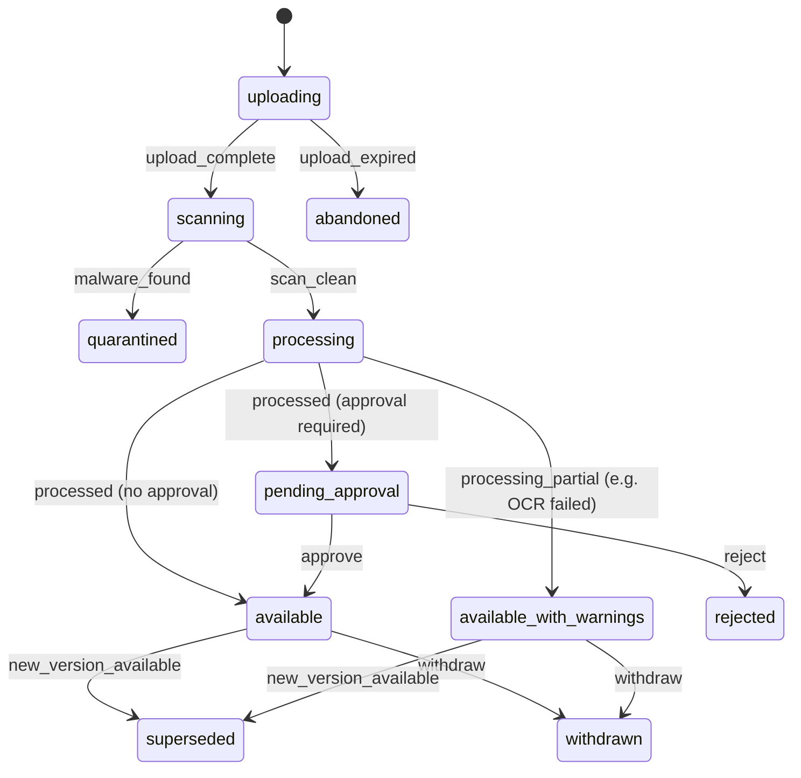

# 6.5 Documents

<!-- Generated layout: edit text between the markers; keep the markers and the front matter. -->

> Case documents: upload, immutable versions with content hashes, confidentiality, approvals, translations and redactions, bundles and lifecycle events

<!-- section:purpose -->
## Purpose and vision

The Documents context holds every file in a case: pleadings, exhibits, witness statements, expert reports, correspondence, procedural orders, awards, transcripts, receipts and the bundles assembled from them. It guarantees that what a party filed is exactly what the tribunal and the other parties see, that nothing filed is ever silently changed, that each document is visible only to the people entitled to it, and that the secretariat can approve documents before they are released where the rule set requires.

The context owns document metadata, immutable versions and their content hashes, approvals, links between documents (translation of, redacted copy of, accessible copy of, correction of) and bundles. Binary storage, encryption, signed URLs and malware scanning are provided by [[PKG-storage]] and [[PKG-encryption-at-rest-signed-urls]]; rendering in the browser by [[APP-document-viewer-and-sandbox]].

<!-- section:classification -->
## Strategic classification

| Aspect | Value |
|---|---|
| Domain type | **Core**: the evidential record of every case; eBundling is a TERES product line |
| Business role | Compliance (integrity of the record), revenue (storage metering via [[BIL-plans-entitlements-and-usage]], bundling services), engagement |
| Evolution stage | Custom; consolidating CORD document handling and the TERES eBundling pipeline |

<!-- section:language -->
## Ubiquitous language

| Term | Definition | Avoid |
|---|---|---|
| **Document** | A logical item in a case with a stable identity and display reference (for example "Exhibit C-12", "Procedural Order No. 3"), which can have several versions. | file, attachment |
| **Document version** | One immutable file plus metadata, identified by its SHA-256 content hash. A new upload of the same document creates a new version. | revision |
| **Rendition** | A derived file for a version: PDF rendition of a Word file, OCR text layer, thumbnails, page images. Never replaces the original. | conversion |
| **Document type** | Category from the tenant catalogue: `pleading`, `exhibit`, `witness_statement`, `expert_report`, `correspondence`, `procedural_order`, `award`, `transcript`, `receipt`, `notice`, `settlement_agreement`, `other`. | |
| **Exhibit reference** | A party's numbering of evidence (for example C-12 for claimant, R-4 for respondent), unique per case. | exhibit number |
| **Visibility** | Who may see the document in the case: `all_participants`, `tribunal_only`, `tribunal_and_filer`, `secretariat_only`, `filer_only` (draft). | permission |
| **Sealed** | A visibility restriction ordered by the tribunal that also hides metadata (title, type) from those without access. | hidden |
| **Without prejudice** | A communication in settlement negotiations that must not be shown to the tribunal; modelled as visibility excluding tribunal. | privileged |
| **Approval** | A secretariat or tribunal review that must pass before a version is released to its audience (for example scrutiny of an award draft, review of a public filing). | sign-off |
| **Withdrawal** | Removal of a version from view by order or by the filer before release; the version is kept. | delete |
| **Bundle** | An ordered, paginated, indexed compilation of document versions for a hearing or the tribunal ([[DOM-ebundling]]). | binder, compilation |

<!-- section:entities -->
## Entities and aggregates

| Entity | Aggregate | Key attributes | Ownership |
|---|---|---|---|
| **Document** | Root | case, document type, title, exhibit reference, filed by, visibility, sealed flag, language, current version | Tenant-owned |
| Document version | Child (immutable) | version number, original file name, media type, size, SHA-256, uploaded by, uploaded at, scan status, processing status, page count, approval status | Tenant-owned |
| Rendition | Child of version | kind (`pdf`, `ocr_text`, `thumbnail`, `page_images`, `tagged_pdf`), object key, SHA-256 | Tenant-owned |
| Approval | Child of version | approval kind, required role, decision, reviewer, reason | Tenant-owned |
| Document link | Own aggregate | kind (`translation_of`, `redaction_of`, `accessible_copy_of`, `corrects`, `annex_of`), from version, to version, authoritative flag | Tenant-owned |
| **Bundle** and versions | Root (see [[DOM-ebundling]]) | purpose, hearing, sections, items, page map, issued version | Tenant-owned |

Documents are always in a case. Tenant-level templates (award templates, letterheads) are **not** case documents; they belong to [[PKG-document-and-notification]].

<!-- section:lifecycle -->
## Lifecycle (state machine)

**Document version**

| Transition | Trigger | Guard |
|---|---|---|
| upload_complete | Client confirms upload to signed URL; storage event | Object exists, size and SHA-256 match the declared values (DOC-BR-2) |
| malware_found / scan_clean | BullMQ `files.scan` result | Scanner verdict recorded |
| processed | Pipeline ([[WF-long-running-pipelines]]): PDF rendition, page count, OCR, thumbnails, text extraction for search | — |
| approve / reject | Approver with the required role | Reviewer is not the uploader (DOC-BR-7) |
| withdraw | Filer before release; tribunal order after release | Reason required; DOC-BR-9 |
| new_version_available | A newer version becomes `available` | — |

Quarantined files are never viewable; the uploader is told and can upload again.

<!-- section:rules -->
## Business rules

| ID | Rule |
|---|---|
| DOC-BR-1 | A document version is immutable: its bytes, hash, uploader and upload time never change. |
| DOC-BR-2 | The client declares size and SHA-256 before upload; the server recomputes the hash after upload and rejects a mismatch. |
| DOC-BR-3 | No file is viewable or downloadable by anyone until it has passed malware scanning ([[PKG-encryption-at-rest-signed-urls]]). |
| DOC-BR-4 | Exhibit references are unique within a case and party side; renumbering creates a new document reference, it does not edit the old one. |
| DOC-BR-5 | A document's visibility can be widened only by the filer before release, or by the tribunal after; it can be narrowed by the tribunal or secretariat at any time. |
| DOC-BR-6 | `without_prejudice` documents are never visible to the tribunal, including through bundles and AI features. |
| DOC-BR-7 | An approver cannot approve their own upload. |
| DOC-BR-8 | Award and procedural-order versions issued by the tribunal must be in PDF and, for generated ones, tagged PDF ([[DOM-accessible-documents-and]]). |
| DOC-BR-9 | Withdrawal hides a version from its audience but keeps it, its hash and its access history for the record. Hard deletion only by the retention job. |
| DOC-BR-10 | A translation records which version is authoritative; if none is stated, the original-language version is authoritative. |
| DOC-BR-11 | A redacted version is a new document linked to the original; the original keeps its visibility. |
| DOC-BR-12 | Maximum single file size is 2 GB and accepted media types come from the tenant allow-list (proposed default: PDF, DOCX, XLSX, PPTX, MSG, EML, JPG, PNG, TIFF, MP3, MP4, WAV, ZIP); archives are expanded into individual documents before scanning. |
| DOC-BR-13 | The time of filing is the server time when the upload is confirmed (`upload_complete`), not when processing ends; this is the time compared against deadlines. |
| DOC-BR-14 | Every view and download of a sealed or tribunal-only document is audited. |

<!-- section:commands -->
## Commands and events

**Commands**: `requestUpload` (returns signed upload URL, upload ID, expiry), `completeUpload`, `createDocument`, `addVersion`, `setVisibility`, `sealDocument`, `submitForApproval`, `approveVersion`, `rejectVersion`, `withdrawVersion`, `linkDocuments`, `requestAccessibleCopy`, `createRedactedCopy`, `getDownloadUrl` (short-lived, audited for restricted documents).

**Queries**: `listCaseDocuments` (filtered by type, party side, date, visibility, with keyset pagination), `getDocument`, `getVersionHistory`, `searchCaseDocuments` (through [[PKG-search]]), `getPendingApprovals`.

**Events**

| Event | Payload summary |
|---|---|
| `document.upload_completed` | documentId, versionId, sha256, sizeBytes, mediaType |
| `document.quarantined` | versionId, scanner |
| `document.available` | documentId, versionId, visibility, pageCount |
| `document.approval_requested` / `document.approved` / `document.rejected` | versionId, approvalKind |
| `document.withdrawn` | versionId, reasonCode |
| `document.visibility_changed` | documentId, from, to |

<!-- section:integrations -->
## Relationships to other contexts

| Context | Pattern |
|---|---|
| [[DOM-cases]] | Customer: filings reference document versions; case participants define base access |
| [[PKG-storage]] | Supplier: object storage, encryption, signed URLs, scanning |
| [[WF-long-running-pipelines]] | Supplier: renditions, OCR, text extraction |
| [[PKG-search]] | Downstream: text and metadata indexed per tenant with visibility filters |
| [[AI-rag]] | Downstream: embeddings only for documents whose tenant enables AI, honouring visibility (DOC-BR-6) |
| [[INT-public-api-documents-and-filings]] | Published API over this context |
| [[DOM-ebundling]] | Child workflow assembling bundles from versions |

<!-- section:variations -->
## Tenant and jurisdiction variations

- Arbitral institutions: high volumes of exhibits, exhibit numbering by party, approvals for tribunal-issued documents, eBundles for hearings, Chinese and other languages.
- SEBI ODR tenants: fewer and smaller documents, many from investors on mobile; approval of claim documents by the ODR institution before forwarding to the other side may be required (assumption; confirm).
- CORD tenants: photos and scans from phones; OCR and accessible copies more important; settlement agreements generated and e-signed.
- Configured: document-type catalogue, media-type allow-list, approval requirements per type (decision table `document-approval-policy`), exhibit numbering pattern.

<!-- section:retention -->
## Data retention and confidentiality

- Documents follow case retention ([[PKG-retention-and-deletion-schedule]]); legal hold blocks deletion of every version and rendition.
- Quarantined files: deleted after 30 days (proposed), keeping hash and scanner verdict.
- Abandoned uploads: object deleted after 24 hours.
- Renditions can be regenerated and are deleted together with their version.
- Confidentiality tiers per [[SEC-data-classification]]: visibility values map to tiers (`tribunal_only` = tribunal-only tier).

<!-- section:metrics -->
## Verification metrics

- Upload success rate and time from upload to available (p95)
- Malware detection rate
- Share of documents needing OCR and OCR failure rate
- Approval turnaround time

<!-- section:questions -->
## Open questions and assumptions

- [ ] Should duplicate uploads (same SHA-256 already in the case) be linked automatically or warned about? Proposed: warn and allow.
- [ ] Is a trusted timestamp needed for filing times in some jurisdictions, beyond the database clock and audit chain?
- [ ] SEBI ODR: confirm whether the ODR institution must review documents before they reach the respondent.
- [ ] Email files (MSG, EML) with attachments: expand attachments as separate documents linked as `annex_of`?

<!-- checks -->
## Template checks

<!-- check:tenancy -->
### Tenancy and residency

All entities tenant-owned with forced RLS ([[DOM-documents-schema]]). Object keys are `{tenantId}/{caseId}/{documentId}/{versionId}/{rendition}` in the tenant's regional bucket; the storage package builds keys from the active tenant and rejects keys outside that prefix. Hash-based deduplication is per case only, never across tenants (cross-tenant dedup would reveal that another tenant holds the same file).

<!-- check:security -->
### Access and confidentiality

Base access comes from the case relationship; document visibility narrows it (`tribunal_only`, `without_prejudice`, sealed). Downloads use short-lived signed URLs issued after a permission check at issue time. Rendering happens on the sandboxed viewer origin. DOC-BR-6 is enforced in the documents service and in every consumer (bundles, search, AI retrieval) by a shared visibility filter function with its own tests.

<!-- check:audit -->
### Audit and legal record

Audited: upload completion (hash, size, uploader, filing time), scan verdict, approvals, visibility and seal changes with reasons, withdrawals, link creation, and every view or download of sealed, tribunal-only or without-prejudice documents. Version immutability plus hashes allow the record "as the tribunal saw it on date X" to be rebuilt.

<!-- check:privacy -->
### Personal data

Documents may contain any category of personal data, including sensitive data in medical or financial evidence. The platform cannot classify every document, so all case documents are treated as confidential by default. Erasure requests cannot remove filed evidence from the record; redacted copies can be produced for wider audiences. AI processing of documents is per-tenant opt-in.

<!-- check:consistency -->
### Invariants and concurrency

Version creation and `current_version_id` update happen in one transaction with an optimistic lock on the document. Filing time is fixed at `completeUpload` (DOC-BR-13) using the database clock. `completeUpload` is idempotent on the upload ID; a repeated confirmation returns the same version.

<!-- check:ai -->
### AI assistance

AI uses: OCR and text extraction (deterministic tools, not generative), summaries and search over case documents ([[AI-rag]]). Retrieval honours visibility, so a neutral never receives without-prejudice text; filed documents are untrusted input for prompt-injection purposes ([[AI-guardrails]]). AI-generated summaries are stored as notes, never as case documents, unless a person files them.

<!-- check:testing -->
### Testing

Lifecycle tests from the machine; hash mismatch and oversize rejection tests; visibility matrix tests for every role and visibility value, including bundles and search; immutability test (UPDATE on `document_versions` as `nomo_app` or `nomo_worker` fails); malware test file (EICAR) never becomes viewable.

<!-- end -->
