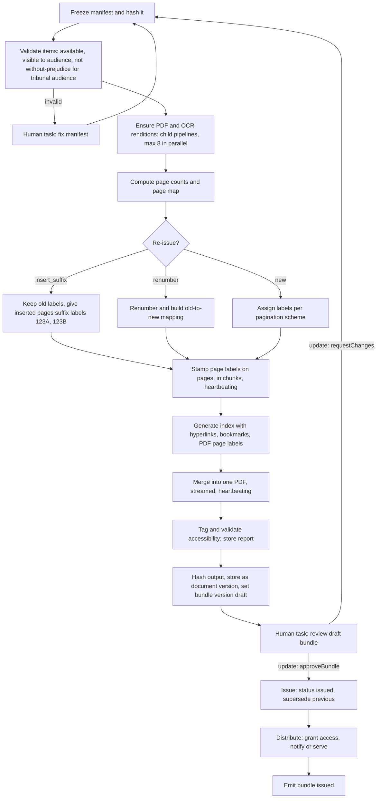

# 6.5.1 eBundling

<!-- Generated layout: edit text between the markers; keep the markers and the front matter. -->

> Assemble hearing bundles: ordering, pagination, index and hyperlinks, OCR, versioned re-issue, distribution

<!-- section:purpose -->
## Purpose and outcome

Assemble a hearing bundle (or a core, authorities or tribunal bundle) from document versions already in the case: put them in the agreed order, paginate with bundle page references, stamp page numbers, build a hyperlinked index and bookmarks, add an OCR text layer where needed, produce an accessible PDF, get it approved, issue it and distribute it to the right audience. Re-issue a corrected version without breaking page references the parties have already cited.

**Done** means a `bundle_versions` row in status `issued` with an output document version (PDF), a page map, a manifest hash, an accessibility validation report, and distribution recorded for every intended recipient; or `failed` with a human task explaining why.

<!-- section:trigger -->
## Trigger and inputs

**Triggers**: command `assembleBundle` from the secretariat or tribunal secretary in the console, or by a party where the tribunal has directed parties to prepare bundles; re-issue by `reissueBundle` with a change set.

**Inputs**

```ts
type BundleAssemblyInput = {
  tenantId: string; caseId: string; bundleId: string; bundleVersionNo: number;
  manifestRef: string;          // bundle_sections + bundle_items rows already saved as a draft
  previousVersionId?: string;   // for re-issue
  reissueStrategy: 'insert_suffix' | 'renumber';
  paginationScheme: 'global' | 'per_section';
  stampFormat: string;          // e.g. '{section}/{page}' from tenant settings
  approvalPolicyVersion: number;
  requestedBy: { membershipId: string };
};
```

**Workflow ID**: `{tenantId}-ebundle-{bundleId}-v{bundleVersionNo}`, task queue `documents`; heavy PDF activities run on `documents-render` (proposed separate queue and worker pool with more CPU and memory). Conflict policy *fail*: a second assembly of the same version is rejected; a new attempt is a new version number.

<!-- section:actors -->
## Actors

| Actor | Interaction |
|---|---|
| Secretariat / tribunal secretary | Builds the manifest in the console, starts assembly, reviews draft (human task), issues |
| Party / counsel (when directed) | Builds and submits their section; secretariat approves |
| Tribunal (presiding) | May be the approver for tribunal bundles; signal `approveBundle` via update |
| Document pipeline ([[WF-long-running-pipelines]]) | Child workflows to produce PDF renditions and OCR for items that lack them |
| Notifications / service ([[DOM-service-of-notices-and-proof]]) | Distribution, by notice where formal service is required |

<!-- section:steps -->
## Step sequence



| # | Step | Type | Notes |
|---|---|---|---|
| 1 | `freezeManifest` | Activity | Copies manifest rows into the bundle version, computes `manifest_sha256` over ordered (version ID, sha256, included pages) |
| 2 | `validateManifest` | Activity | Visibility check against the intended audience using the shared visibility filter; DOC-BR-6 for tribunal audiences |
| 3 | `ensureRenditions` | Child workflows (`{tenantId}-doc-pipeline-{versionId}`) | Reuses an existing pipeline run if one is in progress (signal-with-start) |
| 4 | `computePageMap` | Activity | Writes `page_map_object_key` |
| 5 | Labelling | Workflow logic on the loaded page map | Deterministic, no I/O |
| 6 | `stampPages(chunk)` | Activity on `documents-render`, chunks of 500 pages | Heartbeat every 50 pages with progress |
| 7 | `buildIndex` | Activity | Index as tagged table with links to page labels; PDF outline (bookmarks) per section and item; `/PageLabels` so viewer page numbers match stamps |
| 8 | `mergeBundle` | Activity on `documents-render` | Streamed merge from object storage to object storage; never loads whole bundle in memory |
| 9 | `tagAndValidate` | Activity | Applies tags to generated pages (index, separators), keeps source tags where present, runs a PDF/UA validator and stores the report ([[DOM-accessible-documents-and]]) |
| 10 | `storeOutput` | Activity | Output is a `document_versions` row of type `bundle` with SHA-256 |
| 11 | Review | Human task ([[WF-human-tasks]]) | Approver per `bundle-approval-policy` |
| 12 | `issueBundle` | Activity | State-machine transition, supersedes previous issued version |
| 13 | `distributeBundle` | Activity / child workflow | Access grants and notifications; formal service through a notice when the rule set requires |

<!-- section:timers -->
## Timers and SLAs

| Timer | Source | At breach |
|---|---|---|
| Bundle due date (for example N days before the hearing) | Tribunal direction or decision table `bundle-deadlines`, set as a case deadline | Reminder at 75% to the secretariat; the case deadline is marked missed at breach |
| Review task SLA (proposed 1 business day) | Tenant setting | Reminder, then escalation to case manager |
| Assembly duration guard (proposed 2 h for up to 10,000 pages) | Platform SLO | Alert to operations; workflow continues |
| Manifest fix task SLA (proposed 1 business day) | Tenant setting | Escalation |

<!-- section:signals -->
## Signals, updates and queries

| Message | Kind | Payload | Validation |
|---|---|---|---|
| `approveBundle` | Update | `{ membershipId, note? }` | Caller holds the approver role for this bundle; bundle version is `draft`; approver did not build the manifest unless policy allows |
| `requestChanges` | Update | `{ membershipId, items: [{ itemId, comment }] }` | Same role check; at least one comment |
| `cancelAssembly` | Update | `{ membershipId, reason }` | Secretariat; not after issue |
| `assemblyProgress` | Query | `{ stage, pagesStamped, totalPages, renditionsPending }` | |

<!-- section:activities -->
## Activities

| Activity | Side effect | Idempotency | Timeouts / retry |
|---|---|---|---|
| `freezeManifest` | Writes bundle version manifest | Unique bundle version | 30 s, 5 attempts |
| `validateManifest` | None | — | 30 s |
| `computePageMap` | Writes page map object | Object key derived from bundle version | 2 min |
| `stampPages` | Writes stamped chunk objects | Key `{bundleVersionId}/chunks/{n}.pdf`; overwrite of the same key is safe | Start-to-close 20 min, heartbeat 60 s, 5 attempts, backoff 2x from 10 s |
| `buildIndex` | Writes index PDF | Derived key | 10 min, heartbeat |
| `mergeBundle` | Writes output object | Derived key | 60 min, heartbeat 60 s, 3 attempts |
| `tagAndValidate` | Writes tagged output and report | Derived key | 30 min, heartbeat |
| `storeOutput` | Inserts document version | `{bundleVersionId}:output` | 30 s |
| `issueBundle` | Status, audit, outbox | `{bundleVersionId}:issue` | 30 s |
| `distributeBundle` | Grants, notifications | `{bundleVersionId}:{audience}:{membershipId}` per recipient | 60 s, 10 attempts |

Non-retryable: `ItemNotAvailable`, `VisibilityViolation`, `EncryptedSourcePdf` (password-protected file), `PageLimitExceeded` (proposed 20,000 pages or 5 GB per bundle).

<!-- section:failure -->
## Failure, cancellation and compensation

- A source PDF that cannot be processed (encrypted, corrupt): non-retryable; the workflow opens a "fix manifest" task naming the item; the builder replaces or removes it and the workflow restarts from step 1 with the new manifest (same workflow, new manifest hash).
- Worker crash during stamping or merging: heartbeat timeout triggers a retry; completed chunks are reused because chunk keys are deterministic and the heartbeat records progress.
- Cancellation: intermediate objects are deleted by a cleanup activity; nothing was issued, so no compensation of access is needed.
- After issue, a mistake is fixed only by re-issue (a new version), never by editing the issued file.

<!-- section:versioning -->
## Versioning

Bundles complete in hours, so workflow code changes use `patched()` and patches are removed after one week. Stamp format and approval policy are inputs pinned at start. Tool versions (PDF library, OCR engine) are recorded on each rendition and output so a re-issue can explain differences.

<!-- section:observability -->
## Visibility and monitoring

- Search attributes: `tenantId`, `caseId`, `bundleId`, `stage`, `totalPages`.
- Metrics: assembly duration by page-count bucket; pages per minute per worker; failure reasons; review wait time.
- Alerts: assembly over the duration guard; `documents-render` schedule-to-start latency over 5 minutes; failure rate above 5% in an hour.
- Secretariat UI shows progress from the `assemblyProgress` query.

<!-- section:questions -->
## Open questions

- [ ] PDF engine: reuse the existing TERES eBundling design (Stirling-PDF based) as a service on `documents-render`, or a library-based worker (for example qpdf plus a PDF library)? Decision needed before Phase 4; candidate for an ADR.
- [ ] Default re-issue strategy per tenant type: `insert_suffix` (preserves citations) is proposed for arbitral institutions.
- [ ] Should parties be able to build their own sections in the platform, with the secretariat combining them?
- [ ] Page and size limits per plan ([[BIL-plans-entitlements-and-usage]]).

<!-- checks -->
## Template checks

<!-- check:tenancy -->
### Tenancy and residency

Workflow ID `{tenantId}-ebundle-{bundleId}-v{n}` with `tenantId` search attribute; runs in the tenant's region on `documents` and `documents-render`. Every activity reads and writes objects only under the tenant prefix via the storage package, and opens Prisma transactions with the tenant set. Render workers have per-task-queue concurrency limits and bundle starts are rate-limited per tenant (proposed 5 concurrent assemblies per tenant), so one tenant's 20,000-page bundle cannot starve others.

<!-- check:security -->
### Access to workflow controls

Only secretariat (or parties when the tribunal directed) can start assembly; only the approver role can approve, checked in the update validator. Validation excludes items the audience may not see (including without-prejudice for tribunal bundles). Output inherits the strictest visibility of its audience. Payloads hold IDs only.

<!-- check:idempotency -->
### Side effects and idempotency

All object writes use deterministic keys derived from the bundle version, so retries overwrite the same object. Database inserts use unique keys per bundle version. Distribution uses a per-recipient key. Long activities heartbeat with progress so retries resume. Encrypted or corrupt PDFs are non-retryable.

<!-- check:audit -->
### Audit and legal record

Audited: manifest freeze (hash), each issue (approver, output hash, page count), each re-issue with change log, each distribution, and downloads of the bundle. The manifest hash plus source version hashes prove exactly which documents went into the bundle.

<!-- check:humantasks -->
### Human tasks

Two task types: `fix-bundle-manifest` (assigned to the builder) and `review-bundle` (approver role from policy). Both have SLAs with reminder and escalation. If the approver is unseated or leaves, the task is reassigned to the secretariat pool and audited.

<!-- check:testing -->
### Testing

Golden-file tests: a fixture case with 30 documents (scanned, born-digital, landscape, rotated, encrypted) produces a bundle whose page labels, bookmarks and index links are checked programmatically. Re-issue tests for both strategies verify that unchanged pages keep their labels under `insert_suffix`. Time-skipping tests for review SLAs; failure injection for worker crash mid-merge.

<!-- end -->
