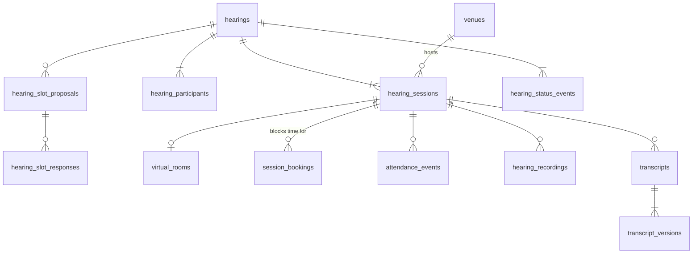

# 6.4.1 Hearings schema

<!-- Generated layout: edit text between the markers; keep the markers and the front matter. -->

> Hearings, rooms, sessions, attendance, recordings and transcripts metadata with no-overlap constraints

<!-- section:purpose -->
## Scope and ownership

Physical schema for [[DOM-hearings]], including recordings and transcripts. Owned by the neutrals and hearings domain team. Prisma file `packages/domain-hearings/prisma/hearings.prisma`. Conventions as in [[DOM-cases-schema#purpose]]. Time ranges use `tstzrange` with `[)` bounds (start inclusive, end exclusive) so back-to-back sessions do not overlap.

Referenced by: `transcription_jobs` ([[DOM-transcribers-schema]]), bundle-hearing links ([[DOM-documents-schema]]), invoice lines for hearing services.

<!-- section:entities -->
## Entities and relationships



All tables tenant-owned; `venues` is tenant-owned reference data.

<!-- section:tables -->
## Tables and columns

**hearings**: `id`, `tenant_id`, `case_id`, `hearing_type text`, `mode text`, `purpose text` (C), `reference_time_zone text`, `status text`, `recording_directed boolean NOT NULL DEFAULT false`, `notice_id uuid NULL`, `created_by_membership_id`, `idempotency_key text`, `version`.

**hearing_slot_proposals**: `id`, `hearing_id`, `candidate tstzrange`, `proposed_by_membership_id`, `closes_at timestamptz`.
**hearing_slot_responses**: `id`, `proposal_id`, `participant_id`, `response text` (`available`, `unavailable`, `tentative`), `responded_at`. Unique `(tenant_id, proposal_id, participant_id)`.

**hearing_participants**: `id`, `hearing_id`, `membership_id uuid NULL`, `guest_name text NULL` (PD), `guest_contact text NULL` (PD), `participant_role text` (`neutral`, `party`, `counsel`, `witness`, `expert`, `interpreter`, `transcriber`, `secretariat`, `observer`), `party_side_id uuid NULL` (case party), `required boolean`, `accommodation_request_id uuid NULL`, `removed_at`. Check: exactly one of `membership_id` or `guest_name` is set.

**venues**: `id`, `name`, `address jsonb`, `time_zone text`, `capacity smallint`, `accessibility_features text[]`, `status text`.

**hearing_sessions**: `id`, `hearing_id`, `seq smallint`, `during tstzrange NOT NULL`, `venue_id uuid NULL`, `status text` (`scheduled`, `live`, `interrupted`, `ended`, `cancelled`), `actual_start timestamptz NULL`, `actual_end timestamptz NULL`, `recording_announced_at timestamptz NULL`, `version`.

**session_bookings**: `id`, `session_id`, `membership_id uuid NOT NULL` (neutrals and secretariat staff who must not be double-booked), `during tstzrange NOT NULL` (copied from session, kept in sync by the session repository in the same transaction), `active boolean NOT NULL DEFAULT true`.

**virtual_rooms**: `id`, `session_id`, `provider text`, `provider_region text`, `provider_meeting_id text`, `join_policy jsonb` (waiting room, passcode required), `breakout_rooms jsonb` (party side to provider breakout ID), `created_at`, `closed_at`.

**attendance_events** (append-only): `id`, `session_id`, `participant_id`, `kind text` (`join`, `leave`, `admitted`, `removed`), `source text` (`provider`, `manual`), `device_class text NULL` (`browser`, `mobile`, `phone_dial_in`), `occurred_at timestamptz`.

**hearing_recordings**: `id`, `session_id`, `provider_recording_id text`, `object_key text NULL`, `media_type text`, `duration_ms integer NULL`, `sha256 bytea NULL`, `status text` (`expected`, `ingesting`, `available`, `failed`, `sealed`), `provider_copy_deleted_at timestamptz NULL`, `access_policy text` (`all_participants`, `tribunal_only`, `tribunal_and_parties`).

**transcripts**: `id`, `session_id`, `language text`, `current_version_id uuid NULL`.
**transcript_versions**: `id`, `transcript_id`, `version_no smallint`, `kind text` (`asr_draft`, `certified`, `reissued`), `document_version_id uuid` ([[DOM-documents-schema]]), `sha256 bytea`, `certified_by_membership_id uuid NULL`, `created_at`.

**hearing_status_events** and **session_status_events** (append-only) with the standard event columns.

<!-- section:keys -->
## Keys and constraints

```sql
CREATE EXTENSION IF NOT EXISTS btree_gist;

ALTER TABLE hearing_sessions ADD CONSTRAINT hs_hearing_fk
  FOREIGN KEY (tenant_id, hearing_id) REFERENCES hearings (tenant_id, id) ON DELETE CASCADE;
ALTER TABLE hearing_sessions ADD CONSTRAINT hs_seq_unique UNIQUE (tenant_id, hearing_id, seq);
ALTER TABLE hearing_sessions ADD CONSTRAINT hs_during_valid
  CHECK (NOT isempty(during) AND NOT lower_inf(during) AND NOT upper_inf(during)
         AND upper(during) - lower(during) <= interval '14 hours');

-- HRG-BR-4: a venue cannot host overlapping live or scheduled sessions
ALTER TABLE hearing_sessions ADD CONSTRAINT hs_venue_no_overlap
  EXCLUDE USING gist (tenant_id WITH =, venue_id WITH =, during WITH &&)
  WHERE (venue_id IS NOT NULL AND status <> 'cancelled');

-- HRG-BR-3: a neutral (or required staff member) cannot be booked twice at once
ALTER TABLE session_bookings ADD CONSTRAINT sb_member_no_overlap
  EXCLUDE USING gist (tenant_id WITH =, membership_id WITH =, during WITH &&)
  WHERE (active);

ALTER TABLE hearing_participants ADD CONSTRAINT hp_identity_check
  CHECK ((membership_id IS NULL) <> (guest_name IS NULL));
ALTER TABLE transcript_versions ADD CONSTRAINT tv_no_unique UNIQUE (tenant_id, transcript_id, version_no);
ALTER TABLE hearing_recordings ADD CONSTRAINT hr_available_has_hash
  CHECK (status NOT IN ('available','sealed') OR (sha256 IS NOT NULL AND object_key IS NOT NULL));
CREATE UNIQUE INDEX vr_provider_meeting ON virtual_rooms (tenant_id, provider, provider_meeting_id);
```

Exclusion constraints with `WHERE` predicates and `btree_gist` for scalar equality are described in [R1]. Application-enforced: HRG-BR-1 (needs case status), HRG-BR-5 (needs notice and rule set), HRG-BR-8.

<!-- section:tenancy -->
## Tenancy and RLS policies

All tables tenant-owned, ENABLE + FORCE RLS, standard policy ([[DOM-cases-schema#tenancy]]). Append-only: `attendance_events`, `hearing_status_events`, `session_status_events`, `transcript_versions`. Exclusion constraints lead with `tenant_id WITH =`, so overlaps are only evaluated inside a tenant; this is deliberate (a neutral's bookings at another tenant are not visible).

<!-- section:indexes -->
## Indexes and access patterns

| Query | Index |
|---|---|
| Hearing calendar of a case | `hearings (tenant_id, case_id, status)`; `hearing_sessions (tenant_id, hearing_id, seq)` |
| Secretariat day view across cases | GiST on `hearing_sessions (tenant_id, during)` (part of the venue exclusion index only covers venue sessions, so a separate GiST index is added) |
| A neutral's upcoming sessions | GiST from `sb_member_no_overlap` serves `membership_id = $1 AND during && $2` |
| Webhook lookup by provider meeting | unique `(tenant_id, provider, provider_meeting_id)`; plus a region-level lookup table in the integration layer keyed by provider meeting ID that returns the tenant ID |
| Attendance per session | `attendance_events (tenant_id, session_id, occurred_at)` |

<!-- section:history -->
## Status, history and concurrency

Hearing and session statuses follow [[DOM-hearings#lifecycle]] with event rows in the same transaction. Rescheduling updates `during` on the session and its `session_bookings` in one transaction (the exclusion constraint checks the new range); the old range is kept in `session_status_events.payload`. Cancelled sessions are never deleted. Transcript versions are append-only.

<!-- section:protection -->
## Data classification and protection

Guest names and contacts are personal data; dropped from attendance exports to parties unless the tribunal allows. `provider_meeting_id` and join passcodes are secrets for the life of the session: passcodes are not stored (fetched from the provider when building join info); meeting IDs are excluded from logs. Recording object keys point to the tenant's encrypted bucket prefix.

<!-- section:retention -->
## Retention, archival and deletion

| Data | Clock | End |
|---|---|---|
| hearings, sessions, participants, attendance, recordings, transcripts | case closure | With case |
| slot proposals and responses | hearing fixed | Delete 90 days after `fix_dates` (proposed) |
| provider-side recording copies | ingestion verified | Delete at provider within 7 days (proposed); `provider_copy_deleted_at` recorded |

<!-- section:migrations -->
## Migrations and rollout

1. `0201_hearings_core`: `btree_gist` (if not already installed), venues, hearings, participants, sessions with exclusion constraint, session_bookings, status events; RLS and grants.
2. `0202_hearings_media`: virtual rooms, attendance, recordings, transcripts and versions.
3. `0203_hearings_indexes`: GiST and B-tree indexes `CONCURRENTLY`.

Standard timeouts. Adding a new exclusion constraint to a populated table requires a pre-check query for violations and a clean-up plan, since `ADD CONSTRAINT ... EXCLUDE` cannot be `NOT VALID`.

<!-- section:prisma -->
## Prisma schema mapping

Models `Hearing`, `HearingSlotProposal`, `HearingSlotResponse`, `HearingParticipant`, `Venue`, `HearingSession`, `SessionBooking`, `VirtualRoom`, `AttendanceEvent`, `HearingRecording`, `Transcript`, `TranscriptVersion` and event models. `during` columns are `Unsupported("tstzrange")`; the sessions repository exposes typed helpers using `$queryRaw` with `tstzrange($1, $2, '[)')`. Exclusion violations (SQLSTATE `23P01`) are mapped to a domain error `SchedulingConflict` with the conflicting session ID.

<!-- section:volume -->
## Volume, growth and performance

Proposed: about 1.5 hearings per arbitration case and 1 per ODR case; 3 sessions per arbitration hearing. Five-year India estimate about 3M sessions and 15M attendance events. Attendance events are the hottest table; partition by month on `occurred_at` if it exceeds 50M rows.

<!-- section:questions -->
## Open questions

- [ ] Keep `session_bookings` in sync by repository code (current proposal) or by trigger from `hearing_sessions`? A trigger guarantees sync for every writer.
- [ ] Do in-person hearings need room-level resources (interpretation booths, screens) with their own no-overlap constraints?

<!-- checks -->
## Template checks

<!-- check:tenancy -->
### Tenant isolation in the schema

Every table is tenant-owned with forced RLS and composite foreign keys. Exclusion constraints include `tenant_id WITH =`, so overlap checks never read another tenant's rows. Webhook resolution uses a regional lookup that maps provider meeting ID to tenant before opening a tenant-scoped transaction.

<!-- check:integrity -->
### Invariants enforced by the database

Database: no venue double-booking and no member double-booking (exclusion constraints, safe under concurrent schedulers) [R1]; session range sanity (bounded, under 14 hours); participant identity shape; recording available implies hash and object key; transcript version numbering. Application: scheduling only after constitution, notice periods.

<!-- check:migration-safety -->
### Zero-downtime and reversible migrations

Exclusion constraints cannot be added `NOT VALID`, so any later exclusion constraint on a populated table is preceded by a violation report and clean-up, and added in a low-traffic window with `lock_timeout` set. Other changes follow the expand / contract rules in [[DOM-cases-schema#migrations]].

<!-- check:audit -->
### History, immutability and evidence

Attendance, status events and transcript versions are append-only. Recording files have SHA-256 stored at ingestion and checked on each download; certified transcript versions record the certifier.

<!-- check:performance -->
### Query performance under RLS and growth

Range queries use GiST indexes with `tenant_id` as the first column (via `btree_gist`). Day-view queries for a large tenant (about 200 sessions a day) return in under 50 ms on the projected volume.

<!-- citations -->
## Citations

```json
[
  {
    "excerpt": "Exclusion constraints can use GiST indexes with operators such as && for range overlap; a partial exclusion constraint can be declared with a WHERE predicate.",
    "id": "R1",
    "kind": "vendor",
    "title": "PostgreSQL documentation: Constraints (including exclusion constraints)",
    "url": "https://www.postgresql.org/docs/current/ddl-constraints.html",
    "vendor": "PostgreSQL Global Development Group"
  }
]
```

<!-- end -->
