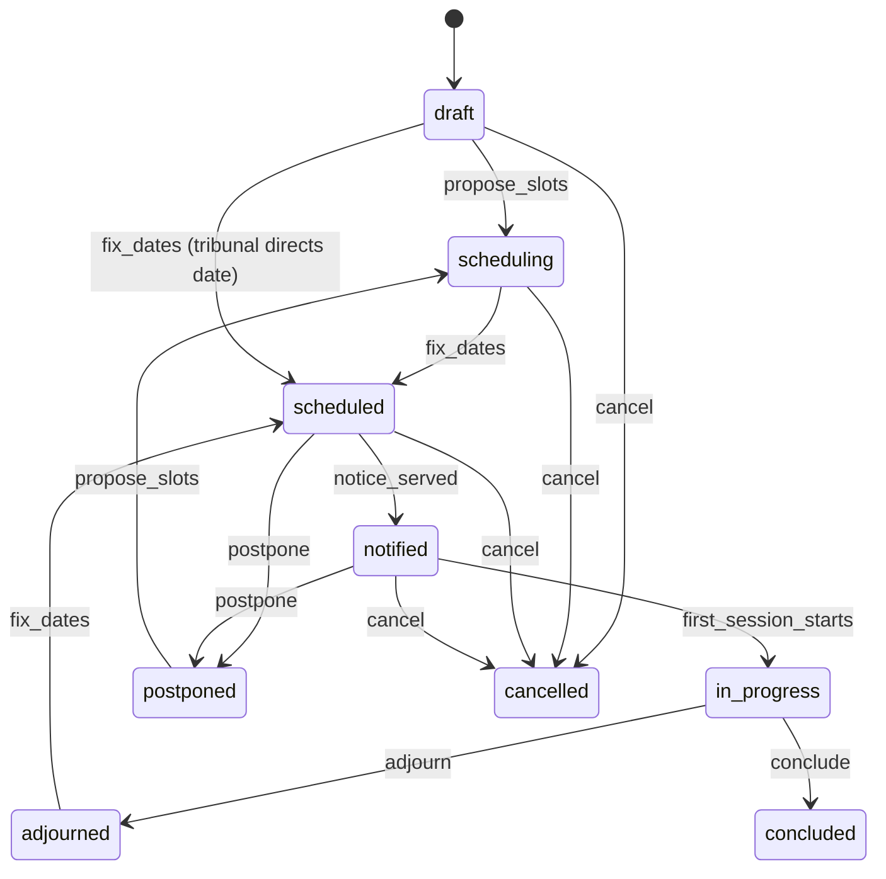

# 6.4 Hearings

<!-- Generated layout: edit text between the markers; keep the markers and the front matter. -->

> Hearing scheduling across time zones, virtual and in-person sessions, attendance, recordings and links to transcripts

<!-- section:purpose -->
## Purpose and vision

The Hearings context schedules and runs the hearings of a case: case management conferences, evidentiary hearings, oral arguments, conciliation and mediation meetings, and emergency hearings. It finds a time that works for the tribunal and the parties across time zones, books a virtual room or a physical venue (or both, for hybrid hearings), tells participants, records who attended, captures the recording, and links each session to its transcript.

A hearing is where a party is heard. Errors here (a wrong time zone in a notice, a room that fails, a recording that is lost, a party who could not join) are grounds for complaint or challenge, so the context must make every scheduling decision and every attendance fact provable.

<!-- section:classification -->
## Strategic classification

| Aspect | Value |
|---|---|
| Domain type | **Core** (virtual hearings are a key product capability for TERES and CORD) |
| Business role | Revenue (hearing services, room hire, transcription), engagement (hearing room in browser) |
| Evolution stage | Custom on top of a third-party video provider ([[INT-video-conferencing-for-hearings]]) |

<!-- section:language -->
## Ubiquitous language

| Term | Definition | Avoid |
|---|---|---|
| **Hearing** | A scheduled sitting of the tribunal (or conciliator / mediator) with the parties for a stated purpose, possibly over several days. | meeting (except for mediation, as a tenant label) |
| **Hearing type** | `case_management_conference`, `evidentiary`, `oral_argument`, `conciliation_meeting`, `mediation_session`, `emergency`. | |
| **Mode** | `virtual`, `in_person`, `hybrid`. | |
| **Session** | One continuous sitting within a hearing, normally one day or half-day, with its own start and end. | day, slot |
| **Slot proposal** | A candidate time offered to participants during scheduling. | poll |
| **Venue** | A physical hearing room the tenant manages or hires. | location |
| **Virtual room** | The video meeting created with the provider for a session, with breakout rooms per party where needed. | link, Zoom |
| **Participant** | A person expected at the hearing: neutral, party, counsel, witness, expert, interpreter, transcriber, secretariat, observer. | attendee (attendance is what actually happened) |
| **Attendance** | Join and leave facts per participant per session, from the provider and from the secretariat for in-person attendees. | |
| **Recording** | The audio / video file of a session, ingested into our storage. | video |
| **Transcript** | Text record of a session; versions include ASR draft, certified, and re-issued after errata. Produced through [[DOM-transcribers]]. | minutes |
| **Adjournment** | A decision to stop and continue at a later date; the hearing stays open. | postponement (before start) |

<!-- section:entities -->
## Entities and aggregates

| Entity | Aggregate | Key attributes | Ownership |
|---|---|---|---|
| **Hearing** | Root | case, type, mode, purpose, seat time zone, status, scheduling deadline | Tenant-owned |
| Slot proposal and responses | Child of hearing | candidate range, participant responses (`available`, `unavailable`, `tentative`) | Tenant-owned |
| **Session** | Own aggregate (concurrent edits to different days) | `during` range, venue, virtual room, status, recording consent announcement | Tenant-owned |
| Virtual room | Child of session | provider, provider meeting ID, region, join policy (waiting room, passcode), breakout rooms | Tenant-owned |
| Venue | Root | name, address, capacity, accessibility features, time zone | Tenant-owned reference data |
| Participant | Child of hearing | membership or external guest, participant role, party side, required flag, accommodations (link to accommodation request) | Tenant-owned |
| Attendance event | Append-only child of session | participant, join / leave, source (provider, manual), occurred at | Tenant-owned |
| Recording | Child of session | provider recording ID, object key, duration, sha256, status | Tenant-owned |
| Transcript and versions | Root (referenced by Transcribers) | session, kind (`asr_draft`, `certified`, `reissued`), document version, sha256 | Tenant-owned |

<!-- section:lifecycle -->
## Lifecycle (state machine)

**Hearing**

**Session**: `scheduled → live → ended`; `scheduled → cancelled`; `live → interrupted → live` (room failure and recovery).

**Recording**: `expected → ingesting → available | failed`; `available → sealed` when the tribunal restricts access.

| Transition | Trigger | Guard |
|---|---|---|
| propose_slots | Secretariat / tribunal secretary | Case `constituted` or later (except `emergency` and `conciliation_meeting`) – HRG-BR-1 |
| fix_dates | Tribunal or secretariat | No overlap for neutrals and venue (HRG-BR-3, HRG-BR-4) |
| notice_served | `notice.served` from [[DOM-service-of-notices-and-proof]] | All required participants served |
| first_session_starts | Provider event `meeting.started` or secretariat | Within 2 h of scheduled start |
| adjourn / conclude | Presiding or sole neutral | Reason for adjournment |
| postpone / cancel | Tribunal or secretariat | Reason; re-notice required (HRG-BR-8) |

<!-- section:rules -->
## Business rules

| ID | Rule |
|---|---|
| HRG-BR-1 | Hearings other than `emergency`, `conciliation_meeting` and `mediation_session` can be scheduled only after the tribunal is constituted. |
| HRG-BR-2 | Every hearing time is stored in UTC with the hearing's reference time zone (the seat's by default); every notice shows the time in the reference zone and in each recipient's own zone. |
| HRG-BR-3 | A neutral cannot be booked in two overlapping sessions in the same tenant (database exclusion constraint). Overlaps with their bookings at other tenants are only detectable through their own availability blocks. |
| HRG-BR-4 | A venue cannot be booked for overlapping sessions (database exclusion constraint). |
| HRG-BR-5 | The notice period between notice served and the first session is at least the rule-set minimum (decision table `hearing-notice-period`); the tribunal may shorten it with a recorded order. |
| HRG-BR-6 | Virtual rooms are created in the provider region matching the tenant's region where the provider supports it; if not, the hearing cannot be recorded through the provider and the secretariat is warned. |
| HRG-BR-7 | Sessions are recorded only if the tribunal has directed recording; the recording state is announced at the start and shown to all participants for the whole session. |
| HRG-BR-8 | Postponing or changing a scheduled hearing requires a new notice to all required participants. |
| HRG-BR-9 | Each party side may have a private breakout room that the tribunal and other parties cannot enter or record. |
| HRG-BR-10 | Witnesses are admitted from the waiting room only when called, and only the tribunal or secretariat can admit them. |
| HRG-BR-11 | A recording is available to participants only after it has been ingested into the tenant region, hashed and scanned, and only to roles the tribunal allows. |
| HRG-BR-12 | Attendance is recorded for every required participant; absence of a required party is flagged to the tribunal at session start + 15 minutes (proposed). |
| HRG-BR-13 | Accommodation requests (interpreter, CART, sign-language interpreter, extra breaks) approved for a participant are attached to every session they attend ([[DOM-hearing-room-accessibility]]). |

<!-- section:commands -->
## Commands and events

**Commands**: `createHearing`, `proposeSlots`, `respondToSlots`, `fixDates`, `addParticipant`, `removeParticipant`, `bookVenue`, `createVirtualRoom` (system), `startSession`, `endSession`, `adjournHearing`, `concludeHearing`, `postponeHearing`, `cancelHearing`, `recordManualAttendance`, `ingestRecording` (system), `sealRecording`, `orderTranscript` (to Transcribers).

**Queries**: `getHearingCalendar` (case, tribunal, secretariat views), `getSlotGrid` (availability across participants, rendered in each viewer's zone), `getSessionJoinInfo` (per participant, short-lived), `getAttendance`, `getRecordings`.

**Events**

| Event | Payload summary |
|---|---|
| `hearing.scheduled` | hearingId, caseId, sessions (start, end, zone), mode |
| `hearing.rescheduled` / `hearing.cancelled` | hearingId, reason code |
| `session.started` / `session.ended` | sessionId, actual times |
| `attendance.recorded` | sessionId, participantId, kind |
| `recording.available` | recordingId, sessionId, durationMs, sha256 |
| `hearing.concluded` | hearingId |

<!-- section:integrations -->
## Relationships to other contexts

| Context | Pattern |
|---|---|
| [[DOM-cases]] | Upstream; Hearings requires case status and tribunal |
| [[DOM-neutrals]] | Supplier of availability |
| [[DOM-service-of-notices-and-proof]] | Hearing notices are served through it |
| [[INT-video-conferencing-for-hearings]] | Anti-corruption layer over the provider (rooms, breakout rooms, recordings, attendance webhooks) |
| [[DOM-transcribers]] | Downstream: recordings feed transcription jobs |
| [[DOM-documents]] | Hearing bundles from [[DOM-ebundling]] are linked to the hearing |
| [[APP-hearing-room-in-browser]] | The in-browser room UI |
| [[WF-separation-of-concerns-temporal]] | Hearing reminder workflow (worked example there) |

<!-- section:variations -->
## Tenant and jurisdiction variations

- Arbitral institutions: multi-day evidentiary hearings, hybrid mode with a physical venue, interpreters, transcription ordered, witness waiting room.
- SEBI ODR tenants: short virtual conciliation meetings and arbitration hearings, typically one session; recordings may be required by the ODR institution's rules (assumption; confirm).
- CORD tenants: virtual meetings, often unrepresented parties joining by phone or mobile browser; audio-only and dial-in matter more than breakout rooms.
- Configured through decision tables (`hearing-notice-period`, `hearing-reminder-policy`) and tenant settings (default provider, recording default, waiting room default).

<!-- section:retention -->
## Data retention and confidentiality

- Recordings and transcripts are part of the case record; retention follows the case. The tribunal may seal a recording (`tribunal-only`).
- Provider-side copies of recordings are deleted after ingestion is verified (hash match), within 7 days (proposed), so the only long-term copy is in the tenant's region.
- Attendance events follow the case retention; IP addresses in provider events are dropped at ingestion.

<!-- section:metrics -->
## Verification metrics

- Share of hearings scheduled within N days of the first proposal
- Room failure rate (sessions with `interrupted`) and mean recovery time
- Recording ingestion success rate and time to availability
- Attendance of required participants at start time

<!-- section:questions -->
## Open questions and assumptions

- [ ] Video provider per region: which providers can host meetings and store recordings in India, Singapore and the US, and do we need our own media servers anywhere? Owner: integrations lead with [[INT-video-conferencing-for-hearings]].
- [ ] Is a recording ever a legal requirement for SEBI ODR hearings? Legal to confirm.
- [ ] Physical venues: does any tenant need us to integrate with an external venue booking system?
- [ ] Should cross-tenant neutral double-booking be detectable with the neutral's consent (shared free / busy across their profiles)?

<!-- checks -->
## Template checks

<!-- check:tenancy -->
### Tenancy and residency

All entities are tenant-owned with forced RLS ([[DOM-hearings-schema]]). Virtual rooms are created with the tenant's provider credentials ([[INT-integration-framework]] vault) in the tenant's region. Provider webhooks are mapped to a tenant by the stored provider meeting ID within the region. Join links are per participant and short-lived, so a link forwarded to another person or tenant does not grant access.

<!-- check:security -->
### Access and confidentiality

Joining requires a platform session for members, or a one-time guest token for external witnesses issued by the secretariat. The waiting room is on by default; only tribunal and secretariat can admit. Party breakout rooms are restricted to that party side. Recording access is set per recording by the tribunal. Operators cannot join rooms; support sees only room health metadata.

<!-- check:audit -->
### Audit and legal record

Audited: scheduling decisions (who fixed dates, against which slot responses), notices, changes and cancellations with reasons, admissions from the waiting room, recording start and stop, attendance, recording ingestion (hash), sealing, and every download of a recording.

<!-- check:privacy -->
### Personal data

Recordings capture voice and image of all participants, including witnesses who are not users. The tenant is fiduciary; participants are told at the start that the session is recorded (HRG-BR-7). Recordings stay in-region; provider copies are deleted after ingestion. Witness personal data collected for guest access is limited to name and email or phone.

<!-- check:consistency -->
### Invariants and concurrency

Neutral and venue double-booking is prevented by exclusion constraints, so two schedulers fixing dates at once cannot both succeed. Sessions are separate aggregates so editing day 3 does not conflict with day 1. `fixDates` carries an idempotency key; the reminder workflow is started from the outbox with the hearing ID as workflow ID.

<!-- check:i18n -->
### Localisation and jurisdiction

Times are stored in UTC with an IANA reference zone; the slot grid and notices show each participant's own zone too (HRG-BR-2). DST transitions in the US region are covered in tests (a session spanning a change keeps its UTC range). Interpreted hearings record the languages used per session.

<!-- check:testing -->
### Testing

Exclusion-constraint tests for neutral and venue overlaps (including touching ranges, which are allowed with `[)` bounds). Time-zone tests across India, Singapore, US Eastern and Pacific zones including DST change weekends. Provider contract tests against a sandbox: room creation, webhooks, recording download. Lifecycle tests generated from the machine.

<!-- end -->
