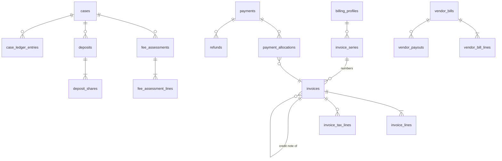

# 6.6.1 Invoices and vendor bills schema

<!-- Generated layout: edit text between the markers; keep the markers and the front matter. -->

> Fee schedules applied, invoices, line items, vendor bills, payments and currency handling

<!-- section:purpose -->
## Scope and ownership

Physical schema for [[DOM-invoices-and-vendor-bills]]. Owned by the transcribers and billing domain team. Prisma file `packages/domain-billing/prisma/case-billing.prisma` (named `case-billing` to avoid confusion with the platform [[BIL]] tables). Conventions as in [[DOM-cases-schema#purpose]]; money is always `amount_minor bigint` with `currency char(3)`.

References cases, neutral appointments, transcription jobs and document versions (rendered invoice PDFs) by composite FKs. Read by [[INT-accounting-sync]] through the outbox, and by Reporting through `nomo_reporting`.

<!-- section:entities -->
## Entities and relationships



All tables tenant-owned. Aggregate roots: billing_profiles, fee_assessments, deposits, invoices, payments, refunds, vendor_bills.

<!-- section:tables -->
## Tables and columns

**billing_profiles**: `id`, `tenant_id`, `legal_name text`, `tax_registrations jsonb` (scheme, number, state / jurisdiction), `address jsonb`, `bank_details_ciphertext bytea NULL` (C, encrypted), `default_currency char(3)`, `status text`, `version`.

**invoice_series**: `id`, `billing_profile_id`, `series_key text` (for example `INV`, `CN`), `period text` (for example `2026-27`), `prefix text`, `next_value integer NOT NULL`, unique `(tenant_id, billing_profile_id, series_key, period)`.

**fee_assessments**: `id`, `case_id`, `schedule_key text`, `schedule_version integer`, `amount_in_dispute_minor bigint`, `currency char(3)`, `inputs jsonb` (facts passed to the decision), `total_minor bigint`, `assessed_at`, `assessed_by_kind text`, `superseded_by uuid NULL`.

**fee_assessment_lines**: `id`, `assessment_id`, `fee_code text` (`registration`, `administrative`, `neutral_fee`, `hearing_room`, `transcription`), `description text`, `amount_minor bigint`, `basis jsonb` (band, rate, hours).

**deposits**: `id`, `case_id`, `purpose text`, `currency char(3)`, `requested_total_minor bigint`, `status text`, `version`.
**deposit_shares**: `id`, `deposit_id`, `case_party_side text` (`claimant`, `respondent`), `case_party_id uuid NULL`, `share_minor bigint`, `invoice_id uuid NULL` (the payment request), `substituted_by_party_id uuid NULL`.

**invoices**: `id`, `case_id`, `billing_profile_id`, `kind text` (`tax_invoice`, `payment_request`, `credit_note`), `number text NULL` (set at issue), `series_id uuid NULL`, `credit_of_invoice_id uuid NULL`, `payer_snapshot jsonb` (PD; name, address, tax ID, at issue), `payer_party_id uuid NULL`, `currency char(3)`, `subtotal_minor bigint`, `tax_minor bigint`, `total_minor bigint`, `paid_minor bigint NOT NULL DEFAULT 0`, `credited_minor bigint NOT NULL DEFAULT 0`, `issued_at`, `due_at`, `status text`, `document_version_id uuid NULL` (rendered PDF), `idempotency_key text`, `version`.

**invoice_lines**: `id`, `invoice_id`, `seq smallint`, `fee_code text`, `description text`, `quantity numeric(12,3)`, `unit_minor bigint`, `amount_minor bigint`, `source_kind text` (`assessment_line`, `transcription_job`, `hearing_session`, `manual`), `source_id uuid NULL`.

**invoice_tax_lines**: `id`, `invoice_id`, `tax_code text` (for example `IN_CGST`, `IN_SGST`, `IN_IGST`, `SG_GST`, `US_STATE`), `rate numeric(6,4)`, `taxable_minor bigint`, `tax_minor bigint`, `decision_key text`, `decision_version integer`.

**payments**: `id`, `payer_party_id uuid NULL`, `payer_name text` (PD), `method text` (`card`, `upi`, `netbanking`, `bank_transfer`, `cheque`, `other`), `gateway text NULL`, `gateway_event_id text NULL`, `gateway_reference text NULL`, `amount_minor bigint`, `currency char(3)`, `received_at`, `fx_rate numeric(18,8) NULL`, `fx_source text NULL`, `fx_date date NULL`, `screening_status text` (`not_required`, `clear`, `hold`, `released`, `blocked`), `screening_ref text NULL`, `status text` (`received`, `allocated`, `partially_allocated`, `refunded`), `version`.

**payment_allocations**: `id`, `payment_id`, `invoice_id`, `amount_minor bigint`, `amount_in_invoice_currency_minor bigint`, `allocated_at`, `allocated_by_kind text`.

**refunds**: `id`, `payment_id`, `amount_minor bigint`, `currency char(3)`, `reason text`, `status text` (`requested`, `approved`, `sent`, `failed`), `approved_by_membership_id`, `gateway_reference text NULL`.

**vendor_bills**: `id`, `case_id`, `vendor_kind text` (`neutral`, `transcriber`, `vendor`), `neutral_appointment_id uuid NULL`, `transcriber_profile_id uuid NULL`, `transcription_vendor_id uuid NULL`, `vendor_reference text` (their bill number), `currency char(3)`, `subtotal_minor`, `tax_minor`, `total_minor`, `status text`, `submitted_by_membership_id`, `approved_by_membership_id uuid NULL`, `document_version_id uuid NULL` (their PDF), `version`.

**vendor_bill_lines**: `id`, `vendor_bill_id`, `seq`, `description`, `quantity`, `unit_minor`, `amount_minor`, `source_kind text` (`fee_term`, `transcription_job`, `expense`), `source_id uuid NULL`.

**vendor_payouts**: `id`, `vendor_bill_id`, `amount_minor`, `currency`, `method`, `reference text`, `paid_at`, `recorded_by_membership_id`.

**case_ledger_entries** (append-only): `id`, `case_id`, `case_party_id uuid NULL`, `account text` (`fees_receivable`, `deposit_held`, `deposit_drawn`, `unallocated_credit`, `refund_payable`), `amount_minor bigint` (signed), `currency char(3)`, `source_kind text`, `source_id uuid`, `occurred_at`.

**invoice_status_events**, **vendor_bill_status_events** (append-only) with standard columns.

<!-- section:keys -->
## Keys and constraints

```sql
ALTER TABLE invoices ADD CONSTRAINT inv_number_unique UNIQUE (tenant_id, billing_profile_id, number);
ALTER TABLE invoices ADD CONSTRAINT inv_number_when_issued
  CHECK (status IN ('draft','discarded') OR number IS NOT NULL);
ALTER TABLE invoices ADD CONSTRAINT inv_totals_check CHECK (
  subtotal_minor >= 0 AND tax_minor >= 0 AND total_minor = subtotal_minor + tax_minor
  AND paid_minor >= 0 AND credited_minor >= 0 AND paid_minor + credited_minor <= total_minor);
ALTER TABLE invoices ADD CONSTRAINT inv_credit_shape CHECK ((kind = 'credit_note') = (credit_of_invoice_id IS NOT NULL));
ALTER TABLE invoices ADD CONSTRAINT inv_credit_fk
  FOREIGN KEY (tenant_id, credit_of_invoice_id) REFERENCES invoices (tenant_id, id) ON DELETE RESTRICT;
CREATE UNIQUE INDEX inv_idem ON invoices (tenant_id, idempotency_key);
CREATE UNIQUE INDEX pay_gateway_event ON payments (tenant_id, gateway, gateway_event_id)
  WHERE gateway_event_id IS NOT NULL;                                  -- webhook replay safety
ALTER TABLE payment_allocations ADD CONSTRAINT alloc_positive CHECK (amount_minor > 0);
ALTER TABLE payments ADD CONSTRAINT pay_fx_shape CHECK ((fx_rate IS NULL) = (fx_source IS NULL));
-- INV-BR-13: one bill line per transcription job
CREATE UNIQUE INDEX vbl_job_once ON vendor_bill_lines (tenant_id, source_id)
  WHERE source_kind = 'transcription_job';
ALTER TABLE vendor_bills ADD CONSTRAINT vb_vendor_shape CHECK (
  (vendor_kind = 'neutral' AND neutral_appointment_id IS NOT NULL) OR
  (vendor_kind = 'transcriber' AND transcriber_profile_id IS NOT NULL) OR
  (vendor_kind = 'vendor' AND transcription_vendor_id IS NOT NULL));
```

`paid_minor` and `credited_minor` are maintained by the allocation and credit-note commands in the same transaction as the allocation row, under a `SELECT ... FOR UPDATE` on the invoice; the CHECK makes over-allocation impossible even if application code is wrong. Deposit draw limits (INV-BR-14) are checked against `case_ledger_entries` under a row lock on `deposits`. All amounts are `bigint` minor units; `numeric` only for rates and quantities.

<!-- section:tenancy -->
## Tenancy and RLS policies

All tables tenant-owned, ENABLE + FORCE RLS, standard policy ([[DOM-cases-schema#tenancy]]). Append-only: `case_ledger_entries`, status event tables, `invoice_tax_lines` and `invoice_lines` of issued invoices (enforced by a trigger that rejects UPDATE / DELETE when the parent invoice is not `draft`). `accounting_sync` workers use `nomo_worker` with the tenant set; no cross-tenant finance role exists in the app; platform finance reporting uses the warehouse.

<!-- section:indexes -->
## Indexes and access patterns

| Query | Index |
|---|---|
| Case financial summary | `invoices (tenant_id, case_id, status)`; `case_ledger_entries (tenant_id, case_id, account)` |
| Outstanding invoices by due date (dunning, ageing report [[RPT-cases]]) | `invoices (tenant_id, due_at) WHERE status IN ('issued','partially_paid')` |
| Gateway webhook dedup | unique partial on `(tenant_id, gateway, gateway_event_id)` |
| Vendor bill queue | `vendor_bills (tenant_id, status, created_at)` |
| Neutral's bills | `vendor_bills (tenant_id, neutral_appointment_id)` |
| Accounting sync backlog | outbox (in [[INT-api-platform-tables]]) by status |

<!-- section:history -->
## Status, history and concurrency

Statuses map to [[DOM-invoices-and-vendor-bills#lifecycle]] with status events in the same transaction. Issued invoices never change; credit notes are separate invoices. The ledger is the history of balances. No soft delete; drafts may be discarded (status) and purged after 90 days.

<!-- section:protection -->
## Data classification and protection

`bank_details_ciphertext` is envelope-encrypted with the tenant key ([[PKG-encryption-utilities-key]]), decrypted only for payout recording and masked (last 4 digits) elsewhere. `payer_snapshot` and `payer_name` are personal data, excluded from the warehouse except payer type and country. No card data is stored anywhere.

<!-- section:retention -->
## Retention, archival and deletion

| Data | Clock | End |
|---|---|---|
| Invoices, credit notes, tax lines, payments, allocations, refunds | Invoice date / end of financial year | Tax record period of the seller jurisdiction (to be confirmed by finance), then delete; survives case deletion |
| Fee assessments, deposits, ledger | Case closure | With the later of case retention and tax retention |
| Vendor bills and payouts | Bill date | Tax record period |
| Billing profile bank details | Profile retirement | Delete ciphertext when no payouts are pending |

<!-- section:migrations -->
## Migrations and rollout

1. `0501_case_billing_profiles`: billing profiles, invoice series.
2. `0502_case_fees`: assessments, deposits, invoices and lines, tax lines, status events, append-only trigger.
3. `0503_case_payments`: payments, allocations, refunds, ledger.
4. `0504_vendor_bills`: vendor bills, lines, payouts (requires neutrals and transcribers tables).
5. `0505_case_billing_indexes`: concurrent indexes.

Standard timeouts and expand / contract rules ([[DOM-cases-schema#migrations]]). Any change to money columns is additive (new column, backfill, switch, drop later), never an in-place type change.

<!-- section:prisma -->
## Prisma schema mapping

Models `BillingProfile`, `InvoiceSeries`, `FeeAssessment`, `FeeAssessmentLine`, `Deposit`, `DepositShare`, `Invoice`, `InvoiceLine`, `InvoiceTaxLine`, `Payment`, `PaymentAllocation`, `Refund`, `VendorBill`, `VendorBillLine`, `VendorPayout`, `CaseLedgerEntry`. Money columns are `BigInt` in Prisma and wrapped in a `Money` value type (`{ amountMinor: bigint; currency: string }`) by the repository; never JavaScript `number`. Raw-SQL-only: CHECKs, partial unique indexes, the append-only trigger, RLS.

<!-- section:seed -->
## Seed and reference data

Currencies with minor-unit exponents (ISO 4217) and tax codes come from [[PKG-reference-and-seed-data]]. Fee schedules and tax tables are tenant decision tables, seeded with defaults per tenant type and published by tenant admins.

<!-- section:volume -->
## Volume, growth and performance

Proposed: about 3 invoices and 2 payments per arbitration case, 1 each per ODR case with fees; ledger about 10 entries per case. Five-year India estimate about 4M invoices and 20M ledger entries. No partitioning foreseen within five years.

<!-- section:questions -->
## Open questions

- [ ] Confirm invoice numbering period and format rules per region (finance).
- [ ] Should the ledger become a full double-entry ledger (debit / credit pairs) to simplify reconciliation with Odoo, or stay single-entry by account?
- [ ] Are trigger-based append-only rules acceptable under our migration standards (see also [[DOM-transcribers-schema#questions]])?

<!-- checks -->
## Template checks

<!-- check:tenancy -->
### Tenant isolation in the schema

All tables tenant-owned with forced RLS and composite FKs. Invoice series counters are per tenant and billing profile; webhook dedup keys include `tenant_id`. No global sequence exists.

<!-- check:integrity -->
### Invariants enforced by the database

Database-enforced: invoice totals arithmetic, no over-allocation or over-credit (`paid + credited <= total`), number present once issued and unique per billing profile, credit-note shape, one bill line per transcription job, vendor shape, gateway event dedup, FX fields paired, append-only lines after issue (trigger). Application under row lock: deposit draw limit and consecutive numbering.

<!-- check:migration-safety -->
### Zero-downtime and reversible migrations

Money columns are only ever changed additively; backfills run per tenant in batches with progress; triggers are added with the table in the same migration. Standard `lock_timeout` and `statement_timeout`.

<!-- check:privacy -->
### Personal data, erasure and the legal record

Payer snapshots and payment payer names are personal data needed for tax records; kept for the tax period under the legal-obligation basis and excluded from analytics. Bank details are encrypted with the tenant key; crypto-shredded on offboarding after the tax period ends.

<!-- check:audit -->
### History, immutability and evidence

Ledger entries and status events are append-only; issued invoices and their lines cannot be changed (trigger). Every tax line records the decision table and version used, so any amount can be explained later.

<!-- check:testing -->
### Schema verification

Constraint tests for each CHECK and unique index (insert invalid data, expect the specific constraint error). Concurrency tests for numbering and allocation. Isolation tests on all tables.

<!-- end -->
