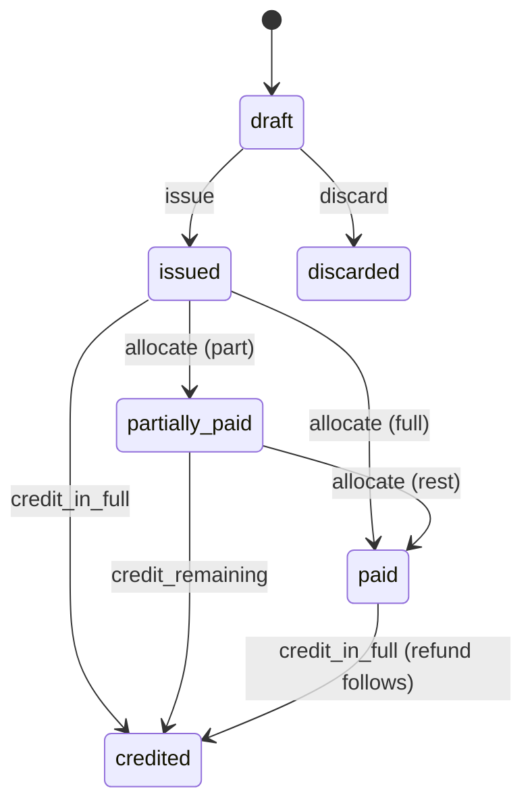
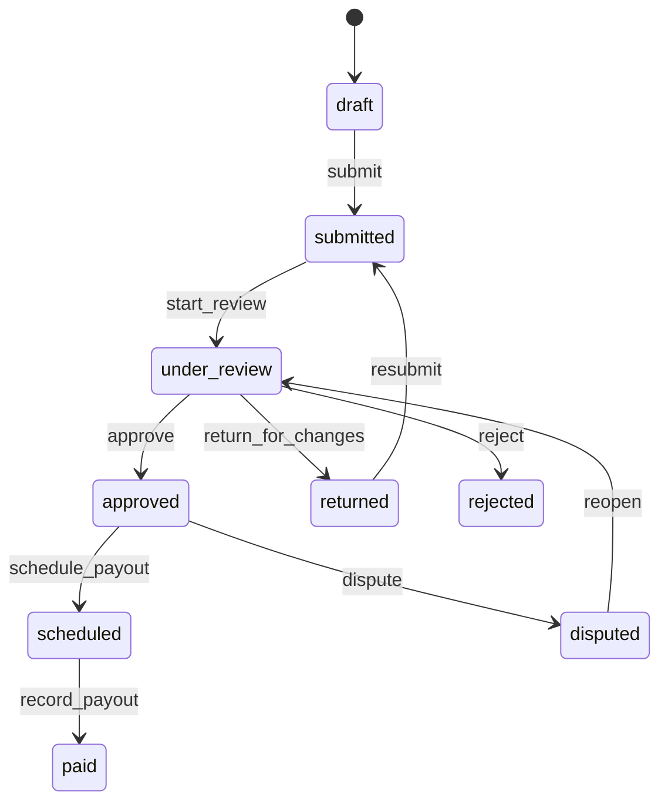

# 6.6 Invoices and vendor bills

<!-- Generated layout: edit text between the markers; keep the markers and the front matter. -->

> Money in a case: fee assessment from versioned schedules, deposits, invoices and payments from parties, and bills from neutrals, transcribers and vendors

<!-- section:purpose -->
## Purpose and vision

This context handles money inside a case, with the tenant (institution) as the seller and the payer of vendors. It assesses fees from the tenant's fee schedules (registration, administrative and neutral fees, hearing and transcription services), requests deposits (advances on costs) from the parties in the agreed shares, issues invoices and credit notes, records payments and refunds, tracks what each party has paid, and processes the bills that neutrals, transcribers and other vendors send to the tenant.

It is not Nomology's billing of tenants for the platform, which is the [[BIL]] area. For a CORD tenant, CORD itself is the institution, so the seller is NTPL; the model is the same.

Money errors damage trust quickly and can stop a case: unpaid deposits can suspend proceedings under most institution rules. Every amount must be traceable to a schedule version and a decision, and every balance must reconcile with the accounting system ([[INT-accounting-sync]]).

<!-- section:classification -->
## Strategic classification

| Aspect | Value |
|---|---|
| Domain type | **Supporting** (necessary, but not where the platform differentiates); fee-schedule flexibility is a selling point for institutions |
| Business role | Revenue for tenants; compliance (tax invoices, AML / sanctions on payers and payees, FEMA for cross-border receipts by Indian tenants) |
| Evolution stage | Custom on top of payment gateways and accounting sync; tax calculation by decision tables |

<!-- section:language -->
## Ubiquitous language

| Term | Definition | Avoid |
|---|---|---|
| **Fee schedule** | A tenant's published, versioned table of fees: registration fee, administrative fee scale by amount in dispute, neutral fee scale or hourly caps, service fees (hearing room, transcription). Held as decision tables in [[PKG-rules-and-decision-engine]]. | price list (for services only), tariff |
| **Amount in dispute** | The sum of quantified claims and counterclaims used by the schedule, in the case currency. | claim value (UI) |
| **Fee assessment** | The result of applying a schedule version to a case at a point in time: lines and amounts, pinned to the schedule version. Reassessed when the amount in dispute changes. | quote, estimate |
| **Deposit** | An advance on costs requested from parties to cover expected neutral and administrative fees; held and drawn down. | advance (UI label in some tenants), retainer |
| **Share** | Each party's proportion of a deposit or fee (default equal between sides; tribunal may direct otherwise). | split |
| **Substitute payment** | One party paying another party's unpaid share so the case can continue. | |
| **Invoice** | A tax invoice or payment request from the tenant to a payer (party, counsel firm or third-party funder), with lines, taxes and a number from the tenant's series. | bill (used for vendor bills) |
| **Credit note** | A document reducing or cancelling an issued invoice; invoices are never edited after issue. | refund (a refund is money returned) |
| **Payment** | Money received, from a gateway, bank transfer or other method, allocated to invoices or deposits. | receipt (the receipt is the document) |
| **Vendor bill** | A bill to the tenant from a neutral, transcriber or vendor for work in a case. | invoice (reserved for outgoing) |
| **Payout** | The tenant's payment of an approved vendor bill, recorded here and executed by the tenant's finance process or a payout provider. | |
| **Billing profile** | The tenant's seller identity: legal entity name, tax registrations, address, bank details, invoice series. | |

<!-- section:entities -->
## Entities and aggregates

| Entity | Aggregate | Key attributes | Ownership |
|---|---|---|---|
| Billing profile | Root | legal name, tax IDs (GSTIN, Singapore GST number, US state registrations), address, bank details (encrypted), invoice series | Tenant-owned |
| **Fee assessment** | Root (per case) | schedule key and version, amount in dispute, lines, total, assessed at, superseded by | Tenant-owned |
| **Deposit** | Root | case, purpose, requested total, shares per party, held balance, drawn total, status | Tenant-owned |
| **Invoice** | Root | number, kind (`tax_invoice`, `payment_request`, `credit_note`), payer snapshot, currency, lines, tax lines, totals, due date, status | Tenant-owned |
| **Payment** | Root | payer, method, gateway reference, amount and currency, received at, FX rate to invoice currency (if different), screening result reference | Tenant-owned |
| Allocation | Child of payment | invoice or deposit, amount | Tenant-owned |
| Refund | Root | payment, amount, reason, status | Tenant-owned |
| **Vendor bill** | Root | vendor (neutral profile, transcriber, vendor), case, lines, tax, currency, status, approval | Tenant-owned |
| Payout | Child of vendor bill | amount, method, reference, paid at | Tenant-owned |
| Case ledger entry | Append-only | case, party, account, amount, source document | Tenant-owned |

<!-- section:lifecycle -->
## Lifecycle (state machine)

**Invoice**

`overdue` is a derived flag (`due_at < now()` and not paid), not a status, so no timer writes status.

**Deposit**: `requested → partially_funded → funded → drawing → exhausted | closed`; `closed` after final accounting with any balance refunded.

**Vendor bill**

| Transition | Trigger | Guards |
|---|---|---|
| issue (invoice) | Secretariat or fee workflow | INV-BR-3, INV-BR-4, INV-BR-5 |
| allocate | Payment received (gateway webhook, manual bank reconciliation) | INV-BR-8, INV-BR-9 |
| credit | Secretariat with reason | INV-BR-6 |
| approve (vendor bill) | Secretariat / finance with `bills.approve` | INV-BR-12, INV-BR-13 |
| record_payout | Finance or payout provider callback | Payee screening clear (INV-BR-10) |

<!-- section:rules -->
## Business rules

| ID | Rule |
|---|---|
| INV-BR-1 | Fees are assessed only from a published fee-schedule version; the assessment records the schedule key and version and the inputs used. |
| INV-BR-2 | When the amount in dispute changes (new claim, counterclaim, amendment), the assessment is recomputed as a new assessment; the old one is superseded, not edited. |
| INV-BR-3 | An invoice number is assigned at issue from the billing profile's series, consecutive within the series and period, never reused. Assumption: series rules (for example consecutive numbering per financial year for Indian GST invoices) to be confirmed by finance per region. |
| INV-BR-4 | Issued invoices are immutable; corrections are by credit note and, if needed, a new invoice. |
| INV-BR-5 | The payer details on an invoice are a snapshot at issue; later changes to party data do not change it. |
| INV-BR-6 | A credit note cannot exceed the uncredited amount of the invoice it references. |
| INV-BR-7 | Taxes are computed by the decision table `case-fee-tax` from the billing profile, the payer's location and tax status and the service type; the table version is recorded on each tax line. |
| INV-BR-8 | Allocations to an invoice cannot exceed its outstanding amount; any excess is held as unallocated credit for the payer in the case. |
| INV-BR-9 | Payments in a currency other than the invoice currency record the rate used, its source and date; invoice amounts are never converted after issue. |
| INV-BR-10 | Payers and vendor payees are screened against sanctions lists before a payment is accepted or a payout is released, where the tenant's policy requires it ([[INT-kyc-and-sanctions-screening]]); a potential match blocks the step and creates a compliance task. |
| INV-BR-11 | Deposits are requested in shares (default equal per side); if a party does not pay its share within the rule-set period, the other side is invited to make a substitute payment, and the case workflow may suspend the case per the rule set (CASE-BR-17). |
| INV-BR-12 | A neutral's bill must reference an active or ended appointment on the case and the confirmed fee terms; amounts above the fee terms cap need tribunal-fee approval by the secretariat. |
| INV-BR-13 | A transcriber or vendor bill must reference delivered transcription jobs or services; a job billed once cannot be billed again. |
| INV-BR-14 | Drawing on a deposit cannot exceed its held balance. |
| INV-BR-15 | At case closure the deposit is reconciled: fees drawn, balance refunded to parties in proportion to their contributions unless the award directs otherwise. |
| INV-BR-16 | Fee waivers or reductions need a named approver with `fees.waive` and a reason, and are recorded as credit notes or assessment adjustments, never by editing amounts. |

<!-- section:commands -->
## Commands and events

**Commands**: `assessFees`, `requestDeposit`, `issueInvoice`, `issueCreditNote`, `recordPayment` (manual), `ingestGatewayPayment` (webhook), `allocatePayment`, `requestRefund`, `approveRefund`, `waiveFee`, `drawFromDeposit`, `closeDepositAccount`, `submitVendorBill`, `reviewVendorBill`, `approveVendorBill`, `returnVendorBill`, `recordPayout`.

**Queries**: `getCaseFinancials` (per party: assessed, invoiced, paid, deposit held, outstanding), `listInvoices`, `listVendorBills` (queue), `getStatement` (per payer), `getFeeEstimate` (pre-filing calculator from the published schedule).

**Events**

| Event | Payload summary |
|---|---|
| `fees.assessed` | caseId, assessmentId, scheduleVersion, total, currency |
| `deposit.requested` / `deposit.funded` / `deposit.share_overdue` | depositId, caseId, partyId |
| `invoice.issued` / `invoice.paid` / `invoice.credited` | invoiceId, caseId, number, total, currency |
| `payment.received` / `payment.screening_hold` | paymentId, amount, currency, method |
| `vendor_bill.submitted` / `vendor_bill.approved` / `vendor_bill.paid` | billId, vendorKind, amount |

<!-- section:integrations -->
## Relationships to other contexts

| Context | Pattern |
|---|---|
| [[DOM-cases]] | Partnership: claims drive assessment; payment status gates registration and closure; non-payment can suspend |
| [[DOM-neutrals]] | Supplier of appointments and fee terms |
| [[DOM-transcribers]] | Supplier of delivered jobs for client invoice lines and vendor bills |
| [[PKG-rules-and-decision-engine]] | Fee schedules and tax tables as decision tables |
| Payment gateways ([[INT-common-integrations]]) | Anti-corruption layer: gateway events to `payment.received` |
| [[INT-accounting-sync]] | Downstream: invoices, credit notes, payments, vendor bills synced per billing profile (for example to Odoo) |
| [[INT-kyc-and-sanctions-screening]] | Screening of payers and payees |
| [[BIL-invoicing-taxes-gst-singapore]] | Shares tax and e-invoicing components where the same rules apply; separate data |

<!-- section:variations -->
## Tenant and jurisdiction variations

| Aspect | Arbitral institution | SEBI ODR institution | CORD tenant |
|---|---|---|---|
| Schedules | Registration fee, admin fee and neutral fee scales by amount in dispute; hourly rates with caps | Fixed fee schedule by claim value set under the SEBI framework (values to be confirmed by legal) | Fixed fees per dispute type |
| Deposits | Yes, with shares and substitute payment | Generally not (assumption) | No |
| Currency | Multi-currency (USD, HKD, SGD, INR and others) | INR | INR (India), others per region |
| Payers | Parties, law firms, funders | Investors, brokers / members as directed | Individuals and businesses |
| Tax | Per seller jurisdiction and place of supply | India GST | India GST (NTPL) |

Configured through fee-schedule and tax decision tables, billing profiles, and tenant settings (screening required, deposit rules).

<!-- section:retention -->
## Data retention and confidentiality

- Tax invoices, credit notes and payment records are kept for the tax record period of the seller's jurisdiction, which may be longer than the case record (assumption: per-region values to be confirmed by finance and recorded in [[PKG-retention-and-deletion-schedule]]). They are retained even if the case record is deleted, with party data reduced to what the tax record requires.
- Bank details of vendors and billing profiles are encrypted and deleted when no longer needed for payouts or records.
- Confidentiality: fee terms and vendor bills are secretariat-only; parties see their own invoices and statements; the tribunal sees deposit status.

<!-- section:metrics -->
## Verification metrics

- Days from invoice issue to payment (by tenant and payer type)
- Share of cases suspended for non-payment
- Vendor bill approval turnaround
- Reconciliation differences with the accounting system (target zero)

<!-- section:questions -->
## Open questions and assumptions

- [ ] Finance / legal per region: invoice numbering and e-invoicing obligations for tenants (they are the sellers), and whether the platform must generate e-invoice payloads for Indian tenants above the threshold.
- [ ] Does the platform ever hold client money (deposits) itself, or only record what the tenant's bank account holds? Proposed: record only; money flows to the tenant's own gateway or bank account. Legal to confirm there is no payment-aggregator licensing implication.
- [ ] FEMA: Indian tenants receiving fees from foreign parties; is any reporting data needed from the platform? Finance.
- [ ] Should neutrals submit bills in the platform or should bills be generated from fee terms and time entries automatically?

<!-- checks -->
## Template checks

<!-- check:tenancy -->
### Tenancy and residency

All entities are tenant-owned with forced RLS ([[DOM-invoices-and-vendor-bills-schema]]). Invoice series and numbering are per billing profile inside the tenant, generated by a locked counter row in the issuing transaction, safe under PgBouncer transaction pooling. Gateway credentials and webhooks are per tenant through [[INT-integration-framework]]; a webhook is mapped to a tenant by its endpoint and verified signature, never by a field in the payload. Tax records survive case deletion and tenant offboarding exports include them.

<!-- check:security -->
### Access and confidentiality

Permissions: `fees.assess`, `invoices.issue`, `fees.waive`, `bills.approve`, `payouts.record` are separate, and the approver of a vendor bill cannot be the person who submitted it. Bank details are encrypted fields, revealed only to `payouts.record` holders and masked elsewhere. Changes to a billing profile's bank details need step-up authentication and are notified to tenant admins.

<!-- check:audit -->
### Audit and legal record

Audited: every assessment (schedule version, inputs), invoice issue, credit note, waiver (approver, reason), payment and allocation, refund approval, deposit draw, vendor bill decisions, payout recording, screening holds and releases, bank detail changes. The append-only case ledger lets finance rebuild any party's balance at any date.

<!-- check:privacy -->
### Personal data

Personal data: payer identities, addresses, tax IDs, bank details of vendors, payment references. Tax records must be kept under tax law even after an erasure request (legal-obligation basis); other data is minimised after the retention period. Payment card data is never stored: card payments are handled by the gateway's hosted page.

<!-- check:compliance -->
### Retention and regulatory rules

| Source | Encoded as |
|---|---|
| Tenant fee schedules (institution rules) | Versioned decision tables, INV-BR-1 |
| Tax law per seller region (GST in India and Singapore, US state sales tax) | Decision table `case-fee-tax`, billing profiles; values to be confirmed by finance |
| AML / sanctions screening policy | INV-BR-10, screening provider |
| SEBI fee schedule for ODR matters | Decision table for SEBI ODR rule set (values to be confirmed) |

<!-- check:consistency -->
### Invariants and concurrency

Invariants checked in the database: allocations not above outstanding (CHECK `paid_minor + credited_minor <= total_minor` on the invoice, updated under a row lock), deposit draws not above held balance (ledger check under row lock on the deposit), credit notes not above uncredited amount. Payment ingestion is idempotent on the gateway's event ID. Invoice issue takes a row lock on the series counter, so concurrent issues get consecutive numbers without gaps.

<!-- check:i18n -->
### Localisation and jurisdiction

All amounts in integer minor units with ISO 4217 currency; rounding per currency's minor unit (JPY 0, INR 2, KWD 3 decimal places from reference data). Invoices render in the payer's language where the tenant has a translated template, with the legally required language (for example English) always present. Tax IDs are typed by scheme.

<!-- check:testing -->
### Testing

Decision-table tests for fee schedules at boundary amounts (exactly at each band edge). Property tests that ledger balances always equal the sum of allocations and draws. Concurrency test: 50 parallel invoice issues produce 50 consecutive numbers with no gap. Gateway webhook replay test (same event twice) creates one payment.

<!-- end -->
