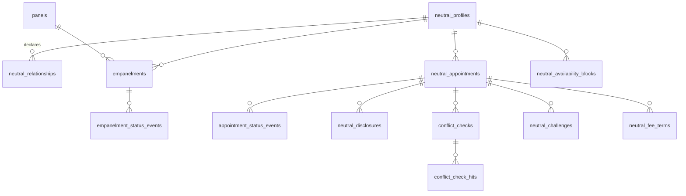

# 6.2.1 Neutrals schema

<!-- Generated layout: edit text between the markers; keep the markers and the front matter. -->

> Neutral profiles, empanelment per tenant, conflict declarations, availability and appointments

<!-- section:purpose -->
## Scope and ownership

Physical schema for [[DOM-neutrals]]. Owned by the neutrals and hearings domain team. Prisma file `packages/domain-neutrals/prisma/neutrals.prisma`. Conventions (IDs, money, timestamps, enumerations, classification comments) as stated in [[DOM-cases-schema#purpose]].

Referenced by: `tribunal_seats.neutral_appointment_id` ([[DOM-cases-schema]]), hearing participants ([[DOM-hearings-schema]]), neutral vendor bills ([[DOM-invoices-and-vendor-bills-schema]]). All by composite `(tenant_id, id)` foreign keys.

<!-- section:entities -->
## Entities and relationships



All 13 tables are tenant-owned. Aggregate roots: `neutral_profiles`, `panels`, `empanelments`, `neutral_appointments`, `neutral_challenges`.

<!-- section:tables -->
## Tables and columns

**neutral_profiles**: `id`, `tenant_id`, `membership_id uuid NOT NULL` (unique per tenant), `display_name text` (PD), `name_latin text` (PD), `honorific text`, `nationalities char(2)[]` (PD), `languages text[]` (BCP 47), `jurisdictions char(2)[]`, `expertise text[]` (tags from tenant taxonomy), `qualifications text` (PD), `public_bio text` (PD), `cv_document_version_id uuid NULL`, `max_concurrent_cases smallint NULL`, `status text` (`active`, `inactive`), `version`.

**neutral_relationships**: `id`, `neutral_profile_id`, `related_name text` (SPD), `related_name_normalised text` (lower-case, transliterated, punctuation removed; used for matching), `related_kind text` (`employer`, `former_employer`, `client`, `board`, `family`, `financial_interest`, `other`), `valid_from date NULL`, `valid_to date NULL`, `note text NULL` (SPD).

**panels**: `id`, `name text`, `procedure_types text[]`, `region_code text NULL` (for example Indian state code), `eligibility jsonb` (criteria validated by schema), `renewal_months smallint NULL`, `max_concurrent_cases smallint NULL`, `status text`.

**empanelments**: `id`, `neutral_profile_id`, `panel_id`, `status text` (`applied`, `under_review`, `empanelled`, `suspended`, `lapsed`, `removed`, `rejected`), `valid_from date NULL`, `valid_to date NULL`, `allocation_cursor bigint NOT NULL DEFAULT 0` (for round-robin), `version`.

**empanelment_status_events** (append-only): `id`, `empanelment_id`, `from_status`, `to_status`, `actor_membership_id`, `reason`, `occurred_at`.

**neutral_appointments**: `id`, `case_id uuid NOT NULL`, `neutral_profile_id`, `seat_role text`, `neutral_role text` (`arbitrator`, `emergency_arbitrator`, `conciliator`, `mediator`), `appointing_authority text` (`institution`, `parties`, `co_arbitrators`, `court`), `nominated_by_party_id uuid NULL`, `panel_id uuid NULL`, `status text` (`proposed`, `conflict_review`, `invited`, `accepted`, `declined`, `confirmed`, `active`, `ended`, `withdrawn`), `invited_at`, `invitation_expires_at`, `accepted_at`, `confirmed_at`, `ended_at timestamptz NULL`, `end_reason text NULL`, `replaces_appointment_id uuid NULL`, `idempotency_key text NOT NULL`, `version`.

**appointment_status_events** (append-only): as for empanelment, plus `rule_set_version integer`.

**neutral_disclosures**: `id`, `neutral_appointment_id`, `disclosure_no smallint`, `form_key text` (for example `in-s12-sixth-schedule` – exact key per rule set), `answers jsonb` (C), `document_version_id uuid` (signed statement), `document_sha256 bytea`, `signed_at timestamptz`, `signature_method text` (`esign`, `click`), `circulated_at timestamptz NULL`, `supersedes_id uuid NULL`.

**conflict_checks**: `id`, `neutral_appointment_id`, `run_at`, `trigger text` (`initial`, `party_added`, `counsel_added`, `manual`), `inputs_sha256 bytea` (hash of the normalised name list checked), `hit_count smallint`, `outcome text NULL` (`clear`, `cleared_with_hits`, `not_invited`), `reviewed_by_membership_id uuid NULL`, `reviewed_at`.

**conflict_check_hits**: `id`, `conflict_check_id`, `hit_kind text` (`declared_relationship`, `repeat_appointment_party`, `repeat_appointment_counsel`, `prior_case_party`), `matched_term text` (SPD), `source_ref uuid` (relationship or appointment), `score numeric(4,3)`, `reviewer_note text NULL`, `reviewed boolean NOT NULL DEFAULT false`.

**neutral_challenges**: `id`, `neutral_appointment_id`, `case_id`, `challenging_party_id`, `grounds_filing_id uuid`, `status text` (`filed`, `awaiting_responses`, `under_decision`, `upheld`, `dismissed`, `withdrawn`), `decided_at`, `decision_filing_id uuid NULL`, `version`.

**neutral_fee_terms**: `id`, `neutral_appointment_id`, `term_no smallint`, `basis text` (`scale`, `hourly`, `fixed`), `scale_key text NULL` + `scale_version integer NULL`, `rate_minor bigint NULL`, `cap_minor bigint NULL`, `currency char(3)`, `approved_by_membership_id uuid`, `effective_from timestamptz`, `superseded_at timestamptz NULL` (C).

**neutral_availability_blocks**: `id`, `neutral_profile_id`, `during tstzrange NOT NULL`, `kind text` (`busy`, `unavailable`, `tentative`), `source text` (`manual`, `calendar_sync`), `external_ref text NULL` (calendar event ID hash, no title).

<!-- section:keys -->
## Keys and constraints

```sql
CREATE EXTENSION IF NOT EXISTS btree_gist;  -- needed for equality on uuid inside a GiST exclusion constraint

ALTER TABLE neutral_profiles ADD CONSTRAINT np_membership_unique UNIQUE (tenant_id, membership_id);
ALTER TABLE empanelments ADD CONSTRAINT emp_unique UNIQUE (tenant_id, neutral_profile_id, panel_id);
ALTER TABLE empanelments ADD CONSTRAINT emp_profile_fk
  FOREIGN KEY (tenant_id, neutral_profile_id) REFERENCES neutral_profiles (tenant_id, id) ON DELETE CASCADE;
ALTER TABLE neutral_appointments ADD CONSTRAINT na_case_fk
  FOREIGN KEY (tenant_id, case_id) REFERENCES cases (tenant_id, id) ON DELETE RESTRICT;
CREATE UNIQUE INDEX na_idem ON neutral_appointments (tenant_id, idempotency_key);
-- one live appointment per neutral per case
CREATE UNIQUE INDEX na_one_live_per_case ON neutral_appointments (tenant_id, case_id, neutral_profile_id)
  WHERE status NOT IN ('declined','withdrawn','ended');
ALTER TABLE neutral_disclosures ADD CONSTRAINT nd_no_unique UNIQUE (tenant_id, neutral_appointment_id, disclosure_no);
ALTER TABLE neutral_fee_terms ADD CONSTRAINT nft_basis_check CHECK (
  (basis = 'scale' AND scale_key IS NOT NULL) OR (basis IN ('hourly','fixed') AND rate_minor IS NOT NULL AND rate_minor >= 0));
-- NEU-BR-12: no overlapping blocks of the same kind for one neutral
ALTER TABLE neutral_availability_blocks ADD CONSTRAINT nab_no_overlap
  EXCLUDE USING gist (tenant_id WITH =, neutral_profile_id WITH =, kind WITH =, during WITH &&);
ALTER TABLE neutral_availability_blocks ADD CONSTRAINT nab_bounded CHECK (NOT isempty(during) AND upper_inf(during) = false);
```

Exclusion constraints are documented in [R1]. Application-enforced: NEU-BR-1 (panel eligibility, needs rule set), NEU-BR-4 (all hits reviewed before `clear_for_invitation`, checked in the state-machine guard), NEU-BR-6 (objection window), NEU-BR-7 (capacity, checked under row lock on the profile).

<!-- section:tenancy -->
## Tenancy and RLS policies

All tables tenant-owned, ENABLE + FORCE RLS, standard `tenant_isolation` policy for `nomo_app` and `nomo_worker` as in [[DOM-cases-schema#tenancy]] ([[MT-rls-enabled-and-forced-on]]). Append-only: `empanelment_status_events`, `appointment_status_events`, `neutral_disclosures` (INSERT and SELECT only; superseding is a new row). Field visibility for `neutral_relationships` and `conflict_check_hits` is enforced in the authorisation layer and additionally by a restricted view `neutral_relationships_for_review` (created `WITH (security_invoker = true)` so RLS still applies) used only by the conflicts service.

<!-- section:indexes -->
## Indexes and access patterns

| Query | Index |
|---|---|
| Search panel members by expertise / language | `empanelments (tenant_id, panel_id, status)`; GIN on `neutral_profiles.expertise` and `.languages` |
| Round-robin next neutral on a panel | `empanelments (tenant_id, panel_id, allocation_cursor) WHERE status = 'empanelled'` |
| Conflict matching on names | `neutral_relationships (tenant_id, related_name_normalised)` with `pg_trgm` GIN for fuzzy match |
| Appointments for a case | `neutral_appointments (tenant_id, case_id, status)` |
| My appointments (neutral workspace) | `neutral_appointments (tenant_id, neutral_profile_id, status)` |
| Free / busy in a window | GiST from the exclusion constraint on `(tenant_id, neutral_profile_id, kind, during)` |
| Current capacity count | `neutral_appointments (tenant_id, neutral_profile_id) WHERE status = 'active'` |

<!-- section:history -->
## Status, history and concurrency

Status columns map to the two state machines in [[DOM-neutrals#lifecycle]]; each change inserts a status event row in the same transaction. Disclosures and fee terms are versioned by new rows. Profiles are soft-deactivated (`status = 'inactive'`); hard delete only by the retention job. Optimistic lock on `version`.

<!-- section:protection -->
## Data classification and protection

`neutral_relationships.related_name`, `note` and `conflict_check_hits.matched_term` are sensitive: excluded from search indexes, the warehouse, logs and workflow payloads; the normalised matching column is also excluded from exports. Fee terms are confidential and excluded from party-facing views. CVs are documents with confidentiality `tenant-internal`.

<!-- section:retention -->
## Retention, archival and deletion

| Table | Clock | End |
|---|---|---|
| appointments, disclosures, conflict checks, challenges, fee terms | with the case | Case retention |
| profiles, relationships, availability | last empanelment end and no retained case | Delete personal fields 1 year after (proposed); keep minimal name + ID while referenced cases are retained |
| availability blocks | `upper(during)` | Delete 90 days after the block ends (proposed) |

<!-- section:migrations -->
## Migrations and rollout

1. `0101_neutrals_core`: extension `btree_gist` and `pg_trgm` (installed by `nomo_migrator`), `neutral_profiles`, `neutral_relationships`, `panels`, `empanelments`, `empanelment_status_events`, RLS and grants.
2. `0102_neutral_appointments`: appointments, status events, disclosures, conflict checks and hits, challenges, fee terms (requires `cases` from `0001_cases_core`).
3. `0103_neutral_availability`: availability blocks with exclusion constraint.
4. `0104_neutrals_indexes`: GIN / trigram indexes `CONCURRENTLY`.

Same `lock_timeout` / `statement_timeout` settings and expand / contract rules as [[DOM-cases-schema#migrations]]. Adding an exclusion constraint to a populated table later requires a clean-up step for existing overlaps first.

<!-- section:prisma -->
## Prisma schema mapping

Models `NeutralProfile`, `NeutralRelationship`, `Panel`, `Empanelment`, `NeutralAppointment`, `NeutralDisclosure`, `ConflictCheck`, `ConflictCheckHit`, `NeutralChallenge`, `NeutralFeeTerm`, `NeutralAvailabilityBlock` plus event models. `during tstzrange` is `Unsupported("tstzrange")` in Prisma, so availability reads and writes use typed `$queryRaw` helpers in the neutrals repository. Raw-SQL-only: exclusion constraint, trigram and GIN indexes, partial unique indexes, the security-invoker view, RLS.

<!-- section:volume -->
## Volume, growth and performance

Proposed: up to 5,000 neutral profiles per large tenant; appointments roughly 1.3 per case (about 2.6M after five years in India); availability blocks up to 200 per active neutral per year. Conflict checks run per appointment and per party change; at 3 checks per appointment, about 8M check rows and 20M hit rows after five years. Revisit partitioning `conflict_check_hits` above 50M rows.

<!-- section:questions -->
## Open questions

- [ ] Is `pg_trgm` approved as an installed extension on managed Postgres in every region (AWS and Azure)? Owner: infrastructure.
- [ ] Name matching across scripts (Devanagari, Tamil, Chinese) needs a transliteration library; choose one and decide whether it runs in the database or the app.
- [ ] Should calendar-synced busy blocks be stored at all, or queried live from the calendar provider at scheduling time?

<!-- checks -->
## Template checks

<!-- check:tenancy -->
### Tenant isolation in the schema

All 13 tables carry `tenant_id` with forced RLS and composite foreign keys; the one view uses `security_invoker = true`. Unique constraints are per tenant (`(tenant_id, membership_id)`), so the same person at two tenants never collides or reveals the other profile. Exclusion constraints include `tenant_id WITH =`.

<!-- check:integrity -->
### Invariants enforced by the database

Database: one live appointment per neutral per case; per-appointment disclosure numbering; fee-term shape; availability non-overlap via exclusion constraint [R1]; status value checks. Application under row lock: capacity (NEU-BR-7) using `SELECT ... FOR UPDATE` on the profile; all-hits-reviewed guard. JSONB (`answers`, `eligibility`) validated against versioned schemas.

<!-- check:privacy -->
### Personal data, erasure and the legal record

Relationship declarations are the most sensitive data here; they are visible to the neutral and conflict reviewers only, excluded from warehouse and search, and deleted with the profile once no retained case references them. Neutrals can correct their profile and relationships at any time; past conflict-check snapshots keep only a hash of inputs, not a copy of the relationship list.

<!-- check:residency -->
### Region placement and cross-region references

Neutral profiles exist per tenant in that tenant's region. A neutral empanelled in India and Singapore has two unrelated rows in two databases; nothing is copied between regions. Platform identity linking the two lives in the identity layer ([[MT-tenancy-and-identity-schema]]) and holds no profile data.

<!-- check:audit -->
### History, immutability and evidence

Status event tables and disclosures are append-only by grants; disclosures carry the signed document hash; conflict checks keep an inputs hash and per-hit reviewer notes, so the review before confirmation can be shown later.

<!-- check:performance -->
### Query performance under RLS and growth

Conflict matching uses a trigram GIN index on the normalised name, filtered by tenant first; the expected candidate set per tenant (under 100k relationship rows) keeps matching under 100 ms. Availability window queries use the GiST index created by the exclusion constraint.

<!-- citations -->
## Citations

```json
[
  {
    "excerpt": "Exclusion constraints ensure that if any two rows are compared on the specified columns or expressions using the specified operators, at least one comparison returns false or null.",
    "id": "R1",
    "kind": "vendor",
    "title": "PostgreSQL documentation: Constraints (including exclusion constraints)",
    "url": "https://www.postgresql.org/docs/current/ddl-constraints.html",
    "vendor": "PostgreSQL Global Development Group"
  }
]
```

<!-- end -->
