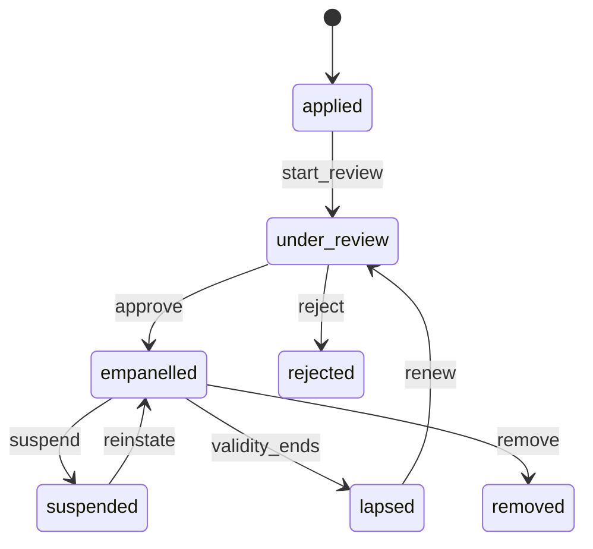
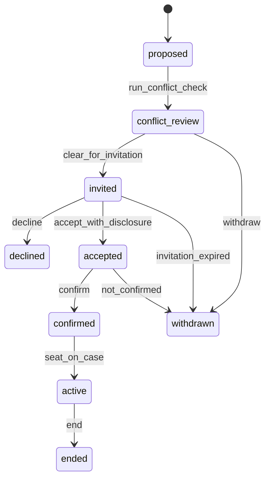

# 6.2 Neutrals

<!-- Generated layout: edit text between the markers; keep the markers and the front matter. -->

> Neutral profiles, empanelment per tenant, conflict checks and disclosures, nomination, appointment and challenge, availability and fee terms

<!-- section:purpose -->
## Purpose and vision

The Neutrals context manages the arbitrators, conciliators and mediators a tenant can appoint: who they are, which panels they are on, what they have disclosed, whether they are free of conflicts for a given case, how they are nominated, appointed, confirmed, challenged and replaced, when they are available, and on what fee terms. It supplies confirmed appointments to [[DOM-cases]], which seats them on the tribunal.

Getting this right protects the award. An appointment made without a proper disclosure, or with an unflagged conflict, is a ground for challenge and can undo months of proceedings. The context must give secretariat staff the evidence that each appointment followed the rules, and give neutrals one place to keep their profile, disclosures and availability current.

<!-- section:classification -->
## Strategic classification

| Aspect | Value |
|---|---|
| Domain type | **Core** for arbitral institutions and ODR institutions (panel management and conflict checks are a key reason to use a platform); supporting for CORD |
| Business role | Compliance (independence and disclosure), engagement (neutral workspace), revenue (neutral fees through [[DOM-invoices-and-vendor-bills]]) |
| Evolution stage | Custom; consolidating TERES and CORD neutral rosters into one model |

<!-- section:language -->
## Ubiquitous language

| Term | Definition | Avoid |
|---|---|---|
| **Neutral** | A person who acts as arbitrator, emergency arbitrator, conciliator or mediator. Profile is per tenant. | judge, adjudicator, panellist |
| **Neutral role** | The capacity on a case: `arbitrator`, `emergency_arbitrator`, `conciliator`, `mediator`. | |
| **Panel** | A named list maintained by a tenant (for example "SEBI ODR conciliators – Maharashtra", "Expedited arbitrators"). | roster, list (UI only) |
| **Empanelment** | A neutral's membership of a panel, with its status and validity period. | registration, onboarding |
| **Nomination** | A party's or co-arbitrators' proposal of a person for a seat. Not binding until appointment. | selection |
| **Appointment** | The decision by the appointing authority (institution, tribunal, parties' agreement or a court) that a person fills a seat. | assignment |
| **Acceptance** | The neutral's agreement to act, with their disclosure statement. | |
| **Confirmation** | The institution's final step making the appointment effective (where the rule set provides for it). | approval |
| **Disclosure** | A written, dated statement by the neutral of circumstances that might give rise to justifiable doubts about independence or impartiality, and of availability. Continues through the case. | declaration (UI only) |
| **Conflict check** | A platform-assisted search of the neutral's declared relationships and appointment history against the case's parties, counsel and related entities. Produces hits for human review; never clears a neutral by itself. | |
| **Challenge** | A party's formal objection to a neutral, decided under the rule set. | objection (UI only) |
| **Availability** | Blocks of time a neutral marks as busy or free, and their stated capacity (for example maximum concurrent cases). | calendar |
| **Fee terms** | How a neutral is paid in a case: scale (ad valorem by claim value), hourly rate with cap, or fixed fee, as set by the rule set or agreed. | rate (UI only) |

<!-- section:entities -->
## Entities and aggregates

| Entity | Aggregate | Key attributes | Ownership |
|---|---|---|---|
| **Neutral profile** | Root | membership (platform identity in this tenant), display name, nationality, languages, qualifications, expertise tags, jurisdictions, CV document, public bio, status | Tenant-owned |
| Declared relationship | Child of profile | related entity (organisation or person name, normalised), kind (employer, client, board seat, family), period | Tenant-owned, sensitive |
| Panel | Root | name, procedure types, region / state, eligibility criteria, renewal period | Tenant-owned |
| Empanelment | Root (links profile and panel) | status, valid from / to, approval record | Tenant-owned |
| Appointment | **Root** | case, seat role, appointing authority, nominated by, status, accepted at, confirmed at, ended at, end reason | Tenant-owned; referenced by `tribunal_seats` in Cases |
| Disclosure | Child of appointment (versioned) | statement document version, answers to rule-set questionnaire, signed at, supersedes | Tenant-owned |
| Conflict check | Child of appointment | run at, inputs snapshot hash, hits, reviewer, outcome | Tenant-owned |
| Challenge | Root | appointment, challenging party, grounds, status, decision document | Tenant-owned |
| Availability block | Child of profile | `tstzrange`, kind (`busy`, `unavailable`, `tentative`), source (manual, calendar sync) | Tenant-owned |
| Fee terms | Child of appointment | basis, rate or scale reference, currency, cap, deposit share | Tenant-owned, confidential |

A person who sits on panels at two tenants has two profiles (one per tenant, possibly in two regions). Conflict checks only use data within the tenant. A platform-level "my profile" convenience that copies non-sensitive profile fields between a person's own profiles is a possible later feature and requires the neutral's explicit action each time.

<!-- section:lifecycle -->
## Lifecycle (state machine)

**Empanelment**



**Appointment**



| Transition | Trigger | Guards |
|---|---|---|
| run_conflict_check | Secretariat or appointment workflow | Case parties and counsel known |
| clear_for_invitation | Secretariat reviews hits | Every hit has a reviewer note (NEU-BR-4) |
| accept_with_disclosure | Neutral in the neutral workspace | Disclosure submitted and signed (NEU-BR-2) |
| confirm | Secretariat / appointing authority | Disclosure circulated to parties and any objection window from the rule set has passed without challenge, or the challenge is dismissed (NEU-BR-6) |
| seat_on_case | Event to Cases (`appointment.confirmed`) | Case in a status that accepts seating |
| end | Resignation, removal, challenge upheld, case closed, replacement | Reason required |

**Challenge**: `filed → awaiting_responses → under_decision → upheld | dismissed | withdrawn`. Upheld ends the appointment with reason `challenge_upheld` and triggers a replacement appointment.

<!-- section:rules -->
## Business rules

| ID | Rule |
|---|---|
| NEU-BR-1 | A neutral can be proposed only from a panel the case's rule set allows for that procedure type, unless the parties jointly nominate a person off-panel and the rule set permits it. |
| NEU-BR-2 | No appointment is accepted without a signed disclosure in the rule set's form. In India-seated cases the disclosure follows the form required under s.12 of the Arbitration and Conciliation Act [R1]; the exact form version is configured per rule set. |
| NEU-BR-3 | A conflict check runs before invitation and again whenever a party, counsel or related entity is added to the case. |
| NEU-BR-4 | A conflict hit can be cleared only by a named secretariat user with a reason; the platform never clears a hit automatically. |
| NEU-BR-5 | Disclosure is continuing: when a neutral updates a disclosure during the case, the new version is circulated to parties and the old one kept. |
| NEU-BR-6 | Confirmation waits for the objection window set by the rule set (decision table `appointment-objection-window`). |
| NEU-BR-7 | A neutral may not be active on more concurrent cases than their declared capacity or the panel's limit, whichever is lower, unless the secretariat overrides with a reason. |
| NEU-BR-8 | A neutral who is suspended or removed from a panel cannot be newly proposed from it; existing appointments continue unless the tenant decides otherwise. |
| NEU-BR-9 | Repeat appointments of the same neutral by the same party or counsel within the tenant are counted and shown at conflict review (window set per tenant, proposed 3 years). |
| NEU-BR-10 | A neutral sees only their own appointments and the cases they are seated on; they never see other neutrals' disclosures except on their own tribunal. |
| NEU-BR-11 | Fee terms are fixed at confirmation; changes need secretariat approval and are versioned. |
| NEU-BR-12 | Availability blocks of a neutral do not overlap within the same kind (database exclusion constraint). |
| NEU-BR-13 | Appointment of a replacement follows the same procedure as the original appointment unless the rule set says otherwise. |

<!-- section:commands -->
## Commands and events

**Commands**: `applyForEmpanelment`, `reviewEmpanelment`, `approveEmpanelment`, `suspendEmpanelment`, `renewEmpanelment`, `updateProfile`, `declareRelationship`, `proposeNeutral`, `nominateNeutral` (party), `runConflictCheck`, `recordConflictReview`, `inviteNeutral`, `acceptAppointment`, `declineAppointment`, `submitDisclosure`, `confirmAppointment`, `fileChallenge`, `decideChallenge`, `endAppointment`, `setAvailability`, `setFeeTerms`.

**Queries**: `searchNeutrals` (by panel, expertise, language, jurisdiction, availability window, capacity), `getNeutralProfile` (role-filtered), `getAppointmentsForCase`, `getMyAppointments`, `getConflictCheck`, `getAvailability`.

**Events**

| Event | Payload summary |
|---|---|
| `empanelment.status_changed` | profileId, panelId, from, to |
| `appointment.proposed` / `appointment.invited` | appointmentId, caseId, seatRole |
| `appointment.accepted` | appointmentId, disclosureVersionId |
| `appointment.confirmed` | appointmentId, caseId, seatRole, neutralProfileId |
| `appointment.ended` | appointmentId, caseId, reason |
| `disclosure.updated` | appointmentId, disclosureVersionId |
| `challenge.filed` / `challenge.decided` | challengeId, appointmentId, outcome |

<!-- section:integrations -->
## Relationships to other contexts

| Context | Pattern |
|---|---|
| [[DOM-cases]] | Supplier: Neutrals publishes confirmed appointments; Cases seats them and sends party / counsel lists for conflict checks |
| [[DOM-hearings]] | Supplier of availability; Hearings reads free / busy for scheduling |
| [[DOM-invoices-and-vendor-bills]] | Supplier of fee terms; neutral bills reference the appointment |
| [[DOM-documents]] | CVs, disclosures and challenge decisions are document versions |
| Calendar integration ([[INT-common-integrations]]) | Anti-corruption layer: busy / free only, no event titles imported |
| [[INT-kyc-and-sanctions-screening]] | Optional screening of neutrals at empanelment |
| [[PKG-ethical-walls-conflict-based]] | Consumer: declared conflicts create walls |

<!-- section:variations -->
## Tenant and jurisdiction variations

| Aspect | Arbitral institution | SEBI ODR institution | CORD tenant |
|---|---|---|---|
| Panels | Several, by expertise and procedure | Conciliators and arbitrators per the ODR institution's empanelment criteria | One or two general panels |
| Appointment | Party nomination plus institution confirmation, or institution appointment | Institution appoints from panel, often by rotation; assumption to be confirmed against SEBI circulars [R2] | Platform appoints from panel |
| Disclosure form | Institution's form; s.12 form for Indian seats | s.12 form | s.12 form for Indian seats |
| Allocation | Manual | Rotation / round-robin with capacity checks (decision table `neutral-allocation`) | Round-robin |
| Fees | Scale or hourly per institution schedule | Fixed fee schedule by claim value (decision table) | Fixed |

<!-- section:retention -->
## Data retention and confidentiality

- Disclosures, conflict-check records and challenge decisions are part of the case record and follow the case's retention.
- Profiles of neutrals no longer empanelled are kept while any case they sat on is retained; personal profile fields not needed for those records (phone, CV, bio) are deleted 1 year after the last empanelment ends (proposed).
- Declared relationships are **sensitive**: visible to the neutral and to secretariat users with the `conflicts.review` permission only.
- Fee terms are confidential to the secretariat and the neutral (and to parties if the rule set publishes fees).

<!-- section:metrics -->
## Verification metrics

- Time from proposal to confirmation; acceptance and decline rates
- Conflict-check hit rate and share of hits leading to non-invitation
- Challenge rate and outcome per tenant
- Utilisation against declared capacity (feeds [[RPT-neutrals]])

<!-- section:questions -->
## Open questions and assumptions

- [ ] Legal to confirm the disclosure form versions per rule set (s.12 forms for Indian seats; institution forms elsewhere) and who signs (e-signature via [[INT-e-signature]] or click-to-sign).
- [ ] SEBI ODR allocation: confirm whether rotation is required and the capacity limits per conciliator / arbitrator (assumption until confirmed).
- [ ] Should repeat-appointment counting (NEU-BR-9) also consider related entities (group companies), and who maintains entity relationships?
- [ ] Do neutrals want one cross-tenant profile they control? If yes, design a consent-driven copy, not a shared row.
- [ ] Is sanctions screening of neutrals required (for example when paying fees across borders)? Finance / legal to confirm.

<!-- checks -->
## Template checks

<!-- check:tenancy -->
### Tenancy and residency

All entities are tenant-owned with forced RLS ([[DOM-neutrals-schema#tenancy]]). A neutral at two institutions has two profiles linked only by the platform identity, which tenants cannot query. Conflict checks run inside one tenant's data only; there is no cross-tenant conflict search, and that limitation is shown to secretariat users. Panels and allocation tables are tenant data. On tenant offboarding, profiles and appointments are exported with the case data and deleted.

<!-- check:security -->
### Access and confidentiality

Field-level rules: declared relationships and conflict hits visible only to the neutral and `conflicts.review` holders; fee terms to secretariat and the neutral; parties see the disclosure statement and public bio, not the relationship list. A neutral whose appointment ends loses access to the case in the same transaction as `appointment.ended` is processed by Cases. A neutral with a declared conflict on a case is walled from it ([[PKG-ethical-walls-conflict-based]]).

<!-- check:audit -->
### Audit and legal record

Audited: every appointment transition, each disclosure version (with document hash and signer), each conflict-check run (inputs snapshot hash, hits) and the reviewer's decision per hit, challenges and decisions, empanelment approvals and suspensions, fee-term changes, and secretariat capacity overrides with reason. These records let an institution show a court that disclosure and conflict review happened before confirmation.

<!-- check:privacy -->
### Personal data

Personal data: neutral identity, contact details, CV, nationality, relationships (sensitive: may reveal family and financial interests). The tenant is fiduciary / controller. Purpose: empanelment and appointment; basis to be confirmed by legal (contract with the neutral for profile data; legal obligation for disclosures where the governing law requires them). Neutrals can correct profile data at any time; disclosures already circulated cannot be erased but can be superseded.

<!-- check:compliance -->
### Retention and regulatory rules

Disclosure before acceptance (NEU-BR-2) is a hard guard on `accept_with_disclosure`; the Indian s.12 requirement [R1] is met by the configured form. Objection windows are decision-table values. Allocation rules for SEBI ODR are decision tables, with values to be confirmed against [R2].

<!-- check:consistency -->
### Invariants and concurrency

Capacity (NEU-BR-7) is checked inside the `confirmAppointment` transaction with a `SELECT ... FOR UPDATE` on the neutral profile row, so two concurrent confirmations cannot both exceed capacity. Availability overlap is a database exclusion constraint. Cases seats a neutral only on `appointment.confirmed` from the outbox; the seat insert uses the appointment ID as idempotency key.

<!-- check:ai -->
### AI assistance

A neutral suggestion feature (ranking panel members for a case by expertise and availability) would influence who decides a dispute. It is out of scope for the first release; if built, it is advisory only, off by default per tenant, must not use protected characteristics, and needs an ISO 42001 impact assessment under [[AI-ai-governance-and-impact]] before release. Conflict checks use deterministic name matching, not AI, so that results are explainable.

<!-- check:testing -->
### Testing

Lifecycle tests generated from both state machines. Rule tests per NEU-BR ID, including concurrent confirmation beyond capacity (two parallel transactions) and overlap rejection. Conflict-check tests with a fixture of near-duplicate names and transliterations (for example Devanagari and Latin forms). Isolation tests on every neutrals table.

<!-- citations -->
## Citations

```json
[
  {
    "clause": "s.12",
    "excerpt": "Section 12 requires a person approached for appointment as arbitrator to disclose in writing circumstances likely to give rise to justifiable doubts as to independence or impartiality, in the form specified in the Act's schedules.",
    "id": "R1",
    "issuer": "Government of India (Ministry of Law and Justice)",
    "jurisdiction": "India",
    "kind": "regulation",
    "ref": "Act No. 26 of 1996",
    "title": "The Arbitration and Conciliation Act, 1996",
    "url": "https://www.indiacode.nic.in/bitstream/123456789/1978/1/A199626.pdf"
  },
  {
    "excerpt": "Sets out the role of ODR institutions empanelled by MIIs, including appointment of conciliators and arbitrators.",
    "id": "R2",
    "issuer": "Securities and Exchange Board of India",
    "jurisdiction": "India",
    "kind": "regulation",
    "ref": "SEBI circular, 31 July 2023",
    "title": "Online Resolution of Disputes in the Indian Securities Market (circular dated 31 July 2023)",
    "url": "https://www.sebi.gov.in/legal/circulars/jul-2023/online-resolution-of-disputes-in-the-indian-securities-market_74794.html"
  }
]
```

<!-- end -->
