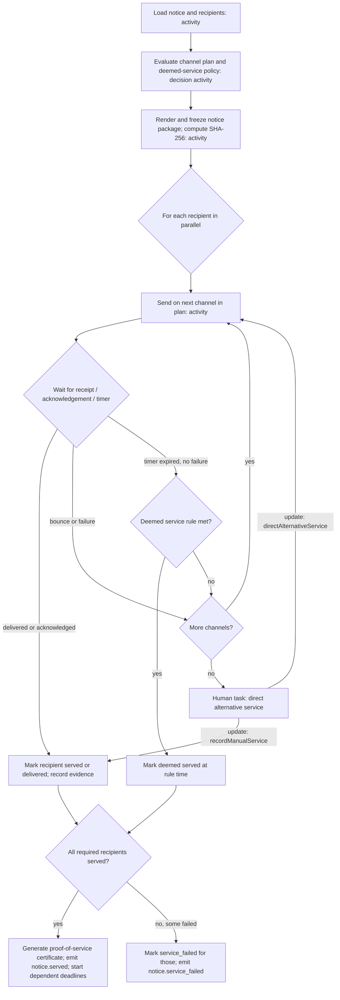

# 6.1.1 Service of notices and proof of delivery

<!-- Generated layout: edit text between the markers; keep the markers and the front matter. -->

> Electronic service of notices and orders with delivery evidence (provider message IDs, receipts, bounces) and fallback channels

<!-- section:purpose -->
## Purpose and outcome

Serve notices, orders and other communications on parties and their representatives electronically, collect delivery evidence from every channel, fall back to other channels when delivery fails, and decide when service is legally effective under the case's rule set. The result is a proof-of-service record and certificate that would stand up if a party later claims they were never notified.

**Done** means one of: every required recipient is `served` (actual or deemed under the rule set), with evidence stored and a `notice.served` event emitted; or the notice is `service_failed` for one or more recipients and a human task asks the secretariat to direct alternative service. Either outcome is recorded on the case timeline.

<!-- section:trigger -->
## Trigger and inputs

**Triggers**

- Domain command `serveNotice` called by a case workflow step (for example notice of arbitration after registration; procedural order filed by the tribunal; award issued) or by the secretariat from the console.
- Each call creates a `notices` row and starts one workflow per notice.

**Inputs** (workflow input; IDs only, content stays in Postgres and object storage)

```ts
type NoticeServiceInput = {
  tenantId: string; caseId: string; noticeId: string;
  noticeType: 'notice_of_arbitration' | 'procedural_order' | 'hearing_notice' | 'award' | 'general';
  recipientIds: string[];            // notice_recipients rows (party or representative)
  documentVersionIds: string[];      // what is being served
  ruleSetKey: string; ruleSetVersion: number;
  deemedServicePolicyVersion: number; // decision table 'notice-deemed-service'
  requestedBy: { kind: 'user' | 'system'; membershipId?: string; workflowId?: string };
};
```

**Workflow ID**: `{tenantId}-notice-service-{noticeId}`, task queue `cases`, ID conflict policy *fail* (a second start for the same notice is a bug), reuse policy *reject duplicate* [R1].

<!-- section:actors -->
## Actors

| Actor | Interaction |
|---|---|
| Case workflow / secretariat | Starts the workflow (via `serveNotice`) |
| Messaging providers (email, SMS, WhatsApp) via [[INT-messaging-providers]] | Activities send through [[PKG-notifications]]; providers call back with delivery receipts, which the webhook handler turns into **signals** `deliveryReceipt` |
| Recipient (party, counsel) | Opens the portal link and acknowledges; the API sends **signal** `recipientAcknowledged` |
| Secretariat / tribunal secretary | Receives a human task when fallback is exhausted; responds by **update** `directAlternativeService` (for example courier, publication, service on another address) or `recordManualService` with evidence |
| Courier / postal operator | Outside the system; tracking number and proof of delivery entered by secretariat |
| Operators | **Query** `serviceStatus` for the console |

<!-- section:steps -->
## Step sequence



| # | Step | Type |
|---|---|---|
| 1 | `loadNotice` | Activity |
| 2 | `evaluateDecision('notice-channel-plan')` and `evaluateDecision('notice-deemed-service')` | Decision activity |
| 3 | `freezeNoticePackage`: render cover letter from template ([[PKG-document-and-notification]]), store as immutable document version, hash every served document | Activity |
| 4 | Per recipient: child workflow `{tenantId}-notice-recipient-{recipientId}` running steps 5 to 8 | Child workflow |
| 5 | `sendOnChannel(channel)` | Activity (enqueues BullMQ `notifications` job with `jobId` = idempotency key) |
| 6 | Wait for `deliveryReceipt` / `recipientAcknowledged` or channel timer | Signal wait with timer |
| 7 | Next channel or deemed-service evaluation | Decision in workflow from plan already loaded |
| 8 | Fallback exhausted: `createHumanTask('direct-alternative-service')` and wait for update | Human task ([[WF-human-tasks]]) |
| 9 | `generateProofOfService`: tagged PDF certificate ([[DOM-accessible-documents-and]]) listing recipients, channels, timestamps, provider message IDs and document hashes | Activity |
| 10 | `completeNotice`: set notice status, emit `notice.served` via outbox; the case workflow starts deadlines that run from service | Activity |

Channel plan example from the decision table: counsel → email (wait 24 h for delivery receipt) → SMS with portal link; unrepresented party → email + SMS together → WhatsApp (if opted in) → secretariat task for courier. Actual plans are tenant data.

<!-- section:timers -->
## Timers and SLAs

| Timer | Source | At breach |
|---|---|---|
| Per-channel delivery wait (e.g. 24 h for email receipt) | Decision table `notice-channel-plan` per tenant | Try next channel |
| Deemed-service time (e.g. delivery to the designated address counts as service at a stated time) | Decision table `notice-deemed-service`, derived from the rule set and, for India-seated cases, Arbitration and Conciliation Act s.3 [R2]; values to be confirmed by legal | Recipient marked `deemed_served` with the rule reference |
| Secretariat task SLA for alternative service (proposed 2 business days) | Tenant SLA setting | Reminder at 75%, escalation to case manager at 100% |
| Overall service window (proposed 14 days) | Tenant setting | Notice marked `service_failed` for outstanding recipients; tribunal informed |

Business days and holidays follow the seat calendar from [[PKG-calendars-and-deadline]]. Assumption: whether an email delivery receipt (as opposed to an acknowledgement) is sufficient evidence of receipt varies by rule set and seat; legal to confirm for each rule set. The Information Technology Act, 2000 provisions on time of receipt of electronic records may also be relevant for Indian seats (legal to confirm).

<!-- section:signals -->
## Signals, updates and queries

| Message | Kind | Payload | Validation |
|---|---|---|---|
| `deliveryReceipt` | Signal (from provider webhook handler) | `{ recipientId, channel, providerMessageId, event: 'delivered'|'bounced'|'failed'|'read', occurredAt, rawEvidenceRef }` | Webhook signature verified before signalling; `providerMessageId` must match an attempt for this recipient; unknown IDs are dropped and logged |
| `recipientAcknowledged` | Signal (from portal) | `{ recipientId, membershipId, acknowledgedAt, ip, userAgentHash }` | Membership must be the recipient or their active representative |
| `directAlternativeService` | Update | `{ recipientId, channel: 'courier'|'email_alt'|'sms_alt'|'publication', address?, reason, membershipId }` | Validator: caller is secretariat for the case; recipient not already served; reason non-empty |
| `recordManualService` | Update | `{ recipientId, method, servedAt, evidenceDocumentVersionId, membershipId }` | Validator: evidence document exists in the case; `servedAt` not in the future |
| `cancelService` | Update | `{ reason, membershipId }` | Secretariat only; not after certificate is generated |
| `serviceStatus` | Query | returns per-recipient state, channels tried, next timer | |

<!-- section:activities -->
## Activities

| Activity | Side effect | Idempotency key | Timeout / retry |
|---|---|---|---|
| `loadNotice` | Read | n/a | 10 s, 5 attempts |
| `evaluateDecision` | Read | n/a | 10 s, 5 attempts |
| `freezeNoticePackage` | Writes cover document version, hashes | `{noticeId}:freeze` (unique on `notices.package_frozen_at`) | 2 min, 5 attempts, heartbeat for large packages |
| `sendOnChannel` | Enqueues provider send; inserts `notice_delivery_attempts` row | `{noticeId}:{recipientId}:{channel}:{attemptNo}` used as BullMQ `jobId` and provider idempotency key where supported | 30 s, 10 attempts, backoff 2x from 5 s |
| `recordEvidence` | Inserts `notice_evidence` (provider event, raw payload stored in object storage) | `{providerMessageId}:{event}` unique | 10 s, 10 attempts |
| `createHumanTask` | Inserts `human_tasks` row | `{workflowId}:alt-service:{n}` | 10 s |
| `generateProofOfService` | Renders PDF, stores document version, links to notice | `{noticeId}:certificate` | 5 min, 5 attempts |
| `completeNotice` | Updates status, audit event, outbox `notice.served` | `{noticeId}:complete` | 10 s, 10 attempts |

Non-retryable errors: `RecipientHasNoContactPoint`, `TemplateMissing`, `PermissionDenied`, `NoticeCancelled`.

Tables (in [[DOM-cases-schema]]): `notices` (id, case_id, notice_type, status `pending|in_service|served|partially_served|service_failed|cancelled`, package document version, package_sha256, workflow_id), `notice_recipients` (notice_id, case_party_id or representation_id, required boolean, status, served_at, service_basis `delivered|acknowledged|deemed|manual`, rule_reference), `notice_delivery_attempts` (recipient_id, channel, destination_masked, provider, provider_message_id, sent_at, outcome), `notice_evidence` (attempt_id, event, occurred_at, raw_object_key, sha256).

<!-- section:failure -->
## Failure, cancellation and compensation

- **Provider outage**: `sendOnChannel` retries for up to about 10 minutes; then the attempt is recorded as `failed` and the next channel in the plan is used. Provider outages raise an alert through [[OBS-alerting]].
- **All channels fail**: human task for alternative service; nothing is deemed served without a rule or a person's record.
- **Cancellation** (secretariat cancels, or case withdrawn): outstanding child workflows are cancelled; already-sent messages cannot be recalled, so the notice is marked `cancelled` with the attempts kept as evidence; a cancellation message may be sent if the rule set requires.
- **Compensation**: none of the steps are undone; evidence is never deleted. If the wrong documents were served, the secretariat serves a corrected notice that references the first.
- **Late receipt after deemed service**: receipt is recorded as additional evidence; `served_at` is not changed.

<!-- section:versioning -->
## Versioning

Channel plans and deemed-service policies are pinned at start (input versions). Workflow code changes use `patched()` markers; notices complete within days, so old patches can be removed two weeks after the last old-version run closes. A change of the evidence model (new provider event types) is additive.

<!-- section:observability -->
## Visibility and monitoring

- Search attributes: `tenantId`, `caseId`, `noticeType`, `serviceState`, `nextDeadline`.
- Metrics: notices started / served / failed per tenant and type; time to service p50 / p95; share served by deemed rule vs actual delivery; channel failure rate per provider and region.
- Alerts: notice `in_service` longer than its overall window without a human task open; bounce rate for a provider above 5% in an hour; signal from a webhook for an unknown message ID above baseline.
- Secretariat view: case timeline shows each notice with per-recipient status and evidence links.

<!-- section:questions -->
## Open questions

- [ ] For each rule set, which events count as service: provider delivery receipt, portal acknowledgement, or a deemed time after dispatch? Legal to confirm (assumption: configurable per rule set; default requires delivery receipt or acknowledgement).
- [ ] Is WhatsApp acceptable as a service channel for SEBI ODR and CORD tenants, or only as a reminder channel? Legal to confirm.
- [ ] Do we need a qualified timestamp (for example a trusted timestamping authority) on proof-of-service certificates, or is the database clock with hash chaining in the audit log sufficient?
- [ ] Postal / courier integration: manual entry only, or integrate with a courier API in India first?

<!-- checks -->
## Template checks

<!-- check:tenancy -->
### Tenancy and residency

Workflow IDs are `{tenantId}-notice-service-{noticeId}` and `{tenantId}-notice-recipient-{recipientId}`, with `tenantId` as a search attribute; they run on the `cases` task queue in the tenant's home-region namespace. Every activity receives `tenantId` and opens its transaction with the tenant set. Provider webhooks are resolved to the tenant by looking up `provider_message_id` inside the region (the webhook endpoint is regional), never by trusting a tenant field from the provider. Workflow payloads carry IDs and masked destinations only, encrypted by the regional payload codec.

<!-- check:security -->
### Access to workflow controls

Only secretariat members of the case may start, cancel or direct alternative service; the API checks the permission matrix before calling Temporal, and update validators re-check that the recipient is not already served. Provider webhooks are verified by signature before any signal. Recipients' acknowledgements must come from the recipient's or their representative's session. Resending is rate-limited to 3 sends per recipient per channel per day to prevent spam.

<!-- check:idempotency -->
### Side effects and idempotency

Every send uses `{noticeId}:{recipientId}:{channel}:{attemptNo}` as the BullMQ `jobId` and, where the provider supports it, as the provider idempotency key; a retried activity therefore never sends twice. Evidence is keyed by `{providerMessageId}:{event}` with a unique constraint. Certificate and completion steps use unique keys per notice. Non-retryable errors are listed in Activities.

<!-- check:audit -->
### Audit and legal record

Legally significant steps: package frozen (hashes), each send attempt (channel, masked destination, provider message ID), each provider event, acknowledgement, deemed service (with rule reference and policy version), manual service (with evidence and actor), certificate generated, service failed. Each writes an audit event inside the activity transaction; raw provider payloads are kept in object storage with SHA-256. Evidence lives in Postgres and storage, not in Temporal history.

<!-- check:compliance -->
### Regulatory timelines

Deemed-service timing comes from the `notice-deemed-service` decision table, derived from each rule set and, for Indian seats, s.3 of the Arbitration and Conciliation Act [R2]. Values are pinned at start, so a later rule change does not alter service already in progress. Deadlines that run from service start only after `notice.served`, from the recorded `served_at`.

<!-- check:humantasks -->
### Human tasks

One human task type, `direct-alternative-service`, assigned to the case's tribunal secretary (fallback: tenant secretariat pool). It shows the channels tried, failure reasons and options. SLA 2 business days (proposed), reminder at 75%, escalation to the case manager role at 100%. If the assigned secretary leaves the tenant, [[WF-human-tasks]] reassigns to the pool and audits the change.

<!-- check:testing -->
### Testing

Time-skipping tests cover each channel timer, deemed-service path and overall window [R3]. Failure injection: provider 5xx for an hour, bounce on first channel, webhook for unknown message ID, duplicate receipt. Activities are tested against provider sandboxes and real Postgres with RLS, including repeat calls with the same key. Replay tests run on recorded histories before merge. Isolation test: an acknowledgement signal from a tenant B session for tenant A's notice is rejected.

<!-- citations -->
## Citations

```json
[
  {
    "excerpt": "Workflow ID reuse and conflict policies control what happens when a workflow with the same ID is started again.",
    "id": "R1",
    "kind": "vendor",
    "title": "Temporal docs: Workflow Id and Run Id",
    "url": "https://docs.temporal.io/workflow-execution/workflowid-runid",
    "vendor": "Temporal Technologies"
  },
  {
    "clause": "s.3",
    "excerpt": "Section 3 deems a written communication received if delivered to the addressee personally or at their place of business, habitual residence or mailing address, or, after reasonable inquiry, at the last known address by a means that records the attempt.",
    "id": "R2",
    "issuer": "Government of India (Ministry of Law and Justice)",
    "jurisdiction": "India",
    "kind": "regulation",
    "ref": "Act No. 26 of 1996",
    "title": "The Arbitration and Conciliation Act, 1996",
    "url": "https://www.indiacode.nic.in/bitstream/123456789/1978/1/A199626.pdf"
  },
  {
    "excerpt": "The TypeScript testing suite provides a time-skipping test environment for workflows with timers.",
    "id": "R3",
    "kind": "vendor",
    "title": "Temporal docs: Testing suite (TypeScript)",
    "url": "https://docs.temporal.io/develop/typescript/testing-suite",
    "vendor": "Temporal Technologies"
  }
]
```

<!-- end -->
