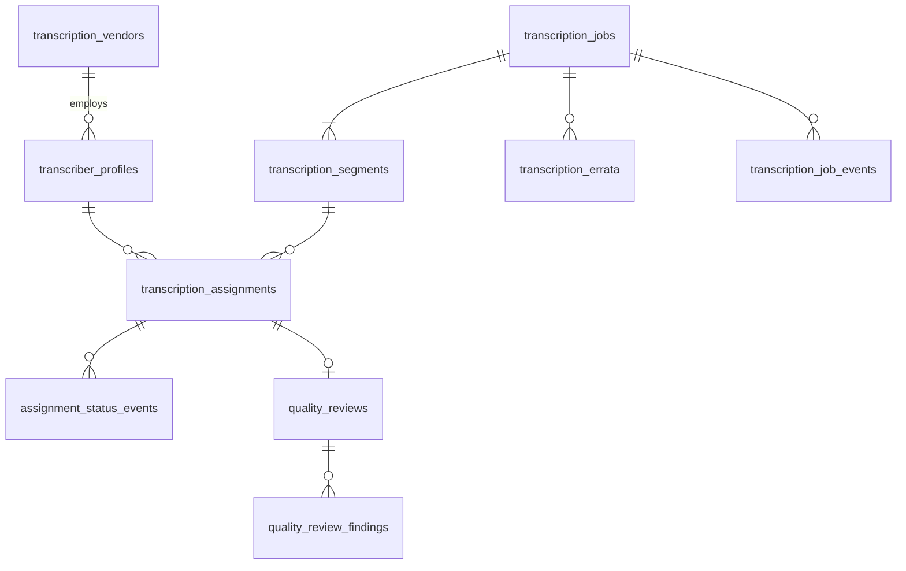

# 6.3.1 Transcribers schema

<!-- Generated layout: edit text between the markers; keep the markers and the front matter. -->

> Transcriber profiles, assignments, turnaround tracking and quality reviews

<!-- section:purpose -->
## Scope and ownership

Physical schema for [[DOM-transcribers]]. Owned by the transcription team. Prisma file `packages/domain-transcribers/prisma/transcribers.prisma`. Conventions as in [[DOM-cases-schema#purpose]].

References: `hearing_sessions`, `hearing_recordings` and `transcript_versions` in [[DOM-hearings-schema]] (composite FKs). Referenced by vendor bill lines in [[DOM-invoices-and-vendor-bills-schema]].

<!-- section:entities -->
## Entities and relationships



All tables tenant-owned. Aggregate roots: `transcription_vendors`, `transcriber_profiles`, `transcription_jobs`, `transcription_assignments`, `quality_reviews`.

<!-- section:tables -->
## Tables and columns

**transcription_vendors**: `id`, `tenant_id`, `legal_name text` (I), `contract_ref text`, `rate_card jsonb` (C; validated), `status text`, `version`.

**transcriber_profiles**: `id`, `membership_id uuid NOT NULL`, `vendor_id uuid NULL`, `languages text[]`, `specialisms text[]`, `roles text[]` (subset of `editor`, `reviewer`, `certifier`), `capacity_minutes_per_day integer`, `undertaking_document_version_id uuid NULL`, `undertaking_valid_to date NULL`, `probation_jobs_remaining smallint NOT NULL DEFAULT 10`, `declared_conflicts jsonb NOT NULL DEFAULT '[]'` (SPD; normalised names), `status text` (`active`, `suspended`, `inactive`), `version`.

**transcription_jobs**: `id`, `case_id`, `hearing_session_id`, `recording_id`, `tier text`, `style text`, `languages text[]`, `ordered_by_membership_id`, `ordered_at`, `due_at timestamptz`, `status text` (per lifecycle), `asr_model_version text NULL`, `certified_transcript_version_id uuid NULL`, `delivered_at timestamptz NULL`, `on_time boolean NULL`, `workflow_id text`, `idempotency_key text NOT NULL`, `version`.

**transcription_segments**: `id`, `job_id`, `seq smallint`, `start_ms integer`, `end_ms integer`, `asr_draft_object_key text NULL`, `asr_confidence numeric(4,3) NULL`, `working_text_object_key text NULL`, `status text` (`pending`, `offered`, `in_progress`, `submitted`, `approved`, `returned`), `version`.

**transcription_assignments**: `id`, `job_id`, `segment_id uuid NULL` (null for job-level review / certify), `transcriber_profile_id`, `task_kind text` (`edit`, `review`, `certify`), `offer_round smallint`, `offered_at`, `offer_expires_at`, `accepted_at`, `due_at`, `submitted_at`, `status text`, `idempotency_key text NOT NULL`, `version`.

**assignment_status_events** and **transcription_job_events** (append-only): `id`, parent ID, `from_status`, `to_status`, `actor_kind`, `actor_membership_id`, `reason`, `occurred_at`.

**quality_reviews**: `id`, `assignment_id` (the work reviewed), `reviewer_profile_id`, `sampled_ms integer`, `accuracy_score numeric(5,2)`, `weighted_error_score numeric(6,2)`, `outcome text` (`pass`, `fail`), `reviewed_at`.

**quality_review_findings**: `id`, `quality_review_id`, `category text` (`mishearing`, `omission`, `speaker`, `formatting`, `terminology`, `timestamp`), `severity smallint`, `offset_ms integer`, `note text`.

**transcription_errata**: `id`, `job_id`, `requested_by_membership_id`, `requested_at`, `items jsonb` (list of offset, current text, proposed text), `decision text NULL` (`accepted`, `partially_accepted`, `rejected`), `decided_by_membership_id`, `new_transcript_version_id uuid NULL`.

<!-- section:keys -->
## Keys and constraints

```sql
ALTER TABLE transcription_segments ADD CONSTRAINT seg_job_fk
  FOREIGN KEY (tenant_id, job_id) REFERENCES transcription_jobs (tenant_id, id) ON DELETE CASCADE;
ALTER TABLE transcription_segments ADD CONSTRAINT seg_seq_unique UNIQUE (tenant_id, job_id, seq);
ALTER TABLE transcription_segments ADD CONSTRAINT seg_range_check CHECK (start_ms >= 0 AND end_ms > start_ms);
ALTER TABLE transcription_jobs ADD CONSTRAINT job_session_fk
  FOREIGN KEY (tenant_id, hearing_session_id) REFERENCES hearing_sessions (tenant_id, id) ON DELETE RESTRICT;
CREATE UNIQUE INDEX job_idem ON transcription_jobs (tenant_id, idempotency_key);
-- one live job per session and style
CREATE UNIQUE INDEX job_one_live ON transcription_jobs (tenant_id, hearing_session_id, style)
  WHERE status <> 'cancelled';
-- at most one live assignment per segment and task kind
CREATE UNIQUE INDEX asg_one_live ON transcription_assignments (tenant_id, segment_id, task_kind)
  WHERE status IN ('offered','accepted','in_progress','submitted') AND segment_id IS NOT NULL;
ALTER TABLE quality_reviews ADD CONSTRAINT qr_score_check CHECK (accuracy_score BETWEEN 0 AND 100);
```

TRN-BR-4 (no self-review) is enforced by a trigger `trg_no_self_review` on `transcription_assignments` insert for `task_kind IN ('review','certify')`, which rejects the row if the same transcriber has an `edit` assignment for the same segment or job; a trigger is used because the check spans rows and a race would otherwise allow it.

<!-- section:tenancy -->
## Tenancy and RLS policies

All tables tenant-owned, ENABLE + FORCE RLS, standard policy as in [[DOM-cases-schema#tenancy]]. The trigger function is `SECURITY INVOKER` and reads only through RLS. Append-only event tables have INSERT / SELECT policies only. Transcriber-facing queries add an assignment filter in the repository (TRN-BR-12) on top of RLS.

<!-- section:indexes -->
## Indexes and access patterns

| Query | Index |
|---|---|
| Job board by due time and status | `transcription_jobs (tenant_id, status, due_at)` |
| My queue | `transcription_assignments (tenant_id, transcriber_profile_id, status, due_at)` |
| Offer engine: eligible transcribers by language | GIN on `transcriber_profiles.languages` with `status = 'active'` partial |
| Segments of a job | unique `(tenant_id, job_id, seq)` |
| Scorecard | `quality_reviews (tenant_id, reviewer_profile_id, reviewed_at)`, plus join through assignments |

<!-- section:history -->
## Status, history and concurrency

Job and assignment status follow the state machines in [[DOM-transcribers#lifecycle]] with event rows in the same transaction. Working text is stored in object storage as versioned objects per save (keys in the segment row), not in Postgres. Optimistic lock on `version` for jobs, segments and assignments.

<!-- section:protection -->
## Data classification and protection

`declared_conflicts` is sensitive personal data, visible to the transcription manager only. Segment text and drafts live in object storage under the tenant's prefix with regional encryption; never copied to search indexes until certified (then indexed by the Documents search pipeline under case permissions).

<!-- section:retention -->
## Retention, archival and deletion

| Data | Clock | End |
|---|---|---|
| jobs, assignments, events | case closure | With case |
| drafts and working text objects | certification | Delete after 90 days (proposed) |
| quality reviews and findings | review date | 3 years (proposed), pseudonymise transcriber after exit |
| profiles | transcriber exit | Delete personal fields after 1 year unless referenced by retained reviews (then pseudonymise) |

<!-- section:migrations -->
## Migrations and rollout

1. `0301_transcribers_core`: vendors, profiles (RLS, grants).
2. `0302_transcription_jobs`: jobs, segments, assignments, event tables, reviews, findings, errata; trigger `trg_no_self_review` (requires `hearing_sessions` from `0201_hearings_core`).
3. `0303_transcribers_indexes`: concurrent indexes.

Standard timeouts and expand / contract rules per [[DOM-cases-schema#migrations]].

<!-- section:prisma -->
## Prisma schema mapping

Models `TranscriptionVendor`, `TranscriberProfile`, `TranscriptionJob`, `TranscriptionSegment`, `TranscriptionAssignment`, `QualityReview`, `QualityReviewFinding`, `TranscriptionErrata` and event models. Raw-SQL-only: the self-review trigger, partial unique indexes, CHECK constraints, RLS.

<!-- section:volume -->
## Volume, growth and performance

Proposed: 1,000 to 3,000 hearing hours a year per large institution tenant; 4 segments per hour, so about 12k segments and 30k assignments per year per large tenant. Small tables; no partitioning foreseen.

<!-- section:questions -->
## Open questions

- [ ] Store working text in Postgres (simpler search and diffing) or object storage (current proposal, keeps large text out of the database)?
- [ ] Is a trigger acceptable under our migration standards, or should TRN-BR-4 be an application check with an advisory lock?

<!-- checks -->
## Template checks

<!-- check:tenancy -->
### Tenant isolation in the schema

Every table carries `tenant_id` under forced RLS with composite foreign keys to Hearings tables; the only trigger is security invoker. Partial unique indexes are per tenant.

<!-- check:integrity -->
### Invariants enforced by the database

Database: segment ranges and order, one live job per session and style, one live assignment per segment and task kind (prevents double offers under concurrency), score range, and no self-review by trigger. Application: capacity and conflict checks under a row lock on the transcriber profile.

<!-- check:migration-safety -->
### Zero-downtime and reversible migrations

Tables are small; the trigger is created in the same migration as its table. Standard `lock_timeout` / `statement_timeout`, concurrent index builds, and expand / contract for any change to populated tables, as in [[DOM-cases-schema#migrations]].

<!-- check:residency -->
### Region placement and cross-region references

All tables live in the tenant's regional database; working text and audio objects in the tenant's regional bucket. Transcribers working from outside the region access data remotely through the workspace; whether that is a cross-border transfer is an open question in [[DOM-transcribers#questions]]. No global table is needed.

<!-- check:audit -->
### History, immutability and evidence

Event tables are append-only by grants. Certified transcript versions (in [[DOM-hearings-schema]]) are immutable with a SHA-256; errata produce new versions linked to the old.

<!-- end -->
