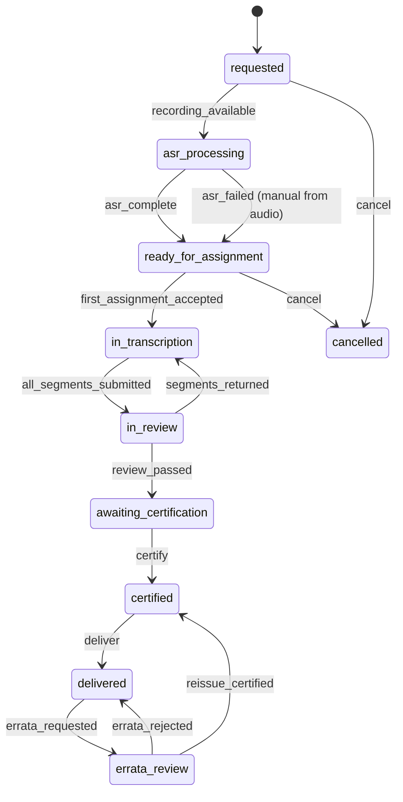

# 6.3 Transcribers

<!-- Generated layout: edit text between the markers; keep the markers and the front matter. -->

> Transcriber and vendor pool, transcription jobs and segment assignment, turnaround SLAs, quality review and certification of transcripts

<!-- section:purpose -->
## Purpose and vision

The Transcribers context turns hearing recordings into certified transcripts on time. It manages the pool of transcribers (in-house staff and contracted vendors), breaks each recording into work, assigns it, tracks turnaround against the tier the tenant or parties ordered, runs quality review, and certifies the final transcript. The automatic speech recognition (ASR) draft is produced by the pipeline in [[WF-long-running-pipelines]]; people correct, review and certify it here.

Transcripts are relied on by tribunals when writing awards and by parties in post-hearing submissions, often within a day of the hearing. Late or inaccurate transcripts delay proceedings and damage the institution's standing, so turnaround and quality are the two measures this context exists to control.

<!-- section:classification -->
## Strategic classification

| Aspect | Value |
|---|---|
| Domain type | **Core** for TERES (transcription is a primary product line); supporting for CORD |
| Business role | Revenue (transcription is billed per hour of audio and tier), engagement (transcriber workspace), cost (vendor bills) |
| Evolution stage | Custom; existing TERES transcription operations to be moved onto the shared model |

<!-- section:language -->
## Ubiquitous language

| Term | Definition | Avoid |
|---|---|---|
| **Transcription job** | The work to produce one transcript for one hearing session recording, at one turnaround tier and style. | order, request (UI only) |
| **Turnaround tier** | The ordered delivery speed: `realtime` (live feed with later certified copy), `same_day`, `next_day`, `two_day`, `five_day`. Values per tenant price list. | TAT (internal shorthand only) |
| **Style** | `verbatim` (every utterance, false starts) or `clean_verbatim`. Set per job. | |
| **Segment** | A slice of the recording (default 15 minutes of audio, cut at silence) assigned as one unit. | chunk |
| **ASR draft** | Machine-generated text with speaker diarisation and timestamps, the starting point for human work. | auto-transcript |
| **Assignment** | Offer of a segment or review task to a transcriber, with due time. | allocation |
| **Transcriber** | A person who edits segments (`editor`) or reviews and certifies (`reviewer`, `certifier`), employed or contracted. | typist |
| **Vendor** | An organisation supplying transcribers under contract; bills through [[DOM-invoices-and-vendor-bills]]. | agency |
| **Quality review** | Scoring of a sample of a transcriber's output against the audio, with findings by category. | QA |
| **Certification** | A named certifier's statement that the transcript is a true record, producing the certified version. | sign-off |
| **Errata** | A correction request after delivery, by a party or the tribunal, leading to a re-issued version. | |

<!-- section:entities -->
## Entities and aggregates

| Entity | Aggregate | Key attributes | Ownership |
|---|---|---|---|
| **Transcriber profile** | Root | membership, vendor (optional), languages, specialisms (construction, finance), roles (editor, reviewer, certifier), status, capacity hours per day, confidentiality undertaking on file | Tenant-owned |
| Vendor | Root | legal name, contract reference, rate card, billing entity | Tenant-owned |
| **Transcription job** | Root | hearing session, recording, tier, style, languages, ordered by, due at, status, certified transcript version | Tenant-owned |
| Segment | Child of job | start / end offset, ASR draft ref, status | Tenant-owned |
| Assignment | Own aggregate | segment or job, transcriber, task kind (`edit`, `review`, `certify`), offered at, due at, status | Tenant-owned |
| Quality review | Own aggregate | assignment reviewed, reviewer, accuracy score, findings | Tenant-owned |
| Errata request | Child of job | requested by, items, decision | Tenant-owned |

The transcript text and its versions belong to [[DOM-hearings]] (`transcripts`, `transcript_versions`); this context references them. The recording file belongs to Hearings and is stored through [[PKG-storage]].

<!-- section:lifecycle -->
## Lifecycle (state machine)

**Transcription job**

**Assignment**: `offered → accepted | declined | expired`; `accepted → in_progress → submitted → approved | returned`; `returned → in_progress`. An expired or declined offer returns the segment to the pool.

| Transition | Trigger | Guard |
|---|---|---|
| recording_available | `recording.available` event from Hearings | Recording passed malware scan and is in the tenant's region |
| first_assignment_accepted | Transcriber accepts in workspace | TRN-BR-2, TRN-BR-3 |
| all_segments_submitted | Last segment submitted | All segments `submitted` |
| review_passed | Reviewer | Accuracy at or above tenant threshold (TRN-BR-7) |
| certify | Certifier | TRN-BR-8 |
| deliver | Workflow | Certified version exists; access granted to case participants |

<!-- section:rules -->
## Business rules

| ID | Rule |
|---|---|
| TRN-BR-1 | Due time = end of the hearing session + tier duration, computed in the tenant's operating time zone by [[PKG-calendars-and-deadline]]; `five_day` and `two_day` tiers count business days, `same_day` and `next_day` count clock hours (values per tenant price list). |
| TRN-BR-2 | Only transcribers with an active confidentiality undertaking and the job's language may be offered work. |
| TRN-BR-3 | A transcriber who has a declared conflict with a party or counsel in the case, or who is connected to the tribunal, may not be assigned (conflict data from their profile; checked at offer). |
| TRN-BR-4 | A transcriber cannot review or certify a segment they edited. |
| TRN-BR-5 | Assignment offers expire after the tenant-set window (proposed 30 minutes for `same_day`, 4 hours for `five_day`). |
| TRN-BR-6 | A transcriber's accepted work in a day may not exceed their declared capacity; the offer engine skips them otherwise. |
| TRN-BR-7 | A job passes review only when the sampled accuracy score meets the tenant threshold (proposed 98% word accuracy for certified transcripts). |
| TRN-BR-8 | Certification is by a named certifier role and produces an immutable certified transcript version with a content hash. |
| TRN-BR-9 | At 75% of turnaround elapsed with segments not submitted, unassigned segments are escalated to the transcription manager and may be re-offered to more transcribers in parallel. |
| TRN-BR-10 | A missed turnaround is recorded against the job and, where the price list says so, reduces the client invoice tier (for example billed at the slower tier). |
| TRN-BR-11 | Errata are accepted only within the tenant-set window after delivery (proposed 7 days); accepted errata produce a new certified version linked to the old. |
| TRN-BR-12 | Transcribers see only the segments assigned to them and the case title and glossary needed to work; never the case file. |
| TRN-BR-13 | New transcribers are on probation: 100% of their first 10 jobs are reviewed; afterwards a tenant-set sample (proposed 10% of segments). |

<!-- section:commands -->
## Commands and events

**Commands**: `orderTranscription`, `cancelTranscription`, `splitIntoSegments` (system), `offerAssignment` (system), `acceptAssignment`, `declineAssignment`, `submitSegment`, `returnSegment`, `approveSegment`, `recordQualityReview`, `certifyTranscript`, `deliverTranscript`, `requestErrata`, `decideErrata`, `registerTranscriber`, `updateCapacity`, `suspendTranscriber`.

**Queries**: `getMyQueue` (transcriber workspace, [[APP-transcriber-workspace]]), `getJobBoard` (manager: jobs by due time and risk), `getTurnaroundRisk`, `getTranscriberScorecard`.

**Events**

| Event | Payload summary |
|---|---|
| `transcription.ordered` | jobId, hearingSessionId, tier, style |
| `transcription.assignment_offered` / `_accepted` / `_expired` | assignmentId, jobId, transcriberProfileId |
| `transcription.turnaround_at_risk` | jobId, dueAt, percentElapsed |
| `transcription.certified` | jobId, transcriptVersionId, sha256 |
| `transcription.delivered` | jobId, deliveredAt, onTime |
| `transcription.errata_resolved` | jobId, newVersionId |

<!-- section:integrations -->
## Relationships to other contexts

| Context | Pattern |
|---|---|
| [[DOM-hearings]] | Upstream: recording available, session times; downstream: certified transcript versions stored there |
| [[WF-long-running-pipelines]] | ASR and diarisation pipeline produces drafts per segment |
| [[AI-ai-gateway]] | ASR models routed in-region |
| [[DOM-invoices-and-vendor-bills]] | Client invoice lines per job (audio hours, tier) and vendor bills per transcriber or vendor |
| [[WF-human-tasks]] | Assignments surface as tasks in the transcriber workspace |
| [[RPT-transcribers]] | Downstream: turnaround and quality metrics |

<!-- section:variations -->
## Tenant and jurisdiction variations

- Arbitral institution and TERES clients: realtime and same-day tiers common; verbatim style; multi-language hearings with interpreters (transcript records both languages, configurable).
- SEBI ODR and CORD tenants: hearings are short; transcription is often not ordered, or an ASR-only "hearing notes" product is used with no certification (configured as a separate tier `asr_only` that never produces a certified version).
- Price lists, tiers, thresholds and offer windows are tenant configuration (decision tables `transcription-tiers`, `transcription-quality-threshold`).

<!-- section:retention -->
## Data retention and confidentiality

- Transcripts and certified versions follow case retention (they are part of the record) and are stored in [[DOM-hearings-schema]].
- Segment drafts and intermediate edits are deleted 90 days after certification (proposed), keeping only certified versions.
- Quality reviews are kept for 3 years for vendor performance management (proposed), with transcriber names pseudonymised after the transcriber leaves.
- Audio segments copied to the transcriber workspace are streamed by signed URL, never downloadable unless the tenant allows it.

<!-- section:metrics -->
## Verification metrics

- On-time delivery rate by tier and tenant (target proposed: 98% for `next_day`)
- Average accuracy score by transcriber and vendor
- Offer acceptance rate and average time to accept
- Errata rate per 100 transcript pages

<!-- section:questions -->
## Open questions and assumptions

- [ ] Can transcribers located outside the tenant's region work on that tenant's recordings (remote access from another country)? This is a cross-border access question under DPDP / PDPA; legal to confirm per region.
- [ ] Is certification a legal statement in any jurisdiction we serve (for example a certified transcript for court use), and does it need e-signature?
- [ ] Should turnaround penalties reduce vendor bills as well as client invoices? Commercial decision.
- [ ] Accuracy measurement: word accuracy on a sampled minute, or a weighted error score by category? Proposed: weighted score; confirm with the transcription manager.

<!-- checks -->
## Template checks

<!-- check:tenancy -->
### Tenancy and residency

All entities are tenant-owned with forced RLS ([[DOM-transcribers-schema]]). A vendor working for two tenants has a vendor row in each; transcribers have one profile per tenant. The offer engine runs per tenant inside its region; it never pools transcribers across tenants. If a vendor's transcriber is shared across tenants, each tenant's capacity view only shows work for that tenant (a known limitation: capacity across tenants is not coordinated; open question).

<!-- check:security -->
### Access and confidentiality

Transcribers get the narrowest access on the platform: assigned segments only, streamed audio through short-lived signed URLs ([[PKG-encryption-at-rest-signed-urls]]), no download by default, watermarked text exports, session timeout of 30 minutes idle (proposed). Access is revoked when an assignment is returned, expires or the job is cancelled. The confidentiality undertaking is a guard on every offer.

<!-- check:audit -->
### Audit and legal record

Audited: every offer, acceptance, submission, return, approval, quality review, certification (certifier, version hash), delivery (to whom), errata decisions, and every audio stream session start (who, segment, duration). The certified version hash appears on the transcript cover page.

<!-- check:privacy -->
### Personal data

Recordings contain voices and possibly sensitive personal data spoken in hearings. Transcriber profile data is employee or contractor data of the tenant. Processing is in-region; ASR runs on in-region models only ([[AI-ai-gateway]]). Vendors are sub-processors of the tenant and must be listed in its records; the platform shows the list per tenant.

<!-- check:consistency -->
### Invariants and concurrency

Capacity and conflict checks run in the `acceptAssignment` transaction with a lock on the transcriber row. Segment state and job state are separate aggregates; the job moves to `in_review` through an event when the last segment is submitted, so concurrent submissions never conflict on the job row. All commands carry idempotency keys; the offer engine uses `{segmentId}:{offerRound}`.

<!-- check:ai -->
### AI assistance

ASR drafts and speaker labels are AI output. They are never delivered as a certified transcript without human edit, review and certification (TRN-BR-8); the `asr_only` tier is labelled "machine-generated, not certified" on every page. Model version and confidence are stored per segment. Quality of ASR is tracked against human-corrected output (word error rate per language) and reported in [[OBS-ai-usage]].

<!-- check:testing -->
### Testing

Turnaround tests with time-skipping cover each tier, business-day boundaries and the 75% escalation. Offer-engine tests cover capacity, language, conflict and expiry. TRN-BR-4 (no self-review) has a dedicated test. Isolation tests on every table.

<!-- end -->
