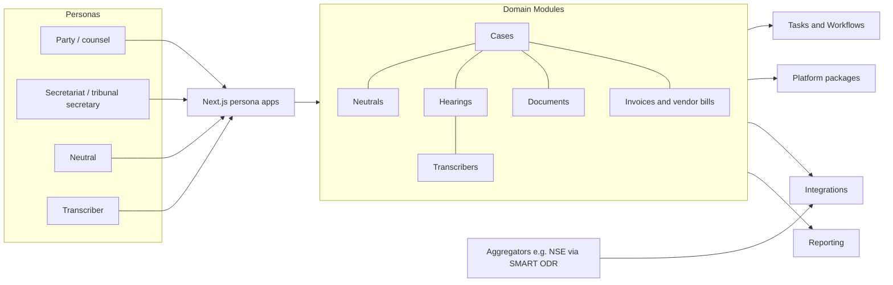

# 6 Domain Modules

<!-- Generated layout: edit text between the markers; keep the markers and the front matter. -->

> Business domains of dispute resolution: cases, neutrals, transcribers, hearings, documents, and case fees and vendor bills, each a bounded context on the shared multi-tenant platform

<!-- section:purpose -->
## Purpose and scope

The Domain Modules area holds the bounded contexts that model the work of dispute resolution itself: a case from filing to closure, the neutrals who decide or facilitate it, the hearings where it is heard, the documents and bundles that make up the record, the transcripts of what was said, and the fees charged to parties and paid to neutrals and transcribers. Each module speaks the language of secretariat staff, tribunals, counsel and parties, and turns that language into one model shared by CORD, TERES and bespoke builds such as the HKIAC Case Management Platform.

**In scope**

- Domain models, lifecycles and business rules for Cases ([[DOM-cases]]), Neutrals ([[DOM-neutrals]]), Transcribers ([[DOM-transcribers]]), Hearings ([[DOM-hearings]]), Documents ([[DOM-documents]]) and Invoices and vendor bills ([[DOM-invoices-and-vendor-bills]])
- The physical schema for each context (the `*-schema` children), owned by the context
- Domain processes that are specific to one context: service of notices ([[DOM-service-of-notices-and-proof]]), eBundling ([[DOM-ebundling]])
- Domain-specific accessibility obligations: hearing room ([[DOM-hearing-room-accessibility]]) and generated documents and bundles ([[DOM-accessible-documents-and]])
- Domain events each context publishes, and the commands and queries it accepts

**Out of scope (and where it lives)**

| Expected here, but owned elsewhere | Owner |
|---|---|
| Tenants, users, memberships and roles | [[MT-tenant-model]], [[MT-tenancy-and-identity-schema]] |
| Who may see or do what on a case (permission matrix, ethical walls) | [[PKG-authorization]], [[PKG-rbac-abac-case-level-party]], [[PKG-ethical-walls-conflict-based]] |
| The workflow engine, human-task inbox and state-machine library | [[WF]] area |
| Configurable deadlines, fee scales and routing tables | [[PKG-rules-and-decision-engine]], [[PKG-calendars-and-deadline]] |
| Sending email, SMS and WhatsApp | [[PKG-notifications]], [[INT-messaging-providers]] |
| Video rooms, e-signature, KYC and payment providers | [[INT-common-integrations]] and children |
| Nomology's own subscription billing of tenants | [[BIL]] area (this area covers fees a tenant charges in its cases) |
| Retention clocks and legal hold mechanics | [[PKG-data-retention-legal-hold-and]] (this area supplies the retention triggers) |
| Reports and MIS built on domain data | [[RPT-platform-stats]] and children |

<!-- section:goals -->
## Goals and non-goals

**Goals**

1. One case model serves the three tenant types (arbitral institution, SEBI ODR institution, CORD tenant) with differences held in configuration (rule sets, decision tables, process definitions), not forks. Measured by: zero tenant-specific branches in domain code (lint rule on `tenantId ===` comparisons in `packages/domain-*`).
2. Every legally significant change (filing, service, appointment, order, award, fee waiver) is recorded so the case can be reconstructed as it stood on any date. Measured by: every lifecycle transition emits an audit event and a status-event row in the same transaction (CI test generated from each state machine).
3. Tenant isolation is enforced by the database for every domain table (forced RLS), with cross-tenant isolation tests on every table before it ships.
4. A secretariat user can run a full case (intake to award to fee settlement) without engineering help, in all three regions, by the end of Phase 4 of [[PLAN]].
5. Proposed target: core secretariat queries (case list, case overview, document list) return in under 300 ms at p95 for the largest tenant's five-year data volume.

**Non-goals**

- Court case management (filing into court registries, cause lists). The model is designed not to block it later, but it is not specified now.
- A general-purpose CRM or matter-management tool for law firms.
- Free-form tenant-defined entities. Tenants extend entities through custom fields ([[PKG-metadata-management-entity]]), not new tables.

<!-- section:principles -->
## Principles

1. **One context, one owner, one schema.** Each module owns its tables. Other modules reference its rows by ID (with `tenant_id` in the foreign key) or call its service; they never write its tables. Checked by Turborepo boundaries on `packages/domain-*` and a schema ownership manifest reviewed in CI.
2. **Status changes only through the state machine.** No code writes a `status` column directly; all changes go through [[WF-entity-state-machines]]. Checked by a lint rule forbidding `status:` in Prisma `update` calls outside the machine package.
3. **Tenant on every row, RLS forced.** Every domain table follows [[MT-every-tenant-owned-table-carries]] and [[MT-rls-enabled-and-forced-on]]; foreign keys between domain tables include `tenant_id`. Checked by [[MT-lint-review-check-that-every]] and [[MT-automated-tests-that-prove-one]].
4. **Decisions are data.** Deadlines, fee scales, tribunal size thresholds, reminder policies and deemed-service rules come from versioned decision tables, pinned to the case at the point they are applied ([[WF-separation-of-concerns-temporal]]). No tenant or rule-set value is hard-coded.
5. **Filed and served material is immutable.** A filed document version, a served notice and an issued award are never changed; corrections create a new version linked to the old one.
6. **Events through the outbox.** Domain events are written to the outbox in the same transaction as the change and relayed afterwards; no event for a rolled-back change and no lost event for a committed one.
7. **Commands are idempotent.** Every command accepts an idempotency key (UI, public API, Temporal activity) and a repeat with the same key returns the first result.
8. **Neutral language in the model.** Internal names are institution-neutral (`case`, `neutral`, `outcome_document`); tenant-facing labels come from [[I18N-platform-glossary-and]] and [[PKG-tenant-terminology-and-copy]].

<!-- section:context -->
## Context and boundaries



| Neighbour | What flows | Contract |
|---|---|---|
| [[APP]] persona apps | Commands and queries per persona | [[APP-internal-api-trpc-routers-per]] |
| Public API | Case, document and hearing commands from tenant systems | [[INT-public-api-cases-and-parties]], [[INT-public-api-documents-and-filings]], [[INT-public-api-hearings-and]] |
| Aggregators | Bulk matter intake, status pull | [[INT-aggregator-intake-api]] |
| [[WF]] | Workflows start on domain events; activities call domain commands | [[WF-separation-of-concerns-temporal]], [[WF-human-tasks]] |
| [[PKG-rules-and-decision-engine]] | Deadline, fee and routing decisions | Decision tables, invoked as Activities |
| [[PKG-storage]] | Document binaries and recordings | [[PKG-object-storage-abstraction-s3]] |
| [[PKG-audit-trail]] | Audit events for every legally significant change | [[PKG-audit-log-schema]] |
| [[INT-common-integrations]] | Video, e-sign, messaging, KYC, payments, accounting | Integration nodes under 9.2 |
| [[RPT]] | Domain facts for ageing, performance and regulator reports | [[OBS-business-events]], read replica / warehouse |

<!-- section:decisions -->
## Key decisions

- [[ADR-tenant-isolation]]: every domain table is tenant-owned with forced RLS; cross-tenant links (a neutral at two institutions) are modelled as two tenant-scoped rows linked by a platform identity.
- [[ADR-orm]]: Prisma models per context; RLS, exclusion constraints and partial indexes live in raw SQL migrations.
- [[ADR-workflow-engine]]: status rules are state machines, multi-week processes are Temporal workflows, short side effects are BullMQ jobs.
- [[ADR-temporal]]: domain workflows run on the tenant's home-region cluster.
- [[ADR-aggregator-reporting]]: domain data must carry the fields aggregator reports need (for example SEBI ODR stage dates) without code per aggregator.

<!-- section:map -->
## Capability map

| Child | Owns |
|---|---|
| [[DOM-cases]] | Case intake, parties and representatives, pleadings and filings, tribunal composition, case timeline, case status lifecycle |
| [[DOM-service-of-notices-and-proof]] | Electronic service of notices and orders, delivery evidence, fallback channels, proof-of-service certificate |
| [[DOM-cases-schema]] | Physical schema for cases, parties, representations, tribunal membership, status events, rule-set pins, notices |
| [[DOM-neutrals]] | Neutral profiles, empanelment per tenant, conflict checks and disclosures, appointment and challenge, availability |
| [[DOM-neutrals-schema]] | Physical schema for neutrals |
| [[DOM-transcribers]] | Transcriber pool, assignment, turnaround SLAs, quality review and certification of transcripts |
| [[DOM-transcribers-schema]] | Physical schema for transcription jobs, assignments and reviews |
| [[DOM-hearings]] | Hearing scheduling, virtual rooms, sessions, attendance, recordings and transcript links |
| [[DOM-hearings-schema]] | Physical schema for hearings with no-overlap constraints |
| [[DOM-hearing-room-accessibility]] | Captions, CART, interpreter pinning, keyboard control and accessible chat in hearings |
| [[DOM-documents]] | Document upload, immutable versions, approvals, confidentiality, bundles |
| [[DOM-ebundling]] | Bundle assembly workflow: order, pagination, index, hyperlinks, OCR, re-issue, distribution |
| [[DOM-documents-schema]] | Physical schema for documents, versions, approvals and bundles |
| [[DOM-accessible-documents-and]] | Accessibility of generated documents and eBundles |
| [[DOM-invoices-and-vendor-bills]] | Case fees and deposits charged to parties; neutral and transcriber bills paid by the tenant |
| [[DOM-invoices-and-vendor-bills-schema]] | Physical schema for fee applications, invoices, payments and vendor bills |

Gaps noticed: there is no node yet for **case-level orders and awards** (drafting, approval, issue, correction) beyond what Documents and Cases cover, and none for **settlement agreements** in conciliation / mediation. Both are listed as open questions.

<!-- section:phasing -->
## Phasing

Aligned with [[PLAN]]:

| Phase | Children | Exit condition |
|---|---|---|
| 3. First domain slice | Cases, Cases schema, Service of notices, Documents, Documents schema | One case filed, served, documents uploaded and approved end to end in staging in all three regions; isolation tests green for every new table |
| 4. Extended domain | Neutrals, Hearings, Transcribers, Invoices and vendor bills and their schemas; eBundling | A full arbitration (constitution, hearing, transcript, award, fees settled) run in staging for each tenant type |
| 4 (with Hearings) | Hearing room accessibility; Accessible documents and eBundles | Not deferrable: accessibility checks run from the first hearing and the first generated PDF |

Cross-cutting from the first table: audit events, outbox events, forced RLS, state-machine enforcement.

<!-- section:risks -->
## Risks and open questions

- [ ] Orders and awards: confirm whether they become their own context (with drafting, approval and correction workflows) or stay inside Cases and Documents. Owner: domain lead.
- [ ] Settlement agreements and conciliation outcomes for SEBI ODR and CORD: model as a document type plus case outcome, or a separate entity? Owner: product (CORD).
- [ ] HKIAC CMP data region: Hong Kong is not one of our three regions. Confirm which region (or a dedicated deployment) hosts HKIAC data before Phase 4. Owner: CTO with HKIAC.
- [ ] Glossary sign-off with legal and operations for each child (claimant / applicant, award / decision, neutral / arbitrator / conciliator). Owner: legal.
- [ ] Risk: three tenant types pull the case lifecycle in different directions; mitigation is the generic status set plus rule-set-driven stages in [[DOM-cases]].

<!-- checks -->
## Template checks

<!-- check:ownership -->
### Ownership and governance

Proposed: a single domain architecture lead is accountable for the area, with each child owned by one domain team (cases and documents; neutrals and hearings; transcribers and billing). Required reviewers: security for permissions and sealed material, the data protection lead for any new personal data category, legal / operations for glossary and lifecycle changes, accessibility lead for the two accessibility children, and the product lead of the tenant type driving the change (CORD, TERES or HKIAC CMP). Scope or principle changes go through a pull request on this node with those reviewers, and child owners are notified through CODEOWNERS. Names to be filled in by engineering leadership (open question).

<!-- check:boundaries -->
### Scope and boundaries

Boundaries are set by the out-of-scope table in Purpose. The two overlaps most likely to blur are resolved as follows: (1) **notifications vs service of notices**: [[PKG-notifications]] sends messages; [[DOM-service-of-notices-and-proof]] decides what must be served, on whom, and when service is legally effective, and stores the evidence. (2) **case fees vs subscription billing**: [[DOM-invoices-and-vendor-bills]] covers money in a case (tenant as seller), [[BIL]] covers Nomology charging tenants. No domain table is written by another area; Reporting reads through the reporting role or warehouse ([[MT-cross-tenant-reporting-via-a]]). Every external system (video, e-sign, KYC, payments, messaging) is behind an Integration node.

<!-- check:principles -->
### Principles and enforcement

Each principle names its enforcement: Turborepo boundaries and a schema ownership manifest (P1); a lint rule against direct `status` writes (P2); the RLS lint and isolation tests from Multi-tenancy (P3); a review checklist item that every configurable value cites a decision table (P4); `REVOKE UPDATE, DELETE` on immutable version tables for `nomo_app` and `nomo_worker` (P5); an outbox contract test (P6); an idempotency test generated per command (P7); a banned-term lint against the glossary (P8). Exceptions are requested as an ADR with an expiry date.

<!-- check:compliance -->
### Regulatory and control mapping

Obligations carried by this area and the child that evidences each:

| Obligation | Child | Evidence |
|---|---|---|
| Arbitrator disclosure of circumstances affecting independence (India: Arbitration and Conciliation Act s.12 [R1]; institution rules elsewhere) | [[DOM-neutrals]] | Signed disclosure versions, audit events |
| Deemed receipt of written communications (India s.3 [R1]; institution rules) | [[DOM-service-of-notices-and-proof]] | Delivery evidence and proof-of-service certificate |
| SEBI ODR process and timelines for MII-routed matters [R2] | [[DOM-cases]] with rule sets | Stage dates feeding [[RPT-example]] |
| DPDP Act / GDPR / PDPA for party, counsel and neutral data [R3] | All schema children | Classification per column, retention triggers |
| WCAG 2.2 AA for hearings and documents | Accessibility children | ACR inputs via [[APP-accessibility-conformance]] |
| AML / sanctions screening of payers and payees | [[DOM-invoices-and-vendor-bills]] | Screening result references from [[INT-kyc-and-sanctions-screening]] |

Specific timelines and thresholds are not restated here; each is an assumption until legal confirms it in the relevant decision table.

<!-- check:regions -->
### Tenancy and residency

Every domain module runs per region; there is no global domain data. The only cross-region element is the global tenant directory in [[MT-data-residency-2]], which holds routing metadata and no case data. A neutral empanelled with an Indian tenant and a Singapore tenant has a separate profile row in each region's database; nothing about one is visible in the other. Tenant variations are configuration: rule sets, decision tables, process definitions, custom fields and labels. Azure deployments change nothing in this area.

<!-- check:phase -->
### Phasing

See Phasing. Cases and Documents land in Phase 3 because every other context references them; Neutrals, Hearings, Transcribers and Invoices land in Phase 4. Audit, outbox, forced RLS and state-machine enforcement are cross-cutting from the first table and may not be deferred. Exit conditions are stated per phase so they can be checked in staging in all three regions.

<!-- citations -->
## Citations

```json
[
  {
    "clause": "s.3, s.12",
    "excerpt": "Section 3 deems written communications received when delivered personally or at the place of business, habitual residence or mailing address, or the last known address after reasonable inquiry; section 12 requires prospective arbitrators to disclose in writing circumstances likely to give rise to justifiable doubts.",
    "id": "R1",
    "issuer": "Government of India (Ministry of Law and Justice)",
    "jurisdiction": "India",
    "kind": "regulation",
    "ref": "Act No. 26 of 1996",
    "title": "The Arbitration and Conciliation Act, 1996",
    "url": "https://www.indiacode.nic.in/bitstream/123456789/1978/1/A199626.pdf"
  },
  {
    "excerpt": "Establishes the online dispute resolution framework for the Indian securities market through MIIs and empanelled ODR institutions.",
    "id": "R2",
    "issuer": "Securities and Exchange Board of India",
    "jurisdiction": "India",
    "kind": "regulation",
    "ref": "SEBI circular, 31 July 2023",
    "title": "Online Resolution of Disputes in the Indian Securities Market (circular dated 31 July 2023)",
    "url": "https://www.sebi.gov.in/legal/circulars/jul-2023/online-resolution-of-disputes-in-the-indian-securities-market_74794.html"
  },
  {
    "excerpt": "Sets obligations of data fiduciaries processing digital personal data in India.",
    "id": "R3",
    "issuer": "Government of India (MeitY)",
    "jurisdiction": "India",
    "kind": "regulation",
    "ref": "Act No. 22 of 2023",
    "title": "Digital Personal Data Protection Act, 2023",
    "url": "https://www.meity.gov.in/static/uploads/2024/06/2bf1f0e9f04e6fb4f8fef35e82c42aa5.pdf"
  }
]
```

<!-- end -->
