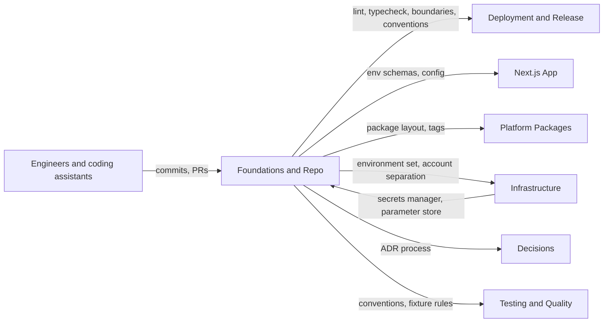

# 1 Foundations and Repo

<!-- Generated layout: edit text between the markers; keep the markers and the front matter. -->

<!-- section:purpose -->
## Purpose and scope

Foundations and Repo sets the ground rules every line of platform code is written under: how the repository is laid out, which language settings and conventions apply, how configuration and secrets reach a running container, which environments exist, and how decisions and reviews are governed. Every other area builds on these rules, so they are fixed in Phase 0 and changed only through the governance process in [[FND-governance]].

**In scope**
- Monorepo layout, package boundaries and build orchestration ([[FND-monorepo]])
- TypeScript, lint, format, commit and pre-commit conventions ([[FND-language-and-conventions]])
- Typed configuration and environment variables, and the rule that secrets come only from the regional secrets manager ([[FND-environment-management]])
- The environment set (local, dev, preview, staging, UAT, production) and what may run or be stored in each ([[FND-environments]])
- Decision records, coding standards, pull request templates and CODEOWNERS ([[FND-governance]])

**Out of scope (and where it lives)**
- Pipelines, preview environments, migrations and releases: [[DEP]]
- Cloud accounts, networking, secrets-manager and KMS set-up: [[INF-cloud-and-iac]], [[INF-secrets-and-keys]]
- Choice of application libraries (Prisma, Zod, TanStack Query, React Hook Form): [[APP-framework-dependencies]]
- Test strategy and test tooling: [[TST]]
- Architecture documentation and runbooks: [[DOC-architecture-docs-adrs-runbooks]]

<!-- section:goals -->
## Goals and non-goals

**Goals** (proposed targets, to be confirmed at the Phase 0 exit review)
1. A new engineer goes from a clean laptop to a running local stack with seeded fixture tenants in under 60 minutes, using one documented command sequence ([[DOC-onboarding-guide-for-engineers]]).
2. 100% of the rules in this area that can be automated are enforced by a required CI check; the rest map to a named review checklist item.
3. Zero committed secrets: secret scanning runs on pre-commit, on every pull request and through GitHub push protection, with 0 open findings older than 24 hours.
4. The same container image digest is promoted unchanged from dev to production in every region (no per-environment builds).
5. Pull request CI for an average change finishes in under 12 minutes at p50 and 20 minutes at p95, using Turborepo affected-graph runs and a remote cache.
6. Every accepted architecture decision is recorded as an ADR node before the code that depends on it merges.

**Non-goals**
- Supporting more than one package manager or more than one Node.js major version at a time.
- Per-tenant forks or tenant-specific branches of the codebase; tenant variation is configuration ([[PKG-settings]], [[PKG-configuration-and-customisation]]).
- A polyglot repository; non-TypeScript components (for example Temporal server, PgBouncer) are run as vendor images, not built here.

<!-- section:principles -->
## Principles

1. **One repository, one lockfile, one toolchain version.** Node.js and pnpm versions are pinned in the repo and checked in CI.
2. **Boundaries are declared, not remembered.** Every package has a layer tag and the allowed import directions are checked by `turbo boundaries` and lint ([[FND-monorepo#rules]]).
3. **Tenant data access only through `@nomology/db`.** No package other than `packages/db` imports `@prisma/client` or runs raw SQL; this keeps the tenant extension of [[MT-prisma-client-extension-wraps]] on every query.
4. **Configuration is typed and validated at start-up; a container with invalid configuration does not start.**
5. **Secrets never enter the repository, the image, build logs or `NEXT_PUBLIC_*` variables.**
6. **Build once, promote the digest.** Environment differences are runtime configuration, never build flags.
7. **Production data never leaves production.** No real personal data or case content in local, dev, preview or staging ([[FND-environments#rules]]).
8. **Every rule names its enforcement point**, and every exception has an owner and expiry date.
9. **Decisions that are expensive to reverse are written down first** as an ADR node ([[FND-governance]]).

<!-- section:context -->
## Context and boundaries

| Neighbour | What flows | Contract |
|---|---|---|
| [[DEP]] | CI consumes the lint, typecheck and boundary tasks defined in `turbo.json`; promotion relies on build-once images | [[DEP-ci-cd-pipelines-build-test]] |
| [[INF]] | Infrastructure provides per-region secrets managers, parameter stores and separated accounts; Foundations defines the variable names and schemas | [[FND-environment-management]], [[INF-secrets-and-keys]] |
| [[APP]], [[PKG]], [[WF]] | Every app and package follows the layout, tags and conventions | [[FND-monorepo]], [[FND-language-and-conventions]] |
| [[ADR]] | Governance defines when an ADR is required and how it is approved | [[FND-governance]] |
| [[TST]] | Conventions for test file locations, fixture tenants and synthetic data | [[TST-unit-integration-contract-and]] |

<!-- section:decisions -->
## Key decisions

- [[ADR-next-js-hosting]] — self-hosted containers mean the repo must produce Next.js `standalone` images and runtime configuration, not platform-specific build settings.
- [[ADR-orm]] — Prisma is the only database access layer, which is why `@prisma/client` imports are confined to `packages/db`.
- [[ADR-tenant-isolation]] — forced RLS shapes the import and raw-SQL rules in [[FND-language-and-conventions]].
- [[ADR-workflow-engine]], [[ADR-queue-technology]] — workers for Temporal and BullMQ are separate apps in the monorepo with their own env schemas.
- [[ADR-container-orchestration]] — environment variables and secrets must work on both ECS task definitions and Azure Container Apps.
- Proposed new ADRs: Turborepo remote cache hosting (self-hosted in our account vs Vercel), compiled vs just-in-time internal packages, and source of truth for ADRs (spec tree vs repo). See [[FND-monorepo#questions]].

<!-- section:map -->
## Capability map

| Child | Owns |
|---|---|
| [[FND-monorepo]] | Folder layout, workspace config, package naming and tags, `turbo.json` tasks, remote cache, dependency policy at repo level |
| [[FND-language-and-conventions]] | `tsconfig` base, ESLint flat config, Prettier, Husky hooks, lint-staged, commitlint, naming and code-level rules |
| [[FND-environment-management]] | `@nomology/env` schemas, variable naming, non-secret config sources, secret injection, start-up validation |
| [[FND-environments]] | The environment set, account separation, data rules per environment, Temporal namespaces and URLs per environment |
| [[FND-governance]] | ADR trigger rules and lifecycle, coding standards index, PR template, CODEOWNERS, GitHub rulesets |

No gaps identified. Overlap to watch: environment promotion is owned by [[DEP-environment-promotion-and-multi]]; [[FND-environments]] only defines what each environment is.

<!-- section:phasing -->
## Phasing

All five children land in **Phase 0 (Foundations)** of [[PLAN]], because every later phase depends on them.

| Step | Exit condition (checkable) |
|---|---|
| 0a | Monorepo skeleton with `apps/web`, `apps/worker-temporal`, `apps/worker-jobs`, `packages/db`, `packages/env`, `tooling/*`; `pnpm install && pnpm turbo run build` green on CI |
| 0b | Lint, typecheck, boundaries, commitlint and secret scanning are required checks in the `main` ruleset |
| 0c | `@nomology/env` validates every app's configuration at start-up; a container with a missing variable exits non-zero in dev |
| 0d | Local, dev and preview environments exist; staging in all three regions exists before Phase 1 ends |
| 0e | CODEOWNERS, PR template and the ADR process are live; ADR nodes 19.1 to 19.7 have status, options and consequences filled in |

Before Phase 1 starts: a new engineer has followed [[DOC-onboarding-guide-for-engineers]] end to end on a clean machine and the time was recorded.

<!-- section:risks -->
## Risks and open questions

- [ ] Owner for the Foundations area to be named (proposed: platform engineering lead; deputy: DevOps lead).
- [ ] Decide Turborepo remote cache hosting: self-hosted in our AWS account with signed artefacts, or Vercel Remote Cache (third-party processor of build artefacts).
- [ ] Decide whether `infra/` (Terraform) lives in this monorepo or in a separate repository with stricter access.
- [ ] Decide whether the spec workspace or the repository is the source of truth for ADRs.
- [ ] Risk: monorepo CI time grows with package count; mitigated by affected-graph runs and remote caching, watched through the CI duration metric in [[DEP-ci-cd-pipelines-build-test]].
- [ ] Risk: UAT environments used by clients may receive real data; see [[FND-environments#questions]].

<!-- checks -->
## Template checks

<!-- check:ownership -->
### Ownership and governance

Proposed accountable owner: platform engineering lead, with the DevOps lead as deputy; CTO approves changes to principles. Specialist reviewers: information security owner for anything touching secrets, environments or CODEOWNERS on security paths; DevOps for `turbo.json` and CI tasks. Changes to scope or principles go through a pull request against this node plus an ADR where the change is expensive to reverse; child-node owners are tagged on that pull request. Review at every phase boundary in [[PLAN]].

<!-- check:boundaries -->
### Scope and boundaries

Each out-of-scope item has a named home: pipelines and releases in [[DEP]], cloud set-up in [[INF]], library choice in [[APP-framework-dependencies]], test strategy in [[TST]], architecture docs in [[DOC]]. The one overlap is environments: [[FND-environments]] defines what each environment is and what data it may hold; [[DEP-environment-promotion-and-multi]] defines how a release moves between them. No database tables are owned by this area.

<!-- check:principles -->
### Principles and enforcement

Each principle maps to an enforcement point: (1) `packageManager` field plus `engines` check in CI; (2) `turbo boundaries` and ESLint `no-restricted-imports` as required checks; (3) ESLint rule banning `@prisma/client` and `$queryRawUnsafe` outside `packages/db`; (4) `@nomology/env` throws at start-up and the container health check fails; (5) gitleaks pre-commit and CI, GitHub push protection, and a build step that fails if a `NEXT_PUBLIC_` variable name matches the secret naming pattern; (6) deploy jobs accept only an image digest produced by the `main` build; (7) review checklist item plus seeding scripts that only generate synthetic data; (8) and (9) PR template items checked by CODEOWNERS review. Exceptions are recorded per [[FND-governance#exceptions]]; principle 3 and principle 5 are non-waivable.

<!-- check:decisions -->
### Decisions linked

Linked decisions: [[ADR-next-js-hosting]], [[ADR-orm]], [[ADR-tenant-isolation]], [[ADR-workflow-engine]], [[ADR-queue-technology]], [[ADR-container-orchestration]] (all accepted, but their nodes currently hold only the decision line; options considered and consequences need to be filled in before Phase 0 exit). Open decisions that block children: remote cache hosting and package compilation mode (block [[FND-monorepo]] finalisation), ADR source of truth (blocks [[FND-governance]]). Proposed decision date: before Phase 0 step 0b.

<!-- check:compliance -->
### Regulatory and control mapping

This area produces evidence for ISO/IEC 27001:2022 Annex A controls on secure development life cycle, secure coding, separation of development, test and production environments, change management and access to source code, and for SOC 2 change-management criteria. Evidence produced: GitHub ruleset configuration and audit log, CODEOWNERS approvals on pull requests, CI run history, secret-scanning history and the ADR register. Data-protection obligations (DPDP Act, GDPR, PDPA) touch this area through principle 7 (no production personal data outside production). Mapping owner: information security owner, kept in [[SEC-isms-controls]].

<!-- check:regions -->
### Tenancy and residency

The repository, CI and toolchain are global and hold no tenant data. Everything that runs is per region: each region (India, Singapore, US, and Azure deployments where a client needs them) gets the same image with region-specific runtime configuration (`APP_REGION`, `CLOUD`, endpoints) validated by `@nomology/env`. Adding a region means adding an env profile, a secrets-manager path and GitHub environments; no code changes. The global build cache must hold only build artefacts, never data.

<!-- check:phase -->
### Phasing

All children are Phase 0 and none may be deferred, because Phase 1 (tenant model, RLS, authentication) depends on the db package boundary, env validation and CI checks. Exit conditions are listed in the Phasing section as checkable statements (for example "a container with a missing variable exits non-zero").

<!-- end -->
