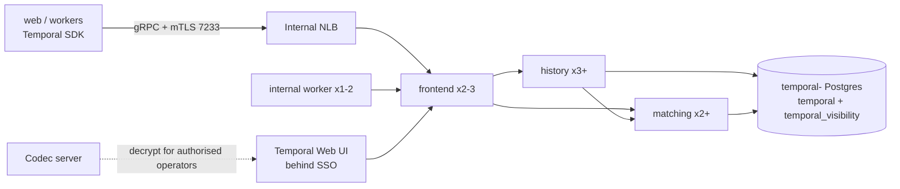

# 14.4 Temporal

<!-- Generated layout: edit text between the markers; keep the markers and the front matter. -->

> Self-hosted Temporal cluster per region on ECS: frontend, history, matching and worker services, Postgres persistence, mTLS, payload codec and codec server

<!-- section:purpose -->
## Purpose and responsibilities

Runs the Temporal server that executes all durable workflows (case lifecycle, hearing reminders, transcription, OCR and AI pipelines, payments and dunning, scheduled regulator and aggregator reports). Layer 4 (runtime) of [[WF-separation-of-concerns-temporal]]; decided by [[ADR-temporal]] (self-hosted, per region) and [[ADR-workflow-engine]].

Depended on by: Temporal workers in [[INF-compute]], the Next.js API layer (Temporal Client), [[PKG-rules-and-decision-engine]] (called as an Activity), [[WF-long-running-pipelines]], [[WF-human-tasks]], [[RPT-aggregators]] (Schedules).

Not covered here: workflow code, task queue design and versioning rules (in [[WF-separation-of-concerns-temporal]]).

<!-- section:topology -->
## Topology per region



| Region | Environment | Server services | Persistence | Namespaces |
|---|---|---|---|---|
| India | prod | frontend 3, history 3, matching 2, worker 2 over 3 AZs | Dedicated RDS PostgreSQL `temporal-in`, Multi-AZ | `prod-in` |
| Singapore | prod | frontend 2, history 3, matching 2, worker 1 | `temporal-sg`, Multi-AZ | `prod-sg` |
| US | prod | Same as Singapore | `temporal-us`, Multi-AZ | `prod-us` |
| India | staging / UAT / dev | frontend 1, history 1, matching 1, worker 1 (one cluster, three namespaces) | Single-AZ RDS | `staging-in`, `uat-in`, `dev-in` |
| Azure region | prod | Same shape on Container Apps | Azure Flexible Server, zone-redundant HA | `prod-<region>` |

The Temporal persistence store is a **separate Postgres instance** from the application database, so Temporal load (history writes, timers) cannot affect request latency and the two can be sized and restored independently. Tenants are carried in workflow context and Search Attributes, not as per-tenant namespaces ([[WF-separation-of-concerns-temporal]]).

<!-- section:sizing -->
## Sizing and scaling

- **History shards: 1,024 per production cluster** (proposed). Shard count is fixed when the cluster is created and cannot be changed later without building a new cluster and migrating [R1], so it is set for year-3 volume, not launch volume.
- Starting load assumption (to be validated by load test): India up to 50 workflow starts per second at peak (bulk SEBI ODR intake through MIIs), Singapore and US under 10 per second; up to 2 million open workflows per region (long-lived cases using Continue-As-New).
- Persistence DB: `db.r7g.large` (India `db.r7g.xlarge`), gp3 storage starting at 200 GB with autoscaling; history grows with retention period × closed workflows.
- Scaling triggers: persistence latency p99 > 50 ms, history service CPU > 60%, `schedule_to_start` latency p95 > 1 s on any task queue (worker side), shard lock contention.
- Load test with Temporal's benchmarking tool (Omes) in staging before go-live at 3× expected peak [R1].

<!-- section:config -->
## Configuration baseline

| Setting | Value | Why |
|---|---|---|
| Server version | Current supported 1.x release, pinned by digest in IaC; upgrades one minor version at a time [R1] | Sequential upgrades are required |
| `numHistoryShards` | 1024 (prod), 4 (dev) | Fixed at creation |
| Persistence | PostgreSQL (`postgres12_pgx` plugin), databases `temporal` and `temporal_visibility` | Same engine as the platform; no Cassandra to run |
| Visibility | Postgres advanced visibility (proposed); OpenSearch is the open question in [[WF-separation-of-concerns-temporal]] | Search Attributes `tenantId`, `caseId`, `caseType`, `status` |
| Namespace retention | 30 days for closed workflows (proposed) | Workflow history is operational, not the legal record; the case record and audit trail ([[PKG-audit-trail]]) are the system of record |
| Archival | Off at launch; if enabled, to a regional S3 bucket with the regional KMS key | Residency |
| Dynamic config | Per-namespace RPS limits; `frontend.namespaceRPS`, `limit.blobSize.error` 2 MB | Protects the cluster from one runaway caller; keeps payloads small (pass IDs, not documents) |
| Persistence connections | Temporal connects **directly** to its own Postgres, not through the application PgBouncer; `maxConns` per service sized to stay under the instance `max_connections` | Temporal manages its own pools; keeps app pooler budget separate ([[INF-separate-connection-settings-for]]) |
| mTLS | Internode and frontend mTLS with certificates from AWS Private CA per region, 90-day validity, auto-renew | Only workers and the app with a client certificate can connect |
| Authorization | Custom `ClaimMapper` / `Authorizer` with JWT for the Web UI; client certificates for workers | Self-hosted Temporal has no RBAC or audit logging by default [R1] |
| Payload codec | AES-256-GCM codec in `@nomology/temporal-codec` with a data key wrapped by the regional KMS key `temporal-payload` | Workflow inputs, results and signals are encrypted before they reach Temporal persistence |
| Codec server | Small service in-region, behind SSO; decrypts only for users with the `temporal-operator` role, logs every decode | Operators can inspect payloads only when allowed |

<!-- section:resilience -->
## High availability and DR

| Failure | Effect | Response | RPO / RTO (proposed) |
|---|---|---|---|
| One server task dies | Other replicas take shards / requests; brief retries | Automatic (ECS replaces task) | 0 / < 1 min |
| AZ loss | Services on two AZs continue; persistence fails over (Multi-AZ) | Automatic; SDK clients retry | 0 / < 5 min |
| Persistence DB failover | 30–120 s of failed persistence calls; workflow tasks retried | Automatic; verify with drill | 0 / < 5 min |
| Data corruption / bad upgrade | Workflows fail or stall | Restore persistence to point in time; then run reconciliation (below) | 5 min / 4 h |
| Region loss | All workflows in region stop | Rebuild in DR region from IaC and restored persistence where approved ([[INF-backup-and-disaster-recovery]]) | Per region |

**Reconciliation after a persistence restore**: Temporal state restored to time T may be behind the application database (for example a case advanced after T). A `reconcile-workflows` job compares each open case's status in Postgres with its workflow state (via Query) and re-signals or restarts workflows from the case record. Workflows must therefore be restartable from the case record, which is a design rule for workflow authors.

Drills: quarterly persistence failover in staging and production; yearly point-in-time restore plus reconciliation in staging.

<!-- section:security -->
## Security

- Temporal frontend reachable only on the internal NLB from `web`, worker and codec-server security groups; history, matching and internal worker ports reachable only from Temporal services.
- mTLS everywhere; certificates per service; CA per region.
- Web UI behind SSO with MFA, roles `temporal-viewer` (no payload decode) and `temporal-operator` (decode, signal, terminate). Every terminate / reset / signal through the UI or CLI is logged to the security log ([[OBS-security-events]]).
- Persistence DB: private, TLS required, KMS-encrypted with the regional key, credentials in Secrets Manager with rotation.
- Payloads encrypted by codec, so even a DB snapshot reveals no case content. Search Attributes are **not** encrypted: only IDs and enumerated values (`tenantId`, `caseId`, `caseType`, `status`) are allowed there; never names or emails.

<!-- section:operations -->
## Runbook

Routine:

- **Upgrade**: read release notes, upgrade staging, run the workflow regression suite and replay tests, then production region by region; one minor version at a time [R1]. Schema upgrades with `temporal-sql-tool` run as a one-off task before service rollout.
- **Certificate rotation**: automatic renewal 30 days before expiry; alert at 14 days if not renewed.
- **Stuck workflows**: use Search Attributes to find them (`tenantId`, `status`), inspect with codec-enabled UI, then signal, reset or terminate per [[WF-separation-of-concerns-temporal]] rules; every action needs a ticket reference.
- **Pause a task queue** during an incident: scale its worker service to 0; tasks wait in Temporal.

Incident steps (persistence latency high): check RDS CPU / IOPS, long-running queries in `temporal` DB, history shard ownership churn; reduce load by lowering namespace RPS; scale history.

<!-- section:observability -->
## Monitoring and alerts

Server metrics scraped by the regional collector [R1]:

| Signal | Alert (proposed) |
|---|---|
| `service_errors` / `service_requests` by operation | > 1% for 10 min → page |
| `persistence_latency` p99 | > 100 ms for 10 min → ticket; > 500 ms → page |
| `persistence_errors` | Any sustained for 5 min → page |
| SDK `temporal_activity_schedule_to_start_latency` p95 per task queue | Above queue target for 10 min → page owner of the queue |
| `workflow_failed` + `workflow_timeout` rate per workflow type | Above baseline × 3 → ticket |
| Certificate days to expiry | < 14 → ticket; < 3 → page |

Dashboards: one per region with server health, task-queue backlogs and failed workflows by type.

<!-- section:cost -->
## Cost

Drivers: persistence DB instance and storage (largest), history service tasks. Proposed: about 10–14 vCPU of server tasks plus one `r7g.large`/`xlarge` Multi-AZ DB per production region. Temporal Cloud would trade this for per-action pricing but was rejected by [[ADR-temporal]] (residency and control).

<!-- section:readiness -->
## Production readiness

| Item | Status |
|---|---|
| Shard count decided and recorded | Proposed 1024 |
| mTLS and authorizer in place | Not started |
| Payload codec and codec server | Not started |
| Load test with Omes at 3× peak | Not started |
| Persistence failover drill | Not started |
| Reconciliation job built and tested | Not started |

<!-- section:questions -->
## Open questions

- [ ] Confirm 1,024 history shards per production cluster (cannot be changed later).
- [ ] Visibility store: Postgres advanced visibility vs OpenSearch per region (shared open question with [[WF-separation-of-concerns-temporal]]).
- [ ] Namespace retention for closed workflows: 30 days enough for support investigations?
- [ ] Do non-production namespaces share one cluster in India, or does each environment get its own cluster?
- [ ] Who owns Temporal upgrades and on-call: platform engineering or a dedicated SRE role?
- [ ] For Azure clients, where does Temporal run (Container Apps vs VMs), and is Temporal Cloud ever acceptable?

<!-- checks -->
## Template checks

<!-- check:security -->
### Security

Frontend reachable only via an internal NLB from listed security groups; mTLS between all services and for clients, using a per-region private CA with 90-day certificates. Web UI behind SSO with a custom authorizer (Temporal has no built-in RBAC or audit [R1]); operator actions are logged to the security log. Payloads are encrypted by our codec with a regional KMS key, so persistence and snapshots hold no readable case content; Search Attributes are restricted to IDs and enumerated values.

<!-- check:residency -->
### Data residency

Each region has its own cluster and its own persistence DB; there is no multi-cluster replication. Workflow payloads are encrypted with a regional key, archival (if enabled) goes to a regional bucket, and the codec server runs in-region. Search Attributes hold only IDs, so the visibility store contains no personal data.

<!-- check:dr -->
### Resilience and recovery

RPO 0 / RTO under 5 minutes for task, AZ or DB failover; RPO 5 minutes / RTO 4 hours for a point-in-time restore after corruption, followed by a reconciliation job that realigns workflows with the case record in Postgres. Persistence failover is drilled quarterly; restore plus reconciliation yearly in staging.

<!-- check:isolation -->
### Tenant isolation and noisy neighbours

Tenants share a namespace per region; isolation is by tenant-prefixed workflow IDs, tenant context injected by interceptors and checked in every Activity that touches the database (through RLS). Resource fairness: per-namespace RPS limits, separate task queues for heavy work, and per-tenant concurrency limits inside the interpreter workflow so one tenant's bulk intake cannot starve others.

<!-- check:observability -->
### Monitoring and alerting

Server service and persistence metrics plus SDK schedule-to-start latency per task queue are the key signals; paging alerts are on error rates, persistence errors and backlog latency, not CPU. Certificate expiry is monitored.

<!-- check:lifecycle -->
### Operations and lifecycle

The server version is pinned and upgraded one minor version at a time [R1], first in staging with replay tests. The runbook covers upgrades, certificate rotation, stuck workflows and pausing task queues. On-call ownership is an open question.

<!-- citations -->
## Citations

```json
[
  {
    "excerpt": "Shard count is set at build time and cannot be adjusted later; monitor service_requests/errors/latency and persistence_requests/errors/latency; upgrade sequentially without skipping minor versions; self-hosted Temporal has no RBAC or audit logging out of the box.",
    "id": "R1",
    "kind": "vendor",
    "title": "Temporal self-hosted production checklist",
    "url": "https://docs.temporal.io/self-hosted-guide/production-checklist",
    "vendor": "Temporal Technologies"
  }
]
```

<!-- end -->
