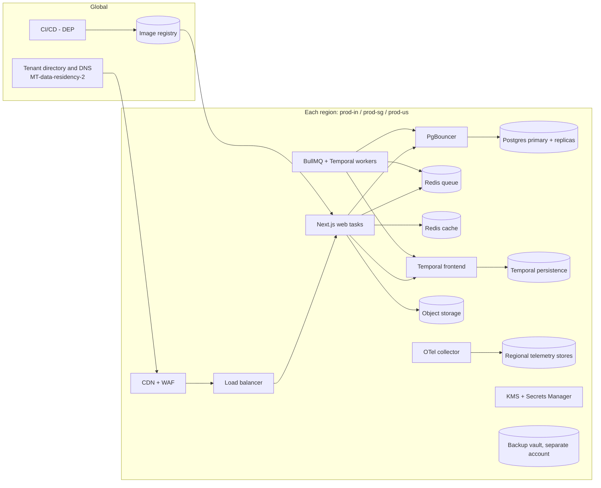

# 14 Infrastructure

<!-- Generated layout: edit text between the markers; keep the markers and the front matter. -->

> Regional runtime platform: accounts and IaC, containers, Temporal, Redis, Postgres with PgBouncer, networking, keys, backup and DR — one full stack per residency region

<!-- section:purpose -->
## Purpose and scope

The Infrastructure area provides the runtime that every other area runs on: one complete, independent stack per residency region (India, Singapore, US), plus an Azure variant where a client contract requires Azure. It exists so that data residency ([[MT-data-residency-2]]), tenant isolation ([[MT-isolation-strategy]]) and recovery targets are properties of the platform, not of each feature.

**In scope**

- Cloud accounts / subscriptions, landing zone guardrails and Terraform modules for every environment and region ([[INF-cloud-and-iac]])
- Container images and runtime for the Next.js app and workers ([[INF-compute]], [[INF-orchestration]])
- Self-hosted Temporal cluster per region ([[INF-temporal]])
- Redis per region for BullMQ and caching ([[INF-redis]])
- Managed Postgres per region, read replicas, and the connection path through PgBouncer ([[INF-database]], [[INF-database-connection-handling]])
- VPC, WAF, CDN, DNS, private endpoints and egress control ([[INF-networking]])
- KMS keys and secret managers per region ([[INF-secrets-and-keys]])
- Backups, restore drills and disaster recovery per region ([[INF-backup-and-disaster-recovery]])

**Out of scope (and where it lives)**

| Item someone might expect here | Owner |
|---|---|
| Instrumentation, telemetry pipeline, SLOs and alert rules | [[OBS]] (Infrastructure provides the regional collector hosts and stores) |
| CI/CD pipelines, canary releases, migration strategy | [[DEP]] ([[DEP-ci-cd-pipelines-build-test]], [[DEP-database-migration-strategy-zero]]) |
| Encryption helpers and the secrets client used in code | [[PKG-encryption-utilities-key]] |
| Object storage abstraction, signed URLs, malware scanning | [[PKG-storage]] (Infrastructure creates the buckets and keys) |
| Global tenant directory and request routing rules | [[MT-data-residency-2]] (Infrastructure provides DNS and the regional endpoints) |
| Business continuity plan, people and supplier dependencies | [[SEC-business-continuity]] |
| Data warehouse and reporting replicas design | [[RPT-report-infrastructure]] (uses the replicas defined in [[INF-database]]) |

<!-- section:goals -->
## Goals and non-goals

**Goals (proposed targets, to be confirmed by engineering leads)**

1. Every production region (prod-in, prod-sg, prod-us) can be rebuilt from Terraform and backups alone, with no console steps, in under 8 hours (measured in the yearly region rebuild drill).
2. Monthly availability of the regional platform (web, API, workers, Temporal) of at least 99.9% per region, measured by [[OBS-uptime-synthetic-monitoring]].
3. Zero copies of tenant data outside the tenant's pinned region, verified quarterly by a residency inventory of backups, replicas, logs and snapshots.
4. Postgres recovery point objective of 5 minutes and recovery time objective of 1 hour for an availability-zone or instance failure; targets for region loss set per region in [[INF-backup-and-disaster-recovery]].
5. Infrastructure change lead time under 1 day from merged pull request to applied in all three production regions, with drift detected within 24 hours.
6. Monthly infrastructure cost per region known within 10% and allocated by component and environment through enforced tags.

**Non-goals**

- Active-active serving of one tenant from two regions. Each tenant has exactly one home region.
- A dedicated database per tenant as the default model ([[ADR-tenant-isolation]]); dedicated infrastructure is an exception handled by parameters, not a second code path.
- Kubernetes. Orchestration is ECS or Azure Container Apps ([[ADR-container-orchestration]]).
- Supporting more than one cloud inside a single region deployment (a region runs either the AWS stack or the Azure stack).

<!-- section:principles -->
## Principles

Every child node must follow these rules. Each has a named check.

| # | Principle | How it is checked |
|---|---|---|
| INF-P1 | **One region, one stack.** Every stateful component (Postgres, Redis, Temporal persistence, object storage, logs, backups) is created per region and never shared across regions. | Terraform module review; policy-as-code rule that rejects cross-region replication or backup copy unless listed in the residency exceptions register |
| INF-P2 | **No resource outside the allowed regions.** | AWS Service Control Policy / Azure Policy region allow-list per account or subscription |
| INF-P3 | **Everything from code.** No console changes in staging or production; humans have read-only consoles by default. | Nightly `terraform plan` drift job; CloudTrail / Activity Log alert on write calls by human roles |
| INF-P4 | **Private by default.** Data stores have no public endpoint; only the load balancer / CDN is internet-facing. | Policy-as-code (Checkov or OPA) on every plan; AWS Config rule |
| INF-P5 | **Encrypt with our keys.** All data at rest uses customer-managed keys per region and purpose; TLS 1.2+ on every connection. | Policy-as-code; quarterly key inventory |
| INF-P6 | **Least-privilege identities, no long-lived keys.** Services use task roles / managed identities; CI uses OIDC federation; humans use SSO with MFA and time-bound elevation. | IAM Access Analyzer; access review in [[SEC-access-reviews]] |
| INF-P7 | **Same module, different parameters.** Regions and environments differ only through a parameter file; Azure uses a module with the same inputs and outputs. | Module interface tests; review checklist |
| INF-P8 | **No unproven recovery.** A component cannot go to production until its restore has been rehearsed once in staging. | Production readiness review ([[INF-backup-and-disaster-recovery#readiness]]) |
| INF-P9 | **RLS-safe connection path.** Nothing between the app and Postgres may hold session state across transactions; tenant context is set only with `set_config(..., true)` ([[MT-prisma-client-extension-wraps]]). | Isolation tests through PgBouncer in CI ([[TST-multi-tenant-isolation-tests]]) |
| INF-P10 | **Tagged for cost and ownership.** Every resource carries `nomo:env`, `nomo:region`, `nomo:component`, `nomo:owner`, `nomo:data-class`. | Tag policy; untagged-resource report |

Exceptions are raised as a short Decision node with an expiry date and approved by the Infrastructure owner and the security lead.

<!-- section:context -->
## Context and boundaries

| Neighbour | What crosses the boundary | Contract |
|---|---|---|
| [[MT]] Multi-tenancy | Region list, tenant-to-region routing, Postgres roles and RLS assumptions | [[MT-data-residency-2]], [[MT-isolation-strategy]] |
| [[DEP]] Deployment | Images, task definitions, migration jobs, region rollout order | [[DEP-environment-promotion-and-multi]] |
| [[OBS]] Observability | OTLP endpoints per region, infrastructure metrics and logs | [[OBS-foundations#pipeline]] |
| [[WF]] Workflows | Temporal namespaces and task queues, BullMQ Redis endpoints | [[WF-separation-of-concerns-temporal]], [[WF-background-jobs-and-queues]] |
| [[PKG]] Packages | Buckets, keys, Redis cache endpoint, secret names | [[PKG-storage]], [[PKG-caching]], [[PKG-encryption-utilities-key]] |
| [[RPT]] Reporting | Read replica endpoints and the reporting role | [[RPT-report-infrastructure]] |
| [[SEC]] Security | Logs, CloudTrail, backups and drill evidence for ISO 27001 / SOC 2 | [[SEC-isms-controls]], [[SEC-business-continuity]] |

<!-- section:decisions -->
## Key decisions

- [[ADR-next-js-hosting]] — Next.js is built as `standalone` output into containers and run per region; no serverless edge runtime holds tenant data.
- [[ADR-container-orchestration]] — ECS (Fargate) is the default runtime; Azure Container Apps is the like-for-like Azure variant, so modules must expose the same interface for both.
- [[ADR-temporal]] — We run and patch Temporal ourselves per region, which makes Temporal persistence, mTLS and upgrades an Infrastructure responsibility.
- [[ADR-queue-technology]] — BullMQ needs Redis with `noeviction`, which forces a separate queue Redis from the cache Redis.
- [[ADR-tenant-isolation]] — Shared database with forced RLS means one Postgres per region and a connection path (PgBouncer) that must never carry session state.
- [[ADR-orm]] — Prisma drives the pool sizing and the need for a direct (non-pooled) connection for migrations.

**Decisions still needed (proposed new ADR nodes)**

- Managed Postgres flavour on AWS: RDS for PostgreSQL vs Aurora PostgreSQL.
- Pooler on AWS: self-run PgBouncer vs RDS Proxy (RDS Proxy pins sessions on `set_config`, see [[INF-pgbouncer]]).
- Region-loss strategy for Singapore, where the AWS stack has no second in-country region.
- Terraform vs OpenTofu, and the IaC tool for the Azure variant.
- Observability backend per region (see [[OBS]]).

<!-- section:map -->
## Capability map

| Child | Owns |
|---|---|
| [[INF-cloud-and-iac]] | Accounts and subscriptions, landing-zone guardrails, Terraform module layout, state, policy-as-code, drift detection |
| [[INF-compute]] | Container images (web, workers, PgBouncer, collector), base image, runtime settings, autoscaling signals |
| [[INF-orchestration]] | ECS clusters and services, Azure Container Apps environments, deployment mechanics, service discovery |
| [[INF-temporal]] | Temporal server per region: services, persistence, namespaces, mTLS, codec server, upgrades |
| [[INF-redis]] | Queue Redis (BullMQ) and cache Redis per region, ACL users, persistence and failover |
| [[INF-database]] | Managed Postgres per region, parameters, roles, extensions, read replicas, upgrades |
| [[INF-database-connection-handling]] | The connection path from every workload to Postgres; children: [[INF-pgbouncer]], [[INF-small-fixed-prisma-pool-per]], [[INF-timeouts-on-connect-query-and]], [[INF-separate-connection-settings-for]], [[INF-monitor-pool-usage-wait-times]] |
| [[INF-networking]] | VPC layout, load balancers, WAF, CDN, DNS, private endpoints, egress allow-list |
| [[INF-secrets-and-keys]] | KMS keys per region and purpose, secret managers, rotation, break-glass |
| [[INF-backup-and-disaster-recovery]] | Backup policies, immutable vaults, RPO / RTO per component, restore and failover drills |

Gap noted: there is no node for the **regional OTel collector and telemetry stores as infrastructure**. Proposed: keep the pipeline design in [[OBS-foundations#pipeline]] and add hosting to [[INF-compute]] / [[INF-orchestration]] rather than a new node.

<!-- section:phasing -->
## Phasing

Aligned with the delivery plan ([[PLAN]]).

| Phase | Infrastructure that must exist | Exit condition |
|---|---|---|
| 0. Foundations | Accounts, Terraform layout and state, dev environment in India region, CI OIDC roles, image registry, base images | `terraform apply` from CI creates dev from empty; no console-created resources |
| 1. Core platform | Postgres with roles and RLS, PgBouncer, Secrets Manager / KMS, networking baseline, staging in one region | Isolation tests pass through PgBouncer in transaction mode in CI and staging |
| 2. Shared services | Redis (queue and cache), object storage buckets and keys | BullMQ failover test passes; cache keys tenant-scoped |
| 3. First domain slice | Temporal per environment, worker services | A workflow survives worker restart and Temporal frontend restart in staging |
| 4–6 | Scaling for transcription and AI pipelines, Azure variant if a client signs | Load test meets [[TST-performance-and-load-testing]] targets |
| 7. Insight and compliance | Read replicas for reporting, telemetry stores per region | Reporting runs only against replicas |
| 8. Hardening | Production in India, Singapore, US; backup vaults; DR drills | Full restore drill per region within RTO; production readiness review signed |

Must not be deferred: region guardrails (INF-P2), encryption with customer-managed keys, private data stores, and IaC-only changes. These are cheap at Phase 0 and very expensive to retrofit.

<!-- section:risks -->
## Risks and open questions

- [ ] **Singapore region loss** — no second AWS region in Singapore; options are multi-AZ only, an Azure Southeast Asia standby, or a lawful cross-border copy. Owner: Infrastructure lead with legal.
- [ ] **Self-hosted Temporal operating load** — upgrades, shard count and persistence tuning need skills the team may not have yet. Owner: Platform engineering.
- [ ] **Azure parity drift** — the Azure variant is used by few tenants and may lag. Mitigation: run the Azure staging stack in CI weekly.
- [ ] **CDN edge caching** — global CDN edges sit outside the region; tenant pages must never be cached at the edge ([[INF-networking]]).
- [ ] **Cost of three full stacks** while tenant counts are small; non-production environments may be shared in one region.

**Open questions**

- [ ] Confirm the production region list and cloud per region: AWS ap-south-1 (Mumbai), ap-southeast-1 (Singapore), us-east-1 (N. Virginia) — or different US region?
- [ ] Is an in-country DR region (AWS ap-south-2 Hyderabad for India; us-west-2 for US) required for go-live, or after Phase 8?
- [ ] What is the region-loss plan for Singapore tenants, and has it been explained to Singapore clients?
- [ ] Which clients require Azure today, and in which regions?
- [ ] Are non-production environments (dev, staging, UAT) per region, or only in India with synthetic data?
- [ ] Who is the accountable owner for the Infrastructure area, and who is the deputy?

<!-- checks -->
## Template checks

<!-- check:boundaries -->
### Scope and boundaries

Infrastructure owns hosts, networks, data stores and keys; it does not own what runs on them. The four overlaps most likely to cause confusion are resolved as follows:

| Overlap | Resolution |
|---|---|
| Telemetry | [[OBS]] owns names, pipelines and alert rules; Infrastructure owns the regional collector service and storage it runs on |
| Secrets | [[INF-secrets-and-keys]] owns the key stores and rotation; [[PKG-encryption-utilities-key]] owns the client library |
| Storage | [[PKG-storage]] owns the abstraction; Infrastructure creates buckets, policies and keys |
| Routing | [[MT-data-residency-2]] owns the directory and rules; [[INF-networking]] provides DNS records and regional endpoints |

No tables are shared with other areas: Infrastructure owns no application tables. Temporal persistence tables are owned by [[INF-temporal]] and live in a separate database.

<!-- check:principles -->
### Principles and enforcement

Each of the ten principles (INF-P1 to INF-P10) names its enforcement: Service Control Policies and Azure Policy for regions, policy-as-code (Checkov / OPA) on every Terraform plan for public exposure, encryption and tags, a nightly drift plan for console changes, IAM Access Analyzer for long-lived keys, and isolation tests through PgBouncer for the RLS-safe connection path. The only principle without automation is INF-P8 (rehearsed restore), which is a production readiness review item with evidence stored for ISO 27001. Exceptions require a Decision node with an expiry date.

<!-- check:regions -->
### Tenancy and residency

Per region: everything stateful (Postgres, Redis, Temporal, storage, logs, backups, telemetry, keys). Global: the tenant directory and DNS ([[MT-data-residency-2]]), the image registry (images contain no tenant data), CI identity, Terraform state for global resources, and the IAM / SSO identity for engineers. Global parts must hold no tenant personal data; the directory holds tenant ID, slug, home region and domains only. Azure differences (Container Apps instead of ECS, Flexible Server built-in PgBouncer, Key Vault, Azure Policy) are contained in Azure modules with the same interface. Adding a region means a new parameter file per component, a new SCP allow-list entry and a directory entry; target effort is two engineer-weeks plus a DR drill. Moving a tenant between regions is a data migration owned by [[MT-tenant-lifecycle]]; Infrastructure provides export / import tooling but no live cross-region replication.

<!-- check:quality -->
### Quality targets

Proposed inherited targets: 99.9% monthly availability per region; Postgres RPO 5 minutes / RTO 1 hour for zone or instance failure; region-loss targets per region in [[INF-backup-and-disaster-recovery]]; capacity for 50 tenants and 2,000 concurrent users per region at the end of the plan horizon (assumption, to be replaced by sales forecasts); p95 database query latency under 50 ms for request-path queries. Each target has a dashboard in [[OBS-performance]] or [[OBS-uptime-synthetic-monitoring]]. Client SLAs must be looser than these SLOs.

<!-- check:phase -->
### Phasing

Every child has a phase in the phasing table, matching [[PLAN]]. Cross-cutting from Phase 0: IaC-only changes, region guardrails, encryption with customer-managed keys, and private data stores. PgBouncer must exist from Phase 1 because the isolation tests must run through the same transaction-pooling path as production. Deferred to Phase 8: production in all three regions, cross-AZ failover drills and the full restore drill; the risk is that DR gaps are found late, so a staging restore is required at the end of Phase 3.

<!-- end -->
