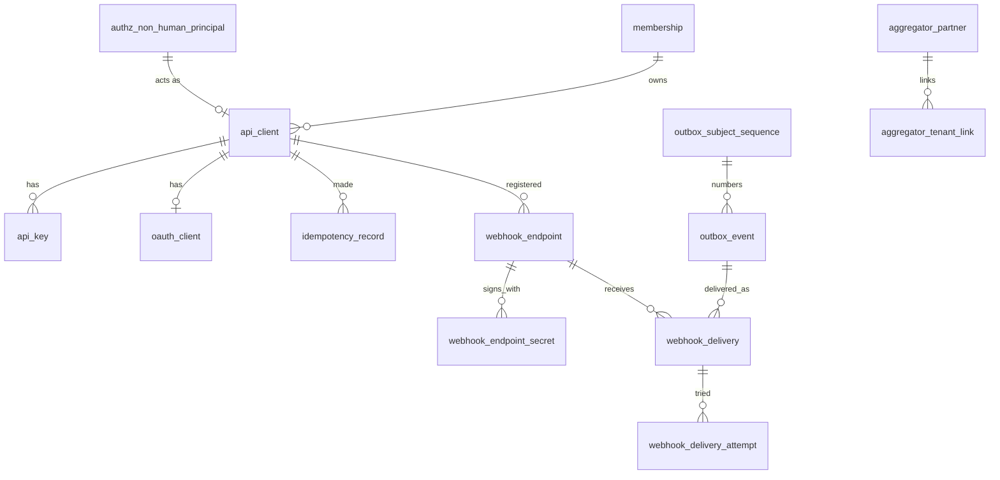

# 9.4.7 API platform tables

<!-- Generated layout: edit text between the markers; keep the markers and the front matter. -->

> API clients, hashed keys, OAuth clients, idempotency keys, webhook endpoints, outbox and delivery attempts

<!-- section:purpose -->
## Scope and ownership

Physical schema for the public API platform: API clients, hashed API keys, OAuth clients, idempotency records, webhook endpoints and secrets, the transactional outbox, webhook deliveries and attempts, and aggregator links. Owner: API platform team. Prisma schema file `packages/db/prisma/schema/api-platform.prisma`; Postgres schema `public` (same database per region). Readers: auth middleware (credential lookup through a dedicated role), API Route Handlers, the webhook relay and delivery workers (BullMQ), tenant admin console. Other contexts reference these tables by ID only, except domain modules, which **insert** outbox rows through the `@nomology/outbox` helper in their own transactions.

<!-- section:entities -->
## Entities and relationships


| Table | Class | Aggregate root |
|---|---|---|
| `api_client`, `api_key`, `oauth_client` | tenant-owned | `api_client` |
| `idempotency_record` | tenant-owned | itself |
| `webhook_endpoint`, `webhook_endpoint_secret` | tenant-owned | `webhook_endpoint` |
| `outbox_event`, `outbox_subject_sequence` | tenant-owned | `outbox_event` |
| `webhook_delivery`, `webhook_delivery_attempt` | tenant-owned | `webhook_delivery` |
| `aggregator_partner` | platform-level ([[MT-platform-level-tables]]) | itself |
| `aggregator_tenant_link` | tenant-owned | itself |

<!-- section:tables -->
## Tables and columns

Conventions: IDs `uuid` (UUIDv7 generated in the application [R3]); timestamps `timestamptz`; enums as `text` with `CHECK`; no money in this context. Classification: P = personal, C = confidential secret material, I = internal.

**api_client**
| Column | Type | Null | Default | Meaning | Class |
|---|---|---|---|---|---|
| id | uuid | no | — | PK | I |
| tenant_id | uuid | no | — | Owner tenant | I |
| name | text | no | — | Label, max 100 | I |
| kind | text | no | — | `service` / `aggregator` | I |
| environment | text | no | — | `live` / `test` | I |
| status | text | no | `'active'` | `in_review` (admin scopes awaiting approval, [[PKG-api-clients-and-keys]]) / `active` / `suspended` / `revoked` | I |
| scopes | text[] | no | — | Granted scopes | I |
| owner_membership_id | uuid | no | — | Accountable human owner (a staff membership with an admin role covering the client's scope); clients of an owner who leaves are flagged and suspended after 7 days unless reassigned | P (ID) |
| service_account_id | uuid | no | — | The `service_account` principal the client acts as (`authz_non_human_principal`, [[PKG-non-human-principals]]); its permission set (`ps.integration.<client>`) is the client's ceiling | I |
| allowed_cidrs | cidr[] | yes | null | IP allow-list, 1–20 entries; required for admin scopes when `auth.api_clients.admin_scope_requires_ip_allowlist` is on ([[PKG-settings-security-and-identity]]) | I |
| resource_restrictions | jsonb | no | `'{}'` | Tightening only: `{ "caseTypeKeys": [...], "unitIds": [...], "maxConfidentiality": "standard" \| "confidential" \| "sealed" }` (read scopes only for the last) | I |
| principal_role | text | yes | null | **Deprecated**: tenant role the client acted as before service accounts; read only during migration, dropped at the contract step | I |
| case_type_filter | text[] | yes | null | **Deprecated**: copied into `resource_restrictions.caseTypeKeys`, dropped at the contract step | I |
| created_by_user_id | uuid | no | — | Human admin who created it | P (ID) |
| created_at / updated_at | timestamptz | no | now() | | I |
| revoked_at | timestamptz | yes | null | | I |
| last_used_at | timestamptz | yes | null | Updated at most once per minute | I |

**api_key**: `id uuid`, `tenant_id uuid`, `api_client_id uuid`, `prefix text` (first 16 chars incl. `ntk_live_in_`, unique), `key_hash bytea` (SHA-256 of full key, C), `last4 char(4)`, `expires_at timestamptz NOT NULL` (no key may be non-expiring; at most `auth.api_clients.max_credential_days` after creation, checked by the application), `revoked_at timestamptz null`, `created_at`, `last_used_at`.

**oauth_client**: `id`, `tenant_id`, `api_client_id` (unique), `client_id text` (unique, public), `auth_method text` (`private_key_jwt` / `client_secret_basic` / `tls_client_auth` / `self_signed_tls_client_auth`, the last two being mutual-TLS client authentication), `jwks jsonb null` (public keys), `jwks_uri text null`, `mtls_thumbprints text[] null` (base64url SHA-256 thumbprints of accepted client certificates, at most 2 so a certificate can be rotated; also used to bind access tokens to the certificate), `client_secret_hash bytea null` (C), `access_token_ttl_seconds int` default 600 check 60..3600, `created_at`.

**idempotency_record**: `tenant_id`, `api_client_id`, `key text` (≤ 255), `method text`, `route text` (route template), `request_hash bytea`, `state text` (`in_progress` / `completed`), `response_status int null`, `response_body jsonb null` (I; may contain personal data echoed from the request, so P), `resource_type text null`, `resource_id uuid null`, `created_at`, `expires_at timestamptz` (created_at + 72 h).

**webhook_endpoint**: `id`, `tenant_id`, `api_client_id uuid null` (null if created in console), `url text` (≤ 2048), `description text null`, `event_types text[]`, `api_version text`, `status text` (`active` / `disabled_by_tenant` / `disabled_failing`), `disabled_reason text null`, `failing_since timestamptz null`, `version int` default 1 (ETag), `created_by_user_id uuid null`, `created_at`, `updated_at`.

**webhook_endpoint_secret**: `id`, `tenant_id`, `endpoint_id`, `secret_ciphertext bytea` (C; envelope-encrypted with the tenant data key, [[PKG-encryption-utilities-key]]), `key_version int`, `status text` (`active` / `retiring`), `created_at`, `retire_at timestamptz null`.

**outbox_event** (partitioned monthly on `occurred_at` [R2]): `id uuid` (event ID), `tenant_id`, `event_type text`, `subject_type text`, `subject_id uuid`, `sequence bigint`, `api_version text`, `payload jsonb` (I; thin payload, no personal data by rule), `occurred_at timestamptz`, `relayed_at timestamptz null`.

**outbox_subject_sequence**: `tenant_id`, `subject_type`, `subject_id`, `last_sequence bigint`.

**webhook_delivery**: `id`, `tenant_id`, `endpoint_id`, `event_id`, `event_occurred_at timestamptz` (to reference the partition), `status text` (`pending` / `succeeded` / `failed_retrying` / `dead` / `dropped`), `attempt_count int` default 0, `next_attempt_at timestamptz null`, `last_status_code int null`, `created_at`, `succeeded_at null`.

**webhook_delivery_attempt** (partitioned monthly on `attempted_at`): `id`, `tenant_id`, `delivery_id`, `attempted_at`, `duration_ms int`, `response_status int null`, `error_class text null` (`timeout`, `dns`, `tls`, `connect`, `non_2xx`, `ssrf_blocked`), `response_excerpt text null` (first 1 KB).

**aggregator_partner** (platform-level): `id`, `key text unique` (e.g. `nse`), `name text`, `status`, `created_at`.

**aggregator_tenant_link**: `id`, `tenant_id`, `aggregator_id`, `api_client_id`, `allowed_case_types text[]`, `field_mapping_version int`, `status text` (`pending_tenant_approval` / `active` / `ended`), `approved_by_user_id uuid null`, `approved_at null`, `starts_at`, `ends_at null`.

<!-- section:keys -->
## Keys and constraints

```sql
-- composite uniqueness so child FKs can include tenant_id
ALTER TABLE api_client ADD CONSTRAINT api_client_pk PRIMARY KEY (id),
  ADD CONSTRAINT api_client_tenant_uq UNIQUE (tenant_id, id),
  ADD CONSTRAINT api_client_kind_ck CHECK (kind IN ('service','aggregator')),
  ADD CONSTRAINT api_client_status_ck CHECK (status IN ('in_review','active','suspended','revoked')),
  ADD CONSTRAINT api_client_owner_fk FOREIGN KEY (tenant_id, owner_membership_id)
      REFERENCES membership (tenant_id, id) ON DELETE RESTRICT,
  ADD CONSTRAINT api_client_service_account_fk FOREIGN KEY (tenant_id, service_account_id)
      REFERENCES authz_non_human_principal (tenant_id, id) ON DELETE RESTRICT,
  ADD CONSTRAINT api_client_cidrs_ck CHECK (allowed_cidrs IS NULL OR cardinality(allowed_cidrs) BETWEEN 1 AND 20);
CREATE UNIQUE INDEX api_client_service_account_uq ON api_client (tenant_id, service_account_id);

ALTER TABLE oauth_client
  ADD CONSTRAINT oauth_client_mtls_ck CHECK (auth_method NOT IN ('tls_client_auth','self_signed_tls_client_auth')
      OR cardinality(mtls_thumbprints) BETWEEN 1 AND 2);

ALTER TABLE api_key ADD PRIMARY KEY (id),
  ADD CONSTRAINT api_key_prefix_uq UNIQUE (prefix),
  ADD CONSTRAINT api_key_client_fk FOREIGN KEY (tenant_id, api_client_id)
      REFERENCES api_client (tenant_id, id) ON DELETE CASCADE;

ALTER TABLE idempotency_record ADD PRIMARY KEY (tenant_id, api_client_id, key),
  ADD CONSTRAINT idem_client_fk FOREIGN KEY (tenant_id, api_client_id) REFERENCES api_client (tenant_id, id),
  ADD CONSTRAINT idem_state_ck CHECK (state IN ('in_progress','completed'));

ALTER TABLE webhook_endpoint ADD PRIMARY KEY (id), ADD UNIQUE (tenant_id, id),
  ADD CONSTRAINT whe_url_https_ck CHECK (url LIKE 'https://%');

ALTER TABLE outbox_event ADD PRIMARY KEY (tenant_id, occurred_at, id);   -- partition key in PK
ALTER TABLE outbox_event ADD CONSTRAINT outbox_seq_uq UNIQUE (tenant_id, subject_type, subject_id, sequence, occurred_at);

ALTER TABLE webhook_delivery ADD PRIMARY KEY (id),
  ADD CONSTRAINT whd_once_uq UNIQUE (tenant_id, endpoint_id, event_id),
  ADD CONSTRAINT whd_endpoint_fk FOREIGN KEY (tenant_id, endpoint_id)
      REFERENCES webhook_endpoint (tenant_id, id) ON DELETE CASCADE,
  ADD CONSTRAINT whd_event_fk FOREIGN KEY (tenant_id, event_occurred_at, event_id)
      REFERENCES outbox_event (tenant_id, occurred_at, id);
```
Database-enforced: one delivery per endpoint and event; HTTPS endpoint URLs; one active OAuth client per API client (`UNIQUE (api_client_id)`); at most one `active` secret per endpoint (partial unique index `WHERE status = 'active'`); aggregator matter uniqueness lives in the cases schema (`UNIQUE (tenant_id, aggregator_id, aggregator_reference)`, [[DOM-cases-schema]]). Application-enforced (with reasons): SSRF checks on URLs (need DNS resolution), scope subset rules (need role data), 10-endpoint limit (entitlement-dependent), the source IP being inside `allowed_cidrs` and the effective access being the intersection of scopes, `resource_restrictions`, network restriction and the service account's permissions (checked per request, APIC-FR-6 in [[PKG-api-clients-and-keys]]), the owner holding an admin role over the client's scope, the service account being of kind `service_account` (a check across tables).

Note: a foreign key into a partitioned `outbox_event` is supported in current PostgreSQL versions; if the deployed version or partition maintenance makes it awkward, drop `whd_event_fk` and rely on the outbox being written first in the same transaction (decision in questions).

<!-- section:tenancy -->
## Tenancy and RLS policies

All tables except `aggregator_partner` are tenant-owned and follow [[MT-rls-enabled-and-forced-on]]:

```sql
DO $$ DECLARE t text; BEGIN
  FOREACH t IN ARRAY ARRAY['api_client','api_key','oauth_client','idempotency_record','webhook_endpoint',
    'webhook_endpoint_secret','outbox_event','outbox_subject_sequence','webhook_delivery',
    'webhook_delivery_attempt','aggregator_tenant_link'] LOOP
    EXECUTE format('ALTER TABLE %I ENABLE ROW LEVEL SECURITY', t);
    EXECUTE format('ALTER TABLE %I FORCE ROW LEVEL SECURITY', t);
    EXECUTE format($p$CREATE POLICY tenant_isolation ON %I FOR ALL TO nomo_app, nomo_worker
      USING (tenant_id = current_setting('app.tenant_id')::uuid)
      WITH CHECK (tenant_id = current_setting('app.tenant_id')::uuid)$p$, t);
  END LOOP; END $$;
```
(Real migrations list each table explicitly so the lint check in [[MT-lint-review-check-that-every]] can see them.) Owners bypass RLS unless it is forced [R1], hence FORCE.

**Pre-tenant credential lookup**: authentication must find the tenant from a key or client ID before any tenant context exists. A dedicated role `auth_resolver` (NOLOGIN, used only by the auth middleware's separate Prisma client through PgBouncer) has:
```sql
GRANT SELECT (prefix, key_hash, tenant_id, api_client_id, expires_at, revoked_at) ON api_key TO auth_resolver;
GRANT SELECT (client_id, tenant_id, api_client_id, auth_method, jwks, jwks_uri, client_secret_hash, mtls_thumbprints) ON oauth_client TO auth_resolver;
GRANT SELECT (id, tenant_id, status, scopes, service_account_id, allowed_cidrs, resource_restrictions, principal_role, case_type_filter, environment) ON api_client TO auth_resolver;
CREATE POLICY credential_lookup ON api_key FOR SELECT TO auth_resolver USING (true);
CREATE POLICY credential_lookup ON oauth_client FOR SELECT TO auth_resolver USING (true);
CREATE POLICY credential_lookup ON api_client FOR SELECT TO auth_resolver USING (true);
```
This is the only cross-tenant read path in this schema; it exposes no secrets beyond hashes and is covered by isolation tests and security review. The webhook delivery worker connects as `nomo_worker` and sets tenant context per job. The relay scans the outbox across tenants through a narrow `SECURITY DEFINER` function `outbox_claim_batch(limit)` owned by `outbox_relay` that returns only `(tenant_id, id, occurred_at)`, after which each tenant's rows are read under that tenant's context (security review required).

<!-- section:indexes -->
## Indexes and access patterns

| Query | Index |
|---|---|
| Auth: key by prefix | `api_key_prefix_uq` (unique) |
| Auth: OAuth client by client_id | `UNIQUE (client_id)` |
| Console: list clients | `(tenant_id, status, created_at DESC)` on `api_client` |
| Clients of an owner (owner leaves, access review) | `(tenant_id, owner_membership_id)` on `api_client` |
| Client of a service account (non-human principal review, disable cascade) | unique `api_client_service_account_uq` |
| Idempotency lookup | PK `(tenant_id, api_client_id, key)` |
| Idempotency purge | `(expires_at)` |
| Relay: unrelayed events | partial `(occurred_at) WHERE relayed_at IS NULL` on each outbox partition |
| `/v1/events` list | `(tenant_id, occurred_at, id)` (PK) |
| Matching endpoints for fan-out | `(tenant_id, status)` on `webhook_endpoint` plus GIN on `event_types` |
| Due deliveries | partial `(next_attempt_at) WHERE status IN ('pending','failed_retrying')` |
| Delivery log per endpoint | `(tenant_id, endpoint_id, created_at DESC)` |
| Attempts per delivery | `(tenant_id, delivery_id, attempted_at)` |

<!-- section:history -->
## Status, history and concurrency

- `api_client.status`, `webhook_endpoint.status`, `webhook_delivery.status` and `aggregator_tenant_link.status` are small state machines in code ([[WF-entity-state-machines]]); transitions are audited ([[PKG-audit-trail]]).
- Keys and secrets are never updated, only revoked or retired; new ones are new rows.
- Outbox and attempts are append-only (no `UPDATE`/`DELETE` grant for `nomo_app` or `nomo_worker` on `outbox_event` except `relayed_at`, granted to `outbox_relay`).
- Concurrency: `webhook_endpoint.version` for ETag; `outbox_subject_sequence` row lock (`UPDATE ... RETURNING last_sequence`) serialises sequence numbers per subject.

<!-- section:protection -->
## Data classification and protection

| Column | Protection |
|---|---|
| `api_key.key_hash`, `oauth_client.client_secret_hash` | SHA-256 of high-entropy secrets (keys are 190 bits random, so a fast hash is sufficient); never logged |
| `webhook_endpoint_secret.secret_ciphertext` | Envelope encryption with per-tenant data key; decrypted only in the delivery worker |
| `idempotency_record.response_body` | May echo personal data; 72-hour retention; excluded from warehouse export |
| `webhook_delivery_attempt.response_excerpt` | Receiver-supplied text; 1 KB max; 30-day retention; excluded from search and warehouse |
| `outbox_event.payload` | Thin by rule; a CI test fails if an event schema contains fields tagged personal |

None of these columns may be copied into logs, the search index or the warehouse except counts and statuses.

<!-- section:retention -->
## Retention, archival and deletion

| Table | Retention | End of life |
|---|---|---|
| `idempotency_record` | 72 h after creation | Hourly delete by `expires_at` in batches |
| `outbox_event` | 30 days after `occurred_at` (events API window) | Detach and drop monthly partitions older than 2 months after confirming all relayed [R2] |
| `webhook_delivery` | 90 days | Batched delete |
| `webhook_delivery_attempt` | 30 days | Drop partitions |
| `api_client`, `api_key`, `oauth_client` | Life of the tenant + 1 year after revocation (audit evidence) | Hard delete on tenant offboarding after export |
| `webhook_endpoint`, secrets | Until deleted; secrets crypto-shredded on tenant offboarding | |
| `aggregator_tenant_link` | Life of link + 8 years (reporting evidence; to confirm) | |

Legal holds do not apply to these operational tables except `aggregator_tenant_link` (consent evidence). Offboarding follows [[MT-tenant-lifecycle]] and [[PKG-retention-and-deletion-schedule]].

<!-- section:migrations -->
## Migrations and rollout

1. `20261101_api_clients`: create `api_client`, `api_key`, `oauth_client` with constraints, RLS policies, `auth_resolver` grants, in one migration file (raw SQL appended to the Prisma migration, per [[MT-prisma-migrations-include-rls]]).
2. `20261101_idempotency`: `idempotency_record` + RLS + purge index.
3. `20261102_outbox`: partitioned `outbox_event` with 3 months of partitions pre-created, `outbox_subject_sequence`, RLS, relay function and role.
4. `20261102_webhooks`: endpoints, secrets, deliveries, partitioned attempts, RLS.
5. `20261103_aggregators`: `aggregator_partner` (platform-level, no RLS), `aggregator_tenant_link` + RLS.
6. Partition maintenance: a Temporal schedule per region creates partitions 2 months ahead and drops expired ones (not a migration).
7. `api_client_governance` (expand, after `0104_authz_governance` in [[PKG-authorization-data-model#migrations]]): add nullable `owner_membership_id`, `service_account_id`, `allowed_cidrs`, `resource_restrictions`, `oauth_client.mtls_thumbprints`; widen the `status` and `auth_method` checks.
8. Backfill per tenant: create one `service_account` principal per client with permission set `ps.integration.<client>` derived from its scopes and old `principal_role` (reviewed by the tenant's `security_admin` in the console before the contract step); owner = the creator's membership, or the tenant's `security_admin` where the creator has left; copy `case_type_filter` into `resource_restrictions`; set `expires_at` on keys that had none to the earlier of created + `auth.api_clients.max_credential_days` and 90 days from the migration, and notify owners.
9. `SET NOT NULL` on `owner_membership_id`, `service_account_id` and `api_key.expires_at` (constraints added `NOT VALID`, then validated).
10. Release N+2 (contract): drop `principal_role` and `case_type_filter` and remove them from the `auth_resolver` grants.

Steps 1–6 create new tables; steps 7–10 change live tables by expand and contract. All changes follow [[DEP-database-migration-strategy-zero]] (indexes `CONCURRENTLY` in separate migrations, `lock_timeout = '5s'`, `statement_timeout = '60s'`). Migrations run per region in the order India, Singapore, US after staging ([[DEP-environment-promotion-and-multi]]). Rollback: drop tables (no data yet); after go-live, roll forward only.

<!-- section:prisma -->
## Prisma schema mapping

Models `ApiClient` (relations to `Membership` as owner and to `AuthzNonHumanPrincipal` as service account), `ApiKey`, `OAuthClient`, `IdempotencyRecord`, `WebhookEndpoint`, `WebhookEndpointSecret`, `OutboxEvent`, `OutboxSubjectSequence`, `WebhookDelivery`, `WebhookDeliveryAttempt`, `AggregatorPartner`, `AggregatorTenantLink` with `@@map` to snake_case tables and `@map` per column. Composite relations use `@relation(fields: [tenantId, apiClientId], references: [tenantId, id])` on `@@unique([tenantId, id])`. Raw-SQL-only features: RLS and policies, column-level grants, `auth_resolver` and `outbox_relay` roles, partitioning of `outbox_event` and attempts, partial indexes, the GIN index, CHECK constraints, the `outbox_claim_batch` function. Prisma's introspection does not see partitions; the schema file documents them in comments.

<!-- section:seed -->
## Seed and reference data

`aggregator_partner` rows are platform reference data loaded per region by the platform-admin job ([[PKG-reference-and-seed-data]]). Development fixtures create one sandbox API client per seeded tenant with a known test key (`ntk_test_...`), never present in production.

<!-- section:volume -->
## Volume, growth and performance

Proposed estimates per region at Year 1 / Year 5: `api_client` 500 / 5,000 rows; `idempotency_record` ~200 k live rows (72 h window); `outbox_event` 3 M / 30 M per month (domain events from all tenants, not only subscribed ones) — the hottest table; `webhook_delivery` 1 M / 10 M per month; attempts 1.3× deliveries. Largest tenant (SEBI ODR volumes) could produce 40% of events. Partitioning is in place from day one for the outbox and attempts; deliveries move to monthly partitions above 50 M rows.

<!-- section:questions -->
## Open questions

- [ ] Security review of the `auth_resolver` policy and the `outbox_claim_batch` SECURITY DEFINER function.
- [ ] Keep the FK from `webhook_delivery` to the partitioned outbox, or rely on transactional ordering?
- [ ] Should the outbox record every domain event (also used by billing, search indexing) or only webhook-relevant ones? Proposed: one shared outbox for all consumers.
- [ ] Retention of revoked API client records (proposed: tenant life + 1 year).
- [ ] Is a maximum of 2 mTLS thumbprints per client enough for aggregators that rotate certificates on their own schedule? (owner: integrations, with [[PKG-api-clients-and-keys]])

<!-- checks -->
## Template checks

<!-- check:tenancy -->
### Tenant isolation in the schema

Every tenant-owned table has non-null `tenant_id`, ENABLE and FORCE RLS and a `nomo_app` / `nomo_worker` policy with USING and WITH CHECK [R1]. Child FKs include `tenant_id` (deliveries to endpoints and events, keys to clients), so cross-tenant references are impossible even for privileged roles. The two cross-tenant paths (credential lookup by `auth_resolver` with column-level grants, and the relay's claim function returning only IDs) are explicit, narrow and tested. The unique `api_key.prefix` is global but random, so it leaks nothing. With `app.tenant_id` unset, `current_setting` raises an error and queries fail closed.

<!-- check:integrity -->
### Invariants enforced by the database

`UNIQUE (tenant_id, endpoint_id, event_id)` guarantees one delivery per endpoint and event under concurrent relays; sequence numbers per subject are serialised by a row lock and protected by a unique constraint; idempotency PK prevents two concurrent requests with the same key (the second sees `in_progress`); status columns have CHECK constraints; HTTPS check on URLs.

<!-- check:migration-safety -->
### Zero-downtime and reversible migrations

All new tables; RLS and grants in the same migration file as each table; partitions pre-created; later index additions use `CONCURRENTLY` in separate migrations with lock and statement timeouts; per-region rollout after staging.

<!-- check:privacy -->
### Personal data, erasure and the legal record

Secrets are hashed or envelope-encrypted; personal data can appear only in idempotency response bodies (72 hours) and receiver response excerpts (30 days), both excluded from warehouse and search. Event payloads are thin by rule, checked in CI.

<!-- check:residency -->
### Region placement and cross-region references

All tables live only in the regional database. `aggregator_partner` is platform reference data replicated by seed per region; aggregator credentials are per region.

<!-- check:performance -->
### Query performance under RLS and growth

Outbox and attempts partitioned monthly [R2]; partial indexes for relay and due deliveries keep hot queries small; RLS predicates are tenant equality on leading index columns; partition drops make retention cheap.

<!-- citations -->
## Citations

```json
[
  {
    "excerpt": "Table owners bypass row security unless FORCE ROW LEVEL SECURITY is set; policies apply USING to existing rows and WITH CHECK to new rows.",
    "id": "R1",
    "kind": "vendor",
    "retrieved": "2026-10-28",
    "title": "PostgreSQL documentation: Row Security Policies",
    "url": "https://www.postgresql.org/docs/current/ddl-rowsecurity.html",
    "vendor": "PostgreSQL Global Development Group"
  },
  {
    "excerpt": "Dropping or detaching a partition removes bulk data far faster than DELETE and avoids vacuum overhead.",
    "id": "R2",
    "kind": "vendor",
    "retrieved": "2026-10-28",
    "title": "PostgreSQL documentation: Table Partitioning",
    "url": "https://www.postgresql.org/docs/current/ddl-partitioning.html",
    "vendor": "PostgreSQL Global Development Group"
  },
  {
    "body": "IETF",
    "excerpt": "Defines UUID version 7, a time-ordered UUID suitable for database keys.",
    "id": "R3",
    "ident": "RFC 9562",
    "kind": "standard",
    "title": "Universally Unique IDentifiers (UUIDs)",
    "url": "https://datatracker.ietf.org/doc/rfc9562/"
  }
]
```

<!-- end -->
