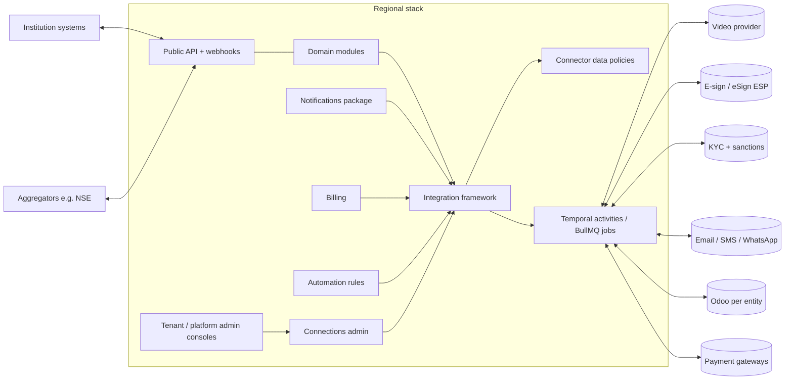

# 9 Integrations and Plugins

<!-- Generated layout: edit text between the markers; keep the markers and the front matter. -->

> Every connection between the platform and outside systems: provider integrations, the shared integration framework, connection administration and connector data policies at every scope, the plugin model, and our own public API and webhooks

<!-- section:purpose -->
## Purpose and scope

The platform depends on outside providers for things we should not build (video, e-signature, identity checks, SMS and email delivery, accounting) and must itself be integrated into by institutions and aggregators. This area makes every such connection follow one set of rules for tenancy, residency, security, retries and evidence, and makes every connection **administrable** by the right person at the right scope: platform, region, offering, tenant, unit, case type and user.

**In scope**
- The shared integration framework: connector interface, credential vault, inbound webhook receiver, outbound call wrapper, sync jobs ([[INT-integration-framework]])
- Administration of connections: catalogue, per-tenant and per-unit connections, OAuth, credentials as secret references, health, usage, rotation and revocation ([[INT-connections-admin]])
- Connector data policies: which data kinds and tiers may go to which connector, layered from platform to unit ([[INT-connector-data-policies]])
- Provider integrations, one node per external party ([[INT-common-integrations]] and its children)
- The plugin model and external app administration ([[INT-plugin-model]])
- Our public REST API, outbound webhooks, developer portal and their administration ([[INT-public-api-and-webhooks]] and its children)
- Accessibility of embedded third-party components ([[INT-third-party-component]])
- The integration settings catalogue ([[PKG-settings-integrations]])

**Out of scope (and where it lives)**
- Payment gateways' commercial flows (dunning, refunds, reconciliation): [[BIL-payment-gateway-integration]] (it uses this area's framework)
- Notification policies, preferences, sender identity and templates: [[PKG-notifications]], [[PKG-notification-policies]], [[PKG-notification-sender-identity]]; this area only sends through providers
- API clients, keys and OAuth apps for our public API: [[PKG-api-clients-and-keys]] (identity); this area consumes them
- Internal tRPC API for our own UI: [[APP-internal-api-trpc-routers-per]]
- API-wide rules (versioning, rate limiting, idempotency): [[APP-api-versioning-rate-limiting]] and the error catalogue [[APP-api-error-catalogue-problem]]
- Regulator and aggregator *report formats*: [[RPT-aggregators]] and [[RPT-configurable-report-templates]]; this area provides the transport ([[INT-aggregator-intake-api]])
- Single sign-on with identity providers and SCIM provisioning: [[PKG-sso-saml-oidc-per-tenant]], [[PKG-user-provisioning-scim]]
- AI model providers: [[AI-ai-gateway]], governed by [[AI-tenant-ai-policy]]
- Automation rules that call connectors: [[WF-automation-rules]] (they are subject to [[INT-connector-data-policies]])

<!-- section:goals -->
## Goals and non-goals

**Goals**
1. Every provider integration is reached only through an adapter in `packages/integrations/*`, so switching or adding a provider touches one package (checked by a Turborepo boundary rule).
2. No inbound event is processed before its signature is verified and its tenant is resolved; target: 0 unverified events processed (security metric).
3. Every outbound mutating call is idempotent; target: 0 duplicate envelopes, messages or charges per quarter found by reconciliation.
4. Each provider has a per-region choice documented, with tenant data processed in the tenant's region or under a recorded transfer basis; target: 100% of active connections have a data policy group and residency status.
5. Self-service administration: a tenant integration admin can connect, test and enable a provider for a unit without Nomology involvement in under 15 minutes for API-key connectors (measured in onboarding pilots); 0 secrets visible in any UI, API response, log or export (canary test).
6. Public API: an institution developer can create a case and receive its status webhooks in the sandbox within one working day using only the developer portal.
7. Webhook delivery: 99.9% of events delivered to healthy endpoints within 60 seconds (proposed SLO); every failed delivery replayable by a tenant admin for 30 days.

**Non-goals**
- A marketplace where third parties run their own code inside our runtime (see [[INT-plugin-model]]).
- A general iPaaS for tenants to build arbitrary integrations; tenants integrate through the public API, webhooks and governed automation rules.
- Supporting every provider a tenant asks for; new providers enter through the vendor process ([[SEC-vendor-sub-processor-management]]).
- Storing or displaying secrets in the platform database or UI.

<!-- section:principles -->
## Principles

1. **Adapter first.** Domain code calls an interface (`VideoProvider`, `ESignProvider`, `KycProvider`, `MessagingProvider`, `AccountingProvider`, `PaymentGatewayAdapter`), never a vendor SDK.
2. **Verify, then resolve tenant, then parse.** Inbound webhooks are signature-verified on the raw body, mapped to one tenant by connection ID, recorded in the inbox, and only then processed.
3. **Outbound calls run in workers.** Calls to providers run in Temporal activities or BullMQ jobs with timeouts, bounded retries and idempotency keys; never inline in a user request except short, read-only lookups with a fallback.
4. **Secrets are references.** Credentials live in the regional secrets manager, referenced by path; no provider credential in the database, env files, logs, UI or configuration packages ([[INF-secrets-and-keys]]).
5. **Region-pinned.** A tenant's integration uses the provider endpoint or account for its home region; if none exists the integration is disabled for that tenant until a transfer basis is recorded ([[MT-data-residency-2]]).
6. **Send the minimum, and prove it.** Every connector operation declares the data kinds and tiers it sends; [[INT-connector-data-policies]] evaluates them before every call and new connectors start blocked.
7. **Evidence is ours.** Evidential artefacts returned by providers (signed PDFs, signing certificates, delivery receipts, KYC results, recordings) are copied into our regional storage with a SHA-256 hash.
8. **Our API follows the same rules we ask of others**: OpenAPI 3.1 / AsyncAPI 3.0 contracts generated from Zod, RFC 9457 errors, signed webhooks, hashed keys.
9. **Administer within bounds.** Every integration choice a tenant can make is a setting in [[PKG-settings-integrations]] or a versioned artefact, resolved along the shared scope hierarchy, bounded by platform limits and plan entitlements, and changed through the admin API that the console and the admin copilot both use.
10. **Changes never move running work.** Changing a default connection, disabling a connection or publishing a stricter policy affects new work; running cases keep what they started with unless explicitly migrated.

<!-- section:context -->
## Context and boundaries

| Neighbour | What crosses | Contract |
|---|---|---|
| Domain modules ([[DOM-cases]], [[DOM-hearings]], [[DOM-documents]]) | Commands to providers; provider results back as domain events | Adapter interfaces; outbox events |
| Notifications ([[PKG-notifications]]) | Rendered messages to send; delivery receipts back | `MessagingProvider` |
| Billing ([[BIL]]) | Payments, ledger posts; usage of metered providers | `PaymentGatewayAdapter`, `AccountingProvider`, usage roll-ups |
| Workflow ([[WF-automation-rules]], [[WF-ai-steps-and-agents]]) | Connector actions in automations and AI steps | `callProvider` + policy evaluation |
| Settings and configuration ([[PKG-settings]], [[PKG-configuration-lifecycle]], [[PKG-configuration-packages]]) | Integration settings, policy and connection definitions (no secrets) | Settings registry, configuration artefacts |
| Identity and access ([[PKG-api-clients-and-keys]], [[PKG-non-human-principals]], [[PKG-permission-catalogue]]) | API clients, connection principals, permission keys | Principal model |
| Security ([[SEC-vendor-sub-processor-management]], [[SEC-security-incident-response-and]]) | Vendor assessments, sub-processor list, provider breach notices | Vendor register |
| Infrastructure ([[INF-networking]], [[INF-secrets-and-keys]]) | Egress allow-lists, secrets paths | Terraform modules |
| Reporting ([[RPT-aggregators]]) | Aggregator status data | [[INT-aggregator-intake-api]] |

<!-- section:decisions -->
## Key decisions

- [[ADR-workflow-engine]] / [[ADR-temporal]]: long provider interactions (envelope signing, recording hand-off, KYC with manual review) are Temporal workflows; [[WF-workflow-engine]] lists webhooks and notification sending as queue jobs.
- [[ADR-queue-technology]]: outbound webhook delivery and message sending run on BullMQ.
- [[ADR-tenant-isolation]]: connection, credential reference, inbox and API tables are tenant-owned with forced RLS.
- [[ADR-aggregator-reporting]]: aggregator integration is configuration-driven; [[INT-aggregator-intake-api]] is the transport for it.
- **To record**: provider choice per category and region (video, e-sign, KYC, SMS, WhatsApp, gateway); public API authentication (OAuth client credentials plus API keys, proposed); whether third-party code may ever run in-process (proposed: no).

<!-- section:map -->
## Capability map

| Child | Owns |
|---|---|
| [[INT-integration-framework]] | `packages/integrations-core`: connector interface, connections, credential vault, OAuth flows, inbound webhook receiver and inbox, outbound call wrapper, rate limiting, sync jobs |
| [[INT-connections-admin]] | Catalogue, connection lifecycle, ownership models, unit enablement, defaults per scope, health, usage, rotation, revocation, admin routes and API |
| [[INT-connector-data-policies]] | Data kinds and tiers per connector and operation, connector groups, layered rules, exemptions, enforcement points |
| [[INT-common-integrations]] | Provider catalogue and per-region choices; email and calendar basics |
| [[INT-video-conferencing-for-hearings]] | Virtual rooms, join tokens, recordings, transcript hand-off |
| [[INT-e-signature]] | Signing envelopes for settlements, awards, declarations; Aadhaar eSign and global e-sign |
| [[INT-kyc-and-sanctions-screening]] | Identity verification and sanctions screening of parties and payees |
| [[INT-messaging-providers]] | Email, SMS, WhatsApp sending, receipts, opt-out |
| [[INT-accounting-sync]] | Invoice, payment and payout posting to Odoo per entity |
| [[INT-third-party-component]] | Accessibility register for embedded vendor components |
| [[INT-plugin-model]] | Extension points, plugin registry, external app installation and approval |
| [[INT-public-api-and-webhooks]] | Developer portal, scopes, limits, API and webhook administration; children define each API family, webhooks and tables |
| [[PKG-settings-integrations]] (in PKG) | Settings catalogue for this area |

Gap: **calendar** two-way sync has no node of its own; `.ics` and optional free / busy lookup are covered in [[INT-common-integrations]] and per-user connections in [[INT-connections-admin]].

<!-- section:phasing -->
## Phasing

[[PLAN]] puts the integrations framework in Phase 5, but several integrations are needed earlier. Proposed:

| Phase | Integration work | Exit condition |
|---|---|---|
| 2 | Minimal framework (secrets path convention, outbound wrapper, inbound receiver + inbox); email provider per region for [[PKG-notifications]]; platform baseline data policy for core connectors | Email sent and bounce received in all three regions |
| 3 | SMS (India DLT templates); connection records, health and the read-only connection page for tenant admins | SMS delivery receipts stored as service evidence; tenant admin sees connection health |
| 4 | Video for hearings, e-signature, KYC / sanctions for payees; tenant-managed connections for API-key connectors, unit enablement, connector data policy editor | One hearing recorded and handed to transcription; one award e-signed end to end; a tenant admin enables a connector for one unit |
| 5 | Full framework (OAuth vault, sync jobs, rate limits), BYO accounts, usage budgets, accounting sync, payment gateways, public API, webhooks and their admin, tenant admin API, aggregator intake, external apps with install approval | First institution integrated through the public API in production; webhook replay used by a tenant admin |
| 7 | WhatsApp, two-way calendar, per-user connections beyond calendar, plugin registry beyond first-party connectors | — |

Not deferrable: signature verification and tenant resolution on inbound events, and the platform baseline data policy, from the first provider in Phase 2.

<!-- section:risks -->
## Risks and open questions

- [ ] Name the area owner and the reviewer for vendor risk.
- [ ] PLAN conflict: notifications (Phase 2) need a messaging provider before the framework (Phase 5); approve the split above.
- [ ] Provider choice per region for video, e-sign, KYC, SMS, WhatsApp; some may have no in-region processing in India or Singapore.
- [ ] Aggregators: confirm whether NSE calls our API, or we push to an NSE interface, before building [[INT-aggregator-intake-api]].
- [ ] Risk: WhatsApp messages are processed by Meta; restricted by the platform baseline to non-confidential prompts ([[INT-connector-data-policies]]).
- [ ] Risk: provider breach notification windows longer than CERT-In's 6 hours.
- [ ] Risk: OAuth grants held by individual people at a tenant break silently when they leave; mitigated by service-account preference and deprovisioning alerts ([[INT-connections-admin#auth]]).
- [ ] Risk: BYO accounts move evidential receipts outside our contracts; legal to confirm acceptability for service of notices.
- [ ] Decide the boundary with the identity group for API client policy keys (key lifetime, IP restrictions): proposed in [[PKG-settings-security-and-identity]].

<!-- checks -->
## Template checks

<!-- check:ownership -->
### Ownership and governance

Area owner: platform engineering, integrations team lead (to be named). Specialist reviewers: security for [[INT-connector-data-policies]] and credentials, privacy owner for data mappings and transfers, legal for messaging and e-signature validity, product owners for CORD and TERES catalogue visibility. Scope changes go through the area's map and an ADR where they change a principle.

<!-- check:boundaries -->
### Scope and boundaries

Commercial payment logic is in [[BIL-payment-gateway-integration]]; message composition, policies and preferences in [[PKG-notifications]] and its children; API client credentials in [[PKG-api-clients-and-keys]]; report formats in [[RPT-aggregators]]; SSO and SCIM in identity nodes; AI providers in [[AI-ai-gateway]]. This area owns connection mechanics, connection administration, connector data policies and the public API surface. Tables `integration_connection`, `provider_event_inbox`, connection unit and usage tables and API platform tables ([[INT-api-platform-tables]]) are written only by this area's packages.

<!-- check:principles -->
### Principles and enforcement

(1) Turborepo boundary rule: only `packages/integrations-*` may import vendor SDKs. (2) Integration test: unsigned inbound event → 401, no inbox row. (3) Lint rule forbids adapter clients in Route Handlers or Server Actions except `@inlineAllowed` lookups. (4) Secret scanning in CI, startup check for `*_API_KEY` env vars, and a canary-secret test over admin API responses and package exports. (5) Connection creation fails without regional configuration or transfer record. (6) Manifest conformance tests and the policy evaluator in `callProvider`. (7) Hash stored with every evidential artefact, nightly sampler. (8) OpenAPI diff in CI. (9) Settings registry check in CI for `integration.*`. (10) Test that changing a default connection does not alter a running case's pinned connection.

<!-- check:compliance -->
### Regulatory and control mapping

DPDP, PDPA and GDPR transfer and processor rules for data sent to providers; CERT-In 6-hour reporting, which needs provider breach notice terms; AML / KYC / sanctions screening for payees ([[RPT-aml-kyc-sanctions-screening]]); India TRAI commercial communication rules for SMS headers and templates ([[PKG-notification-sender-identity]]); e-signature validity under the IT Act 2000, Singapore's Electronic Transactions Act and US ESIGN / UETA (legal to confirm per document type); WCAG 2.2 AA for embedded components; ISO 27001:2022 Annex A 5.14 and 5.19–5.22; SOC 2 CC6.1, CC6.7 and CC9.2. Evidence comes from each provider node's audit section, the connection inventory export, the data policy versions and exemption register, and [[SEC-vendor-sub-processor-management]].

<!-- check:regions -->
### Tenancy and residency

Every integration runs in the tenant's home region: per-region provider accounts or endpoints, per-region secrets paths (`/{env}/{region}/...`), per-region Temporal task queues and BullMQ queues, and per-region admin views (the platform connection health view is served per region). The public API has regional base URLs; credentials encode their region. Global parts: none holding tenant data; the developer portal's static documentation and the connector catalogue code are global. Azure deployments use the same adapters with Azure Key Vault behind the secrets client.

<!-- check:quality -->
### Quality targets

Inherited targets: inbound acknowledgement p99 < 300 ms; outbound wrapper overhead < 5 ms p99; webhook delivery 99.9% within 60 s; public API 99.9% monthly availability per region with p95 300 ms reads and 800 ms writes; connection health detection within 2 probe intervals (30 minutes by default); policy changes effective within 60 seconds; WCAG 2.2 AA for every admin page.

<!-- check:phase -->
### Phasing

See the phasing table: the minimal framework, email and the platform baseline data policy in Phase 2; SMS and read-only connection admin in Phase 3; video, e-sign, KYC, tenant-managed connections and the policy editor in Phase 4; full framework, BYO, public API and webhook admin in Phase 5; WhatsApp and the wider plugin registry in Phase 7.

<!-- end -->
