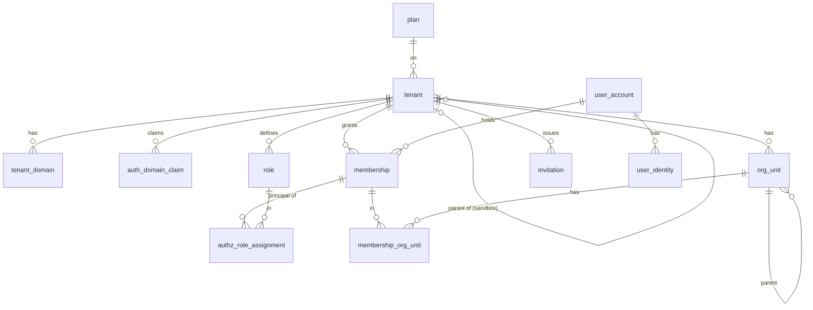

# 3.1.1 Tenancy and identity schema

<!-- Generated layout: edit text between the markers; keep the markers and the front matter. -->

> Tenant registry (type, offerings, sandbox parent, customer grouping), units, users and identities, memberships (staff or external), domain claims, roles; which tables are platform-level vs tenant-owned; role assignments move to authz_role_assignment

<!-- section:purpose -->
## Scope and ownership

Physical schema for the tenant model ([[MT-tenant-model]]). Owned by platform engineering (CODEOWNERS: `@nomology/platform-core` plus a security reviewer). Lives in `packages/db/prisma/schema/tenancy.prisma` and Postgres schema `public` (proposed; all application tables in one schema per regional database), with helper functions in schema `app`.

Other contexts reference these tables by **ID with a composite foreign key** where the referencing table is tenant-owned (for example `case_party(tenant_id, membership_id)` → `membership(tenant_id, id)`), and by ID only from platform-level tables. [[PKG-authentication]] reads `user_account` and `user_identity`; [[PKG-authorization]] reads `membership` and the scoped role assignments in `authz_role_assignment` ([[PKG-authorization-data-model]]), which replace `membership_role`; the global tenant directory is fed from `tenant` and `tenant_domain` by an outbox, never by a direct cross-region query.

<!-- section:entities -->
## Entities and relationships



| Table | Class | Aggregate root |
|---|---|---|
| `tenant` | Platform-level | Yes |
| `tenant_domain` | Platform-level | Part of tenant |
| `plan` | Platform-level | Yes (owned by [[BIL-plans-entitlements-and-usage]], listed here for FK) |
| `user_account` | Platform-level with membership RLS | Yes |
| `user_identity` | Platform-level with membership RLS | Part of user account |
| `org_unit` | Tenant-owned | Yes |
| `role` | Tenant-owned | Yes |
| `membership` | Tenant-owned | Yes |
| `authz_role_assignment` | Tenant-owned | Owned by [[PKG-authorization-data-model]]; listed here because it replaces `membership_role` |
| `membership_role` | Tenant-owned | Retired: read-only during the expand-and-contract migration, then dropped |
| `membership_org_unit` | Tenant-owned | Part of membership |
| `invitation` | Tenant-owned | Yes |
| `auth_domain_claim` | Tenant-owned | Owned by [[PKG-domain-verification]]; listed here for FK and tenancy |

**Units.** `org_unit` is the `unit` scope of the shared configuration model ([[PKG-configuration-scope-hierarchy]]): an office, panel, programme or desk inside a tenant. Columns named `unit_id` or `owning_unit_id` in other schemas (for example [[DOM-cases-schema]], [[PKG-settings-data-model]], [[PKG-authorization-data-model]]) reference `org_unit (tenant_id, id)`. The table keeps its name to avoid a rename migration (see questions).

<!-- section:tables -->
## Tables and columns

Conventions (stated once): IDs are `uuid` generated by the application as UUIDv7 (time-ordered, RFC 9562); timestamps are `timestamptz` in UTC; enums are Postgres enums managed in migrations; text fields that hold names use `text` with a check on length; `created_at`, `updated_at` on every table; `version int` for optimistic concurrency on aggregate roots.

**`tenant`**

| Column | Type | Null | Default | Meaning | Class |
|---|---|---|---|---|---|
| `id` | uuid | no | — | Tenant id, used as `tenant_id` everywhere | Internal |
| `slug` | citext | no | — | Subdomain label, `^[a-z0-9-]{3,40}$`, globally unique | Public |
| `display_name` | jsonb | no | — | `{ "en": "…", "hi": "…" }` | Public |
| `type` | tenant_type | no | — | `arbitral_institution`, `odr_institution`, `cord`, `enterprise`, `court_programme`, `sandbox` (a non-production copy of a parent tenant, [[PKG-configuration-lifecycle]]) | Internal |
| `primary_offering` | offering | no | — | `cord` or `teres`; the offering used outside a case context ([[PKG-configuration-scope-hierarchy]]) | Internal |
| `offerings` | offering[] | no | — | Offerings the tenant is licensed for; must contain `primary_offering` (CHECK; a column default cannot refer to another column, so the provisioning service sets it) | Internal |
| `parent_tenant_id` | uuid | yes | — | FK `tenant(id)`; set if and only if `type = 'sandbox'`; the parent is a non-sandbox tenant in the same region | Internal |
| `customer_account_id` | uuid | yes | — | Groups the tenants of one customer (production tenant, its sandboxes, sister institutions); configuration package promotion checks it ([[PKG-configuration-packages]]). No FK at launch (see questions) | Internal |
| `home_region` | text | no | — | `in`, `sg`, `us`, `in-az` …; must equal this database's region | Internal |
| `status` | tenant_status | no | `'draft'` | See [[MT-tenant-model#lifecycle]] | Internal |
| `plan_id` | uuid | yes | — | FK `plan(id)` | Internal |
| `billing_entity` | billing_entity | no | — | `ntpl`, `tapl`, `us_entity` | Internal |
| `default_locale` | text | no | `'en'` | BCP 47 | Internal |
| `default_time_zone` | text | no | — | IANA zone | Internal |
| `data_key_ref` | text | yes | — | KMS key alias for per-tenant data key (pending ADR) | Confidential |
| `suspended_reason` | text | yes | — | Reason code | Internal |
| `offboarding_export_until`, `delete_after` | timestamptz | yes | — | Offboarding dates | Internal |
| `deleted_at` | timestamptz | yes | — | Tombstone marker | Internal |
| `version` | int | no | 0 | Concurrency | — |

**`tenant_domain`**: `id uuid`, `tenant_id uuid NOT NULL` (FK, but this table is platform-level: the column is a reference, not an RLS key), `hostname citext UNIQUE`, `kind` (`subdomain`/`custom`), `verification_token_hash bytea`, `verified_at timestamptz`, `tls_status text`, `is_primary boolean`.

**`user_account`**: `id uuid`, `display_name text` (Personal), `primary_email citext` (Personal), `primary_phone text` E.164 (Personal), `email_verified_at`, `phone_verified_at timestamptz`, `locale text`, `time_zone text`, `status` (`active`, `locked`, `restricted`, `anonymised`), `last_sign_in_at timestamptz` (Personal), `anonymised_at timestamptz`.

**`user_identity`**: `id uuid`, `user_account_id uuid` FK, `kind` (values below), `issuer text` (null for `email` and `phone`; IdP entity id or issuer URL for `saml` and `oidc`; provider key such as `google` or `singpass` for `social` and `government`; the SCIM connection id for `scim`), `subject text` (Personal), `tenant_id uuid NULL` (set for `saml`, `oidc` and `scim`, so the link is scoped to the tenant whose IdP issued it; null for local and platform-operated `social` and `government` connections), `connection_id uuid NULL` (the tenant SSO or SCIM connection, [[PKG-sso-saml-oidc-per-tenant]], [[PKG-user-provisioning-scim]]), `verified_at timestamptz`, `last_used_at timestamptz` (Personal), `created_at`. Password hashes, passkeys, TOTP and other MFA secrets are not here; they are authenticators in the authentication package's own tables ([[PKG-email-password-magic-link-otp]], [[PKG-mfa-session-management-device]]).

| `kind` | Sign-in methods it covers | `subject` | Owner node |
|---|---|---|---|
| `email` | Password, magic link, email one-time code (one identity per verified email; the methods are credentials on it) | Verified email, lower-cased | [[PKG-email-password-magic-link-otp]] |
| `phone` | SMS and WhatsApp one-time codes | E.164 number | [[PKG-email-password-magic-link-otp]] |
| `saml`, `oidc` | Tenant SSO connections | NameID or `sub` | [[PKG-sso-saml-oidc-per-tenant]] |
| `social` | Platform social sign-in (Google, Microsoft consumer accounts, Apple, LinkedIn) | Provider `sub` | [[PKG-sso-saml-oidc-per-tenant]] |
| `government` | Government login (Singpass in region `sg`; assumption) | Scheme subject | [[PKG-sso-saml-oidc-per-tenant]]; assurance levels in [[PKG-external-party-identity]] |
| `scim` | SCIM-provisioned link for a tenant directory | SCIM `userName` | [[PKG-user-provisioning-scim]] |

The old values map as `email_password` and `magic_link` → `email`, `otp_phone` → `phone` (see Migrations).

**`org_unit`** (the `unit` scope): `tenant_id uuid NOT NULL`, `id uuid`, `parent_id uuid NULL`, `code text` (unique per tenant), `name jsonb`, `kind text NOT NULL DEFAULT 'office'` (`office`, `panel`, `programme`, `desk`, `team`), `external_ref text NULL` (tenant's HR or directory ID, max 100, unique per tenant; [[INT-tenant-admin-api]]), `depth smallint CHECK (depth BETWEEN 1 AND 5)`, `archived_at timestamptz`.

**`role`**: `tenant_id`, `id`, `key text` (shared-model role key such as `tenant_admin` or `secretariat`, a managed template key such as `secretariat_lead`, or `custom:<slug>`), `name jsonb`, `is_system boolean` (kept until the contract step, then replaced by `kind`), `permission_set_ref text` (retired at the contract step). Columns added by [[PKG-authorization-data-model#tables]]: `kind` (`system`, `managed`, `custom`), `system_role_key`, `status`, `published_version`, `assignable_scopes`, `has_privileged`, `has_case_content`.

**`membership`**: `tenant_id`, `id`, `user_account_id uuid NOT NULL`, `kind text NOT NULL` (`staff` or `external`; external memberships carry only the `party`, `counsel`, `neutral` or `observer` personas and get case access through case roles only, [[PKG-external-party-identity]]), `status` (`invited`, `active`, `suspended`, `ended`), `source_of_authority text NOT NULL DEFAULT 'platform'` (`platform` or `idp`; `idp` makes IdP-mastered attributes read-only, [[PKG-user-provisioning-scim]]), `external_ref text NULL` (max 100, unique per tenant), `joined_at`, `ended_at timestamptz`, `invited_by_membership_id uuid NULL`, `version int`.

**`membership_role`** (retired): `tenant_id`, `membership_id`, `role_id`, `granted_by_membership_id`, `granted_at`, `expires_at timestamptz NULL`. Replaced by **`authz_role_assignment`**, defined in [[PKG-authorization-data-model#tables]]: a principal (membership, group or non-human principal) holds a role or permission set at a scope (`tenant`, `unit`, `case_type` or `case`) for a time window, with source, granting admin and approver. `membership_role` stays read-only during the expand-and-contract migration below and is dropped at the contract step.

**`membership_org_unit`**: `tenant_id`, `membership_id`, `org_unit_id`, `is_primary boolean NOT NULL DEFAULT false` (the member's primary unit, used by unit-scoped administration, [[APP-administration-model]]).

**`invitation`**: `tenant_id`, `id`, `target_email citext NULL`, `target_phone text NULL` (Personal), `membership_kind text` (`staff` or `external`), `role_ids uuid[]` (become `authz_role_assignment` rows on acceptance), `org_unit_ids uuid[]`, `token_hash bytea` (SHA-256 of the token; the token is never stored), `expires_at`, `accepted_at`, `revoked_at`, `created_by_membership_id`.

**`auth_domain_claim`** (tenant-owned; columns, statuses and the link table `auth_domain_connection` are owned by [[PKG-domain-verification#notes]]): `id`, `tenant_id`, `domain citext`, `include_subdomains boolean`, `status` (`pending`, `verified`, `verified_manual`, `lapsed`, `expired`, `removed`), `token_hash bytea`, `verified_at`, `last_checked_at`, `consecutive_failures int`, `evidence_ref text NULL`, `created_by`. An email domain may be claimed by several tenants. It is a different record from `tenant_domain`, which holds the web hostnames a tenant is served on ([[MT-tenant-resolution]]). Home-realm discovery runs on the tenant host, so it reads only the current tenant's claims under RLS.

<!-- section:keys -->
## Keys and constraints

- Primary keys: `tenant(id)`, `tenant_domain(id)`, `user_account(id)`, `user_identity(id)`; tenant-owned tables use **composite primary keys `(tenant_id, id)`** so that composite foreign keys are possible and indexes lead with `tenant_id`.
- Foreign keys between tenant-owned tables include `tenant_id`: `org_unit(tenant_id, parent_id)` → `org_unit(tenant_id, id)` ON DELETE RESTRICT; `membership_org_unit` to `membership` and `org_unit` the same way; `auth_domain_claim(tenant_id)` → `tenant(id)`. Keys of `authz_role_assignment` (including its partial foreign keys to `membership`) are in [[PKG-authorization-data-model#keys]]; the retired `membership_role` keeps its old keys until it is dropped.
- `tenant(parent_tenant_id)` → `tenant(id)` ON DELETE RESTRICT.
- Every tenant-owned table: `tenant_id` → `tenant(id)` ON DELETE RESTRICT (tenants are tombstoned, never deleted while rows exist).
- `membership(user_account_id)` → `user_account(id)` ON DELETE RESTRICT.
- Unique: `tenant(slug)`; `tenant_domain(hostname)`; `user_account(primary_email)` where `status <> 'anonymised'` (partial unique); `user_identity(kind, issuer, subject) NULLS NOT DISTINCT` (so `email` and `phone` identities, which have no issuer, are unique too); `membership(tenant_id, user_account_id)`; `role(tenant_id, key)`; `org_unit(tenant_id, code)`; `org_unit(tenant_id, external_ref)` and `membership(tenant_id, external_ref)` where not null; `auth_domain_claim(tenant_id, domain)`; one primary unit per membership (`membership_org_unit(tenant_id, membership_id) WHERE is_primary`).
- Check: `tenant.home_region = app.region()` (function returning the database's configured region, set at provisioning) so a tenant row cannot be created in the wrong regional database; `invitation` requires exactly one of `target_email` / `target_phone`; `tenant`: `(type = 'sandbox') = (parent_tenant_id IS NOT NULL)` and `primary_offering = ANY (offerings)`; `membership.kind IN ('staff','external')`.
- Left to application code (with reasons): last-owner rule (TM-R6 and ROLE-R1 in [[PKG-roles-and-permission-sets]]; needs a cross-row check under lock), a sandbox's parent being a non-sandbox tenant in the same region, external memberships holding only external personas ([[PKG-external-party-identity]]), org-unit cycle prevention (checked in service; a trigger is an option if bugs appear), invitation expiry (time-based).

<!-- section:tenancy -->
## Tenancy and RLS policies

| Table | Class | RLS |
|---|---|---|
| `tenant`, `tenant_domain`, `plan` | Platform-level | None (no tenant RLS); `nomo_app` has SELECT; writes only via platform context in the platform admin console ([[APP-platform-admin-and-support]]) — see [[MT-platform-level-tables]] |
| `org_unit`, `role`, `membership`, `membership_org_unit`, `invitation`, `auth_domain_claim`, `membership_role` (until dropped) | Tenant-owned | Standard `tenant_isolation` policy, enabled and forced |
| `authz_role_assignment` | Tenant-owned | Standard policy, declared in [[PKG-authorization-data-model#tenancy]] |
| `user_account`, `user_identity` | Platform-level with personal data | **Membership policy** (below), enabled and forced |

Standard policy (applied to each tenant-owned table above, see [[MT-rls-enabled-and-forced-on]]):

```sql
ALTER TABLE membership ENABLE ROW LEVEL SECURITY;
ALTER TABLE membership FORCE ROW LEVEL SECURITY;
CREATE POLICY tenant_isolation ON membership FOR ALL TO nomo_app, nomo_worker
  USING (tenant_id = app.current_tenant_id())
  WITH CHECK (tenant_id = app.current_tenant_id());
```

Membership policy for user accounts: a tenant context may read only accounts with a membership in that tenant, and any context may read the account of the signed-in user (`app.user_id`). Sign-in itself runs before a tenant is known and uses a narrow authentication context (`app.auth_context = 'signin'`) that can look up one identity by `(kind, issuer, subject)` through a reviewed `SECURITY DEFINER` function `app.find_identity(...)` rather than by opening the table.

```sql
ALTER TABLE user_account ENABLE ROW LEVEL SECURITY;
ALTER TABLE user_account FORCE ROW LEVEL SECURITY;
CREATE POLICY ua_self ON user_account FOR SELECT TO nomo_app, nomo_worker
  USING (id = nullif(current_setting('app.user_id', true), '')::uuid);
CREATE POLICY ua_tenant_members ON user_account FOR SELECT TO nomo_app, nomo_worker
  USING (EXISTS (SELECT 1 FROM membership m
                 WHERE m.user_account_id = user_account.id
                   AND m.tenant_id = app.current_tenant_id()));
CREATE POLICY ua_update_self ON user_account FOR UPDATE TO nomo_app
  USING (id = nullif(current_setting('app.user_id', true), '')::uuid);
-- INSERT only via app.create_user_account() (SECURITY DEFINER, reviewed), used by invitation acceptance and sign-up
```

A sandbox tenant is an ordinary tenant for RLS: it never shares rows with its parent; copying configuration into it goes through configuration packages ([[PKG-configuration-packages]]).

No role bypasses these policies except `nomo_platform_ops` (listed jobs) and `nomo_migrator` for DDL.

<!-- section:indexes -->
## Indexes and access patterns

| Query | Served by |
|---|---|
| Resolve host → tenant (middleware cache miss) | `tenant_domain(hostname)` unique |
| Memberships of the signed-in user (tenant switcher) | `membership(user_account_id)` — note this query runs in user-self context through `app.my_memberships()` |
| Members list in tenant admin console, filtered by status, kind and role | `membership(tenant_id, status, kind)`; `authz_role_assignment(tenant_id, role_id)` ([[PKG-authorization-data-model#indexes]]) |
| Authorization: roles of a membership | `authz_role_assignment(tenant_id, principal_type, principal_id)` ([[PKG-authorization-data-model#indexes]]) |
| Sign-in by identity | `user_identity(kind, issuer, subject)` unique |
| Invitation acceptance by token | `invitation(token_hash)` unique |
| Org-unit tree | `org_unit(tenant_id, parent_id)` |
| RLS subquery for user_account | `membership(user_account_id, tenant_id)` |
| Home-realm discovery: claims for an email domain in this tenant | unique `auth_domain_claim(tenant_id, domain)` |
| Sandboxes of a tenant; tenants of one customer | `tenant(parent_tenant_id)`; `tenant(customer_account_id)` |
| Members of a unit (unit admin) | `membership_org_unit(tenant_id, org_unit_id)` |
| Lookup by tenant HR or directory ID | unique `membership(tenant_id, external_ref)`, `org_unit(tenant_id, external_ref)` |

<!-- section:history -->
## Status, history and concurrency

- `tenant.status` and `membership.status` follow state machines in [[WF-entity-state-machines]]; transitions are written with the expected current status in the `WHERE` clause and an incremented `version` (optimistic concurrency).
- History is kept by [[PKG-audit-trail]] events, not by temporal tables.
- Deletes: tenants are tombstoned; memberships are ended, not deleted; invitations are revoked; user accounts are anonymised. Hard deletes happen only at tenant deletion or by the retention package.

<!-- section:protection -->
## Data classification and protection

| Column | Protection beyond RLS | Never copied to |
|---|---|---|
| `user_account.primary_email`, `primary_phone`, `display_name` | Masked in support views (`a***@example.com`); visible in full only to tenant admins and the user | Logs, Temporal payloads (ids only), search index outside the people picker, warehouse (pseudonymised) |
| `user_identity.subject` | None extra; not secret but personal | Logs |
| `invitation.token_hash` | Token never stored; SHA-256 hash only | Anywhere |
| `invitation.target_email/phone` | Deleted 30 days after acceptance, revocation or expiry | Logs |
| `tenant.data_key_ref` | Reference only; key material in KMS ([[INF-secrets-and-keys]]) | — |

<!-- section:retention -->
## Retention, archival and deletion

| Table | Clock | End action |
|---|---|---|
| `invitation` | Accepted / revoked / expired | Target fields nulled after 30 days; row deleted after 1 year |
| `membership` | Ended | Kept while any case record referencing it is retained ([[PKG-retention-and-deletion-schedule]]) |
| `user_account` | No active membership | After 24 months (proposed) anonymise; immediately on valid erasure request if no retained record references it |
| `tenant`, `tenant_domain` | Tenant deleted | Tenant kept as tombstone; domains deleted |
| Tenant-owned tables | Tenant offboarding | Deleted by the lifecycle workflow ([[MT-tenant-lifecycle]]) |

<!-- section:migrations -->
## Migrations and rollout

Ordered migrations (Prisma Migrate, each with hand-edited SQL for what Prisma cannot generate [R1]; applied per region by `prisma migrate deploy` under `nomo_migrator` [R2]):

1. `0001_roles_and_helpers` — schema `app`; functions `app.current_tenant_id()`, `app.region()`; default privileges so new tables grant to `nomo_app` / `nomo_worker` only what the classification file says (roles themselves are created by infrastructure code, not migrations).
2. `0002_tenant_platform_tables` — enums, `plan`, `tenant`, `tenant_domain`.
3. `0003_identity` — `user_account`, `user_identity`, membership-based policies (added in 0004 once `membership` exists; until then RLS enabled with no policy, which denies all).
4. `0004_tenant_owned_identity` — `org_unit`, `role`, `membership`, `membership_role`, `membership_org_unit`, `invitation`; ENABLE + FORCE RLS and `tenant_isolation` policies in the same migration file.
5. `0005_identity_functions` — `app.find_identity`, `app.create_user_account`, `app.my_memberships` as `SECURITY DEFINER` with `SET search_path = pg_catalog, public`, registered in `packages/db/security-definer-register.yaml`.

Changes for the administration and access overhaul (live tables, so each follows expand and contract, [[DEP-database-migration-strategy-zero]]):

6. `0006_tenant_offerings` (expand): add `sandbox` to `tenant_type` (`ALTER TYPE … ADD VALUE` in its own migration file, because the new value cannot be used in the same transaction); create enum `offering` (`cord`, `teres`); add nullable `primary_offering`, `offerings`, `parent_tenant_id`, `customer_account_id`. A platform-admin script backfills offerings per tenant from the contract record (two-person review); then `SET NOT NULL` and the CHECKs are added `NOT VALID` and validated.
7. `0007_identity_kinds` (expand): add the new `kind` values, `connection_id`, `verified_at`, `last_used_at`; rewrite `email_password` and `magic_link` rows to `email` and `otp_phone` to `phone` in batches of 5,000, merging duplicates for the same account and email; release N reads both old and new values. The old enum values are removed in release N+2 by recreating the type, because Postgres cannot drop an enum value.
8. `0008_membership_kind` (expand): add `membership.kind` (nullable), `source_of_authority` (default `platform`), `external_ref`; `org_unit.kind`, `org_unit.external_ref`; `membership_org_unit.is_primary`. Backfill per tenant: `kind = 'external'` where the membership holds only `party`, `counsel`, `neutral` or `observer` roles, otherwise `staff` (neutrals who are also staff stay `staff`; flagged for tenant review); `is_primary` on the oldest unit of each membership. Then `SET NOT NULL` on `kind`.
9. `0009_auth_domain_claim`: create the table with RLS in the same file; copy rows from `auth.sso_domain` ([[PKG-sso-saml-oidc-per-tenant]]), which is dropped in the contract release.
10. Role assignments: `membership_role` → `authz_role_assignment` follows the expand, dual-write and contract steps in [[PKG-authorization-data-model#migrations]] (migration `0102_authz_assignments` to release N+2). This node drops `membership_role`, `role.is_system` and `role.permission_set_ref` only at that contract step.

Every migration sets `SET lock_timeout = '5s'; SET statement_timeout = '60s';` at the top. Rollback is roll-forward with a corrective migration; down migrations are not used in production. Before each contract step, reads can be switched back by flag.

<!-- section:prisma -->
## Prisma schema mapping

- Models `Tenant`, `TenantDomain`, `UserAccount`, `UserIdentity`, `OrgUnit`, `Role`, `Membership`, `MembershipRole` (until the contract step), `MembershipOrgUnit`, `Invitation`, `AuthDomainClaim`; enums `TenantType` (with `sandbox`), `Offering`, `IdentityKind`, `MembershipKind`. `AuthzRoleAssignment` lives in `authz.prisma` ([[PKG-authorization-data-model#prisma]]). All are mapped with `@@map("snake_case")` and `@map` per field.
- Tenant-owned models use `@@id([tenantId, id])` and relations with `fields: [tenantId, membershipId], references: [tenantId, id]`.
- Not visible to Prisma (raw SQL only): all RLS policies, `app.*` functions, the partial unique index on `user_account(primary_email)`, the `home_region` check, `citext` columns (declared as `String @db.Citext` with the extension created in 0001).

<!-- section:seed -->
## Seed and reference data

At provisioning, the lifecycle workflow ([[MT-tenant-lifecycle]]) seeds per tenant: one `role` row per system role and managed role template in the current permission catalogue release ([[PKG-roles-and-permission-sets]]), the units, settings and blueprints of the chosen tenant blueprint ([[PKG-configuration-packages]]), a root unit, and the first `tenant_owner` invitation. A sandbox is seeded from its parent's published configuration with synthetic or masked data only ([[PKG-configuration-lifecycle]]). Plans are platform reference data loaded per region from [[PKG-reference-and-seed-data]]. Development fixtures (`acia` arbitral institution, `odr-alpha` SEBI ODR institution, `cord` tenant, each with one user per persona) live in `packages/db/seed/dev/` and are never loaded in production.

<!-- section:volume -->
## Volume, growth and performance

Proposed estimates for the largest region (India) at five years: tenants < 500; users 2–5 million (SEBI ODR investors and MSME claimants dominate); memberships 3–8 million; largest tenant (an ODR institution) about 40% of memberships. `membership` and `user_account` stay well within single-table Postgres limits; the RLS subquery on `user_account` must use `membership(user_account_id, tenant_id)` and be load-tested at 8 million rows.

<!-- section:questions -->
## Open questions

- [ ] Global identity index versus one account per region (owner: CTO, with legal).
- [ ] Should party accounts created by aggregator bulk intake be full user accounts or lightweight "contact" records until the party first signs in? Affects volume and consent.
- [ ] Per-tenant data keys (`data_key_ref`) pending ADR.
- [ ] Inactive-account anonymisation period (24 months proposed), owner: DPO.
- [ ] Confirm one Postgres schema (`public`) per regional database versus a schema per bounded context.
- [ ] Keep the physical table name `org_unit` for the shared-model `unit` scope, or rename it to `unit`? Proposed: keep, and say so in every node that uses `unit_id`. (owner: platform lead)
- [ ] How do `tenant_type` selectors on platform, region and offering values resolve for a `sandbox` tenant? Assumption: with the parent's type. (owner: configuration lead, [[PKG-configuration-scope-hierarchy]])
- [ ] What does `customer_account_id` point to: a billing customer record in [[BIL-plans-entitlements-and-usage]] or a new platform-level `customer_account` table? (owner: CTO with billing)
- [ ] Backfill rule for `membership.kind` of neutrals: panel neutrals who are not staff should be `external`; confirm with institutions. (owner: product)

<!-- checks -->
## Template checks

<!-- check:tenancy -->
### Tenant isolation in the schema

Tenant-owned tables use composite primary keys and composite foreign keys including `tenant_id`, so a row cannot reference another tenant's row even if a forged id is supplied; forced RLS with WITH CHECK blocks reads and writes outside the context. `user_account` is shared within a region but readable only for self or members of the current tenant. The three `SECURITY DEFINER` functions are the only controlled crossing points and are registered and reviewed.

<!-- check:migration-safety -->
### Zero-downtime and reversible migrations

Migrations 1 to 5 create new objects and take only brief locks. Migrations 6 to 10 change live tables and follow expand and contract: nullable columns first, batched backfills per tenant, `NOT VALID` constraints validated afterwards, enum values added in their own files, and drops only after a dual-write release. `lock_timeout` and `statement_timeout` are set in each file [R3]. Migrations are applied region by region via [[DEP-environment-promotion-and-multi]]; RLS is created in the same migration as the table, so there is no window where a tenant table exists without policies.

<!-- check:privacy -->
### Personal data, erasure and the legal record

Personal data sits in `user_account`, `user_identity` (subjects, last use) and `invitation` target fields; `membership.external_ref` may hold a tenant HR identifier. Access requests read these plus memberships; correction updates `user_account`; erasure anonymises the account when no retained case record depends on it, otherwise restricts it ([[SEC-data-principal-rights-requests]]). Invitation contact data is cleared 30 days after it is no longer needed.

<!-- check:residency -->
### Region placement and cross-region references

All tables live in the regional database; `tenant.home_region` is checked against `app.region()`. The only data leaving the region is the directory projection (slug, hostnames, region, status) sent by outbox to the global directory; it contains no personal data.

<!-- check:testing -->
### Schema verification

`rls-coverage.spec.ts` checks every table in this node against `tenancy-classification.yaml`; isolation tests cover memberships, invitations and the membership-based policy on `user_account` (tenant A cannot see an account that has only a tenant B membership); a migration test applies all migrations to an empty database and to a snapshot of staging on every pull request.

<!-- citations -->
## Citations

```json
[
  {
    "excerpt": "Migration files are SQL and can be edited before they are applied, to add SQL that Prisma does not generate.",
    "id": "R1",
    "kind": "vendor",
    "title": "Prisma documentation: Customizing migrations",
    "url": "https://www.prisma.io/docs/orm/prisma-migrate/workflows/customizing-migrations",
    "vendor": "Prisma"
  },
  {
    "excerpt": "Use `prisma migrate deploy` in production and CI; `migrate dev` is for development only.",
    "id": "R2",
    "kind": "vendor",
    "title": "Prisma documentation: Development and production workflows",
    "url": "https://www.prisma.io/docs/orm/prisma-migrate/workflows/development-and-production",
    "vendor": "Prisma"
  },
  {
    "excerpt": "statement_timeout, lock_timeout and idle_in_transaction_session_timeout settings.",
    "id": "R3",
    "kind": "vendor",
    "title": "PostgreSQL documentation: Client Connection Defaults",
    "url": "https://www.postgresql.org/docs/current/runtime-config-client.html",
    "vendor": "PostgreSQL Global Development Group"
  }
]
```

<!-- end -->
