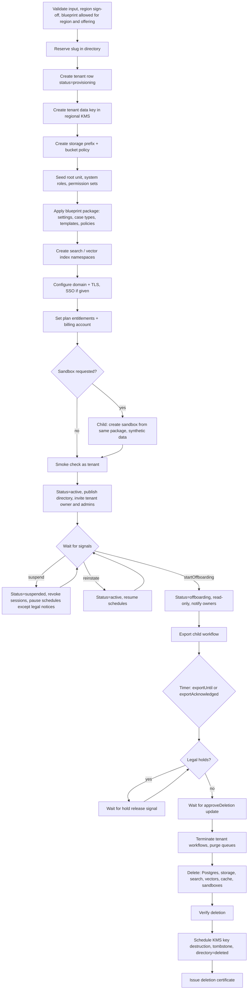

# 3.5 Tenant lifecycle

<!-- Generated layout: edit text between the markers; keep the markers and the front matter. -->

> Provisioning from a signed tenant blueprint (with optional sandbox and first-owner invitation), suspension, offboarding, data export, deletion approval and deletion with certificate

<!-- section:purpose -->
## Purpose and outcome

Takes a tenant from a signed contract to a working tenant built from a **tenant blueprint**, keeps its status correct while it is a customer (suspension, reinstatement), and at the end exports its data to the institution and deletes it everywhere, with proof. Platform staff drive it from [[APP-platform-admin-and-support]] using the wizard in [[APP-tenant-onboarding-wizard]]; tenant owners see its tenant-facing steps (first-run setup, export download) in [[APP-tenant-admin-console]]. Timer values and bounds come from [[PKG-settings-platform-operations]] (`platform.lifecycle.*`). "Done" for each phase:

- **Provisioned**: tenant `active` in its home region, directory entry live, blueprint package applied (roles, permission sets, settings, case types, templates, notification policies), storage, keys and indexes created, optional sandbox created, first `tenant_owner` invited, smoke check passed.
- **Onboarded** (tenant-side, does not block `active`): first-run setup checklist completed or dismissed by the tenant owner.
- **Suspended / reinstated**: status changed, users and integrations behave as specified, tenant owners and admins notified.
- **Offboarded**: export delivered and acknowledged (or the window has expired), all tenant data deleted from database, storage, search, vectors, caches and Temporal, keys scheduled for destruction, backups ageing out, and a deletion certificate issued.

<!-- section:trigger -->
## Trigger and inputs

| Trigger | Source | Input |
|---|---|---|
| `ProvisionTenant` | Platform admin finishing the provisioning wizard ([[APP-tenant-onboarding-wizard]]), op `platform.tenant.provision` | `tenantId`, region, offering (CORD or TERES), tenant type, billing entity, plan, blueprint ID and version, blueprint parameters (seat time zone, default locale, case types to enable), first owner email, optional additional admins, optional custom domain, optional SSO metadata, sandbox requested (boolean), contract reference |
| `SuspendTenant` / `ReinstateTenant` | Platform admin, billing dunning ([[BIL-payment-gateway-integration]]), platform security | `tenantId`, reason code, effective time, ticket |
| `StartOffboarding` | Platform admin after contract end (maker-checker) | `tenantId`, `exportUntil`, `deleteAfter`, export format, recipient membership (a `tenant_owner`) |
| `ApproveDeletion` | `platform_owner` with DPO sign-off reference | `tenantId`, sign-off reference |

Workflow ID: `{tenantId}-tenant-lifecycle-{tenantId}`: one long-running workflow per tenant, started at provisioning, using Continue-As-New yearly to bound history. Task queue `platform-ops` in the tenant's home region; namespace `prod-<region>`. Child workflows: `{tenantId}-tenant-blueprint-apply-{packageVersion}`, `{tenantId}-tenant-sandbox-{sandboxId}`, `{tenantId}-tenant-export-{exportId}`.

<!-- section:actors -->
## Actors

| Actor | Role key | Interaction |
|---|---|---|
| Platform admin | `platform_admin` | Starts provisioning and offboarding; sends `suspend`, `reinstate`, `extendExport`; resolves failed steps (`retry`, `abandon`) |
| Regional operations | `regional_ops` | May resolve failed steps; receives alerts |
| Platform owner | `platform_owner` | Approves region legal sign-off (once per region and tenant type) and final deletion |
| Platform billing | `platform_billing` (and the billing service) | Sends `suspend` / `reinstate` with reason `non_payment`; sets plan |
| Platform security | `platform_security` | Sends `suspend` with reason `security` |
| Tenant owner | `tenant_owner` | Accepts invitation; completes first-run setup; downloads export; sends `exportAcknowledged` |
| DPO / legal | — (sign-off recorded by platform owner) | Approves deletion when a legal hold was released; signs the deletion certificate |
| Retention package | system | Reports legal holds ([[PKG-data-retention-legal-hold-and]]) |
| Configuration packages | system | Applies the blueprint package ([[PKG-configuration-packages]]) |
| Directory service | system | Receives region/status updates via outbox |

<!-- section:steps -->
## Step sequence



| # | Step | Type | Notes |
|---|---|---|---|
| P0 | Validate input; check region approval for this tenant type; check blueprint version is `published` and allowed for the region and offering | Activity | Rejects unknown region codes and retired blueprints |
| P1 | Reserve slug | Activity (directory) | Idempotent on `tenantId`; slug checked against `platform.tenant.reserved_slugs` |
| P2 | Create tenant row (`provisioning`) | Activity, platform context | |
| P3 | Create tenant data key | Activity (KMS) | Pending ADR on per-tenant keys |
| P4 | Storage prefix and policy | Activity | `s3://nomo-prod-<region>-docs/<tenantId>/` |
| P5 | Seed root unit, system roles and permission sets | Activity, tenant context | Roles and sets from [[PKG-roles-and-permission-sets]]; natural-key upserts |
| P6 | Apply blueprint package | Child workflow | Verifies the package signature, applies settings, case-type blueprints, templates, notification policies, automation rules and AI policy defaults as **published version 1** of each, with `via=system` and the blueprint reference in the change set ([[PKG-configuration-packages]]) |
| P7 | Search and vector namespaces | Activity | [[PKG-search]], [[AI-rag]] |
| P8 | Domain and TLS; SSO configuration | Activities | Custom domain waits for DNS verification (signal or poll up to `platform.lifecycle.domain_verification_days`) ([[PKG-domain-verification]]) |
| P9 | Entitlements and billing account | Activity | [[BIL-plans-entitlements-and-usage]] |
| P10a | Sandbox | Child workflow | Same package, synthetic data only; entitlement-checked |
| P11 | Smoke check | Activity | Create and read a canary row as the tenant, resolve three settings, render the sign-in page, then delete the canary |
| P12 | Activate, publish, invite | Activities | Invitation of the first `tenant_owner` via [[PKG-notifications]]; additional admins invited with their roles; owner sees the first-run checklist at `/admin/setup` |
| S1 | Suspend | Activities | Sessions revoked ([[PKG-mfa-session-management-device]]); API keys disabled; scheduled workflows paused except those marked legally required when `platform.lifecycle.suspension_legal_notices_continue` is true |
| S2 | Reinstate | Activities | Reverse of S1 |
| O1 | Offboarding start | Activity | Read-only; new cases blocked |
| O2 | Export | Child workflow `{tenantId}-tenant-export-{exportId}` | Database rows as JSON Lines per table, documents with manifest and SHA-256 hashes, configuration as a configuration package; delivered via signed URL valid 7 days |
| O3 | Export window | Timer + signal | `exportUntil` (contract, default `platform.lifecycle.export_window_days`) |
| O4–O5 | Legal hold check | Activity + signal wait | Deletion blocked while any hold exists |
| O5a | Deletion approval | Update wait | `platform_owner` with DPO sign-off reference (irreversible op `platform.tenant.approve_deletion`) |
| O6 | Stop work | Activities | Terminate all workflows with `tenantId` search attribute; drain BullMQ |
| O7 | Delete | Activities (batched, heartbeating) as `nomo_platform_ops` | Order: derived stores, sandboxes, objects, then database tables child-first |
| O8 | Verify | Activity | Counts per table, storage prefix empty, index empty |
| O9 | Keys, tombstone, directory | Activities | KMS key scheduled for deletion (pending window per provider) |
| O10 | Certificate | Activity | PDF signed by DPO, stored in platform records |

<!-- section:timers -->
## Timers and SLAs

| Timer | Value (setting key) | Source | On breach |
|---|---|---|---|
| Custom domain verification | 7 days (`platform.lifecycle.domain_verification_days`) | Product default | Continue on subdomain; notify platform admin |
| First owner invitation | 7 days (`platform.lifecycle.owner_invitation_days`) | TM-R11 | Platform admin re-issues; tenant stays `active` |
| First-run setup reminder | 3 and 10 days after activation | Product default | Reminder to tenant owner; account manager notified at day 10 |
| Export window | Contract value; default 30 days (`platform.lifecycle.export_window_days`, proposed) | Client contract / [[PKG-retention-and-deletion-schedule]] | Proceed to deletion approval if no hold; reminders at 7 and 1 days before |
| Deletion after export | `deleteAfter`; within 90 days of contract end (`platform.lifecycle.delete_after_days`, proposed) | Contract; DPDP storage limitation (erase when purpose served, s.8(7)) [R1] | Alert DPO if overdue |
| Deletion approval wait | 14 days after export window | Product default | Escalate to platform owner and DPO |
| Backup age-out | Backup retention (for example 35 days) | [[INF-backup-and-disaster-recovery]] | Certificate states the date by which backups expire |
| Suspension grace for non-payment | Per contract (`platform.lifecycle.nonpayment_grace_days`) | Billing | — |

<!-- section:signals -->
## Signals, updates and queries

| Signal / update | Payload | Validation |
|---|---|---|
| `suspend` (update) | `{ reason: 'non_payment' \| 'security' \| 'contract' \| 'region_move', note, ticket, actorId }` | Actor has `platform.tenant:update` (platform admin, billing service, platform security); returns new status |
| `reinstate` (update) | `{ actorId, note, ticket }` | Status is `suspended` |
| `startOffboarding` (update) | `{ exportUntil, deleteAfter, format, recipientMembershipId, approvalId }` | Dates in the future; recipient is an active `tenant_owner`; maker-checker approval present |
| `approveDeletion` (update) | `{ actorId, dpoSignOffRef }` | Actor holds `platform.tenant:approve`; export window closed; no legal hold |
| `retry` / `abandon` (update) | `{ actorId, note }` | Status is `provisioning_failed` |
| `extendExport` (signal) | `{ until }` | Platform admin; not past `deleteAfter` |
| `exportAcknowledged` (signal) | `{ membershipId }` | Tenant owner of this tenant |
| `legalHoldReleased` (signal) | `{ holdId }` | From retention package |
| `domainVerified` (signal) | `{ hostname }` | From domain verification job |
| `setupCompleted` (signal) | `{ membershipId }` | From first-run checklist; informational only |
| Query `status` | — | Returns phase, current step, step history, timers, pending signals and blueprint version for the platform console and the tenant owner's setup page |

Every update is sent through `runAdminOp` ([[APP-administration-model#design]]), which checks the permission and writes the audit event before the Temporal Update is issued.

<!-- section:activities -->
## Activities

| Activity | Side effect | Idempotency key | Timeout / retry |
|---|---|---|---|
| `reserveSlug` | Directory entry | `tenantId` | 30 s, 5 attempts |
| `createTenantRow` | Insert tenant | `tenantId` (PK) | 30 s, 5 |
| `createDataKey` | KMS key with alias `tenant/<tenantId>` | Alias | 60 s, 5 |
| `createStoragePrefix` | Bucket policy entries | `tenantId` | 60 s, 5 |
| `seedRolesAndUnits` | System roles, permission sets, root unit | Natural keys (`role.key`, `unit.code`) with upsert | 120 s, 5 |
| `applyBlueprintPackage` (child workflow) | Published configuration version 1 per area | `tenantId` + package ID + version | Heartbeat 30 s, 30 min |
| `createIndexes` | Search / vector namespaces | Namespace name | 120 s, 5 |
| `configureDomain` | DNS check, certificate request | Hostname | 60 s, unlimited within the verification window |
| `createSandbox` (child workflow) | Sandbox tenant context with synthetic data | `sandboxId` | Heartbeat 30 s, 30 min |
| `smokeCheck` | Canary row created and deleted | `tenantId` + run ID | 120 s, 3 |
| `activateTenant` | Status update, outbox | Expected status precondition | 30 s, 5 |
| `inviteInitialAdmins` | Invitations | `tenantId` + email | 60 s, 5 |
| `revokeSessions` / `disableApiKeys` | Session and key rows | Tenant id + operation id | 60 s, 5 |
| `exportTable` (per table) | JSONL to export bucket | `exportId` + table | Heartbeat 30 s, 2 h |
| `exportConfiguration` | Configuration package of the tenant's published versions | `exportId` | 10 min |
| `deleteTenantData` (per table batch) | DELETE by `tenant_id` in batches of 10,000 | Repeatable (delete is naturally idempotent) | Heartbeat 30 s, 6 h |
| `verifyDeletion` | Read-only counts | — | 10 min |
| `scheduleKeyDeletion` | KMS deletion scheduled | Key alias | 60 s, 5 |
| `issueCertificate` | PDF + record | `tenantId` | 120 s, 5 |

<!-- section:failure -->
## Failure, cancellation and compensation

- **Provisioning step fails after retries**: tenant set to `provisioning_failed`; workflow waits for `retry` or `abandon` update from a platform admin. `abandon` runs compensation in reverse: delete sandbox, remove indexes, remove applied configuration, delete seeded rows, remove storage prefix, schedule key deletion, release the slug, mark tenant `deleted` (it never held customer data).
- **Blueprint package fails validation** (signature, schema, a setting outside current bounds): P6 fails before writing anything (the package applies in one transaction per area, all areas or none); the console shows the failing items and offers a newer blueprint version or abandon.
- **Suspension partially applied** (for example session revocation failed): workflow retries; status is already `suspended`, and middleware enforces read-only from the status, so partial failure cannot leave users with write access.
- **Export fails**: retried per table; if a table cannot be exported, the export is marked incomplete, the window is extended automatically by 7 days and the platform admin is alerted. Deletion never starts with an incomplete export unless the platform owner and DPO both approve.
- **Deletion fails mid-way**: deletion is restartable; the tenant stays `offboarding` and read access stays blocked. Verification must pass before the certificate.
- **Cancellation**: offboarding can be cancelled (`reinstate`) only before step O6.

<!-- section:versioning -->
## Versioning

The workflow is long-lived, so changes use `patched()` markers and Continue-As-New boundaries [R2]. New provisioning steps are added for new tenants only; existing tenants get a one-off backfill job if needed. Blueprint application and offboarding are versioned separately as child workflows so that a tenant whose offboarding started stays on the version it began with. Blueprint **content** changes do not affect existing tenants: a tenant provisioned from blueprint version 3 keeps its own published configuration; a later blueprint version is offered to existing tenants only as an optional package import through [[PKG-configuration-packages]].

<!-- section:observability -->
## Visibility and monitoring

Search attributes: `tenantId`, `tenantType`, `offering`, `blueprintId`, `lifecyclePhase` (`provisioning`, `active`, `suspended`, `offboarding`, `deleted`), `region` [R3]. Metrics: provisioning duration (target under 30 minutes excluding custom domain DNS), failed steps by activity, tenants in `provisioning_failed`, time to first-run setup completion, offboarding tenants past `deleteAfter`. Alerts: any tenant in `provisioning_failed` for over 1 hour; any offboarding overdue; deletion approval waiting over 14 days; any deletion verification failure (P2, to DPO and platform on-call).

<!-- section:questions -->
## Open questions

- [ ] Per-tenant KMS keys and crypto-shredding: confirm with DevOps cost and key limits per region; record as ADR.
- [ ] Default export window and deletion deadline (30 and 90 days proposed) to be confirmed against standard client contracts.
- [ ] Export format: JSON Lines + documents + configuration package is proposed; do institutions need a case-file format (for example per-case folders with PDFs) instead?
- [ ] What must Nomology keep after deletion (for example invoices for tax law, audit records of the offboarding itself)? To be confirmed by finance and legal.
- [ ] During suspension for non-payment, which legally required notices still go out? Legal to decide per tenant type; the switch is `platform.lifecycle.suspension_legal_notices_continue`.
- [ ] Should tenant owners be able to request offboarding themselves from the console (with platform confirmation), or only through the account manager? (owner: product with legal)

<!-- checks -->
## Template checks

<!-- check:tenancy -->
### Tenancy and residency

One workflow per tenant, ID prefixed with the tenant id, run in the tenant's home region on the `platform-ops` queue; activities run in tenant context except platform-level and deletion steps, which use platform context or `nomo_platform_ops` with the job id logged.

<!-- check:security -->
### Access to workflow controls

Only platform staff with `platform.tenant:create` / `:update` / `:delete` (workforce SSO, phishing-resistant MFA) may start provisioning or offboarding; offboarding is maker-checker and deletion needs `platform_owner` with DPO sign-off; suspend can also come from the billing service and platform security through authenticated updates; tenant owners may only acknowledge exports and complete setup. Every update passes `runAdminOp` (permission check and audit) before it reaches Temporal, and the Temporal UI is restricted to platform operators.

<!-- check:idempotency -->
### Side effects and idempotency

Every activity has a natural idempotency key (tenant id, alias, namespace, export id + table); deletes are naturally idempotent; status changes use expected-status preconditions so a retry cannot apply a transition twice.

<!-- check:audit -->
### Audit and legal record

Each transition, blueprint application (with package ID, version and signature), export delivery, acknowledgement, legal-hold wait, deletion approval and deletion verification is written to the platform audit trail ([[PKG-audit-trail]]) and, while the tenant exists, to the tenant's audit trail so tenant owners see it in [[APP-admin-change-history]]; the deletion certificate is stored as a platform record, because Temporal history is retained only briefly and the tenant's own audit trail is deleted with the tenant.

<!-- check:compliance -->
### Regulatory timelines

Export window and deletion deadline come from the client contract; the DPDP Act requires erasure when the purpose is no longer served unless retention is required by law (s.8(7)) [R1], and GDPR Art. 28(3)(g) requires a processor to delete or return data at the end of services [R4]. Overdue deletion is detected by the alert above before it becomes a breach of contract.

<!-- check:change -->
### Change and versioning safety

Workflow code changes use `patched()` and Continue-As-New; blueprint content is data applied by a versioned child workflow, so blueprint changes never alter running lifecycles or existing tenants' configuration. Replay tests run against recorded histories of each phase before deploy.

<!-- check:humantasks -->
### Human tasks

Human waits: failed-step resolution (platform admin, alert at 1 hour), owner invitation acceptance (7 days, re-issue), first-run setup (non-blocking, reminders), export acknowledgement (bounded by the export window timer), deletion approval (escalation at 14 days). Each wait is visible in the `status` query and on the platform console lifecycle page.

<!-- check:testing -->
### Testing

Temporal time-skipping test environment [R5] covers provisioning success, every failure and compensation path, suspension and reinstatement, export window expiry, legal-hold wait and deletion verification; an end-to-end staging run produces a real deletion certificate before Phase 7 exit.

<!-- citations -->
## Citations

```json
[
  {
    "excerpt": "Sections 5–6 (notice and consent), 8 (obligations of data fiduciary, including breach intimation), 11–14 (rights of data principal), 17 (exemptions).",
    "id": "R1",
    "issuer": "Government of India (MeitY)",
    "jurisdiction": "India",
    "kind": "regulation",
    "ref": "Act No. 22 of 2023",
    "title": "Digital Personal Data Protection Act, 2023",
    "url": "https://www.meity.gov.in/static/uploads/2024/06/2bf1f0e9f04e6fb4f8fef35e82c42aa5.pdf"
  },
  {
    "excerpt": "patched() and Worker Versioning let running executions continue on the code path they started with.",
    "id": "R2",
    "kind": "vendor",
    "title": "Temporal docs: Versioning (TypeScript SDK)",
    "url": "https://docs.temporal.io/develop/typescript/versioning",
    "vendor": "Temporal Technologies"
  },
  {
    "excerpt": "Custom search attributes index workflow executions for filtering in visibility queries.",
    "id": "R3",
    "kind": "vendor",
    "title": "Temporal docs: Search Attributes",
    "url": "https://docs.temporal.io/search-attribute",
    "vendor": "Temporal Technologies"
  },
  {
    "excerpt": "Art. 12(3) one month to respond to requests (extendable by two months); Arts 13–14 information; Arts 15–22 rights; Art. 28 processors; Art. 30 records; Art. 32 security; Art. 33 notify the supervisory authority within 72 hours; Art. 34 communicate to data subjects; Chapter V transfers.",
    "id": "R4",
    "issuer": "European Parliament and Council",
    "jurisdiction": "EU / EEA",
    "kind": "regulation",
    "ref": "Regulation (EU) 2016/679",
    "title": "General Data Protection Regulation",
    "url": "https://eur-lex.europa.eu/eli/reg/2016/679/oj/eng"
  },
  {
    "excerpt": "Time-skipping test environment for testing timers without waiting real time.",
    "id": "R5",
    "kind": "vendor",
    "title": "Temporal docs: Testing suite (TypeScript SDK)",
    "url": "https://docs.temporal.io/develop/typescript/testing-suite",
    "vendor": "Temporal Technologies"
  }
]
```

<!-- end -->
