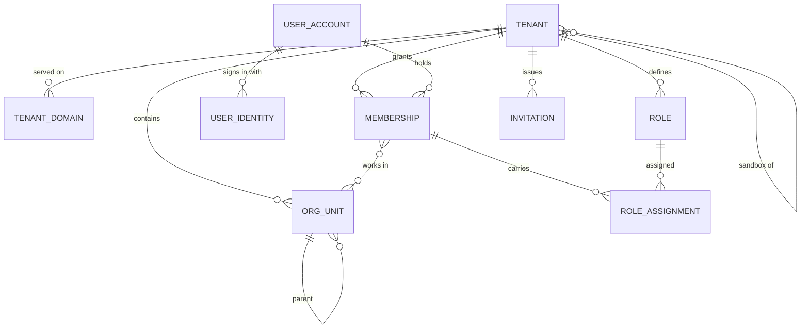
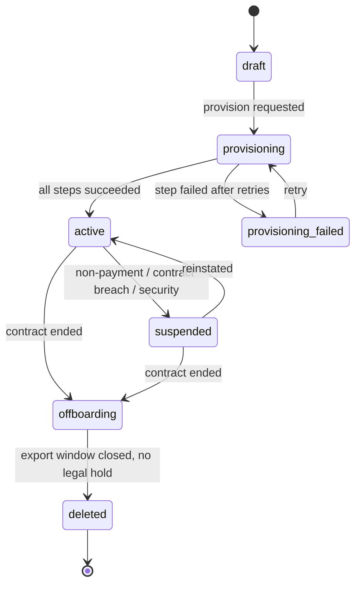

# 3.1 Tenant model

<!-- Generated layout: edit text between the markers; keep the markers and the front matter. -->

> Platform → Tenant (institution / client) → Organisation units → Users

<!-- section:purpose -->
## Purpose and vision

The tenant model defines who the platform's customers are and how people belong to them. A **tenant** is the unit of data ownership, configuration, billing and residency: an institution or client that runs its cases on the platform. Getting this model right decides whether an arbitral institution, a SEBI ODR institution and the CORD centre can share the platform safely, configure their own rules, and leave with their data.

The context owns: tenants and their type, region and status; organisation units inside a tenant (for example a secretariat team or a regional office); user accounts; memberships of users in tenants; and the roles a membership carries. It does not own what those roles may do (that is [[PKG-authorization]]) or how users sign in ([[PKG-authentication]]).

<!-- section:classification -->
## Strategic classification

- **Supporting, but foundational.** It is not what customers buy, but every other context depends on it and errors here are security incidents.
- **Business role**: compliance (data ownership and residency) and revenue (tenant = billing customer, linked to a billing entity NTPL, TAPL or the US entity in [[BIL-invoicing-taxes-gst-singapore]]).
- **Evolution stage**: stable after Phase 1. Changes to the model (for example a new tenant type) need an ADR.

<!-- section:language -->
## Ubiquitous language

| Term | Definition | Avoid |
|---|---|---|
| **Platform** | The Nomology-operated system as a whole, in one region. Owns platform-level tables and staff accounts. | "System", "global" |
| **Tenant** | An institution or client whose cases, users and configuration are isolated from all others. Has exactly one home region. | "Customer" (that is the billing view), "organisation", "account" |
| **Tenant type** | What kind of institution: `arbitral_institution`, `odr_institution` (SEBI-recognised ODR institution), `cord` (the CORD centre operated by Nomology), `enterprise` (a company resolving its own disputes), `court_programme` (for example a court-annexed programme), or `sandbox` (a non-production copy of a parent tenant). Drives defaults, not permissions. | — |
| **Offering** | The product line a tenant is licensed for: `cord` or `teres`. A tenant has one primary offering and may hold both; a case uses the offering of its case type. | "product" in code |
| **Sandbox tenant** | A tenant of type `sandbox` with a `parent_tenant_id`, used to preview and test configuration with synthetic or masked data ([[PKG-configuration-lifecycle]]). | "test tenant", "staging tenant" |
| **Customer account** | The grouping of tenants that belong to one customer (`customer_account_id`), for example a production tenant and its sandboxes. | — |
| **Home region** | The region (`in`, `sg`, `us`, or an Azure region code) where all the tenant's data is stored and processed. | "Location", "data centre" |
| **Organisation unit (unit)** | An office, panel, programme, desk or team inside a tenant used to route work, scope queues and administration, and hold unit-level settings (for example "Mumbai secretariat", "SEBI ODR desk"). Hierarchical. It is the `unit` scope of the shared configuration model. | "Department", "sub-tenant" |
| **User account** | A person's identity in one region: name, verified email / phone, credentials or SSO links. A person who works with tenants in two regions has two user accounts. | "Profile" |
| **Membership** | The link between a user account and a tenant, carrying kind, status and role assignments. `staff` memberships are the tenant's own people; `external` memberships (parties, counsel, external neutrals, observers) get case access only through case roles ([[PKG-external-party-identity]]). A user can hold memberships in many tenants in the same region. | "Seat" (billing term) |
| **Role** | A named bundle of permission sets assigned to a principal at a scope ([[PKG-roles-and-permission-sets]]). Tenant administrative roles: `tenant_owner`, `tenant_admin`, `security_admin`, `user_admin`, `workflow_designer`, `integration_admin`, `content_admin`, `billing_admin`, `ai_admin`, `auditor`, `unit_admin`. Tenant operational roles: `secretariat`, `neutral`, `transcriber`, `party`, `counsel`, `observer`. Case-level roles (`case_manager`, `tribunal_secretary`, `presiding_neutral`, `claimant_counsel` and others) are assigned per case ([[PKG-rbac-abac-case-level-party]], [[DOM-cases]]), not here. | "Persona" (a persona is the UI route group; one persona may be served by several roles) |
| **Invitation** | A pending offer of membership sent to an email or phone, with roles and an expiry. | — |
| **Platform staff** | Nomology employees with platform roles (`platform_owner`, `platform_admin`, `platform_support`, `platform_security`, `platform_billing`, `regional_ops`). Not members of tenants; reach tenant data only through approved support access ([[PKG-support-access-and-impersonation]]). | "Super admin" |
| **Active tenant** | The tenant a request acts for, resolved from host or credential. Exactly one per request. | "Current org" |

<!-- section:entities -->
## Entities and aggregates

| Aggregate root | Contains | Ownership |
|---|---|---|
| Tenant | Tenant domains, lifecycle status, plan reference, home region | Platform-level (no `tenant_id`; the row *is* the tenant) |
| Organisation unit (the `unit` scope) | Parent link, name, code, kind (office, panel, programme, desk, team) | Tenant-owned |
| User account | User identities (email, phone, SSO subject), profile | Platform-level within a region, visible to a tenant only through memberships (special RLS, see [[MT-tenancy-and-identity-schema]]) |
| Membership | Kind (`staff` or `external`), status, unit assignments (one primary), role assignments at tenant, unit, case-type or case scope ([[PKG-authorization-data-model]]) | Tenant-owned |
| Role | Permission bundle reference | Tenant-owned (system roles seeded per tenant at provisioning; custom roles optional) |
| Invitation | Target, roles, expiry, token hash | Tenant-owned |

Key attributes: tenant `slug` (unique per platform, used in subdomain), `type`, `primary_offering`, `offerings`, `parent_tenant_id` (sandboxes), `customer_account_id`, `home_region`, `status`, `billing_entity`, `default_locale`, `default_time_zone`. Membership `kind`, `status`, `invited_by`, `joined_at`, `ended_at`.

<!-- section:lifecycle -->
## Lifecycle (state machine)

**Tenant status** (enforced by a code-defined state machine, [[WF-entity-state-machines]]; transitions driven by [[MT-tenant-lifecycle]])

| From → to | Triggered by | Guard |
|---|---|---|
| draft → provisioning | `platform_admin` | Region, type, offerings, billing entity, tenant blueprint and first `tenant_owner` set; legal sign-off recorded for the region |
| provisioning → active | Workflow | All provisioning activities succeeded and smoke check passed |
| active → suspended | Platform admin, or billing dunning ([[BIL-payment-gateway-integration]]), or security incident lead | Reason code required; tenant admins notified |
| suspended → active | Platform admin | Reason cleared |
| active/suspended → offboarding | Platform admin after contract end | Export window and deletion date set from contract |
| offboarding → deleted | Workflow at end of window | No active legal hold on any record ([[PKG-data-retention-legal-hold-and]]) |

**Membership status**: `invited → active → suspended → ended`. `ended` memberships are kept (not deleted) so audit history still resolves the actor's name for the life of the case record.

<!-- section:rules -->
## Business rules

- TM-R1: Every tenant has exactly one home region, set at creation; it changes only through the region move procedure in [[MT-data-residency-2]].
- TM-R2: A tenant slug is unique across all regions (checked against the global tenant directory) and is never reused after deletion.
- TM-R3: A user account belongs to one region. The same email may exist as separate accounts in different regions.
- TM-R4: A request acts for exactly one active tenant; a user with several memberships switches tenant explicitly ([[PKG-tenant-and-role-switcher]]).
- TM-R5: A user can act in a tenant only through an `active` membership in that tenant; platform staff are never members by default.
- TM-R6: Every tenant always has at least one active membership with the `tenant_owner` role; removing the last one is rejected (ROLE-R1 in [[PKG-roles-and-permission-sets]]).
- TM-R7: The system roles of the permission catalogue (the tenant administrative and operational roles listed under Language) and the managed role templates (`secretariat_lead`, `case_finance_officer`, `reporting_viewer`, `regulatory_reporter`, `regulatory_approver`, `privacy_officer`) are seeded for every tenant at provisioning and cannot be deleted ([[PKG-roles-and-permission-sets]]); tenants may clone templates and add custom roles only where their plan allows ([[BIL-plans-entitlements-and-usage]]), and never grant more than their plan and the platform bounds allow.
- TM-R8: Units (`org_unit`) form a tree of at most 5 levels (proposed limit) inside one tenant; an org unit cannot have a parent in another tenant.
- TM-R9: A suspended tenant is read-only for tenant users and blocks sign-in for non-admin members; scheduled workflows pause except legally required notices (decision per tenant type, see questions).
- TM-R10: Ending a membership does not remove the person's case-level roles automatically; the secretariat is prompted to reassign open case roles.
- TM-R11: Invitations expire after 7 days (proposed default, tenant-configurable within 1–30 days) and are single-use.
- TM-R12: A tenant in `deleted` status keeps only a tombstone row (id, slug, region, deletion date, deletion certificate reference).
- TM-R13: A sandbox tenant has a `parent_tenant_id`, lives in its parent's home region, holds only synthetic or masked data, and receives configuration only through configuration packages ([[PKG-configuration-packages]]); a sandbox cannot have sandboxes.
- TM-R14: A tenant's `offerings` always include its `primary_offering`; a case type may only belong to an offering the tenant holds.
- TM-R15: An `external` membership may hold only the `party`, `counsel`, `neutral` or `observer` tenant roles and reaches cases only through case roles ([[PKG-external-party-identity]]).

<!-- section:commands -->
## Commands and events

| Command | Actor | Emits |
|---|---|---|
| `CreateTenant(slug, type, region, billingEntity, primaryOffering, offerings, customerAccountId?, blueprint, firstOwner)` | `platform_admin` ([[APP-tenant-onboarding-wizard]]) | `tenant.created` |
| `ProvisionTenant(tenantId)` | System (starts lifecycle workflow, [[MT-tenant-lifecycle]]) | `tenant.provisioned` / `tenant.provisioning_failed` |
| `CreateSandbox(parentTenantId, fromPackage)` | `tenant_owner` or `tenant_admin` of the parent, within the plan's sandbox entitlement ([[PKG-configuration-lifecycle]]) | `tenant.sandbox_created` |
| `SuspendTenant(tenantId, reason)` / `ReinstateTenant` | `platform_admin`; `platform_billing` (dunning); `platform_security` (security incident) | `tenant.suspended`, `tenant.reinstated` |
| `StartOffboarding(tenantId, exportUntil, deleteAfter)` | `platform_admin` | `tenant.offboarding_started` |
| `AddDomain(tenantId, hostname)` / `VerifyDomain` | `tenant_admin` / `platform_admin` | `tenant.domain_added`, `tenant.domain_verified` |
| `CreateOrgUnit`, `MoveOrgUnit` | `tenant_admin`; `unit_admin` inside their subtree | `org_unit.created`, `org_unit.moved` |
| `InviteMember(email/phone, kind, roles, orgUnits)` | `tenant_admin`, `user_admin`; `secretariat` for parties and counsel only | `membership.invited` |
| `AcceptInvitation(token)` | Invitee | `membership.activated` |
| `AssignRole`, `RevokeRole` (scoped role assignments, [[PKG-roles-and-permission-sets]]), `SuspendMembership`, `EndMembership` | Holders of `role:assign` (`tenant_owner`, `tenant_admin`, `user_admin`, `unit_admin` within their scope); an admin may only grant permissions they hold | `membership.roles_changed` (audit `admin.role.assigned`, `admin.role.revoked`), `membership.suspended`, `membership.ended` |

Events carry `tenantId`, actor, and ids only (no names or emails); they feed [[PKG-audit-trail]], [[OBS-business-events]] and outbound webhooks ([[INT-webhook-event-catalogue]]) where the tenant subscribes.

<!-- section:integrations -->
## Relationships to other contexts

| Context | Relationship | Notes |
|---|---|---|
| [[PKG-authentication]] | Customer–supplier (authentication consumes user accounts and identities) | SSO configuration per tenant lives in [[PKG-sso-saml-oidc-per-tenant]] and links users by `user_identity` |
| [[PKG-authorization]] | Customer–supplier | Reads memberships and units; owns permissions, roles and scoped role assignments ([[PKG-authorization-data-model]]) |
| [[DOM-cases]] | Downstream, conformist | Case-level roles reference `membership_id` or `user_account_id` |
| [[BIL-plans-entitlements-and-usage]] | Partnership | Tenant has a plan; seat counting reads active memberships |
| [[PKG-settings]] | Downstream | Settings resolve over the scopes platform → region → offering → tenant → unit → case type → case → user ([[PKG-configuration-scope-hierarchy]]); the tenant's `primary_offering` and `type` select offering values and `tenant_type` targets, and unit values are keyed by `org_unit.id` |
| Global tenant directory | Published language | Slug, domains, region, status replicated out of each region ([[MT-data-residency-2]]) |

<!-- section:variations -->
## Tenant and jurisdiction variations

| Variation | Arbitral institution tenant | SEBI ODR institution tenant | CORD tenant |
|---|---|---|---|
| Typical roles in use | `tenant_owner`, `tenant_admin`, `secretariat` (case-level `case_manager`, `tribunal_secretary`), `neutral`, `counsel`, `party`, `transcriber` | `tenant_owner`, `tenant_admin`, `secretariat` (case managers), `neutral` (conciliators / arbitrators), `party` (investors, often unrepresented), `counsel`; managed templates `regulatory_reporter`, `regulatory_approver` | `tenant_owner`, `tenant_admin`, `secretariat`, `neutral`, `party`, `counsel` |
| Membership creation | Mostly by invitation from the secretariat | Mostly bulk, from aggregator intake (MII) — parties created at intake | Self-registration for claimants plus invitations |
| SSO | Often required for staff | Rare | Not required |
| Units | Teams by case type or office | Teams by MII or region | Teams by programme |
| Home region | Depends on institution (India, Singapore or US) | India | India (assumption) |

Tenant-type defaults are seed data ([[PKG-reference-and-seed-data]]); they set initial roles and settings but never grant permissions not in the permission matrix.

<!-- section:retention -->
## Data retention and confidentiality

- Tenant rows are kept as tombstones after deletion (TM-R12).
- Memberships and user accounts referenced by case records are kept for as long as the case record is retained under the tenant's schedule ([[PKG-retention-and-deletion-schedule]]), because the record must show who acted. At the end of that period the user account's personal fields are anonymised.
- A user account with no memberships for 24 months (proposed) is deleted or anonymised, after notice.
- Erasure requests from a user are handled by [[SEC-data-principal-rights-requests]]; where the tenant must keep the case record, the account is restricted rather than erased.
- Confidentiality: membership lists of a tenant are tenant-internal; a party can see only the people on their own case.

<!-- section:questions -->
## Open questions and assumptions

- [ ] Assumption: the CORD tenant's home region is India. To be confirmed.
- [ ] Should a suspended tenant still send legally required notices on running cases (for example service of an award)? Proposed: yes, configurable per tenant type; legal to confirm.
- [ ] One account per region (TM-R3) versus a global identity index: decision needed (see [[MT-data-residency-2]]).
- [ ] Are custom roles a plan feature or available to all tenants?
- [ ] Inactive account deletion period (24 months proposed) to be confirmed by legal and the DPO.

<!-- checks -->
## Template checks

<!-- check:tenancy -->
### Tenancy and residency

Tenants are platform-level rows (a sandbox is a separate tenant row with its own data, never a view of its parent); units, memberships, roles, role assignments and invitations are tenant-owned with `tenant_id` and forced RLS ([[MT-rls-enabled-and-forced-on]]). User accounts are platform-level within a region but protected by a membership-based RLS policy, so a tenant can see only accounts that hold (or held) a membership in it. All rows live in the tenant's (or the user's) home-region database; only slug, domains, region and status are published to the global directory.

<!-- check:security -->
### Access and confidentiality

Commands map to permissions in [[PKG-policy-engine-permission-matrix]]: only `platform_admin` may create or offboard tenants, and suspension is also open to `platform_billing` (dunning) and `platform_security` (incidents); role assignment needs `role:assign` (privileged roles `role.privileged:assign`) within the admin's own scope, and an admin may only grant permissions they hold ([[PKG-roles-and-permission-sets]]); `unit_admin` manages units and members inside their subtree only; `secretariat` may invite parties and counsel but not staff roles. TM-R6 (last owner) and TM-R5 (no implicit staff membership) are enforced in the domain service and covered by tests.

<!-- check:audit -->
### Audit and legal record

Tenant status changes, domain changes, membership and role changes and invitation acceptance are recorded in [[PKG-audit-trail]] with actor, before/after values and reason. These answer the question an institution's board or a court may ask: who had access to the case file, with which role, and when that changed.

<!-- check:privacy -->
### Personal data

Personal data held: user names, emails, phone numbers, SSO subject identifiers, last sign-in. Purpose: giving access to the platform and recording who acted on a case. Basis: contract with the tenant (the tenant acts as data fiduciary / controller for its users; Nomology as processor), except for the CORD tenant where NTPL is likely the fiduciary (assumption, to be confirmed). Erasure conflicts with the legal record are resolved by restriction and later anonymisation.

<!-- check:consistency -->
### Invariants and concurrency

Inside the membership aggregate the last-admin rule and role assignment are checked in one transaction with `SELECT ... FOR UPDATE` on the tenant's admin memberships. Tenant status transitions use optimistic concurrency (`version` column). The directory is eventually consistent with the regional tenant row (propagation target under 60 seconds); the regional row is the source of truth for status.

<!-- check:i18n -->
### Localisation and jurisdiction

Each tenant has `default_locale` and `default_time_zone`; users can override both. Tenant names may be stored in several languages (`display_name` as a JSON map keyed by BCP 47 tag). Role display names are translatable strings, not data.

<!-- check:testing -->
### Testing

State machine tests for every tenant and membership transition including rejected ones; tests for TM-R2, TM-R5, TM-R6 and TM-R8; isolation tests for org units, memberships and invitations ([[MT-automated-tests-that-prove-one]]); provisioning workflow tests in [[MT-tenant-lifecycle]].

<!-- end -->
