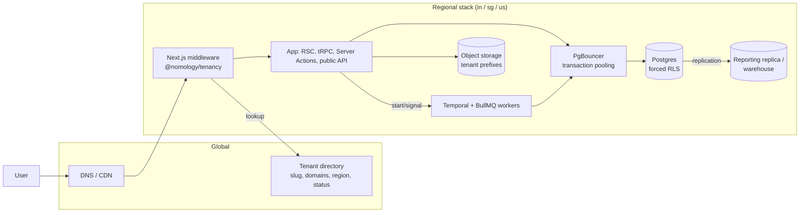

# 3 Multi-tenancy (Core)

<!-- Generated layout: edit text between the markers; keep the markers and the front matter. -->

> Tenant model, tenant resolution, database-enforced isolation (shared Postgres per region with tenant_id and forced RLS), data residency and tenant lifecycle

<!-- section:purpose -->
## Purpose and scope

Multi-tenancy is the layer that lets one platform serve many institutions (arbitral institutions, SEBI-recognised ODR institutions, the CORD tenant run by Nomology, and enterprise clients) while guaranteeing that no tenant can see, change or slow down another tenant's data. It defines what a tenant is, how every request, job and workflow learns which tenant it acts for, how the database enforces that, where each tenant's data lives, and how a tenant is created, suspended and removed.

**In scope**

- The tenant model: platform → tenant → organisation units → users and memberships ([[MT-tenant-model]], [[MT-tenancy-and-identity-schema]])
- Tenant resolution from host name, custom domain, API credential or internal header ([[MT-tenant-resolution]])
- Database isolation: shared Postgres per region, `tenant_id` on every tenant table, forced Row-Level Security, transaction-scoped tenant context, database roles ([[MT-isolation-strategy]], [[MT-prisma-implementation]])
- Safeguards that keep isolation true over time: isolation tests, lint and review checks, a separate reporting path ([[MT-safeguards]])
- Data residency: pinning each tenant to one region and routing every request, job and workflow there ([[MT-data-residency-2]])
- Tenant lifecycle: onboarding, provisioning, suspension, offboarding, export and deletion ([[MT-tenant-lifecycle]])

**Out of scope** (and where it lives instead)

| Someone might look here for | It lives in |
|---|---|
| Who may do what inside a tenant (roles, case-level access, ethical walls) | [[PKG-authorization]], [[PKG-rbac-abac-case-level-party]] |
| Sign-in, SSO per tenant, MFA | [[PKG-authentication]], [[PKG-sso-saml-oidc-per-tenant]] |
| Support staff access to a tenant's data, impersonation | [[PKG-support-access-and-impersonation]] |
| Tenant settings, branding, feature flags | [[PKG-settings]], [[PKG-branding-and-theming]], [[PKG-feature-flags]] |
| Tenant-scoped cache keys and search indexes | [[PKG-caching]], [[PKG-search]] |
| Plans, entitlements and billing entity | [[BIL-plans-entitlements-and-usage]] |
| Physical regional infrastructure (database, PgBouncer, Temporal clusters) | [[INF-database]], [[INF-pgbouncer]], [[INF-temporal]] |
| The CI test suite standard for isolation tests | [[TST-multi-tenant-isolation-tests]] |

<!-- section:goals -->
## Goals and non-goals

**Goals** (proposed targets, to be confirmed at the Phase 1 review)

1. **Zero cross-tenant data exposure.** No production incident in which a user, job or report of one tenant reads or changes another tenant's rows, files, search results, cache entries or workflow data. Measured by the security incident register ([[SEC-security-incident-response-and]]).
2. **Isolation is enforced by the database, not by convention.** 100% of tenant-owned tables have `tenant_id NOT NULL`, RLS enabled and forced, and policies for every command; checked on every pull request and nightly against each regional production catalogue ([[MT-lint-review-check-that-every]]).
3. **Every execution path carries the tenant.** 100% of web requests, tRPC procedures, Server Actions, public API calls, BullMQ jobs and Temporal workflows and activities run with an explicit tenant context or an explicit, audited platform context. Queries without context return no rows and raise an alert.
4. **Residency is provable.** For any tenant, we can show from configuration and logs that its personal and case data was stored and processed only in its home region (India, Singapore or US), apart from documented sub-processor transfers.
5. **Tenant onboarding is self-service for the platform team.** A new tenant in any region is provisioned by the tenant lifecycle workflow in under 30 minutes, without engineering involvement or manual SQL.
6. **Noisy neighbours are contained.** One tenant's load cannot push another tenant's p95 API latency above its SLO; per-tenant rate limits and queue fairness are in place before the first SEBI ODR tenant with bulk intake goes live.

**Non-goals**

- Database-per-tenant or schema-per-tenant isolation as the default ([[ADR-tenant-isolation]] chose shared tables with RLS). A dedicated regional stack for one client is possible as a separate deployment, not a tenancy mode of the shared stack.
- A single global identity spanning regions. A person who uses tenants in two regions has one account per region (see [[MT-data-residency-2]]).
- Tenant-defined database schema changes. Tenant customisation is through metadata and custom fields ([[PKG-metadata-management-entity]]), never DDL.
- Cross-tenant features for end users (for example, a counsel seeing cases from two institutions in one list). The tenant switcher ([[PKG-tenant-and-role-switcher]]) changes context; it never merges it.

<!-- section:principles -->
## Principles

Every child node and every consumer of this area must follow these rules. Each rule names how it is enforced.

| # | Principle | Enforced by |
|---|---|---|
| MT-P1 | Every row of tenant data carries a non-null `tenant_id`; every table is classified as tenant-owned, platform-level or shared reference in `packages/db/tenancy-classification.yaml`. | Schema lint in CI ([[MT-lint-review-check-that-every]]) |
| MT-P2 | The database decides what a query can see. RLS is enabled **and forced** on every tenant-owned table; application `WHERE tenant_id = …` filters are an optimisation, never the control. | Catalogue test `rls-coverage.spec.ts`; nightly production catalogue check |
| MT-P3 | Tenant context is set per transaction with `set_config('app.tenant_id', …, true)`, never per session, so nothing survives a pooled connection. | `@nomology/db` is the only way to get a client ([[MT-prisma-client-extension-wraps]]) |
| MT-P4 | The application never connects as a table owner, superuser or `BYPASSRLS` role. | Role inventory test; [[MT-app-connects-as-a-non]] |
| MT-P5 | No context means no data: a missing tenant context fails closed (zero rows, failed writes, an error and an alert), never "all tenants". | Isolation tests ([[MT-automated-tests-that-prove-one]]) |
| MT-P6 | The tenant is resolved once at the edge of the system (middleware, API key, job envelope, workflow input) and propagated; inner code never re-derives it from user input. | Code review checklist; `@nomology/tenancy` API |
| MT-P7 | Cross-tenant access is a privileged, logged act: only migrations, listed platform jobs, break-glass support access and the reporting role may span tenants, each through its own role. | [[MT-separate-privileged-role-used]], [[MT-cross-tenant-reporting-via-a]], [[SEC-access-reviews]] |
| MT-P8 | A tenant's data stays in its home region. Global components hold only the tenant directory (no personal data), code and images. | Residency guardrails in [[MT-data-residency-2]] |
| MT-P9 | Every derived store is tenant-scoped too: cache keys, search indexes, object-storage prefixes, vector stores, Temporal search attributes, log fields. | Package contracts ([[PKG-caching]], [[PKG-search]], [[AI-rag]]); tenant check on each package node |

<!-- section:context -->
## Context and boundaries

| Neighbouring area | What flows across the boundary | Contract |
|---|---|---|
| [[APP]] Next.js App | Resolved `TenantContext` (id, slug, region, status) placed in request scope by middleware | `@nomology/tenancy` `getTenantContext()` ([[MT-tenant-resolution]]) |
| [[PKG-authentication]] / [[PKG-authorization]] | Membership check: the signed-in user must hold an active membership in the resolved tenant; roles come from scoped role assignments (`authz_role_assignment`, [[PKG-authorization-data-model]]) | Session carries `tenantId`; authorization reads memberships ([[MT-tenancy-and-identity-schema]]) |
| [[PKG-data-access]] | Tenant-scoped Prisma client; `withTenant()` and `withPlatformContext()` | [[MT-prisma-implementation]] |
| [[WF]] Tasks and Workflows | Tenant id in every job envelope, workflow ID prefix, search attribute and interceptor context | [[WF-separation-of-concerns-temporal]] guardrails |
| [[INF]] Infrastructure | Regional Postgres, PgBouncer, Temporal, Redis per region; database roles and secrets | [[INF-pgbouncer]], [[INF-database-connection-handling]], [[INF-secrets-and-keys]] |
| [[RPT]] Reporting | Cross-tenant reads only through the reporting role or warehouse | [[MT-cross-tenant-reporting-via-a]], [[RPT-report-infrastructure]] |
| [[SEC]] Security and Compliance | Evidence for ISO 27001 / SOC 2 logical access and segregation controls; incident handling for isolation failures | [[SEC-isms-controls]], [[SEC-security-incident-response-and]] |
| [[BIL]] Billing | Tenant plan, billing entity (NTPL, TAPL, US entity) and status changes (suspension for non-payment) | Tenant lifecycle events ([[MT-tenant-lifecycle]]) |

<!-- section:decisions -->
## Key decisions

| Decision | How it shapes this area |
|---|---|
| [[ADR-tenant-isolation]] | Pool model: one shared database per region, `tenant_id` on every tenant table and forced RLS. Everything in [[MT-isolation-strategy]] and [[MT-safeguards]] follows from it. |
| [[ADR-orm]] | Prisma has no native RLS support, so tenant context is set by a Client extension inside a transaction and RLS SQL is hand-written in migrations ([[MT-prisma-implementation]]). |
| [[ADR-next-js-hosting]] | Self-hosted regional containers mean tenant resolution runs in our own middleware in the tenant's region, not at a vendor edge. |
| [[ADR-temporal]] | One Temporal cluster per region; namespaces per environment and region, tenant carried in context, not one namespace per tenant. |
| [[ADR-container-orchestration]] | ECS per region, or Azure Container Apps for clients that require Azure; an Azure deployment is treated as its own region code for residency. |
| Pending | Whether tenant data keys are per tenant (enabling crypto-shredding at offboarding) — proposed in [[MT-tenant-lifecycle]], to be recorded as an ADR. |

<!-- section:map -->
## Capability map

| Child | Owns |
|---|---|
| [[MT-tenant-model]] | Business definition of platform, tenant, organisation unit, user, membership; tenant types and lifecycle states |
| [[MT-tenancy-and-identity-schema]] | Physical tables for tenants, domains, org units, users, identities, memberships, roles, invitations; table classification |
| [[MT-tenant-resolution]] | `@nomology/tenancy`: host / custom domain / API key / internal header → `TenantContext`; wrong-region handling |
| [[MT-isolation-strategy]] | The isolation control: assets, threats, role model, RLS policy pattern, permission matrix for database roles |
| [[MT-every-tenant-owned-table-carries]] | `tenant_id` column, type, indexing and composite foreign keys |
| [[MT-platform-level-tables]] | Rules for tables that have no `tenant_id` |
| [[MT-rls-enabled-and-forced-on]] | ENABLE + FORCE RLS and the standard policy on every tenant table |
| [[MT-prisma-implementation]] | `@nomology/db`: tenant-scoped Prisma client, transaction wrapper, roles per workload |
| [[MT-safeguards]] | Controls that keep isolation true over time (tests, lint, reporting path) |
| [[MT-data-residency-2]] | Region pinning, global directory, routing of requests/jobs/workflows, moving a tenant between regions |
| [[MT-tenant-lifecycle]] | Temporal workflow for provisioning, suspension, offboarding, export and deletion |

Gaps noted: per-tenant fairness and rate limiting (noisy neighbour) has no dedicated node; it is currently split between [[APP-api-versioning-rate-limiting]], [[WF-background-jobs-and-queues]] and [[AI-cost-controls]]. Proposed: add a requirement under [[MT-safeguards]].

<!-- section:phasing -->
## Phasing

| Phase ([[PLAN]]) | Children delivered | Exit criteria before the next phase |
|---|---|---|
| 0. Foundations | Database roles, `@nomology/db` skeleton with `withTenant()`, schema lint, first isolation test in CI | CI fails a pull request that adds a tenant table without RLS |
| 1. Core platform | Tenant model and schema, tenant resolution, forced RLS on all tables, privileged migration role, isolation test suite, tenant directory, provisioning half of the lifecycle workflow | Isolation suite green in all three regional staging stacks; pen-test style cross-tenant test by a second engineer; no table without classification |
| 3. First domain slice | Isolation tests extended to cases, documents, parties; object storage and search tenant scoping verified | Cross-tenant tests cover every tRPC router and public API family |
| 7. Insight and compliance | Reporting role / warehouse path; suspension and offboarding with export and deletion | Deletion certificate produced end to end in staging |
| 8. Hardening | Region move procedure rehearsed; external pen test of isolation | Pen-test findings on isolation closed |

Isolation tests, lint checks and the non-owner application role are cross-cutting from Phase 0 and must not be deferred.

<!-- section:risks -->
## Risks and open questions

- [ ] A Prisma query issued outside the tenant transaction wrapper (for example via a raw base client) reaches the database without context. Mitigation: RLS fails closed; base client not exported; ESLint ban. Owner: platform engineering lead.
- [ ] PgBouncer or a future pooler (RDS Proxy) pins or leaks session state. Mitigation: only transaction-local settings; validation test in [[INF-pgbouncer]]. Owner: DevOps.
- [ ] RLS policy cost on large tables (cases, documents, audit events) at five-year volume. Mitigation: `tenant_id` leading indexes; load test in [[TST-performance-and-load-testing]].
- [ ] Global tenant directory becomes a single point of failure for sign-in in all regions. Mitigation: regional read replicas of the directory and a cached copy in each region.
- [ ] Regulatory view on whether a tenant directory entry (institution name and domain) may be held globally. Assumption: it is not personal data; to be confirmed by legal.
- [ ] Cross-region users (counsel appearing before institutions in India and Singapore) dislike separate accounts. Decision needed on whether a global identity index is acceptable.

<!-- checks -->
## Template checks

<!-- check:boundaries -->
### Scope and boundaries

Each concern has one home: the tenant boundary (who the tenant is and what data belongs to it) lives here; who may act inside a tenant lives in [[PKG-authorization]]; support access across the boundary lives in [[PKG-support-access-and-impersonation]]. The contracts that cross the boundary are named: `TenantContext` from `@nomology/tenancy`, the tenant-scoped client from `@nomology/db`, the job/workflow envelope fields (`tenantId`, `region`) and the reporting role. The one overlap still open is per-tenant fairness (rate limits, queue fairness), currently spread across three nodes; a requirement under [[MT-safeguards]] is proposed.

<!-- check:principles -->
### Principles and enforcement

Yes. Each of MT-P1 to MT-P9 names its enforcement: schema lint and the classification file (P1), the `rls-coverage` catalogue test run in CI and nightly against production catalogues (P2), the `@nomology/db` package being the only exported client plus an ESLint `no-restricted-imports` rule on `@prisma/client` (P3), the role inventory test that fails if the runtime role owns objects or has `BYPASSRLS` (P4), the isolation test suite (P5), code review checklist items (P6), separate database roles with access reviews (P7), residency guardrails and infrastructure policy checks (P8), and the tenancy check on every package node (P9).

<!-- check:decisions -->
### Decisions linked

The shaping decisions are recorded and approved: [[ADR-tenant-isolation]], [[ADR-orm]], [[ADR-next-js-hosting]], [[ADR-temporal]], [[ADR-container-orchestration]]. Two decisions are still open and block children: (1) per-tenant encryption keys for crypto-shredding at offboarding, which affects [[MT-tenant-lifecycle]] and [[PKG-encryption-utilities-key]]; (2) global identity versus one account per region, which affects [[MT-tenancy-and-identity-schema]] and [[PKG-tenant-and-role-switcher]]. Both should become ADR nodes under [[ADR]].

<!-- check:compliance -->
### Regulatory and control mapping

| Obligation | Control implemented here | Evidence from |
|---|---|---|
| ISO/IEC 27001:2022 A.8.3 information access restriction, A.5.15 access control, A.8.31 separation of environments | Forced RLS, role separation, per-region stacks | [[MT-isolation-strategy]], [[MT-rls-enabled-and-forced-on]], CI catalogue reports |
| SOC 2 CC6.1 logical access security, C1.1 confidentiality | Database-enforced tenant isolation, reporting role | [[MT-safeguards]] test runs and access reviews |
| DPDP Act s.8(5) reasonable security safeguards; GDPR Art. 32; PDPA protection obligation | Isolation controls and tests | [[MT-automated-tests-that-prove-one]] |
| Client contracts (data segregation and residency clauses, for example with institutional tenants) | Region pinning and residency evidence | [[MT-data-residency-2]] |
| DPDP / GDPR / PDPA erasure and storage limitation at contract end | Offboarding export and deletion with certificate | [[MT-tenant-lifecycle]] |

<!-- check:regions -->
### Tenancy and residency

Per region: the whole data plane (Postgres with RLS, PgBouncer, Redis, Temporal cluster and namespace such as `prod-in`, workers, object storage, search, reporting replica). Global: the tenant directory (slug, domains, region code, status; no personal data), DNS and CDN routing, source code and container images, and CI/CD. An Azure deployment for a client that requires Azure gets its own region code (for example `in-az`) and is treated exactly like another region. A tenant lives in exactly one region; tenants in different regions never share a database, cache or workflow cluster.

<!-- check:phase -->
### Phasing

Phase 0: roles, `@nomology/db` wrapper, schema lint, first isolation test. Phase 1: tenant model, schema, resolution, forced RLS everywhere, directory, provisioning. Phase 3: isolation tests across the first domain slice. Phase 7: reporting path and offboarding. Phase 8: region move rehearsal and external isolation pen test. The non-owner application role, forced RLS, lint and isolation tests must not be deferred past Phase 1 because every later table depends on them.

<!-- end -->
