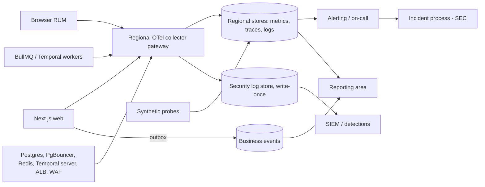

# 11 Observability (instrumentation layer)

<!-- Generated layout: edit text between the markers; keep the markers and the front matter. -->

> Instrumentation layer: OpenTelemetry signals (traces, metrics, logs, events) emitted with tenant and region context, collected and stored per region, with SLOs and alerting; consumption and reports live in Reporting

<!-- section:purpose -->
## Purpose and scope

Observability is the **instrumentation layer**: it defines which signals the platform emits, how they are named, how they travel and where they are stored, and how they become SLOs and alerts. It exists so that engineers can find and fix problems per tenant and per region before clients notice, and so that Reporting ([[RPT]]) and Security ([[SEC]]) have trustworthy raw signals.

**In scope**

- Telemetry foundations: OpenTelemetry SDKs, the shared `@nomology/telemetry` package, naming registry, tenant and region tagging, trace propagation, redaction, regional collector pipeline ([[OBS-foundations]])
- Signal families: business events, performance (API, UI, pipelines), usage, security events, AI usage ([[OBS-business-events]], [[OBS-performance]], [[OBS-frontend-real-user-monitoring]], [[OBS-usage]], [[OBS-security-events]], [[OBS-ai-usage]])
- SLOs, error budget policy, alert rules, on-call routing and incident hand-off ([[OBS-alerting]])
- Synthetic monitoring and the public status page ([[OBS-uptime-synthetic-monitoring]])

**Out of scope (and where it lives)**

| Item someone might expect here | Owner |
|---|---|
| Dashboards and reports for clients, management and regulators | [[RPT]] (for example [[RPT-platform-performance]], [[RPT-platform-security]], [[RPT-platform-ai-usage-analytics]]) |
| The user-visible audit trail (who did what to a case) | [[PKG-audit-trail]] — telemetry is never the legal record |
| Billing usage metering and AI budget enforcement | [[BIL-plans-entitlements-and-usage]], [[AI-cost-controls]] |
| Incident response process and regulatory breach clocks | [[SEC-security-incident-response-and]] |
| Hosting of collectors and telemetry stores | [[INF-compute]], [[INF-orchestration]] |
| Tenant-configurable thresholds (for example deadline warnings) | [[PKG-thresholds-and-alert]] (business notifications, not engineering pages) |

<!-- section:goals -->
## Goals and non-goals

**Goals (proposed targets)**

1. 100% of spans, logs and metrics from application workloads carry `nomo.tenant.id` (or an explicit `none` / `unknown`) and `cloud.region`, checked by a collector-side counter of untagged signals that must stay at 0.
2. A single trace connects browser → Next.js → Postgres → BullMQ / Temporal → external provider for at least 95% of sampled user actions that start background work.
3. Zero confirmed incidents of personal data or case content in stored telemetry per quarter, measured by a weekly scan of stored logs and spans.
4. Every paging alert maps to an SLO or a named imminent-impact condition, has a runbook, and on-call receives on average ≤ 2 pages per shift.
5. All telemetry for a tenant is stored only in that tenant's region.
6. Telemetry cost stays under a set share of regional infrastructure cost (proposed 10%), with series and log-volume budgets enforced.

**Non-goals**

- Session replay or recording of user screens.
- Using telemetry as the source of truth for billing, audit or regulatory reports.
- Giving tenants direct access to raw telemetry tools; tenant-facing views come through Reporting.

<!-- section:principles -->
## Principles

| # | Principle | How it is checked |
|---|---|---|
| OBS-P1 | **OpenTelemetry only.** All code emits through the OTel API via `@nomology/telemetry`; no vendor SDKs in application code. | Lint rule on imports (Turborepo boundary check) |
| OBS-P2 | **Registry first.** Every event name, metric name and custom attribute is declared in the telemetry registry before use. | CI check fails on undeclared names ([[OBS-foundations#catalogue]]) |
| OBS-P3 | **Allow-list attributes.** Only registered attributes leave the process; everything else is dropped in the SDK and again in the collector. | Collector drop counter; unit tests on the processor |
| OBS-P4 | **No personal data or case content in telemetry.** IDs are UUIDs; no names, emails, phone numbers, document text, transcripts, prompts or completions. Security logs are the only exception for IP address and user agent, with restricted access. | Redaction processors; weekly stored-data scan |
| OBS-P5 | **Tenant and region on everything.** Set once from context, never by hand. | Untagged-signal counter = 0 |
| OBS-P6 | **Stay in region.** Collectors and stores per region; cross-region views query in place and return only aggregates. | IaC review; policy-as-code |
| OBS-P7 | **Bounded metric labels.** No IDs (`case.id`, `user.id`, raw URLs) as metric labels; tenant ID only on metrics listed in the registry with a series budget. | Registry flag `metricLabel: allowed`; cardinality alert |
| OBS-P8 | **Alerts are symptoms.** Pages come from SLO burn rates or imminent-impact conditions, each with an owner and runbook. | Alert rule lint (owner, severity, runbook fields required) |

<!-- section:context -->
## Context and boundaries



| Neighbour | What crosses | Contract |
|---|---|---|
| [[INF]] | Collector hosting, infrastructure metrics and logs | [[INF-compute]], [[INF-monitor-pool-usage-wait-times]] |
| [[RPT]] | Business events, aggregated performance, usage, AI usage | Registry schemas as data contracts ([[OBS-business-events]]) |
| [[SEC]] | Security events, alerts that may indicate a breach | [[OBS-security-events]], [[SEC-security-incident-response-and]] |
| [[WF]] | Trace context into BullMQ and Temporal | [[OBS-foundations#pipeline]] |
| [[AI]] | Token, latency, cost and quality signals | [[OBS-ai-usage]] |
| [[APP]] | RUM, CSP reports, error boundaries | [[OBS-frontend-real-user-monitoring]] |

<!-- section:decisions -->
## Key decisions

- [[ADR-next-js-hosting]] — self-hosted containers mean we run our own collectors and initialise OTel in `instrumentation.ts`; no platform-provided telemetry.
- [[ADR-workflow-engine]], [[ADR-temporal]], [[ADR-queue-technology]] — traces must cross BullMQ jobs and Temporal workflows, so propagation through job payloads and Temporal interceptors is mandatory.
- [[ADR-tenant-isolation]] — tenant context already exists per transaction; telemetry reuses the same context source.

**Decisions still needed (proposed new ADR nodes)**

- Telemetry backend per region: self-hosted (for example Prometheus-compatible metrics, Loki, Tempo on regional object storage) vs a managed service with in-region storage. Requirement: storage in-region, retention control, label-based access control.
- SIEM choice for security events.
- On-call and incident tool.
- Custom attribute prefix: `nomo.*` (proposed, following OTel advice to prefix custom attributes) [R1].

<!-- section:map -->
## Capability map

| Child | Owns |
|---|---|
| [[OBS-foundations]] | SDK setup, telemetry package, registry, resource and tenant attributes, propagation, logging format, redaction, sampling, collector pipeline, retention baseline |
| [[OBS-business-events]] | Domain event catalogue (cases, neutrals, transcribers, documents, invoices) emitted through the outbox |
| [[OBS-performance]] | API, database, job and workflow performance metrics and SLOs |
| [[OBS-frontend-real-user-monitoring]] | Web Vitals, client errors and CSP reports from browsers |
| [[OBS-usage]] | Feature adoption and API / UI / workflow usage signals |
| [[OBS-security-events]] | Security event vocabulary, write-once storage, SIEM feed, detections |
| [[OBS-ai-usage]] | GenAI call telemetry: tokens, latency, cost, model, quality signals |
| [[OBS-alerting]] | Alert rules, severities, routing, on-call, error budget policy, incident hand-off |
| [[OBS-uptime-synthetic-monitoring]] | Synthetic journeys per region and persona, uptime SLO, status page |
| Related, outside this area | [[PKG-thresholds-and-alert]] (tenant-configurable thresholds consumed here) |

<!-- section:phasing -->
## Phasing

| Phase ([[PLAN]]) | Observability that must exist | Exit condition |
|---|---|---|
| 0. Foundations | Structured JSON logging with trace IDs; telemetry package skeleton; registry with CI check | Every service logs through the package; CI blocks unregistered names |
| 1. Core platform | Tenant and region tagging, redaction, regional collector, traces through Prisma; security events for sign-in and authorization | Untagged-signal counter at 0 in staging; PII scan clean |
| 3. First domain slice | Propagation into BullMQ and Temporal; first business events (cases, documents); basic alerts on SLOs for web | One trace from filing to Temporal activity in staging |
| 6. Intelligence | AI usage telemetry | Token and cost per tenant visible; no prompt text stored |
| 7. Insight and compliance | Full performance, usage, RUM, SIEM feed, synthetic monitoring, status page, error budget policy signed | SLO dashboards per region; status page live |
| 8. Hardening | Alert review, drills of the incident process, retention evidence | Page budget met for a month |

Cross-cutting from Phase 0 (not deferred): structured logging, redaction, tenant tagging and security events — retrofitting these is costly and risky.

<!-- section:risks -->
## Risks and open questions

- [ ] **Personal data leaking into telemetry** through exception messages, SQL text or URLs. Mitigation: allow-list processors in SDK and collector, weekly scan. Owner: Observability lead.
- [ ] **Cardinality cost** from tenant labels as tenant count grows. Mitigation: series budgets in the registry.
- [ ] **Backend decision delay** blocks Phase 1 pipeline; interim: collector exports to the regional log service only.
- [ ] **Small tenants and low traffic** make some SLOs statistically weak; use synthetic checks to fill gaps.

**Open questions**

- [ ] Backend per region: self-hosted or managed in-region? Who operates it?
- [ ] Is a cross-region "operations overview" (aggregates only, no tenant personal data) acceptable to legal for on-call engineers in another country?
- [ ] Who is the accountable owner for this area?
- [ ] Do any client contracts require us to give them telemetry, monitoring reports or incident notices within set times (to be confirmed by legal / account owners)?

<!-- checks -->
## Template checks

<!-- check:boundaries -->
### Scope and boundaries

Observability emits and stores signals; Reporting turns them into client, management and regulator views; Security owns detection response and breach clocks; the audit trail is a separate system of record in [[PKG-audit-trail]]. Business events cross into Reporting as registry-defined data contracts. Billing and AI budgets use their own ledgers and only reconcile against telemetry.

<!-- check:principles -->
### Principles and enforcement

All eight principles have an automated check: import lint for OTel-only, CI registry check, allow-list processors with drop counters, weekly stored-data PII scan, an untagged-signal counter, IaC review for regional stores, a registry flag for metric labels, and a lint rule requiring owner, severity and runbook on every alert.

<!-- check:compliance -->
### Regulatory and control mapping

Observability provides evidence for ISO 27001:2022 Annex A logging, monitoring and clock synchronisation controls and the corresponding SOC 2 monitoring criteria (through [[OBS-security-events]]), and supports the 6-hour CERT-In incident reporting and 180-day in-India log retention through detection and regional retention ([[OBS-foundations#retention]]). Data minimisation under DPDP, GDPR and PDPA is addressed by the no-personal-data principle and allow-list redaction.

<!-- check:regions -->
### Tenancy and residency

Collectors, stores, SIEM feed and synthetic probes run per region. Nothing global holds telemetry; a cross-region overview, if approved, queries each region and returns only aggregates. On Azure, the same collector image runs on Container Apps and exports to that region's stores; the only differences are infrastructure metric sources (Azure Monitor instead of CloudWatch).

<!-- check:phase -->
### Phasing

Logging, redaction, tenant tagging and security events start in Phases 0–1; propagation into workers in Phase 3; full SLOs, RUM, SIEM and status page in Phase 7, matching [[PLAN]]. The risk of deferring SLOs to Phase 7 is that early tenants run without error budgets; mitigation is basic burn-rate alerts on web availability from Phase 3.

<!-- citations -->
## Citations

```json
[
  {
    "body": "OpenTelemetry (CNCF)",
    "excerpt": "Names are lowercase, dot-separated namespaces; custom attributes should use a company-specific prefix to avoid clashes with future semantic conventions.",
    "id": "R1",
    "ident": "Semantic conventions",
    "kind": "standard",
    "title": "Attribute naming",
    "url": "https://opentelemetry.io/docs/specs/semconv/general/attribute-naming/"
  }
]
```

<!-- end -->
