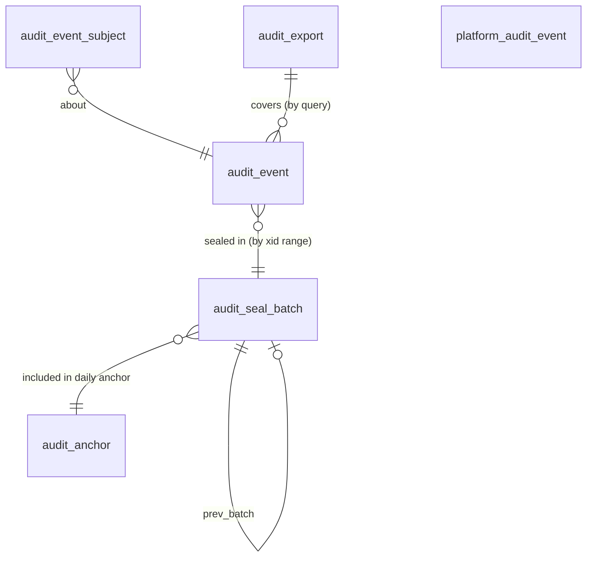

# 5.10.1 Audit log schema

<!-- Generated layout: edit text between the markers; keep the markers and the front matter. -->

> Append-only, partitioned audit events with hash chaining, retention and tenant-scoped export

<!-- section:purpose -->
## Scope and ownership

Physical schema for [[PKG-audit-trail]]: the append-only event tables, the sealing (hash chain) tables and the export bookkeeping. Owned by platform engineering (`packages/audit/prisma/audit.prisma`), stored in the Postgres schema `audit` of each regional database.

Other contexts never join to these tables directly; they write through `audit.record()` and read through `audit.search()` / `caseHistory()`. Domain tables are referenced by ID only (no foreign keys from audit to domain tables, because audit rows must survive deletion or anonymisation of what they describe).

<!-- section:entities -->
## Entities and relationships



| Table | Kind | Notes |
|---|---|---|
| `audit.audit_event` | Tenant-owned, partitioned monthly | Aggregate root; append-only |
| `audit.audit_event_subject` | Tenant-owned, partitioned monthly | Data principals affected by an event (for rights requests) |
| `audit.audit_seal_batch` | Tenant-owned | One row per sealed batch per tenant; hash chain |
| `audit.audit_anchor` | Platform-level | Daily Merkle root of all tenants' batch hashes in the region and the WORM object key |
| `audit.platform_audit_event` | Platform-level, partitioned monthly | Events with no tenant |
| `audit.audit_export` | Tenant-owned | Export jobs and their output object keys |

<!-- section:tables -->
## Tables and columns

Conventions: IDs are UUIDv7 (`uuid`, time-ordered, RFC 9562); timestamps `timestamptz` in UTC; hashes `bytea` (SHA-256, 32 bytes); enums as `text` with `CHECK`.

**audit.audit_event** (partitioned by RANGE on `occurred_at`, monthly)
| Column | Type | Null | Default | Meaning | Class |
|---|---|---|---|---|---|
| id | uuid | no | | Event ID (UUIDv7) | internal |
| tenant_id | uuid | no | | Owning tenant | internal |
| occurred_at | timestamptz | no | `now()` (DB clock, not app clock) | When committed work happened | internal |
| ingest_xid | xid8 | no | `pg_current_xact_id()` | Writing transaction ID; used for sealing horizon | internal |
| schema_version | smallint | no | 1 | Envelope version | internal |
| action | text | no | | Catalogue action, `CHECK (action ~ '^[a-z_]+(\.[a-z_]+)+$')` | internal |
| category | text | no | | `data_change`, `access`, `auth`, `admin`, `communication`, `export`, `system` | internal |
| outcome | text | no | 'success' | `success`, `denied`, `failure` | internal |
| actor_type | text | no | | `user`, `service`, `support`, `api_client`, `system` | internal |
| actor_id | uuid | yes | | User / service / API client ID | personal (pseudonymous ID) |
| on_behalf_of_id | uuid | yes | | Impersonated or represented user | personal (pseudonymous ID) |
| support_grant_id | uuid | yes | | Support access grant used | internal |
| target_type | text | no | | e.g. `case`, `document_version`, `party` | internal |
| target_id | text | no | | ID of target | internal |
| case_id | uuid | yes | | Case context for case history | internal |
| policy_id | text | yes | | Authz policy or decision table | internal |
| policy_version | text | yes | | Version evaluated | internal |
| reason | text | yes | | Max 500 chars, `CHECK (length(reason) <= 500)` | confidential |
| changes | jsonb | yes | | `[{field, before:{hash}|{value}, after:...}]`, validated by app schema and `CHECK (jsonb_typeof(changes) = 'array')` | confidential (hashes only for personal fields) |
| meta | jsonb | yes | | Action-specific flat object, `CHECK (jsonb_typeof(meta) = 'object')` | internal |
| ip_hash | bytea | yes | | HMAC-SHA256 of source IP with regional key; raw IP kept only in security telemetry | personal (pseudonymised) |
| user_agent_family | text | yes | | Browser family / OS only | internal |
| request_id | text | yes | | Correlation ID | internal |
| trace_id | text | yes | | W3C trace ID | internal |
| region | text | no | | `in`, `sg`, `us` | internal |
| event_hash | bytea | no | | SHA-256 over canonical JSON of the row (excluding `event_hash`, `ingest_xid`), computed by the app | internal |

**audit.audit_event_subject** — `tenant_id uuid not null`, `event_id uuid not null`, `occurred_at timestamptz not null`, `subject_type text CHECK (subject_type in ('user','party'))`, `subject_id uuid not null`. Partitioned like `audit_event`.

**audit.audit_seal_batch**
| Column | Type | Null | Meaning |
|---|---|---|---|
| tenant_id | uuid | no | |
| batch_no | bigint | no | 1, 2, 3 ... per tenant |
| xid_from | xid8 | no | Inclusive lower horizon |
| xid_to | xid8 | no | Exclusive upper horizon (`pg_snapshot_xmin` at seal time) |
| event_count | integer | no | |
| merkle_root | bytea | no | Root over `event_hash` ordered by `(occurred_at, id)` |
| prev_batch_hash | bytea | yes | `batch_hash` of batch_no − 1 (null for 1) |
| batch_hash | bytea | no | SHA-256(prev_batch_hash ‖ merkle_root ‖ xid_from ‖ xid_to ‖ event_count) |
| sealed_at | timestamptz | no | |
| anchor_id | uuid | yes | Daily anchor that includes this batch |

**audit.audit_anchor** — `id uuid`, `region text`, `anchored_date date unique per region`, `root bytea`, `object_key text` (WORM bucket key), `object_version_id text`, `created_at timestamptz`.

**audit.platform_audit_event** — same columns as `audit_event` minus `tenant_id`, `case_id`, plus `related_tenant_id uuid null`.

**audit.audit_export** — `id uuid`, `tenant_id uuid`, `requested_by uuid`, `query jsonb`, `format text CHECK (format in ('jsonl','csv'))`, `status text CHECK (status in ('queued','running','done','failed','expired'))`, `object_key text null`, `event_count int null`, `manifest_hash bytea null`, `created_at`, `completed_at`, `expires_at`.

<!-- section:keys -->
## Keys and constraints

- `audit_event` PK `(tenant_id, occurred_at, id)` — the partition key `occurred_at` must be part of the primary key in a partitioned table [R2].
- `audit_event_subject` PK `(tenant_id, occurred_at, event_id, subject_type, subject_id)`; FK to `audit_event (tenant_id, occurred_at, id)` within the same partition key, `ON DELETE CASCADE` (only the retention job deletes).
- `audit_seal_batch` PK `(tenant_id, batch_no)`; `UNIQUE (tenant_id, xid_from)`; `CHECK (xid_to > xid_from)`; FK `(tenant_id, batch_no - 1)` is enforced by the sealer, not a FK (computed column FKs are not supported), and checked by `verifyRange`.
- No FKs from audit to domain tables (audit must outlive the rows it describes).
- Database-enforced immutability: trigger `audit_event_no_update` raises on UPDATE for every role; DELETE is allowed only when `current_setting('app.retention_run', true) = 'on'` and the role is `retention_job` (see Retention).
- Application-enforced: action must be in the catalogue; `changes` shape; canonical hash computation.

<!-- section:tenancy -->
## Tenancy and RLS policies

```sql
ALTER TABLE audit.audit_event ENABLE ROW LEVEL SECURITY;
ALTER TABLE audit.audit_event FORCE ROW LEVEL SECURITY;
CREATE POLICY tenant_select ON audit.audit_event FOR SELECT TO nomo_app, nomo_worker
  USING (tenant_id = current_setting('app.tenant_id', true)::uuid);
CREATE POLICY tenant_insert ON audit.audit_event FOR INSERT TO nomo_app, nomo_worker
  WITH CHECK (tenant_id = current_setting('app.tenant_id', true)::uuid);
-- no UPDATE / DELETE policy for app roles => denied
GRANT SELECT, INSERT ON audit.audit_event TO nomo_app, nomo_worker;
-- no grant to nomo_reporting: platform reporting reads curated reporting.* views only
REVOKE UPDATE, DELETE, TRUNCATE ON audit.audit_event FROM nomo_app, nomo_worker, nomo_reporting;
```
The same pattern applies to `audit_event_subject`, `audit_seal_batch` (INSERT only for the `audit_sealer` role, which is a non-owner role without BYPASSRLS that runs per tenant inside `forEachTenant`) and `audit_export` (INSERT and UPDATE of `status`, `object_key`, `completed_at` for `nomo_app` and `nomo_worker`). Policies are declared on the partitioned parent and apply to all partitions; partitions are created by the migration role with the parent's policies.

`platform_audit_event` and `audit_anchor` are platform-level: no RLS; SELECT granted only to `nomo_platform_ops` (security investigations, every session logged); INSERT to `nomo_app` and `nomo_worker` for `platform_audit_event` through `audit.recordPlatform`. Neither contains tenant personal data beyond pseudonymous actor IDs.

Roles that bypass RLS: none used by this package. Migrations run as `nomo_migrator`, which assumes the owner `nomo_owner` (still subject to forced RLS); the platform-job role `nomo_platform_ops` is never used for sealing, export or retention of audit events.

<!-- section:indexes -->
## Indexes and access patterns

| Query | Index |
|---|---|
| Case history (`caseHistory`, secretariat export) | `(tenant_id, case_id, occurred_at)` where `case_id is not null` |
| Tenant admin search by actor | `(tenant_id, actor_id, occurred_at)` |
| Search by action over time | `(tenant_id, action, occurred_at)` |
| Target history ("who touched this document") | `(tenant_id, target_type, target_id, occurred_at)` |
| Sealer horizon scan | `(tenant_id, ingest_xid)` |
| Rights requests | `audit_event_subject (tenant_id, subject_id)` |

All indexes are created on the partitioned parent (propagated to partitions). No GIN on `meta` or `changes` until a query needs it.

<!-- section:history -->
## Status, history and concurrency

The table is itself the history: rows are never updated. Sealing works as follows:
1. Every minute, the sealer (BullMQ repeatable job, per region) reads `h = pg_snapshot_xmin(pg_current_snapshot())`. Every transaction with an ID below `h` has finished, so no new event can ever appear with `ingest_xid < h`.
2. For each tenant with events where `ingest_xid` is in `[last.xid_to, h)`, it computes the Merkle root over their `event_hash` values in `(occurred_at, id)` order and inserts `audit_seal_batch(batch_no+1, xid_from = last.xid_to, xid_to = h, ...)` with `prev_batch_hash`.
3. Daily, the anchor job builds a Merkle root over all batch hashes of the day in the region, writes it to the WORM bucket and records `audit_anchor`; batches get `anchor_id` via a separate append-only mapping (no UPDATE on sealed rows).

A long-running transaction holds back the horizon and therefore the sealer; that is the `audit.seal.lagging` alert, which also catches stuck transactions.

<!-- section:protection -->
## Data classification and protection

- Personal fields in `changes` are always hashed (HMAC-SHA256 with a per-tenant key from [[PKG-encryption-utilities-key]]) so values cannot be reversed by dictionary attack without the key; only fields tagged non-personal in the domain schema catalogue may appear as plain values.
- `reason` is free text written by staff (for example an override reason) and is classified confidential; UI guidance tells users not to enter personal data, and a scanner flags email and phone patterns.
- IP addresses are stored as keyed hashes; raw IPs live in security telemetry with shorter retention ([[OBS-security-events]]).
- Never copied to: search indexes, the analytics warehouse (only aggregated counts), AI prompts or embeddings.

<!-- section:retention -->
## Retention, archival and deletion

| Table | Clock | Hot (Postgres) | End of life |
|---|---|---|---|
| `audit_event`, `audit_event_subject` | `occurred_at` | 13 months (proposed) | Monthly partition exported per tenant to the regional archive bucket (JSONL + manifest with event hashes and batch hashes), verified, then detached and dropped. Archive objects kept per [[PKG-retention-and-deletion-schedule]] (assumption: case-linked events for the life of the case record plus the institution's retention; security events at least 1 year) |
| `audit_seal_batch`, `audit_anchor` | `sealed_at` | Kept as long as any archived event they cover | Deleted with the last covered archive |
| `platform_audit_event` | `occurred_at` | 13 months | Archived, kept 7 years (proposed) |
| `audit_export` | `created_at` | 90 days | Rows deleted; output objects expire after 7 days |

Legal hold: if a hold covers a tenant or case ([[PKG-data-retention-legal-hold-and]]), the archive objects for that tenant or case are placed under S3 Object Lock legal hold and the deletion job skips them. Tenant offboarding: the tenant receives a full export; archive objects are kept for the contractual period then deleted, and the tenant's hashing key is destroyed so remaining hashes become unlinkable.

<!-- section:migrations -->
## Migrations and rollout

1. `audit_0001_schema` — schema `audit`, partitioned parents, constraints, triggers, grants, RLS (raw SQL; Prisma cannot create partitioned tables).
2. `audit_0002_partitions` — create partitions for the current and next 3 months; a monthly job (`audit.partition.ensure`, run with `nomo_migrator` from the deploy pipeline scheduler) keeps 3 months ahead.
3. `audit_0003_indexes` — indexes on the parent, created before data exists (no CONCURRENTLY needed); later indexes are added to each partition with `CREATE INDEX CONCURRENTLY` and attached to the parent index.
4. Roles: `audit_sealer` and `retention_job` created by the infrastructure role bootstrap, not by Prisma.
Statement and lock timeouts for all migrations: `lock_timeout = 5s`, `statement_timeout = 60s`. Rollback is roll-forward only; dropping audit structures is never part of a rollback.

<!-- section:prisma -->
## Prisma schema mapping

Prisma models `AuditEvent` (`@@schema("audit")`, `@@map("audit_event")`, composite `@@id([tenantId, occurredAt, id])`), `AuditEventSubject`, `AuditSealBatch`, `AuditExport` are declared for type-safe reads. Prisma does not know about: partitioning, the `xid8` column (mapped as `Unsupported("xid8")` and never written by Prisma), the immutability trigger, RLS policies, grants. Inserts go through a raw parameterised statement inside the package so `ingest_xid` and `occurred_at` defaults are always the database's.

<!-- section:volume -->
## Volume, growth and performance

Proposed sizing per region: launch 2 million events/month; year 1 about 10 million/month; year 5 up to 50 million/month (driven by high-volume SEBI ODR tenants and bulk imports). At roughly 1 KB per row including indexes, a monthly partition is 2–50 GB; 13 months hot is up to about 650 GB in the largest region at year 5. Thresholds: if one tenant exceeds 40% of a partition, consider sub-partitioning by hash of `tenant_id`; if hot size exceeds 1 TB, shorten the hot window to 6 months.

<!-- section:questions -->
## Open questions

- [ ] Confirm the 13-month hot window with support and compliance (how far back do tenants search interactively?). Owner: product.
- [ ] Retention per tenant type and whether institutions need audit records kept as part of the case file. Owner: legal.
- [ ] Is a per-tenant hashing key for `changes` acceptable, given key destruction on offboarding makes old hashes unverifiable against values (the chain still verifies)? Owner: security.
- [ ] `xid8` horizon sealing relies on transaction IDs surviving failover; confirm behaviour on RDS / Aurora and Azure Flexible Server failover. Owner: DevOps.

<!-- checks -->
## Template checks

<!-- check:tenancy -->
### Tenant isolation in the schema

Every tenant table here has non-null `tenant_id`, RLS enabled and forced, and policies only for SELECT and INSERT (no UPDATE/DELETE policy, so those are denied). Policies are on the partitioned parent and apply to partitions. The sealer runs as a non-owner role inside per-tenant transactions. Platform tables hold no tenant personal data. No role used by this package bypasses RLS: migrations run as `nomo_migrator` (owner `nomo_owner`, subject to forced RLS), and `nomo_platform_ops` is not used for audit tables.

<!-- check:integrity -->
### Invariants enforced by the database

Append-only is enforced by grants plus a trigger that blocks UPDATE for every role and DELETE except in a flagged retention run. Hash chaining and Merkle batches make silent edits by privileged roles detectable; the `xid8` horizon guarantees each event belongs to exactly one batch even with concurrent writers from UI, public API, Temporal and BullMQ.

<!-- check:migration-safety -->
### Zero-downtime and reversible migrations

Partitioned tables are created before data exists; later indexes are built CONCURRENTLY per partition and attached. Partitions are created three months ahead so no migration runs during month rollover. All migrations set `lock_timeout` 5 s and `statement_timeout` 60 s [R1].

<!-- check:privacy -->
### Personal data, erasure and the legal record

Personal data is limited to pseudonymous IDs, keyed hashes of IPs and of changed personal fields, and `audit_event_subject` links. Erasure requests do not delete audit rows (legal-record exemption, to be confirmed by legal); instead the domain data is erased and the hashes cannot be reversed. On offboarding the tenant hashing key is destroyed. Backups follow [[INF-backup-and-disaster-recovery]] and expire on their own schedule.

<!-- check:residency -->
### Region placement and cross-region references

All tables live in the regional database only; archives and anchors go to buckets in the same region. There are no cross-region references; an event in one region never names data held in another region.

<!-- check:audit -->
### History, immutability and evidence

Rows are immutable, timestamped by the database clock, include actor, on-behalf-of, support grant, policy version, request and trace IDs, and are sealed within about a minute and anchored daily to WORM storage. A secretariat can export a full ordered case history through `caseHistory` without engineering help; `verifyRange` produces a verification report suitable to accompany it.

<!-- check:performance -->
### Query performance under RLS and growth

All tenant indexes lead with `tenant_id` followed by the filter column and `occurred_at`, matching the RLS predicate. Monthly partitions limit scans to the requested time range; the volume section gives the partitioning and hot-window thresholds. Queries are checked with EXPLAIN under `nomo_app` in CI on a seeded data set of 10 million rows.

<!-- citations -->
## Citations

```json
[
  {
    "id": "R1",
    "kind": "vendor",
    "title": "PostgreSQL documentation: Client Connection Defaults (statement_timeout, lock_timeout)",
    "url": "https://www.postgresql.org/docs/current/runtime-config-client.html",
    "vendor": "PostgreSQL Global Development Group"
  },
  {
    "id": "R2",
    "kind": "vendor",
    "title": "PostgreSQL documentation: Table Partitioning",
    "url": "https://www.postgresql.org/docs/current/ddl-partitioning.html",
    "vendor": "PostgreSQL Global Development Group"
  }
]
```

<!-- end -->
