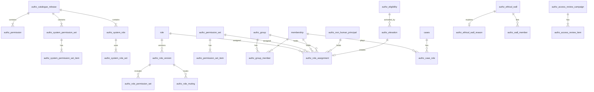

# 5.2.6 Authorization data model

<!-- Generated layout: edit text between the markers; keep the markers and the front matter. -->

> Prisma and Postgres tables for the permission catalogue, roles, permission sets, scoped assignments, case roles, groups, non-human principals, elevation, break-glass, walls, reviews and grant epochs, all tenant-owned tables under forced RLS

<!-- section:purpose -->
## Scope and ownership

Physical schema for authorisation: the permission catalogue, roles and permission sets, scoped assignments, case-level roles, groups, non-human principals, elevation and break-glass records, access requests, separation-of-duties rules, ethical walls, access reviews and the grant epochs used for cache invalidation.

- **Owner**: platform engineering, security lead as mandatory reviewer (CODEOWNERS `@nomology/platform-core` + `@nomology/security`).
- **Prisma file**: `packages/db/prisma/schema/authz.prisma`; Postgres schema `public` in each regional database (same convention as [[MT-tenancy-and-identity-schema]]).
- **Readers**: only `@nomology/authz` reads or writes these tables. Other packages call its API (`authz.can/assert/where/explain`, `authz.caseRoles.*`, `authz.assignments.*`). A lint rule forbids importing these Prisma models outside `packages/authz` and `packages/db`.
- **References in**: domain tables do not reference authz tables. Authz tables reference `membership`, `org_unit`, `role` ([[MT-tenancy-and-identity-schema]]), `cases` ([[DOM-cases-schema]]) and case-type blueprint keys ([[WF-process-definition-model]]) by composite foreign key or by key.
- **Relation to the tenancy schema**: the existing `role` table is extended (columns below) and `membership_role` is replaced by `authz_role_assignment` through an expand-and-contract migration (see *Migrations*).

<!-- section:entities -->
## Entities and relationships



| Table | Class | Aggregate root | Owner node for behaviour |
|---|---|---|---|
| `authz_catalogue_release`, `authz_permission`, `authz_system_permission_set`, `authz_system_permission_set_item`, `authz_system_role`, `authz_system_role_set` | Platform-level reference | release | [[PKG-permission-catalogue]], [[PKG-roles-and-permission-sets]] |
| `authz_policy_bundle` | Platform-level reference | yes | [[PKG-policy-engine-permission-matrix]] |
| `role` (extended), `authz_role_version`, `authz_role_permission_set`, `authz_role_muting` | Tenant-owned | `role` | [[PKG-roles-and-permission-sets]] |
| `authz_permission_set`, `authz_permission_set_item` | Tenant-owned | set | [[PKG-roles-and-permission-sets]] |
| `authz_group`, `authz_group_member` | Tenant-owned | group | [[PKG-user-provisioning-scim]] (sync), this node (storage) |
| `authz_role_assignment` | Tenant-owned | yes | [[PKG-roles-and-permission-sets]] |
| `authz_case_role` | Tenant-owned | part of the case (written by domain commands through authz) | [[PKG-rbac-abac-case-level-party]] |
| `authz_non_human_principal` | Tenant-owned | yes | [[PKG-non-human-principals]] |
| `authz_eligibility`, `authz_elevation`, `authz_break_glass_event` | Tenant-owned | eligibility / elevation | [[PKG-jit-and-break-glass]] |
| `authz_access_request` | Tenant-owned | yes | [[PKG-jit-and-break-glass]] |
| `authz_sod_rule`, `authz_sod_exception` | Tenant-owned (system rules are code) | rule | [[PKG-separation-of-duties]] |
| `authz_ethical_wall`, `authz_ethical_wall_reason`, `authz_wall_member` | Tenant-owned | wall | [[PKG-ethical-walls-conflict-based]] |
| `authz_access_review_campaign`, `authz_access_review_item` | Tenant-owned (platform staff reviews use the platform tenant) | campaign | [[SEC-access-reviews]] |
| `authz_grant_epoch` | Tenant-owned | — | [[PKG-policy-engine-permission-matrix#policy]] |

<!-- section:tables -->
## Tables and columns

Conventions as in [[MT-tenancy-and-identity-schema#tables]]: UUIDv7 ids, `timestamptz` UTC, `created_at` / `updated_at`, `version int` on mutable aggregate roots. Tenant-owned tables have composite primary key `(tenant_id, id)`. Permission keys are `text` matching `^[a-z_]+(\.[a-z_]+)*:[a-z_]+$`. Class codes: I internal, C confidential, PD personal.

**`authz_catalogue_release`** (platform): `release text PK` (`2026.11.0`), `published_at timestamptz`, `published_by text` (staff id), `approved_by text`, `signature bytea` (detached signature of the YAML bundle), `notes text`. I.

**`authz_permission`** (platform): `release text`, `key text`, `resource text`, `action text`, `description jsonb` (localised), `tier text CHECK (tier IN ('standard','sensitive','privileged'))`, `scopes text[]`, `step_up boolean`, `maker_checker text CHECK (… IN ('none','required','config_lifecycle'))`, `customisable boolean`, `non_human text[]`, `entitlement text NULL`, `audit_read boolean`, `deprecated_in text NULL`, `replaced_by text NULL`. PK `(release, key)`. I.

**`authz_system_permission_set`** / **`_item`** (platform): `(release, key)`, `name jsonb`, `description jsonb`; items `(release, set_key, permission_key)`. I.

**`authz_system_role`** / **`authz_system_role_set`** (platform): `(release, key)`, `level text` (`platform`, `tenant_admin`, `operational`, `case`, `managed_template`), `assignable_scopes text[]`, `prerequisite_role_key text NULL`, `privileged boolean` (derived), items `(release, role_key, set_key)`. I.

**`authz_policy_bundle`** (platform): `version text PK` (`2026.11.3+git.4f2c1a`), `catalogue_release text`, `deployed_at timestamptz`, `region text`. I.

**`role`** (tenant; existing table, new columns): `kind text NOT NULL DEFAULT 'custom' CHECK (kind IN ('system','managed','custom'))`, `system_role_key text NULL` (for system and managed rows, one row per tenant created at provisioning for FK convenience), `status text CHECK (status IN ('draft','published','retired'))`, `published_version int NULL`, `assignable_scopes text[] NOT NULL`, `has_privileged boolean NOT NULL DEFAULT false` (computed at publish), `has_case_content boolean NOT NULL DEFAULT false` (computed). The existing `permission_set_ref` column is retired. C.

**`authz_role_version`** (tenant, append-only): `tenant_id`, `id`, `role_id`, `version int`, `state text` (`draft`, `in_review`, `approved`, `published`, `superseded`), `change_set_id uuid NULL` (the `config.change_set` that published it, [[PKG-configuration-lifecycle]]), `catalogue_release text`, `created_by_membership_id`, `approved_by_membership_id NULL`, `published_at NULL`, `effective_permissions text[]` (materialised at publish for fast loading and evidence). C.

**`authz_role_permission_set`**: `tenant_id`, `role_version_id`, `system_set_key text NULL`, `permission_set_id uuid NULL`, CHECK exactly one non-null. C.

**`authz_role_muting`**: `tenant_id`, `role_version_id`, `permission_key text`, `reason text`. C.

**`authz_permission_set`**: `tenant_id`, `id`, `key text` (`ps.custom.<slug>`), `name jsonb`, `description jsonb`, `status`, `version int`. **`authz_permission_set_item`**: `tenant_id`, `permission_set_id`, `permission_key`. C.

**`authz_group`**: `tenant_id`, `id`, `name text`, `source text CHECK (source IN ('local','scim'))`, `external_id text NULL` (IdP group id), `unit_id uuid NULL`, `archived_at`. **`authz_group_member`**: `tenant_id`, `group_id`, `membership_id`, `source`, `added_at`. C / PD.

**`authz_role_assignment`** (replaces `membership_role`):

| Column | Type | Null | Meaning | Class |
|---|---|---|---|---|
| `tenant_id`, `id` | uuid | no | | I |
| `principal_type` | text | no | `membership`, `group`, `non_human` | I |
| `principal_id` | uuid | no | id in the matching table | PD |
| `role_id` | uuid | yes | FK `role` | C |
| `permission_set_id` | uuid | yes | direct permission set assignment (where `access.assignment.allow_direct_permission_sets`) | C |
| `system_set_key` | text | yes | direct system permission set | C |
| `scope_type` | text | no | `tenant`, `unit`, `case_type`, `case` | I |
| `scope_id` | text | yes | null for tenant; unit id, blueprint key or case id | I |
| `include_descendants` | boolean | no | units only | I |
| `starts_at` | timestamptz | no | default `now()` | I |
| `ends_at` | timestamptz | yes | | I |
| `source` | text | no | `manual`, `scim`, `jit`, `break_glass`, `blueprint`, `api`, `migration` | I |
| `source_ref` | uuid | yes | elevation id, break-glass id, SCIM group id | I |
| `granted_by_principal` | uuid | yes | null for system | PD |
| `approved_by_membership_id` | uuid | yes | checker | PD |
| `change_set_id` | uuid | yes | `config.change_set` that made the change (decision D3) | I |
| `reason` | text | yes | required for privileged | C |
| `revoked_at`, `revoked_by_principal`, `revoke_reason` | | yes | | PD |
| `version` | int | no | concurrency | — |

**`authz_case_role`**: `tenant_id`, `id`, `case_id uuid`, `membership_id uuid`, `role_key text` (case-level role key), `side text CHECK (side IN ('claimant','respondent','tribunal','institution','none'))`, `seat_label text NULL` (`sole`, `presiding`, `co_neutral`, `emergency`, `mediator`, `conciliator`, `secretary`; `tribunal_secretary` is its own `role_key`), `represents_party_id uuid NULL`, `source_type text` (`case_party`, `case_representation`, `tribunal_seat`, `case_assignment`, `hearing_assignment`, `participant`), `source_id uuid`, `valid_from timestamptz`, `valid_to timestamptz NULL`, `ended_at timestamptz NULL`, `end_reason text NULL`. C / PD.

**`authz_non_human_principal`**: `tenant_id`, `id`, `kind text CHECK (kind IN ('service_account','ai_agent','integration_connection'))`, `name text`, `owner_membership_id uuid NOT NULL`, `backup_owner_membership_id uuid NULL`, `status` (`active`, `disabled`, `expired`), `ceiling_set_keys text[]` (maximum permission sets), `linked_ref uuid NULL` (API client, agent configuration or connection id), `expires_at timestamptz NULL`, `last_used_at timestamptz NULL`, `created_by_membership_id`. I.

**`authz_eligibility`**: `tenant_id`, `id`, `membership_id`, `role_id`, `scope_type`, `scope_id`, `max_activation_minutes int CHECK (… BETWEEN 15 AND 1440)`, `requires_approval boolean`, `requires_ticket boolean`, `valid_until timestamptz NOT NULL`, `granted_by`, `approved_by`. **`authz_elevation`** (append-only events in `authz_elevation_event`): `tenant_id`, `id`, `eligibility_id`, `requested_at`, `justification text`, `ticket_ref text NULL`, `requested_minutes int`, `status` (`pending`, `approved`, `rejected`, `active`, `expired`, `revoked`, `cancelled`), `decided_by NULL`, `decided_at NULL`, `assignment_id uuid NULL`, `ends_at NULL`. C / PD.

**`authz_break_glass_event`** (append-only): `tenant_id`, `id`, `membership_id`, `profile_key text` (`emergency_case_access`, `tenant_owner_recovery`), `scope_type`, `scope_id`, `reason_code`, `reason_text`, `started_at`, `ends_at`, `ended_at NULL`, `assignment_id`, `review_due_at`, `reviewed_by NULL`, `review_outcome NULL` (`justified`, `not_justified`, `referred`), `review_note NULL`. C / PD.

**`authz_access_request`**: `tenant_id`, `id`, `requester_membership_id`, `target` (`role`, `case`), `role_id NULL`, `case_id NULL`, `scope_type`, `scope_id`, `duration_minutes NULL`, `justification`, `status`, `approver_membership_id NULL`, `decided_at`, `assignment_id NULL`. C / PD.

**`authz_sod_rule`**: `tenant_id`, `id`, `key`, `kind` (`toxic_combination`, `maker_checker_extra`), `permissions_a text[]`, `permissions_b text[]`, `mode` (`warn`, `block`), `status`. **`authz_sod_exception`**: `tenant_id`, `id`, `rule_key`, `membership_id`, `reason`, `approved_by`, `expires_at NOT NULL`. C.

**`authz_ethical_wall`**: columns in [[PKG-ethical-walls-conflict-based#policy]] plus `kind text CHECK (kind IN ('exclusion','need_to_know'))`, `acknowledged_at NULL`. **`authz_ethical_wall_reason`**: `tenant_id`, `wall_id`, `reason_code`, `reason_note_ciphertext bytea` (field-level encrypted, [[PKG-encryption-utilities-key]]). **`authz_wall_member`**: `tenant_id`, `wall_id`, `principal_type`, `principal_id`, `kind` (`subject`, `allowed`, `carve_out`). C.

**`authz_access_review_campaign`**: `tenant_id`, `id`, `name`, `population jsonb` (filter), `reviewer_rule text`, `starts_at`, `due_at`, `status`, `auto_revoke boolean`, `created_by`. **`authz_access_review_item`**: `tenant_id`, `id`, `campaign_id`, `assignment_id` or `case_role_id` or `non_human_principal_id`, `snapshot jsonb` (principal, role, scope, last used), `reviewer_membership_id`, `decision` (`keep`, `change`, `remove`, `no_response`), `decided_at`, `reason`, `applied_at`. C / PD.

**`authz_grant_epoch`**: `tenant_id`, `principal_type`, `principal_id` (`00000000-…` for the tenant-wide epoch), `epoch bigint NOT NULL DEFAULT 1`, `updated_at`. I.

<!-- section:keys -->
## Keys and constraints

- Composite foreign keys with `tenant_id` between all tenant-owned tables: `authz_role_assignment(tenant_id, role_id) → role(tenant_id, id) ON DELETE RESTRICT`; `authz_case_role(tenant_id, case_id) → cases(tenant_id, id) ON DELETE RESTRICT`; `authz_case_role(tenant_id, membership_id) → membership(tenant_id, id) ON DELETE RESTRICT`; `authz_group_member(tenant_id, group_id) → authz_group ON DELETE CASCADE`.
- `principal_id` in `authz_role_assignment` is polymorphic; integrity is enforced by three partial foreign keys through generated columns: `membership_principal uuid GENERATED ALWAYS AS (CASE WHEN principal_type='membership' THEN principal_id END) STORED` with FK to `membership(tenant_id, id)`, and likewise for groups and non-human principals.
- Tenant tables reference platform reference tables by key: `authz_permission_set_item.permission_key` and `authz_role_muting.permission_key` are checked against the current catalogue release by a trigger (`app.check_permission_key()`), not by FK, because the platform table is keyed by `(release, key)`.
- CHECK: exactly one of `role_id`, `permission_set_id`, `system_set_key` on assignments; `scope_id IS NULL` iff `scope_type='tenant'`; `include_descendants` only when `scope_type='unit'`; `ends_at > starts_at`; `source IN ('jit','break_glass') ⇒ ends_at IS NOT NULL`.
- EXCLUDE (btree_gist): no two active assignments of the same role to the same principal at the same scope with overlapping `[starts_at, ends_at)`.
- Unique: `role(tenant_id, key)`; `authz_permission_set(tenant_id, key)`; `authz_group(tenant_id, external_id) WHERE external_id IS NOT NULL`; `authz_case_role(tenant_id, case_id, membership_id, role_key, source_id) WHERE ended_at IS NULL`; `authz_grant_epoch(tenant_id, principal_type, principal_id)`.
- Database-enforced: shapes above, no overlaps, append-only (grants revoked), mandatory end dates for elevation. Application-enforced (need cross-row checks under lock or catalogue lookups): last tenant_owner (ROLE-R1, row lock on `tenant` row), no-escalation rule, maker-checker distinctness (checked again in a deferred constraint trigger `approved_by_membership_id <> granted_by_principal`), toxic combinations.

<!-- section:tenancy -->
## Tenancy and RLS policies

| Table group | Class | RLS |
|---|---|---|
| Catalogue, system roles and sets, policy bundles | Platform-level reference | No tenant RLS; `nomo_app` and `nomo_worker` have SELECT only; written by `nomo_migrator` during release seeding |
| All other `authz_*` tables and `role` | Tenant-owned | Standard policy, enabled and forced |
| Append-only: `authz_role_version`, `authz_elevation_event`, `authz_break_glass_event`, `authz_access_review_item` decisions after `applied_at` | Tenant-owned | Separate `FOR SELECT` and `FOR INSERT` policies; `UPDATE` only on whitelisted columns via `SECURITY DEFINER` functions; `DELETE` revoked |

```sql
ALTER TABLE authz_role_assignment ENABLE ROW LEVEL SECURITY;
ALTER TABLE authz_role_assignment FORCE ROW LEVEL SECURITY;
CREATE POLICY tenant_isolation ON authz_role_assignment FOR ALL TO nomo_app, nomo_worker
  USING (tenant_id = app.current_tenant_id())
  WITH CHECK (tenant_id = app.current_tenant_id());
REVOKE DELETE ON authz_role_assignment FROM nomo_app, nomo_worker;  -- revoke = set revoked_at

ALTER TABLE authz_break_glass_event ENABLE ROW LEVEL SECURITY;
ALTER TABLE authz_break_glass_event FORCE ROW LEVEL SECURITY;
CREATE POLICY bg_select ON authz_break_glass_event FOR SELECT TO nomo_app, nomo_worker
  USING (tenant_id = app.current_tenant_id());
CREATE POLICY bg_insert ON authz_break_glass_event FOR INSERT TO nomo_app
  WITH CHECK (tenant_id = app.current_tenant_id());
REVOKE UPDATE, DELETE ON authz_break_glass_event FROM nomo_app, nomo_worker;
-- review fields set only through app.review_break_glass(id, outcome, note) SECURITY DEFINER, which checks the caller is not the subject
```

`authz_ethical_wall_reason` has the standard policy, and in addition its `reason_note_ciphertext` can only be decrypted by the authz package after a `case.wall:approve` decision; the key purpose is `authz-wall-reason` per region.

Platform staff reviews and staff elevations use the reserved platform tenant (`tenant.type = 'platform'`) in each region so the same tables and policies apply without a bypass.

Roles: `nomo_app` (web), `nomo_worker` (BullMQ and Temporal workers), `nomo_migrator` (DDL and catalogue seeding), `nomo_platform_ops` (listed jobs only, [[MT-separate-privileged-role-used]]), `nomo_reporting` (replica views for access-review and security reports, [[RPT-report-infrastructure]]). Database role names follow decision D5 (`nomo_owner`, `nomo_migrator`, `nomo_app`, `nomo_worker`, `nomo_reporting`, `nomo_platform_ops`, as in the MT nodes); older role names are replaced.

<!-- section:indexes -->
## Indexes and access patterns

| Query (caller) | Index |
|---|---|
| Load all active assignments of a principal at decision time (`loadGrantSet`) | `authz_role_assignment (tenant_id, principal_type, principal_id) WHERE revoked_at IS NULL` INCLUDE `(role_id, scope_type, scope_id, ends_at)` |
| Members of a role (admin console, access review) | `(tenant_id, role_id) WHERE revoked_at IS NULL` |
| Everyone with access at a scope (explainer "who can see this case", unit pages) | `(tenant_id, scope_type, scope_id) WHERE revoked_at IS NULL` |
| Case roles of a user (case list filter, `authz.where`) | `authz_case_role (tenant_id, membership_id, case_id) WHERE ended_at IS NULL` |
| Participants of a case (notification recipients, explainer) | `authz_case_role (tenant_id, case_id, role_key) WHERE ended_at IS NULL` |
| Walls for a subject (per request) | `authz_wall_member (tenant_id, principal_id) ` + `authz_ethical_wall (tenant_id, id) WHERE status IN ('proposed','active')` |
| Walls on a scope (pickers) | `authz_ethical_wall (tenant_id, scope_type, scope_id) WHERE status IN ('proposed','active')` |
| Expiry sweeps (BullMQ `authz-expiry`, every 5 minutes) | `authz_role_assignment (ends_at) WHERE revoked_at IS NULL AND ends_at IS NOT NULL`; same on `authz_case_role (valid_to)` |
| Pending approvals inbox | `authz_elevation (tenant_id, status) WHERE status='pending'`; `authz_access_request (tenant_id, status)` |
| Break-glass reviews due | `authz_break_glass_event (tenant_id, review_due_at) WHERE reviewed_by IS NULL` |
| Group membership expansion | `authz_group_member (tenant_id, membership_id)` |
| Grant epoch lookup | PK `(tenant_id, principal_type, principal_id)` |

The `authz.where` filter for case lists compiles to `EXISTS (SELECT 1 FROM authz_case_role r WHERE r.tenant_id = cases.tenant_id AND r.case_id = cases.id AND r.membership_id = $1 AND r.ended_at IS NULL)` OR a scope predicate (`cases.owning_unit_id = ANY($units)`, `cases.case_type_key = ANY($types)`), which the indexes above serve.

<!-- section:history -->
## Status, history and concurrency

- Roles and permission sets: every change is a new `authz_role_version`; `role.published_version` points to the active one. Assignments refer to the role, not a version: publishing a new version changes the access of all holders at once, which is why the simulator diff is mandatory.
- Assignments are never deleted; revocation sets `revoked_at`, `revoked_by_principal`, `revoke_reason`. Expiry is by `ends_at` and is evaluated with the database clock; the sweep job only records expiry events and bumps epochs.
- Case roles end with `ended_at` and `end_reason` (`representation_ended`, `unseated_challenge_upheld`, `case_closed`, `assignment_expired`, …).
- Concurrency: `version` on `role`, `authz_permission_set`, `authz_role_assignment`; admin API uses `If-Match`. Every committed change increments the affected principal's `authz_grant_epoch` (or the tenant epoch for role or permission set changes) in the same transaction.
- Every change also writes an audit event through the outbox ([[PKG-audit-trail]]) with old and new values.

<!-- section:protection -->
## Data classification and protection

- Personal data: `principal_id`, `granted_by_principal`, approver ids link people to roles. Names and emails are not copied into authz tables; reports join to `membership` and `user_account` at read time under RLS.
- `authz_ethical_wall_reason.reason_note_ciphertext` is field-level encrypted; the existence of a wall is confidential but not encrypted (needed for filtering).
- `reason`, `justification`, `review_note` are free text and may contain personal data; they are excluded from search indexes, logs and AI prompts, and are masked in support views ([[SEC-data-classification]]).
- Never copied to: Temporal payloads (activities pass ids and re-load), Redis grant caches (cache holds permission keys and scope ids only), the warehouse (access-review reports use pseudonymous ids, [[RPT-platform-security]]).

<!-- section:retention -->
## Retention, archival and deletion

| Table | Kept | End action |
|---|---|---|
| Catalogue and system definitions | 10 years after superseded (assumption) | Archive |
| Role versions, permission sets | Life of tenant + 7 years | Deleted with tenant offboarding after export |
| Assignments, case roles (ended) | 7 years after end (assumption; aligns with case-record retention, legal to confirm) | Pseudonymise principal ids, keep the structure for evidence |
| Elevation and break-glass events | 7 years | Pseudonymise |
| Access requests | 3 years after decision | Delete |
| Access review campaigns and items | 3 years after close (matches SOC 2 and ISO evidence retention in [[SEC-access-reviews]]) | Delete |
| Grant epochs | While principal exists | Delete |

Legal holds ([[PKG-data-retention-legal-hold-and]]) on a case extend retention of its `authz_case_role` rows and related wall records. Offboarding exports these tables to the tenant export bundle before deletion. Per-table entries belong in [[PKG-retention-and-deletion-schedule]].

<!-- section:migrations -->
## Migrations and rollout

Ordered migrations (each includes its RLS SQL, [[MT-prisma-migrations-include-rls]]):

1. `0100_authz_catalogue`: platform reference tables; seed release `2026.11.0` from `permissions.yaml` and `roles.yaml` (`nomo_migrator`).
2. `0101_authz_roles`: extend `role` (new nullable columns), create `authz_role_version`, `authz_role_permission_set`, `authz_role_muting`, `authz_permission_set*`; backfill one system or managed `role` row per tenant per system role key.
3. `0102_authz_assignments` (**expand**): create `authz_role_assignment`, `authz_group*`, `authz_grant_epoch`; backfill from `membership_role` with `scope_type='tenant'`, `source='migration'`; old role keys are mapped (`secretariat_lead` → managed template `secretariat_lead`, `case_manager` tenant role → `secretariat` at tenant scope plus a review flag, `finance_officer` → `case_finance_officer`, `reporting_viewer` → template, `member` → base role by invitation type).
4. Application release N: **dual write** to `membership_role` and `authz_role_assignment`; reads from `authz_role_assignment` behind a flag per region; a nightly comparison job reports differences.
5. `0103_authz_case_roles`: create `authz_case_role`; backfill from `case_parties` (with `membership_id`), `case_representations`, `tribunal_seats` (via appointments), case manager assignments and `hearing_assignment`. Batches of 5,000 cases per tenant, `lock_timeout 2s`, `statement_timeout 30s`, resumable by last case id.
6. `0104_authz_governance`: non-human principals, eligibility, elevation, break-glass, access requests, SoD, walls (rename existing `authz.ethical_wall` columns into `authz_ethical_wall`), reviews.
7. Release N+2: **contract**: stop dual write; drop `membership_role` and `role.permission_set_ref`.

Rollback: before step 7, switch reads back to `membership_role` by flag. After step 7, roll forward only. Migrations run per region in the order of [[DEP-database-migration-strategy-zero]].

<!-- section:prisma -->
## Prisma schema mapping

- Models: `AuthzCatalogueRelease`, `AuthzPermission`, `AuthzSystemPermissionSet(Item)`, `AuthzSystemRole(Set)`, `AuthzPolicyBundle`, `Role` (extended), `AuthzRoleVersion`, `AuthzRolePermissionSet`, `AuthzRoleMuting`, `AuthzPermissionSet(Item)`, `AuthzGroup(Member)`, `AuthzRoleAssignment`, `AuthzCaseRole`, `AuthzNonHumanPrincipal`, `AuthzEligibility`, `AuthzElevation(Event)`, `AuthzBreakGlassEvent`, `AuthzAccessRequest`, `AuthzSodRule`, `AuthzSodException`, `AuthzEthicalWall`, `AuthzEthicalWallReason`, `AuthzWallMember`, `AuthzAccessReviewCampaign`, `AuthzAccessReviewItem`, `AuthzGrantEpoch`; `@@map` to snake_case tables.
- Tenant-owned models use `@@id([tenantId, id])` and composite relations.
- Enums are Postgres `text` with CHECK constraints rather than Prisma enums, so catalogue-driven values can be added without an enum migration.
- Raw SQL only (Prisma cannot express): RLS policies; EXCLUDE constraint on assignments; generated columns and partial FKs for polymorphic principals; partial indexes; `app.check_permission_key()` trigger; deferred distinct-approver trigger; `SECURITY DEFINER` review functions.

<!-- section:seed -->
## Seed and reference data

- Catalogue releases and system roles: generated from `packages/authz/catalogue/*.yaml`, signed in CI, loaded per region by `nomo_migrator` at deploy; never edited in the database.
- Per-tenant rows at provisioning ([[APP-tenant-onboarding-wizard]]): system and managed `role` rows; tenant epoch; blueprint assignments and managed templates from the tenant blueprint ([[PKG-configuration-packages]]).
- Test fixtures: `packages/authz/test/fixtures` builds two tenants × three case types × every case role × every tier; never loaded outside test databases.

<!-- section:volume -->
## Volume, growth and performance

| Table | At launch (largest region, India) | 1 year | 5 years | Notes |
|---|---|---|---|---|
| `authz_role_assignment` | 5k | 50k | 300k | Staff, neutrals and transcribers; parties hold only the base role |
| `authz_case_role` | 50k | 1.5M | 10M | SEBI ODR volume drives it: about 8 case roles per case (2 parties, counsel, conciliator, case manager); largest tenant about 40% |
| `authz_group_member` | 2k | 20k | 100k | |
| `authz_ethical_wall` | <1k | 10k | 50k | Mostly from conflict declarations |
| Events (elevation, break-glass) | small | 20k | 100k | |

`authz_case_role` is the hot table (read on every case list). At 10M rows, the partial index on `(tenant_id, membership_id, case_id)` stays small per user. Partition by `tenant_id` hash if any tenant exceeds 20M rows or p95 of the case-list filter exceeds 20 ms.

<!-- section:questions -->
## Open questions

- [ ] Case manager assignment: [[DOM-cases-schema]] has `assigned_secretary_membership_id` but no `case_assignment` table; propose adding `case_assignment` (multiple staff per case) there. (Domain team)
- [ ] Retention periods for assignments and case roles (7 years assumed). (Legal / DPO)
- [ ] Is a hash partition of `authz_case_role` needed at launch for the SEBI ODR blueprint tenants? Decide after load test. (Platform)

<!-- checks -->
## Template checks

<!-- check:tenancy -->
### Tenant isolation in the schema

Every grant table is tenant-owned with forced RLS and composite foreign keys including `tenant_id`, so an assignment, case role or wall can never point to another tenant's principal, case or role. Platform reference tables hold definitions only and are read-only to application roles. Staff use a reserved platform tenant instead of a bypass.

<!-- check:integrity -->
### Invariants enforced by the database

The database enforces scope shape, exactly-one-grant-target, no overlapping duplicate assignments (EXCLUDE), mandatory end dates for JIT and break-glass, append-only histories and distinct maker and checker (deferred trigger). Cross-row rules that need catalogue lookups or locks (last owner, no-escalation, toxic combinations) are enforced in `@nomology/authz` under a row lock on the tenant, because UI, admin API, SCIM and workers all go through that one package.

<!-- check:migration-safety -->
### Zero-downtime and reversible migrations

Expand, dual-write with nightly comparison, switch reads by regional flag, contract two releases later; batched resumable backfills with lock and statement timeouts; rollback by flag until the contract step.

<!-- check:privacy -->
### Personal data, erasure and the legal record

Only ids link people to grants; free-text reasons are excluded from logs, search and AI; ended grants are pseudonymised after 7 years while keeping evidence structure; offboarding exports then deletes.

<!-- check:residency -->
### Region placement and cross-region references

All tables live in each region's database; catalogue releases are identical copies per region; no cross-region references. Staff assignments for a region live in that region's platform tenant.

<!-- check:audit -->
### History, immutability and evidence

Role versions, assignment revocations, elevations and break-glass are append-only, each change bumps a grant epoch and writes an audit event with old and new values and the catalogue release, so the access a person had on any past date can be reconstructed.

<!-- check:performance -->
### Query performance under RLS and growth

Grant sets load in one indexed query per principal and are cached by epoch; case lists use an EXISTS on a partial index; target p95 under 5 ms for grant-set load on cache miss and under 20 ms for the case-list predicate at 5-year volume.

<!-- check:testing -->
### Schema verification

Schema lint (RLS present and forced on every `authz_*` tenant table), cross-tenant tests, EXCLUDE and trigger tests, migration rehearsal on a production-sized anonymised copy, and dual-write comparison reports.

<!-- end -->
