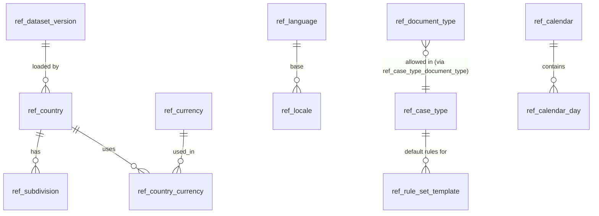

# 5.13.1 Reference and seed data catalogue

<!-- Generated layout: edit text between the markers; keep the markers and the front matter. -->

> Countries, currencies, languages, case types and default rule-set templates; source, owner and load method per region

<!-- section:purpose -->
## Scope and ownership

This node lists the production reference data the platform depends on (countries, currencies, languages, time zones, case types, document types, default rule-set templates and holiday calendar seeds), and defines how it is stored, sourced, owned and loaded in each regional database. It belongs to `@nomology/db` ([[PKG-data-access]]); the Prisma schema lives in `packages/db/prisma/reference.prisma` and the tables live in the `ref` Postgres schema of every regional database.

Readers: every domain schema references these tables by code (foreign key on a `text` code, not a UUID) so values are stable across regions. Tenant-specific variants (a tenant's own case types, its own holidays) live in tenant-owned tables in the owning package and point at the reference rows; they are not stored here.

Development and test fixtures (fake tenants, sample cases) are **not** reference data; they live in `packages/db/fixtures` and can never be loaded into staging-with-real-data, UAT or production (the loader refuses when `APP_ENV` is one of those).

<!-- section:entities -->
## Entities and relationships



| Table | Kind | Aggregate root | Read by |
|---|---|---|---|
| `ref.dataset_version` | Platform-level | Yes | Loader, drift check |
| `ref.country`, `ref.subdivision` | Shared reference | Yes | Parties, addresses, calendars, KYC |
| `ref.currency`, `ref.country_currency` | Shared reference | Yes | Invoices, fees ([[DOM-invoices-and-vendor-bills-schema]]) |
| `ref.language`, `ref.locale` | Shared reference | Yes | i18n ([[I18N-i18n]]), notifications, preferences |
| `ref.time_zone` | Shared reference | Yes | Hearings, deadlines ([[PKG-calendars-and-deadline]]) |
| `ref.case_type`, `ref.case_type_document_type` | Shared reference (platform defaults) | Yes | Cases ([[DOM-cases-schema]]); tenants enable and rename in their own tables |
| `ref.document_type` | Shared reference | Yes | Documents ([[DOM-documents-schema]]) |
| `ref.rule_set_template` | Shared reference | Yes | Rules engine: cloned into a tenant on enable ([[PKG-rules-and-decision-engine]]) |
| `ref.calendar`, `ref.calendar_day` | Shared reference | Yes | Calendars package (public holidays per jurisdiction) |

None of these tables carry `tenant_id` and none hold personal data ([[MT-platform-level-tables]]).

<!-- section:tables -->
## Tables and columns

Conventions: codes are `text` with a `CHECK` on format; human names are stored in English in the table and translated through the i18n message catalogue keyed `ref.<table>.<code>`; every table has `dataset_version_id uuid not null`, `valid_from date`, `valid_to date null` (retired codes are end-dated, never deleted), `created_at timestamptz not null default now()`.

**ref.dataset_version**
| Column | Type | Null | Meaning |
|---|---|---|---|
| id | uuid | no | PK (UUIDv7) |
| dataset | text | no | `country`, `currency`, `case_type`, ... |
| version | text | no | e.g. `iso3166-2026-09` or `case-types-v7` |
| checksum_sha256 | bytea | no | Hash of the canonical source file |
| source_ref | text | no | Upstream source and retrieval date |
| loaded_at | timestamptz | no | |
| loaded_by | text | no | CI job ID |

**ref.country** — `code char(2)` PK (ISO 3166-1 alpha-2, `CHECK (code ~ '^[A-Z]{2}$')`), `alpha3 char(3) unique`, `numeric char(3)`, `name_en text`, `calling_code text`, `is_sanctioned_jurisdiction boolean not null default false` (set only from the screening provider list, see [[INT-kyc-and-sanctions-screening]]).

**ref.subdivision** — `code text` PK (ISO 3166-2, e.g. `IN-KA`), `country_code char(2) references ref.country`, `name_en text`, `kind text` (state, union territory, province).

**ref.currency** — `code char(3)` PK (ISO 4217), `minor_units smallint not null CHECK (minor_units between 0 and 4)`, `name_en text`. Money elsewhere is stored as `bigint` minor units plus currency code.

**ref.language** — `code text` PK (ISO 639-1 or 639-3, e.g. `en`, `hi`, `kn`, `zh`), `script_default text` (ISO 15924), `direction text CHECK (direction in ('ltr','rtl'))`.

**ref.locale** — `tag text` PK (BCP 47, e.g. `en-IN`, `hi-IN`, `zh-Hant-HK`), `language_code text references ref.language`, `region_code char(2) null`, `supported_ui boolean` (platform has a translated UI pack), `supported_docs boolean`.

**ref.time_zone** — `tzid text` PK (IANA, e.g. `Asia/Kolkata`), `tzdb_version text not null` (e.g. `2026a`), `country_code char(2) null`.

**ref.case_type** — `code text` PK (e.g. `ARB_INSTITUTIONAL`, `ARB_ADHOC`, `MEDIATION`, `CONCILIATION`, `ODR_SEBI`, `ODR_MSME`), `family text CHECK (family in ('arbitration','mediation','conciliation','odr'))`, `default_rule_set_template_code text null`.

**ref.document_type** — `code text` PK (e.g. `STATEMENT_OF_CLAIM`, `STATEMENT_OF_DEFENCE`, `PROCEDURAL_ORDER`, `AWARD`, `TRANSCRIPT`, `EXHIBIT`, `POWER_OF_ATTORNEY`), `default_visibility text CHECK (... in ('case_participants','tribunal_only','tenant_internal'))`, `is_legal_record boolean` (drives retention, see [[PKG-retention-and-deletion-schedule]]).

**ref.rule_set_template** — `code text` PK, `version int`, `case_type_code text references ref.case_type`, `definition jsonb not null` (decision tables and process definition references, validated against the rules engine schema), `jurisdiction text null`. Primary key `(code, version)`.

**ref.calendar** — `code text` PK (e.g. `IN-NATIONAL`, `IN-KA`, `SG`, `US-FEDERAL`, `HK`), `subdivision_code text null`, `weekend_days smallint[] not null` (ISO weekday numbers).

**ref.calendar_day** — `(calendar_code, day date)` PK, `kind text CHECK (kind in ('public_holiday','bank_holiday','court_closure','working_override'))`, `name_en text`, `source_ref text`.

Data classification: all columns are **public** or **internal**; no personal data.

<!-- section:keys -->
## Keys and constraints

- Natural-key primary keys (codes) so tenant tables can reference the same value in every region without UUID mapping.
- Foreign keys from tenant tables to reference tables use `ON DELETE RESTRICT`; reference rows are end-dated (`valid_to`) instead of deleted, so historic cases keep valid references.
- `CHECK` constraints enforce code formats (ISO patterns above), `minor_units` range and enumerated `kind` values.
- `ref.rule_set_template (code, version)` is immutable after load: a trigger raises on `UPDATE` of `definition`; a change is a new version.
- Unique: `ref.country.alpha3`, `ref.locale.tag`.
- Application-only rule (documented, not a constraint): a tenant may enable only case types whose `valid_to` is null.

<!-- section:tenancy -->
## Tenancy and RLS policies

All tables in this node are **shared reference** tables: no `tenant_id`, no RLS ([[MT-platform-level-tables]]). Grants make that safe:

```sql
GRANT USAGE ON SCHEMA ref TO nomo_app, nomo_worker, nomo_reporting;
GRANT SELECT ON ALL TABLES IN SCHEMA ref TO nomo_app, nomo_worker, nomo_reporting;
REVOKE INSERT, UPDATE, DELETE, TRUNCATE ON ALL TABLES IN SCHEMA ref FROM nomo_app, nomo_worker, nomo_reporting;
ALTER DEFAULT PRIVILEGES FOR ROLE nomo_owner IN SCHEMA ref GRANT SELECT ON TABLES TO nomo_app, nomo_worker, nomo_reporting;
```

Only `nomo_migrator` (the loader in CI) writes. Rule for reviewers: if a proposed reference table needs a per-tenant value or any personal data, it is not reference data and belongs in a tenant-owned table with RLS.

<!-- section:indexes -->
## Indexes and access patterns

| Access pattern | Index |
|---|---|
| Look up by code (all tables) | Primary key |
| Subdivisions of a country (address forms) | `ref_subdivision (country_code)` |
| Holidays between two dates for a set of calendars (deadline computation) | Primary key `(calendar_code, day)` serves range scans |
| Supported UI locales (language picker) | Partial index `ref_locale (tag) WHERE supported_ui` |

Tables are small (largest is `calendar_day`, a few thousand rows per calendar per decade) and are also cached in process by consumers ([[PKG-caching]]).

<!-- section:history -->
## Status, history and concurrency

History is by `dataset_version` and end-dating, not by audit events: each load records the source and checksum, retired codes get `valid_to`, and rule-set templates are immutable versions. Holiday corrections (for example a holiday declared at short notice) are a new dataset version; [[PKG-calendars-and-deadline]] records which calendar version computed each deadline, so a later correction never silently moves an already-computed deadline.

<!-- section:migrations -->
## Migrations and rollout

1. `0001_ref_schema` — create schema `ref`, tables, constraints, grants (raw SQL for grants and the immutability trigger).
2. `0002_ref_seed_loader` — no data; installs `ref.dataset_version`.
3. Data is loaded by `pnpm db:ref:load --region <in|sg|us>` after migrations, as an idempotent upsert per dataset: compare checksum with the latest `dataset_version`; if different, upsert rows, end-date removed codes, insert the new `dataset_version` row, all in one transaction with `lock_timeout = 5s`.
4. Load order: India → Singapore → US, same as schema migrations ([[DEP-environment-promotion-and-multi]]).
5. Rollback: reference loads are forward-only; a bad load is fixed by loading a corrected version. Because codes are never deleted, a rollback cannot orphan tenant rows.

<!-- section:prisma -->
## Prisma schema mapping

Models `RefCountry` (`@@map("country")`, `@@schema("ref")`), `RefCurrency`, `RefLanguage`, `RefLocale`, `RefTimeZone`, `RefCaseType`, `RefDocumentType`, `RefRuleSetTemplate` (composite `@@id([code, version])`), `RefCalendar`, `RefCalendarDay`, `RefDatasetVersion`, all tagged with the `/// @platform` doc comment so `withPlatform` and `withTenant` both allow reads. Exists only in raw SQL: grants, `CHECK` constraints on code formats, the immutability trigger on `rule_set_template`, the partial index on `ref_locale`.

<!-- section:seed -->
## Seed and reference data

| Dataset | Source | Owner | Update cadence | Load method |
|---|---|---|---|---|
| Countries, subdivisions | ISO 3166 (via a licensed or open mirror, to be chosen) | Platform engineering | Quarterly check | `db:ref:load` |
| Currencies | ISO 4217 list | Platform engineering with finance | Quarterly check | `db:ref:load` |
| Languages, locales | ISO 639, BCP 47; CLDR for display data [R1] | i18n lead ([[I18N-l10n]]) | Per release | `db:ref:load` |
| Time zones | IANA tzdb version shipped with the Node.js runtime | Platform engineering | With each Node.js upgrade | `db:ref:load` (tzdb version recorded) |
| Case types, document types | Product decision per product (CORD, TERES) | Product owner and legal | When a product adds a case type | Reviewed PR to `packages/db/reference/*.json` |
| Rule-set templates | Legal / operations; drafted with institution input | Legal operations | Per release | Reviewed PR; validated by rules-engine schema |
| Holiday calendars | Official gazette notifications per jurisdiction; institution closure days are tenant data, not here | Operations (named per region) | Annually plus ad hoc | Reviewed PR; [[PKG-calendars-and-deadline]] |

Sources are stored as JSON files in `packages/db/reference/` with a `source_ref` and retrieval date; CI validates them with zod schemas before any load.

<!-- section:volume -->
## Volume, growth and performance

Total under 50,000 rows per region at launch; `calendar_day` grows by roughly 20–40 rows per calendar per year. No partitioning needed. The only performance consideration is that consumers cache these tables in process for 10 minutes (invalidated by `dataset_version` change).

<!-- section:questions -->
## Open questions

- [ ] Which ISO 3166 / ISO 4217 source do we license or mirror, and who checks it quarterly? Owner: platform engineering.
- [ ] Who in each region owns holiday calendar updates, and what is the service level for an ad-hoc holiday declaration? Owner: operations.
- [ ] Do aggregator formats (NSE for SEBI ODR matters, MSME) need their own code lists (for example category codes) as reference data? Owner: product, with [[RPT-aggregators]].
- [ ] Case type list per product (CORD, TERES, HKIAC CMP) to be confirmed. Owner: product.
- [ ] Assumption: `is_sanctioned_jurisdiction` is maintained from the screening provider, not by hand. To be confirmed with compliance.

<!-- checks -->
## Template checks

<!-- check:tenancy -->
### Tenant isolation in the schema

These tables hold no tenant-specific or personal data by design and have no `tenant_id`. `nomo_app`, `nomo_worker` and `nomo_reporting` have SELECT only; writes are possible only for `nomo_migrator` in CI. Tenant variants (enabled case types, tenant holidays) are tenant-owned tables in the consuming packages with forced RLS. The review rule in the tenancy section stops tenant data being added here.

<!-- check:migration-safety -->
### Zero-downtime and reversible migrations

Loads are idempotent upserts in one short transaction with `lock_timeout` 5 s; codes are end-dated instead of deleted so N-1 application versions keep working; rule-set templates are immutable versions so running workflows that pinned a version are unaffected.

<!-- check:residency -->
### Region placement and cross-region references

The same datasets are loaded into each regional database from the repository; nothing is replicated across regions at run time. Drift is detected by a daily job comparing `dataset_version.checksum_sha256` per dataset across regions through the deploy pipeline (checksums only leave the region, not data — and this data is public anyway).

<!-- check:testing -->
### Schema verification

CI validates every reference JSON file against its zod schema, runs the loader twice against a fresh database (second run must be a no-op), checks grants (`nomo_app` and `nomo_worker` INSERT on `ref.*` must fail) and confirms the fixture loader refuses to run when `APP_ENV` is `uat` or `production`.

<!-- citations -->
## Citations

```json
[
  {
    "body": "Unicode Consortium",
    "id": "R1",
    "ident": "CLDR",
    "kind": "standard",
    "title": "Unicode CLDR Project",
    "url": "https://cldr.unicode.org/"
  }
]
```

<!-- end -->
