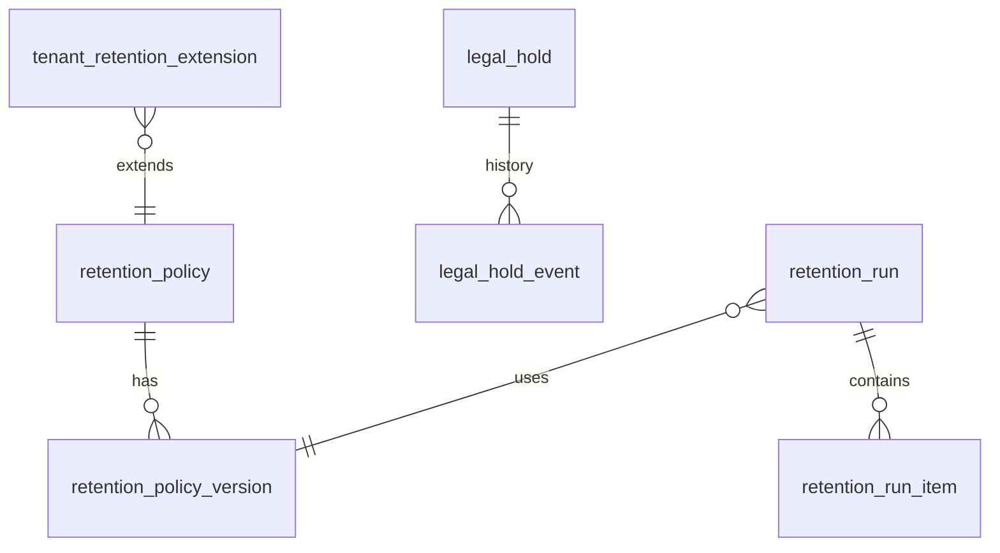

# 5.13.2 Retention and deletion schedule by table

<!-- Generated layout: edit text between the markers; keep the markers and the front matter. -->

> Per-table retention clock, end-of-life action, legal-hold handling and offboarding deletion, feeding privacy controls

<!-- section:purpose -->
## Scope and ownership

The per-table retention schedule for the platform and the control tables that [[PKG-data-retention-legal-hold-and]] uses: when the clock starts for each kind of record, how long it runs (platform minimum, tenant extension), what happens at the end (hard delete, anonymise, archive, crypto-shred), how legal holds apply and what tenant offboarding does. It feeds privacy notices ([[SEC-privacy-notice-copy]]), privacy controls ([[SEC-privacy-controls]]) and the records of processing.

Owned by platform engineering with the DPO / legal as approver of every period. Prisma schema `packages/retention/prisma/retention.prisma`; Postgres schema `retention`. **All periods below are proposals (assumptions) until legal confirms them per tenant type.**

<!-- section:entities -->
## Entities and relationships



| Table | Kind |
|---|---|
| `retention.retention_policy`, `retention.retention_policy_version` | Platform-level (schedule data, no tenant data) |
| `retention.tenant_retention_extension` | Tenant-owned |
| `retention.legal_hold`, `retention.legal_hold_event` | Tenant-owned |
| `retention.retention_run`, `retention.retention_run_item` | Tenant-owned |

<!-- section:tables -->
## Tables and columns

**Schedule (the per-table catalogue)** — proposed values; "clock" is the event that starts the period; "end" is the action.

| Record type (tables) | Owner node | Clock | Platform minimum (proposed) | End-of-life action | Legal hold | Offboarding |
|---|---|---|---|---|---|---|
| Case record, parties, representatives, tribunal membership (`case`, `case_participant`, `case_representation`, `tribunal_member`) | [[DOM-cases-schema]] | Case closed | 8 years | Anonymise parties' contact fields; keep case skeleton and outcome for statistics | Blocks | Export, then delete after contract period |
| Pleadings, evidence, correspondence (`document`, `document_version`, objects) | [[DOM-documents-schema]] | Case closed | 8 years | Hard delete objects and rows | Blocks | Export, delete |
| Awards, orders, settlement agreements | [[DOM-documents-schema]] | Case closed | Tenant-defined, minimum 8 years; assumption: institutions may require permanent retention | Delete or keep per tenant policy | Blocks | Delivered in export; deletion per contract |
| Hearing recordings | [[DOM-hearings-schema]] | Hearing date | 2 years after case closed | Hard delete | Blocks | Export on request, delete |
| Transcripts | [[DOM-transcribers-schema]] | Case closed | 8 years | Hard delete | Blocks | Export, delete |
| Invoices, payments, vendor bills | [[DOM-invoices-and-vendor-bills-schema]] | End of financial year of issue | 8 years (assumption: tax record rules in India, Singapore and US to be confirmed by finance) | Keep minimal financial record, anonymise contact data | Blocks | Retained by Nomology as its own financial record where it is the billing entity |
| KYC and sanctions screening results | [[INT-kyc-and-sanctions-screening]] | End of relationship / case closed | 5 years (assumption; AML record-keeping rules to be confirmed) | Crypto-shred field keys, delete rows | Blocks | Delete |
| Users, memberships, credentials | [[MT-tenancy-and-identity-schema]] | Membership ended / account inactive 3 years | Credentials: immediately on account deletion; profile: 1 year after last membership ends | Delete credentials; anonymise profile | Blocks for user-scope holds | Memberships deleted; user deleted if no other tenant |
| Sessions, devices | [[PKG-mfa-session-management-device]] | Expiry | 90 days | Hard delete | No | Delete |
| Notifications and delivery evidence (`legal_service`) | [[PKG-notifications]] | Case closed | Same as case record | Delete bodies, keep evidence metadata until case record end | Blocks | Export, delete |
| Notifications (other classes) | [[PKG-notifications]] | Sent | 1 year | Hard delete | Blocks | Delete |
| Audit events (case-linked) | [[PKG-audit-log-schema]] | Event time | Same as case record | Delete archive objects | Blocks | Export; archive deleted per contract |
| Audit events (security, platform) | [[PKG-audit-log-schema]] | Event time | 1 year minimum; 180 days kept in India for India-region tenants (CERT-In [R1]) | Delete archive | Blocks | Platform-level kept by Nomology |
| Search index entries | [[PKG-search]] | Source deleted | Follows source | Delete | Follows source | Dropped |
| AI embeddings and prompts logs | [[AI-rag]], [[OBS-ai-usage]] | Source deleted / 90 days for logs | Follows source; logs 90 days | Delete | Follows source | Dropped |
| Rule, template and configuration versions | [[PKG-configuration-and-customisation]] | Retired and unpinned | 8 years (evidence of configuration that governed cases) | Delete | Blocks | Export, delete |
| Application logs and traces | [[OBS-foundations]] | Written | 30–90 days by signal; India security logs 180 days | Time-based expiry in log store | Not per record | Expire |
| Backups | [[INF-backup-and-disaster-recovery]] | Backup taken | 35 days PITR (proposed) | Expire | Not per record (holds rely on primary data) | Expire |

**Control tables**

`retention.retention_policy` — `record_type text pk`, `owner_node text`, `description text`.

`retention.retention_policy_version` — `id uuid pk`, `record_type text references retention_policy`, `version int`, `clock text check (clock in ('case_closed','event_time','fy_end','membership_ended','expiry','source_deleted'))`, `min_period interval not null`, `end_action text check (end_action in ('delete','anonymise','archive','crypto_shred','keep'))`, `hold_applies boolean not null`, `approved_by text not null`, `effective_from date not null`, unique `(record_type, version)`.

`retention.tenant_retention_extension` — `tenant_id uuid not null`, `record_type text`, `period interval not null`, `reason text not null`, `set_by uuid`, `set_at timestamptz`; PK `(tenant_id, record_type)`; check enforced in app that `period >= min_period`.

`retention.legal_hold` — `id uuid pk`, `tenant_id uuid not null`, `scope_type text check (scope_type in ('tenant','case','party','user','document'))`, `scope_id uuid null` (null only for `tenant`), `reason text not null`, `reference text null`, `status text check (status in ('active','released'))`, `placed_by uuid`, `placed_at timestamptz`, `released_by uuid null`, `release_approved_by uuid null`, `released_at timestamptz null`.

`retention.legal_hold_event` — append-only history of hold changes.

`retention.retention_run` — `id uuid pk`, `tenant_id uuid not null`, `trigger text`, `dry_run boolean`, `policy_versions jsonb`, `status text check (status in ('planned','running','completed','failed','partial'))`, `started_at`, `completed_at`, `counts jsonb`.

`retention.retention_run_item` — `tenant_id`, `run_id`, `store text`, `record_type text`, `record_id text`, `action text`, `outcome text check (outcome in ('deleted','anonymised','kept_hold','kept_exemption','failed'))`, `detail text null`; partitioned by month on run start time.

<!-- section:keys -->
## Keys and constraints

- `legal_hold`: `CHECK ((scope_type = 'tenant') = (scope_id IS NULL))`; partial unique index preventing two active tenant-scope holds with identical reference is not needed (multiple holds allowed).
- `retention_run_item` PK `(tenant_id, run_id, store, record_id)` so re-running a batch is idempotent at the database level.
- FKs between tenant-owned tables include `tenant_id` (for example `(tenant_id, run_id)` → `retention_run (tenant_id, id)`).
- Rule enforced in application with reason: "tenant extension ≥ platform minimum" depends on the effective policy version, which can change; validated on write and re-validated on policy change.

<!-- section:tenancy -->
## Tenancy and RLS policies

```sql
ALTER TABLE retention.legal_hold ENABLE ROW LEVEL SECURITY;
ALTER TABLE retention.legal_hold FORCE ROW LEVEL SECURITY;
CREATE POLICY tenant_all ON retention.legal_hold FOR ALL TO nomo_app, nomo_worker
  USING (tenant_id = current_setting('app.tenant_id', true)::uuid)
  WITH CHECK (tenant_id = current_setting('app.tenant_id', true)::uuid);
REVOKE DELETE ON retention.legal_hold FROM nomo_app, nomo_worker;          -- holds are released, never deleted
```
Same pattern for `tenant_retention_extension`, `legal_hold_event` (INSERT/SELECT only), `retention_run` and `retention_run_item`. `retention_policy` and `retention_policy_version` are platform-level reference tables (SELECT for app roles, writes by `nomo_migrator` only). The `retention_job` role used by the run workflow is a non-owner role without BYPASSRLS; it runs per tenant inside `withTenant`. It is not one of the canonical roles in [[MT-isolation-strategy#matrix]], which says deletion of legally significant rows runs under `nomo_platform_ops`; see questions.

<!-- section:indexes -->
## Indexes and access patterns

| Query | Index |
|---|---|
| Hold check for a target (hot path in every deletion) | `legal_hold (tenant_id, scope_type, scope_id) WHERE status = 'active'` |
| Tenant-scope hold check | `legal_hold (tenant_id) WHERE status = 'active' AND scope_type = 'tenant'` |
| Run reports | `retention_run_item (tenant_id, run_id, outcome)` |
| Candidate discovery | In owning domain tables, e.g. `case (tenant_id, closed_at)` — listed in each domain schema node |

<!-- section:history -->
## Status, history and concurrency

Policy versions are immutable rows; holds change status (active → released) and every change is written to `legal_hold_event`; runs and items are append-only. Audit events are written for all hold and extension changes.

<!-- section:retention -->
## Retention, archival and deletion

The control tables themselves: `legal_hold` and `legal_hold_event` kept for the life of the tenant plus 8 years (proposed; they evidence why data was kept); `retention_run_item` kept 3 years (proposed), `retention_run` summaries kept for the life of the tenant plus 8 years as evidence of deletion.

<!-- section:migrations -->
## Migrations and rollout

1. `retention_0001` — schema, tables, constraints, RLS, grants (raw SQL for RLS and grants).
2. `retention_0002_seed_policies` — load initial `retention_policy` and `retention_policy_version` rows from `packages/retention/schedule.yaml` (reviewed by legal), via the reference-data loader.
3. `retention_0003_run_item_partitions` — monthly partitions three months ahead.
All with `lock_timeout = 5s`. Forward-only; schedule changes are new policy versions, not migrations of old ones.

<!-- section:prisma -->
## Prisma schema mapping

Models `RetentionPolicy`, `RetentionPolicyVersion`, `TenantRetentionExtension`, `LegalHold`, `LegalHoldEvent`, `RetentionRun`, `RetentionRunItem` (`@@schema("retention")`). Raw-SQL-only features: RLS policies, grants, the scope check constraint, partial indexes, partitioning of `retention_run_item`.

<!-- section:questions -->
## Open questions

- [ ] Legal / DPO to confirm every period in the schedule per tenant type and jurisdiction; all are assumptions now. Owner: DPO.
- [ ] Finance to confirm tax record retention for NTPL, TAPL and the US entity. Owner: finance.
- [ ] Compliance to confirm KYC / AML record-keeping periods. Owner: compliance.
- [ ] Do institutions require awards to be kept permanently? If yes, `keep` end action for awards per tenant.
- [ ] Should anonymised case skeletons be kept for statistics (GAR, ODR insights reports, [[RPT-industry-marketing]]) or deleted? Owner: product and DPO.
- [ ] Purpose-specific database roles (`retention_job` here, `audit_sealer` in [[PKG-audit-log-schema]], `auth_resolver` and `outbox_relay` in [[INT-api-platform-tables]]) are not in the canonical role set (`nomo_owner`, `nomo_migrator`, `nomo_app`, `nomo_worker`, `nomo_reporting`, `nomo_platform_ops`). Either add them to the role inventory in [[MT-app-connects-as-a-non]] as NOLOGIN or narrow roles, or run deletion under `nomo_platform_ops` as [[MT-isolation-strategy]] states. (owner: CTO with platform lead)

<!-- checks -->
## Template checks

<!-- check:tenancy -->
### Tenant isolation in the schema

All tenant-owned control tables have non-null `tenant_id`, forced RLS with USING and WITH CHECK, and composite FKs including `tenant_id`; schedule tables are platform-level reference data without tenant or personal data; the run role has no BYPASSRLS.

<!-- check:privacy -->
### Personal data, erasure and the legal record

The schedule is the single statement of how long each kind of personal data is kept and what happens at the end, including copies in search, embeddings, audit archive, logs and backups; erasure requests use the same paths with exemptions recorded per item in run reports.

<!-- check:residency -->
### Region placement and cross-region references

All tables live in the regional database; schedules are loaded identically per region from the repository; runs operate only on regional stores.

<!-- check:audit -->
### History, immutability and evidence

Holds are never deleted, only released with a second approver; every change is in `legal_hold_event` and the audit trail; run items record exactly what was deleted, anonymised or kept and why.

<!-- check:testing -->
### Schema verification

CI tests: RLS isolation on all tenant tables; hold check blocks deletion for every scope type; extension below minimum rejected; run item idempotency via primary key; retention job deletes exactly the intended rows on a seeded data set.

<!-- citations -->
## Citations

```json
[
  {
    "excerpt": "Service providers shall maintain logs of their ICT systems for a rolling period of 180 days within Indian jurisdiction.",
    "id": "R1",
    "issued": "2022-04-28",
    "issuer": "CERT-In (Ministry of Electronics and IT, India)",
    "jurisdiction": "India",
    "kind": "regulation",
    "ref": "Directions under section 70B(6) of the IT Act, 2000",
    "title": "CERT-In Directions relating to information security practices, procedure, prevention, response and reporting of cyber incidents",
    "url": "https://www.cert-in.org.in/Directions70B.jsp"
  }
]
```

<!-- end -->
