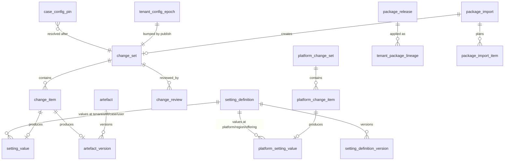

# 5.7.4 Settings and configuration data model

<!-- Generated layout: edit text between the markers; keep the markers and the front matter. -->

> Postgres schema `config`: setting definitions, platform and tenant setting values with validity history, locks, bounds and constraints, configuration epochs, case configuration pins, change sets with items and reviews, artefact versions, packages, lineage and trusted keys; RLS, indexes, retention and migrations

<!-- section:purpose -->
## Scope and ownership

The storage for the configuration backbone: settings resolved by [[PKG-settings]] along the hierarchy in [[PKG-configuration-scope-hierarchy]], the change sets of [[PKG-configuration-lifecycle]], the artefact versions of [[PKG-configuration-and-customisation]], and the packages of [[PKG-configuration-packages]].

- Owner: platform engineering, configuration team.
- Prisma schema file: `packages/settings/prisma/config.prisma` (models for settings, change sets, pins) and `packages/config-core/prisma/artefacts.prisma` (artefacts, packages); both use Postgres schema `config` in each regional database.
- Readers: only `@nomology/settings`, `@nomology/config-core` and `@nomology/config-packages` read or write these tables. Other contexts reference rows by ID only (for example `config.case_config_pin (tenant_id, case_id)`, audit events carrying `change_set_id`) and read values through the package APIs. Reporting reads change-set metadata from the reporting replica through `rpt` views ([[RPT-report-infrastructure]]) without values of `sensitive` keys.

Conventions (stated once): IDs are `uuid` UUIDv7 generated by the application; timestamps are `timestamptz` in UTC; validity intervals are half-open `[valid_from, valid_to)` with `valid_to IS NULL` meaning current; setting values are `jsonb` validated by the definition's Zod schema before insert; enums are Postgres enums created in migrations; every aggregate root has `version int` for optimistic concurrency.

<!-- section:entities -->
## Entities and relationships



| Table | Kind | Aggregate root | Notes |
|---|---|---|---|
| `setting_definition`, `setting_definition_version` | Platform-level | `setting_definition` | Synced from code at deploy |
| `platform_setting_value` | Platform-level | — | Values, bounds, locks and selectors at `platform`, `region`, `offering` |
| `platform_change_set`, `platform_change_item`, `platform_change_review` | Platform-level | `platform_change_set` | Nomology changes |
| `platform_config_epoch` | Platform-level | — | One row per region |
| `package_release`, `trusted_package_key` | Platform-level | `package_release` | Blueprints and extensions; trust list |
| `setting_value` | Tenant-owned | — | Values, constraints and locks at `tenant`, `unit`, `case`, `user` |
| `tenant_config_epoch` | Tenant-owned | — | One row per tenant |
| `change_set`, `change_item`, `change_review`, `change_set_counter` | Tenant-owned | `change_set` | |
| `artefact`, `artefact_version` | Tenant-owned | `artefact` | Existing in config-core; now linked to change items |
| `case_config_pin` | Tenant-owned | — | One row per case: pinned artefact versions and settings |
| `package_export`, `package_import`, `package_import_item`, `tenant_package_lineage` | Tenant-owned | `package_import` | |

Case-type scope values are stored inside the published case-type blueprint body (an `artefact_version` of kind `case_type_blueprint`, [[WF-process-definition-model]]), not in `setting_value`.

<!-- section:tables -->
## Tables and columns

Classification codes: **P** public, **I** internal, **C** confidential (tenant configuration), **PD** personal data. No column holds sensitive personal data.

**`config.setting_definition`** (platform-level)

| Column | Type | Null | Default | Meaning | Class |
|---|---|---|---|---|---|
| `key` | text | no | — | PK; `^[a-z]+(\.[a-z0-9_]+){2,4}$`, domain = first segment | I |
| `domain` | text | no | — | `platform`, `auth`, `access`, `case`, `workflow`, `notify`, `integration`, `brand`, `content`, `locale`, `ai`, `data`, `billing`, `personal` | I |
| `owner_package` | text | no | — | For example `@nomology/notifications` | I |
| `catalogue_node` | text | no | — | Spec node ID of the domain catalogue, for example `PKG-settings-data-and-privacy` | I |
| `current_version` | int | no | — | Latest `setting_definition_version.version` | I |
| `status` | config.definition_status | no | `'active'` | `active`, `deprecated`, `retired` | I |
| `replaced_by` | text | yes | — | Key that replaces a deprecated key | I |
| `created_at`, `updated_at` | timestamptz | no | `now()` | | I |

**`config.setting_definition_version`** (platform-level, immutable)

| Column | Type | Null | Default | Meaning | Class |
|---|---|---|---|---|---|
| `key` | text | no | — | FK `setting_definition(key)` | I |
| `version` | int | no | — | 1, 2, … | I |
| `value_type` | text | no | — | `boolean`, `int`, `decimal`, `duration`, `enum`, `set`, `text`, `localised_text`, `object`, `ref` | I |
| `json_schema` | jsonb | no | — | JSON Schema generated from the Zod schema | I |
| `schema_hash` | bytea | no | — | SHA-256 of `json_schema` | I |
| `default_value` | jsonb | no | — | Code default | I |
| `scopes` | config.scope_type[] | no | — | Allowed scopes, ordered | I |
| `lockable` | boolean | no | false | | I |
| `code_bound` | jsonb | yes | — | Bound in code: `{range:{min,max}}`, `{enum_subset:[…]}`, `{subset_of:[…]}`, `{pattern}`, `{direction:'stricter_only', order:[…]}` | I |
| `entitlement_key` | text | yes | — | `feature.*` or `limit.*` | I |
| `pinning` | config.pinning_mode | no | `'live'` | `case_start`, `live`, `event` | I |
| `case_overridable` | boolean | no | false | | I |
| `migratable` | boolean | no | false | | I |
| `on_out_of_bounds` | text | no | `'fallback'` | `clamp` or `fallback` | I |
| `audit_class` | config.audit_class | no | — | `standard`, `sensitive`, `maker_checker` | I |
| `permission` | text | no | — | Permission to change, for example `settings.data:write` | I |
| `takes_effect` | text | no | — | `immediate`, `next_request`, `next_sign_in`, `new_cases_only`, `next_billing_period`, `next_job_run` | I |
| `label`, `description` | jsonb | no | — | Localised admin text | P |
| `release_id` | text | no | — | Release that synced this version | I |
| `synced_at` | timestamptz | no | `now()` | | I |

**`config.platform_setting_value`** (platform-level; one row per value version)

| Column | Type | Null | Default | Meaning | Class |
|---|---|---|---|---|---|
| `id` | uuid | no | — | PK | I |
| `key` | text | no | — | FK `setting_definition(key)` | I |
| `scope_type` | config.scope_type | no | — | `platform`, `region` or `offering` only (check) | I |
| `scope_ref` | text | no | — | `*` for platform, region code, or offering code | I |
| `selector_key` | text | no | `''` | Sorted, comma-joined tenant types for targeted values; `''` means all | I |
| `value` | jsonb | yes | — | Null when the row only sets a bound or lock | I |
| `bound` | jsonb | yes | — | Hard bound at this scope (tightens the code bound) | I |
| `locked` | boolean | no | false | Lock for all narrower scopes | I |
| `valid_from` | timestamptz | no | — | | I |
| `valid_to` | timestamptz | yes | — | Null while current | I |
| `version` | int | no | — | Per (key, scope, selector), increments | I |
| `platform_change_item_id` | uuid | no | — | FK; provenance | I |
| `recorded_at` | timestamptz | no | `now()` | Transaction time | I |

**`config.setting_value`** (tenant-owned; one row per value version)

| Column | Type | Null | Default | Meaning | Class |
|---|---|---|---|---|---|
| `tenant_id` | uuid | no | — | RLS key | I |
| `id` | uuid | no | — | PK with `tenant_id` | I |
| `key` | text | no | — | FK `setting_definition(key)` | I |
| `scope_type` | config.scope_type | no | — | `tenant`, `unit`, `case` or `user` (check) | I |
| `scope_id` | uuid | yes | — | Null for `tenant`; `org_unit.id`, `case.id` or `membership.id` | I |
| `value` | jsonb | yes | — | Null when the row only sets a constraint or lock; check `pg_column_size(value) < 16384` | C (PD for `user` scope preferences) |
| `constraint_bound` | jsonb | yes | — | Tenant-set tightening for narrower scopes | C |
| `locked` | boolean | no | false | | C |
| `managed` | boolean | no | false | Written by Nomology (blueprint or platform change set); tenant roles cannot change | I |
| `valid_from` | timestamptz | no | — | Effective time | I |
| `valid_to` | timestamptz | yes | — | | I |
| `version` | int | no | — | Per (key, scope_type, scope_id) | I |
| `change_item_id` | uuid | yes | — | FK `(tenant_id, change_item_id)`; null only for `user` preference writes | I |
| `reason` | text | yes | — | Up to 500 characters; required for `case` scope | C |
| `order_document_id` | uuid | yes | — | For `case` scope: the procedural order that required the change | I |
| `recorded_at` | timestamptz | no | `now()` | | I |

User-scope preference writes are high-frequency, low-risk changes by the user; they skip change sets and are written directly with `change_item_id = null` (the user is author and owner). Every other scope requires a change item.

**`config.platform_config_epoch`**: `region text PK`, `epoch bigint NOT NULL`, `updated_at timestamptz`. **`config.tenant_config_epoch`**: `tenant_id uuid PK`, `epoch bigint NOT NULL DEFAULT 0`, `updated_at timestamptz`.

**`config.case_config_pin`** (tenant-owned; replaces the previous artefact-only pin)

| Column | Type | Null | Meaning | Class |
|---|---|---|---|---|
| `tenant_id`, `case_id` | uuid | no | PK; FK `(tenant_id, case_id)` → `case` | I |
| `blueprint_ref` | jsonb | no | `{key, version, artefactVersionId}` of the case-type blueprint | I |
| `artefacts` | jsonb | no | Array of `{kind, key, version, id}` | I |
| `settings` | jsonb | no | Map `key → {value, scope, ref, valueVersion, definitionVersion}` for `case_start` keys | C |
| `pinned_at` | timestamptz | no | | I |
| `migrated_from` | jsonb | yes | Previous pin summary when moved by a reviewed migration | I |
| `version` | int | no | Increments only on migration | I |

**`config.change_set`** (tenant-owned)

| Column | Type | Null | Default | Meaning | Class |
|---|---|---|---|---|---|
| `tenant_id`, `id` | uuid | no | — | PK | I |
| `number` | int | no | — | Per-tenant sequence shown as `CS-0042`, from `change_set_counter` | I |
| `title` | text | no | — | Up to 200 characters | C |
| `reason` | text | yes | — | Required before submit | C |
| `state` | config.change_state | no | `'draft'` | `draft`, `in_review`, `approved`, `published`, `superseded`, `rejected`, `withdrawn`, `failed`, `stale` | I |
| `review_policy` | config.audit_class | no | — | Strictest class among items, after tenant tightening | I |
| `op_key` | text | no | — | Admin op from the registry that created the change set, for example `admin.settings.publish`, `admin.role.assign` ([[APP-administration-model]]) | I |
| `domains` | text[] | no | `'{}'` | Settings catalogues or admin areas touched (for history filters and per-domain visibility) | I |
| `via` | text | no | — | Surface the change came through: `console`, `api`, `bulk`, `copilot`, `support`, `scim`, `system` (decision D3; CHECK constraint) | I |
| `origin` | text | yes | — | Why the change set exists when it was not authored directly: `package_import`, `blueprint`, `case_migration`, `revert` | I |
| `origin_ref` | uuid | yes | — | Package import ID, blueprint release ID or reverted change set ID, matching `origin` | I |
| `bulk_job_id`, `copilot_run_id`, `support_grant_id` | uuid | yes | — | Source links for `via = bulk`, `copilot` and `support` | I |
| `ticket_ref` | text | yes | — | External ticket or order reference given in the form | C |
| `reversible` | boolean | yes | — | Set at publish: whether every item has a stored inverse | I |
| `reverted_by_change_set_id` | uuid | yes | — | The later change set that reverted this one | I |
| `author_membership_id` | uuid | yes | — | Human author | PD (pseudonymous ID) |
| `author_principal_id` | uuid | yes | — | `ai_agent` or `service_account` principal ([[PKG-non-human-principals]]) | I |
| `on_behalf_of_membership_id` | uuid | yes | — | Human who invoked the agent | PD (pseudonymous ID) |
| `author_platform_user_id` | uuid | yes | — | Nomology staff author when `via = support` (always with `support_grant_id`) | I |
| `effective_from` | timestamptz | yes | — | Scheduled activation | I |
| `submitted_at`, `approved_at`, `published_at`, `superseded_at` | timestamptz | yes | — | | I |
| `validation` | jsonb | yes | — | Last validation report | C |
| `impact` | jsonb | yes | — | Impact analysis result (counts only) | C |
| `emergency` | boolean | no | false | Published by the emergency rollback path | I |
| `post_review_due_at` | timestamptz | yes | — | For emergency rollbacks | I |
| `version` | int | no | 0 | Optimistic concurrency | I |
| `created_at`, `updated_at` | timestamptz | no | `now()` | | I |

**`config.change_item`** (tenant-owned): `tenant_id`, `id`, `change_set_id` (FK with tenant), `seq int`, `item_kind text` (`setting.set`, `setting.unset`, `setting.lock`, `setting.unlock`, `setting.constrain`, `artefact.version`, `role.version`, `permission_set.version`, `integration.definition`, `case.migration`, `admin.op` for direct admin operations such as a role assignment), `target_ref text` (for example `setting:brand.footer.show_unit_name`, `artefact:form:statement_of_claim`), `target_scope_type config.scope_type NULL`, `target_scope_id uuid NULL`, `base_version int NULL`, `payload jsonb NOT NULL`, `diff jsonb NULL` (RFC 6902 JSON Patch [R1]), `inverse jsonb NULL` (filled at publish), `audit_class config.audit_class NOT NULL`, `result_ref uuid NULL` (the `setting_value.id` or `artefact_version.id` produced).

**`config.change_review`** (tenant-owned): `tenant_id`, `id`, `change_set_id`, `reviewer_membership_id uuid NOT NULL` (PD, pseudonymous), `decision text CHECK (decision IN ('approved','rejected','warning_acknowledged'))`, `comment text NULL` (≤ 2,000 characters), `step_up_at timestamptz NULL`, `decided_at timestamptz NOT NULL`, `invalidated_at timestamptz NULL` (set when the change set is edited).

**`config.change_set_counter`**: `tenant_id uuid PK`, `next_number int NOT NULL DEFAULT 1`.

**`config.platform_change_set`, `config.platform_change_item`, `config.platform_change_review`**: same columns as the tenant tables without `tenant_id`, with `author_platform_user_id` instead of membership IDs and `regions text[]` for multi-region intent (each region publishes its own copy).

**`config.artefact`** (tenant-owned, existing): `tenant_id`, `id`, `kind text`, `key text`, `current_published_version_id uuid NULL`, `managed boolean DEFAULT false`, `created_at`. **`config.artefact_version`**: `tenant_id`, `id`, `artefact_id`, `version int`, `status` (`draft`, `in_review`, `approved`, `published`, `superseded`, `retired`), `schema_version int`, `body jsonb` (≤ 512 KB), `body_sha256 bytea`, `change_item_id uuid NULL`, `effective_from timestamptz NULL`, `published_at timestamptz NULL`, `created_by_membership_id uuid`.

**Packages**: `config.package_release` (platform-level: `id`, `key`, `version text`, `kind`, `tenant_types tenant_type[]`, `manifest jsonb`, `object_key text`, `digest bytea`, `signing_key_id text`, `status` `draft|published|withdrawn`, `published_by`, `published_at`); `config.trusted_package_key` (platform-level: `key_id text PK`, `environment text`, `region text`, `public_key_pem text`, `allowed_kinds text[]`, `added_by`, `added_at`, `revoked_at`); `config.package_export` (tenant: `tenant_id`, `id`, `kind`, `selection jsonb`, `status`, `object_key`, `digest`, `requested_by_membership_id`, `expires_at`); `config.package_import` (tenant: `tenant_id`, `id`, `object_key`, `manifest jsonb`, `verification jsonb`, `plan jsonb`, `status` `uploaded|verified|planned|applied|rejected`, `change_set_id uuid NULL`, `uploaded_by_membership_id`); `config.package_import_item` (tenant: `tenant_id`, `import_id`, `component_key`, `action`, `decision`, `patch jsonb`); `config.tenant_package_lineage` (tenant: `tenant_id`, `package_key`, `package_version`, `applied_change_set_id`, `applied_at`, PK `(tenant_id, package_key)` keeping the latest, history in audit).

**Proposed additions to `tenant`** ([[MT-tenancy-and-identity-schema]], owned by the multi-tenancy team): `primary_offering offering NOT NULL`, `offerings offering[] NOT NULL`, `parent_tenant_id uuid NULL` (sandbox parent), `customer_account_id uuid NULL` (groups tenants of one customer), and `sandbox` added to `tenant_type`.

<!-- section:keys -->
## Keys and constraints

- PKs: tenant-owned tables use `(tenant_id, id)`; `case_config_pin` uses `(tenant_id, case_id)`; `tenant_config_epoch` and `change_set_counter` use `tenant_id`; `setting_definition_version` uses `(key, version)`.
- FKs between tenant-owned tables include `tenant_id`, for example `change_item (tenant_id, change_set_id) → change_set (tenant_id, id) ON DELETE CASCADE` (only drafts are ever deleted; see history) and `setting_value (tenant_id, change_item_id) → change_item (tenant_id, id) ON DELETE RESTRICT`.
- `setting_value.key → setting_definition(key)` and `platform_setting_value.key → setting_definition(key)` with `ON DELETE RESTRICT`; definitions are retired, never deleted.
- Scope checks:
```sql
ALTER TABLE config.setting_value ADD CONSTRAINT setting_value_scope_chk CHECK (
  scope_type IN ('tenant','unit','case','user')
  AND ((scope_type = 'tenant') = (scope_id IS NULL))
  AND (value IS NOT NULL OR constraint_bound IS NOT NULL OR locked)
  AND (scope_type <> 'case' OR reason IS NOT NULL)
  AND (valid_to IS NULL OR valid_to > valid_from));
ALTER TABLE config.platform_setting_value ADD CONSTRAINT psv_scope_chk CHECK (
  scope_type IN ('platform','region','offering')
  AND ((scope_type = 'platform') = (scope_ref = '*')));
```
- No overlapping validity for the same target (requires `btree_gist`):
```sql
ALTER TABLE config.setting_value ADD CONSTRAINT setting_value_no_overlap EXCLUDE USING gist (
  tenant_id WITH =, key WITH =, scope_type WITH =, coalesce(scope_id, '00000000-0000-0000-0000-000000000000'::uuid) WITH =,
  tstzrange(valid_from, valid_to) WITH &&);
ALTER TABLE config.platform_setting_value ADD CONSTRAINT psv_no_overlap EXCLUDE USING gist (
  key WITH =, scope_type WITH =, scope_ref WITH =, selector_key WITH =, tstzrange(valid_from, valid_to) WITH &&);
```
- Unique: `change_set (tenant_id, number)`; `artefact (tenant_id, kind, key)`; `artefact_version (tenant_id, artefact_id, version)`; `package_release (key, version)`.
- Enforced in application code, with reasons: that a value matches the definition's schema and bounds (schemas live in code and change by release); that the approver differs from the author by person (needs membership-to-account lookups); that `managed` rows are written only by platform principals (also enforced by a column-level `WITH CHECK` on a separate policy, see tenancy).

<!-- section:tenancy -->
## Tenancy and RLS policies

Every tenant-owned table in `config` gets the same policy set, created in the migration that creates the table ([[MT-prisma-migrations-include-rls]]):

```sql
ALTER TABLE config.setting_value ENABLE ROW LEVEL SECURITY;
ALTER TABLE config.setting_value FORCE ROW LEVEL SECURITY;
CREATE POLICY tenant_select ON config.setting_value FOR SELECT TO nomo_app, nomo_worker, nomo_reporting
  USING (tenant_id = current_setting('app.tenant_id', true)::uuid);
CREATE POLICY tenant_insert ON config.setting_value FOR INSERT TO nomo_app
  WITH CHECK (tenant_id = current_setting('app.tenant_id', true)::uuid
              AND (managed = false OR current_setting('app.principal_kind', true) = 'platform'));
CREATE POLICY tenant_update ON config.setting_value FOR UPDATE TO nomo_app
  USING (tenant_id = current_setting('app.tenant_id', true)::uuid)
  WITH CHECK (tenant_id = current_setting('app.tenant_id', true)::uuid);
-- no DELETE policy: value history is closed by setting valid_to, never deleted by the app
GRANT SELECT, INSERT, UPDATE (valid_to) ON config.setting_value TO nomo_app;
GRANT SELECT ON config.setting_value TO nomo_reporting;
```

| Table | SELECT | INSERT | UPDATE | DELETE |
|---|---|---|---|---|
| `setting_value` | tenant | tenant (managed only by platform principal) | `valid_to` only | none |
| `tenant_config_epoch`, `change_set_counter` | tenant | tenant | tenant | none |
| `change_set` | tenant | tenant | tenant | tenant, `state = 'draft'` only (policy `USING (... AND state = 'draft')`) |
| `change_item` | tenant | tenant | tenant while parent is draft (enforced by trigger `change_item_mutable_trg`) | via cascade from draft |
| `change_review` | tenant | tenant | `invalidated_at` only | none |
| `artefact`, `artefact_version` | tenant | tenant | status columns only | none |
| `case_config_pin` | tenant | tenant | tenant (migrations only, via package API) | none (deleted by the retention role with the case) |
| `package_export`, `package_import`, `package_import_item`, `tenant_package_lineage` | tenant | tenant | tenant | none |

`app.principal_kind` is set by the Prisma extension alongside `app.tenant_id` (values `user`, `ai_agent`, `service_account`, `platform`), transaction-local, so it is safe with PgBouncer transaction pooling.

Platform-level tables have no `tenant_id` and no RLS ([[MT-platform-level-tables]]). `nomo_app`, `nomo_worker` and `nomo_reporting` get `SELECT` on `setting_definition`, `setting_definition_version`, `platform_setting_value`, `platform_config_epoch`, `package_release`, `trusted_package_key`; writes are granted only to `config_platform_rw`, a non-owner role used by the platform admin console's server process and the definition sync job. `platform_change_*` tables are readable only by `config_platform_rw` and `platform_security_ro`.

Roles that bypass RLS: only the migration owner (`nomo_migrator`). The retention role deletes `case_config_pin` and `setting_value` rows per tenant inside `forEachTenant` under RLS ([[PKG-data-retention-legal-hold-and]]).

Policy beyond tenant equality: none at the database level. User-scope values are further restricted by the application (a user reads and writes only their own; `user_admin` may read them for support with an audit event).

<!-- section:indexes -->
## Indexes and access patterns

| Query (caller) | Index |
|---|---|
| Resolve current tenant-side values for a chain (cold read, `@nomology/settings`) | `setting_value (tenant_id, key, scope_type, scope_id) WHERE valid_to IS NULL` |
| Load all current tenant and unit values for L2 cache fill | `setting_value (tenant_id, scope_type, scope_id) INCLUDE (key, value, locked, constraint_bound, managed) WHERE valid_to IS NULL AND scope_type IN ('tenant','unit')` |
| User preferences for one membership | `setting_value (tenant_id, scope_id) WHERE scope_type = 'user' AND valid_to IS NULL` |
| Point-in-time resolution (`resolveAt`) | Served by the gist exclusion index on `(tenant_id, key, scope_type, scope_id, tstzrange)` |
| Drift scan after a bound change (all tenants in region, per key) | `setting_value (key) WHERE valid_to IS NULL` (run by the drift job per tenant inside `forEachTenant`) |
| Current platform values for a key | `platform_setting_value (key, scope_type, scope_ref) WHERE valid_to IS NULL` |
| Review queue and history (`/admin/changes`) | `change_set (tenant_id, state, updated_at DESC)`; `change_set (tenant_id, author_membership_id, created_at DESC)` |
| Scheduled activations (`config-activate`) | `change_set (tenant_id, effective_from) WHERE state = 'approved' AND effective_from IS NOT NULL` |
| Items of a change set | PK prefix `change_item (tenant_id, change_set_id, seq)` unique |
| History of one setting or artefact | `change_item (tenant_id, target_ref, change_set_id)` |
| Published version of an artefact | `artefact_version (tenant_id, artefact_id) WHERE status = 'published'` (unique partial index: one published version per artefact) |
| Pin for a case | PK `case_config_pin (tenant_id, case_id)` |

<!-- section:history -->
## Status, history and concurrency

- **Setting values** are bitemporal-lite: `valid_from`/`valid_to` is effective time, `recorded_at` is transaction time. A new value closes the current row (`valid_to = new.valid_from`) and inserts a new row in the same transaction; rows are never updated otherwise or deleted by the application. This gives point-in-time resolution and a complete history without a separate audit lookup.
- **Change sets** follow the state machine in [[PKG-configuration-lifecycle#design]], implemented as a code-defined state machine ([[WF-entity-state-machines]]). Only `draft` change sets can be deleted (by their author); all others are kept.
- **Artefact versions** are immutable once `in_review`; status moves `published → superseded` when a later version is published, and `retired` when no longer selectable.
- **Pins** are immutable except through a reviewed case migration, which increments `version` and records `migrated_from`.
- **Concurrency**: `change_set.version` and per-target `base_version` detect conflicting edits; the exclusion constraints stop two overlapping current values even if two transactions race.

<!-- section:protection -->
## Data classification and protection

- Setting values must not contain personal data or secrets. Save-time checks reject values matching email, phone, PAN, Aadhaar and card-number patterns, and keys whose names contain `secret`, `password`, `token` or `api_key` fail the definition lint ([[PKG-settings#versioning]]).
- User-scope values (locale, time zone, density, digest time) are personal data of low sensitivity. They are not copied to the reporting replica, search index or logs; telemetry carries only key names.
- Values of `sensitive` and `maker_checker` keys are excluded from `rpt` views; reporting sees key, scope and timestamps only.
- Reasons and review comments are free text; the console warns when they look like they contain personal data, and they are never exported in packages.
- Membership IDs on change sets and reviews are pseudonymous; names are joined at display time and are anonymised with the user account ([[MT-tenancy-and-identity-schema]]).

<!-- section:retention -->
## Retention, archival and deletion

| Table | Kept for (proposed) | Clock | End action |
|---|---|---|---|
| `setting_value` (tenant, unit, case scopes), `change_set`, `change_item`, `change_review`, `artefact_version` | 8 years after superseded or retired (configuration evidence, as in [[PKG-retention-and-deletion-schedule]]) | `valid_to` / `superseded_at` | Hard delete in monthly batches |
| `setting_value` (user scope) | Life of the membership | Membership ended | Hard delete with the membership |
| `case_config_pin` | Same as the case record | Case closed | Deleted with the case |
| `package_export` and archives | 30 days | Created | Hard delete row and object |
| `package_import` records | 8 years (evidence of what was imported) | Applied or rejected | Hard delete; archive object deleted after 90 days |
| Platform tables | Life of the platform | — | Kept |

Legal holds apply to all tenant-owned rows linked to a held case or to a tenant-scope hold ([[PKG-data-retention-legal-hold-and]]). At offboarding, a snapshot package is included in the export bundle, then all tenant rows are deleted. Assumption: legal to confirm that 8 years after supersession is the right evidence period for configuration that governed cases (the case record itself is 8 years after closure, so a value superseded early could be deleted before the cases it governed close; the deletion job therefore keeps any value referenced by a pin of a case still within retention).

<!-- section:migrations -->
## Migrations and rollout

Ordered per region, all with `SET lock_timeout = '5s'` and `statement_timeout = '60s'` except backfills, following [[DEP-database-migration-strategy-zero]]:

1. `config_0001_extensions_enums`: `CREATE EXTENSION IF NOT EXISTS btree_gist`; enums `config.scope_type`, `config.pinning_mode`, `config.audit_class`, `config.change_state`, `config.definition_status`.
2. `config_0002_definitions`: `setting_definition`, `setting_definition_version`, grants. The deploy job `config-registry-sync` (BullMQ, run once per release per region) upserts definitions from the generated registry.
3. `config_0003_values_expand`: create `platform_setting_value` and the new `setting_value` columns (`scope_type`, `scope_id`, `valid_from`, `valid_to`, `managed`, `constraint_bound`, `change_item_id`, `order_document_id`) alongside the old `settings.setting_value` (`level`, `scope_id`); RLS SQL in the same file.
4. `config_0004_backfill_values`: batch job copying old rows: `level` `platform` → `platform_setting_value(scope_type='platform')`; `tenant` → `tenant`; `org_unit` → `unit`; `user` → `user`; `valid_from = set_at`. Keys renamed to the shared naming convention through a mapping file (for example `notifications.quietHours` → `notify.quiet_hours.start`), recorded in `setting_definition.replaced_by`. Dual-write from the application for one release.
5. `config_0005_change_sets`: change-set tables, counters, epochs, RLS; backfill existing published artefact versions into one single-item, `published` change set each, so history is continuous.
6. `config_0006_pins`: create `case_config_pin` with the `settings` column; copy existing artefact pins; settings pins start empty for existing cases (they resolve live until migrated, recorded in the case timeline as "pre-pinning case").
7. `config_0007_packages`: package tables and trusted keys.
8. `config_0008_contract`: after one release with no reads of the old table (verified by `pg_stat_user_tables`), drop `settings.setting_value` and the old pin table.
9. `mt_00xx_tenant_offering_sandbox` (owned by the multi-tenancy team): tenant columns listed in the tables section.

Rollback: steps 3–7 are additive and roll forward; the application can be rolled back while old tables still exist (until step 8). Step 8 is only run after the release is stable in every region.

<!-- section:prisma -->
## Prisma schema mapping

Models: `SettingDefinition`, `SettingDefinitionVersion`, `PlatformSettingValue`, `SettingValue`, `PlatformConfigEpoch`, `TenantConfigEpoch`, `CaseConfigPin`, `ChangeSet`, `ChangeItem`, `ChangeReview`, `ChangeSetCounter`, `PlatformChangeSet`, `PlatformChangeItem`, `PlatformChangeReview`, `Artefact`, `ArtefactVersion`, `PackageRelease`, `TrustedPackageKey`, `PackageExport`, `PackageImport`, `PackageImportItem`, `TenantPackageLineage`, all with `@@schema("config")` and `@@map` to snake_case names; fields `@map` to snake_case columns. Composite keys `@@id([tenantId, id])`. Enums `ScopeType`, `PinningMode`, `AuditClass`, `ChangeState`, `DefinitionStatus`.

```prisma
model SettingValue {
  tenantId        String    @map("tenant_id") @db.Uuid
  id              String    @db.Uuid
  key             String
  scopeType       ScopeType @map("scope_type")
  scopeId         String?   @map("scope_id") @db.Uuid
  value           Json?
  constraintBound Json?     @map("constraint_bound")
  locked          Boolean   @default(false)
  managed         Boolean   @default(false)
  validFrom       DateTime  @map("valid_from") @db.Timestamptz
  validTo         DateTime? @map("valid_to") @db.Timestamptz
  version         Int
  changeItemId    String?   @map("change_item_id") @db.Uuid
  reason          String?
  orderDocumentId String?   @map("order_document_id") @db.Uuid
  recordedAt      DateTime  @default(now()) @map("recorded_at") @db.Timestamptz
  definition      SettingDefinition @relation(fields: [key], references: [key])
  @@id([tenantId, id])
  @@map("setting_value")
  @@schema("config")
}
```

Raw SQL only (Prisma's view is incomplete): RLS policies and grants, the `btree_gist` exclusion constraints, check constraints, partial and `INCLUDE` indexes, the `change_item_mutable_trg` trigger, the restricted column grants, and the per-tenant sequence logic in `change_set_counter` (updated with `UPDATE … RETURNING`).

<!-- section:seed -->
## Seed and reference data

- **Definitions** are not seeded by migrations; they are synced from code at deploy by `config-registry-sync`, so the catalogue always matches the running release.
- **Platform, region and offering values** are reference data in `packages/settings/platform-values/<region>.yaml`, reviewed by product (and legal for regulated keys), and applied by the deploy job as a platform change set authored by the release pipeline and approved by the release manager.
- **Blueprints** are built from `packages/blueprints/<key>/` and published per region through `/platform/config/blueprints` ([[PKG-configuration-packages]]).
- **Trusted package keys** are registered by platform security per environment.
- Development and test fixtures: the fixture tenants of [[FND-environments]] (ENVS-8) are created by applying each blueprint with test parameters; no production reference data is copied into tests.

<!-- section:volume -->
## Volume, growth and performance

| Table | Launch (per region) | 1 year | 5 years | Notes |
|---|---|---|---|---|
| `setting_definition_version` | 600 | 900 | 2,000 | |
| `platform_setting_value` | 1,500 | 3,000 | 10,000 | |
| `setting_value` (tenant, unit, case) | 20,000 | 150,000 | 1.5 M | Case-scope overrides are rare (about 2% of cases) |
| `setting_value` (user) | 50,000 | 600,000 | 3 M | Preferences, about 8 per active membership, history included |
| `case_config_pin` | 10,000 | 300,000 | 2 M | One row, about 6 KB, per case; the largest SEBI ODR tenant may hold 60% |
| `change_set` / `change_item` | 2,000 / 10,000 | 40,000 / 300,000 | 250,000 / 2 M | |

Hot tables: `setting_value` current rows (served mostly from cache) and `case_config_pin` (read at case load). Thresholds: if `case_config_pin` exceeds 20 M rows in a region or 100 GB, partition by hash of `tenant_id`; if `change_item` exceeds 20 M rows, partition by `created_at` month.

<!-- section:questions -->
## Open questions

- [ ] Confirm the 8-year evidence period for superseded configuration with legal, and the rule that values referenced by pins of retained cases are kept. (owner: DPO)
- [ ] Should user preference writes also go through change sets for tenants that require it (court programmes)? Proposed: no; they are personal choices. (owner: product)
- [ ] The multi-tenancy team to accept the proposed `tenant` columns (`primary_offering`, `offerings`, `parent_tenant_id`, `customer_account_id`, `sandbox` type). (owner: multi-tenancy lead)
- [ ] Is a hash-partitioned `case_config_pin` needed at launch for the largest SEBI ODR tenant? Assumption: not before 20 M rows. (owner: platform engineering)

<!-- checks -->
## Template checks

<!-- check:tenancy -->
### Tenant isolation in the schema

Every tenant-owned table carries a non-null `tenant_id`, has RLS enabled and forced, and has explicit per-command policies for `nomo_app`, `nomo_worker` and `nomo_reporting`; FKs between tenant tables include `tenant_id`; there are no views or functions in `config` that read across tenants (the drift scan runs per tenant through `forEachTenant`). Platform-level tables hold no tenant data and are readable but not writable by app roles. Sequences are per tenant (`change_set_counter`), so numbering reveals nothing about other tenants. Managed rows can only be inserted when the transaction's principal kind is `platform`.

<!-- check:integrity -->
### Invariants enforced by the database

The database guarantees: no overlapping validity for the same target (gist exclusion), valid scope combinations (check constraints), case-scope values have a reason, one published version per artefact (partial unique index), value history is append-only for app roles (no DELETE policy and column-limited UPDATE), and change items cannot change once their change set leaves draft (trigger). Left to the application, with reasons in the keys section: schema and bound validation (schemas live in code), person-level maker-checker, and entitlement checks. Concurrent writers (console, admin API, package imports, activation jobs) are serialised per target by the exclusion constraint and by `base_version` checks.

<!-- check:migration-safety -->
### Zero-downtime and reversible migrations

Expand, backfill, dual-write and contract over at least one release (steps 3–8), with lock and statement timeouts; the backfill runs in batches of 5,000 rows per tenant with `forEachTenant` and is resumable; the contract step runs only after every region shows no reads of the old table. A failed backfill is re-run idempotently (rows keyed by source ID). Migrations run per region in the release-wave order.

<!-- check:privacy -->
### Personal data, erasure and the legal record

Personal data is limited to user-scope preferences and pseudonymous membership IDs on change sets and reviews. Rights requests: access returns the user's preferences; erasure deletes them with the membership and anonymises the user account, which leaves change-set history with an anonymised author (the legal record of who changed a tenant's configuration is kept as a pseudonymous ID with the institution's legitimate-use basis; assumption to be confirmed by the DPO). No personal data is ever permitted in values, so retention of configuration evidence does not retain personal data.

<!-- check:residency -->
### Region placement and cross-region references

All `config` tables exist in each regional database and hold only that region's tenants. Platform-level tables are per region and populated per region by the deploy job and platform change sets; there is no global configuration table. Packages moved between regions carry configuration only, never IDs.

<!-- check:audit -->
### History, immutability and evidence

The setting history itself answers "what was the value at time T and which change set set it" (`valid_from`, `valid_to`, `change_item_id`), and each change set records author, on-behalf-of, reviewers, reason and diff. Audit events for each publish are written to the hash-chained audit trail ([[PKG-audit-log-schema]]) in the same transaction, so tampering with `config` rows would be detectable by comparing with the audit chain.

<!-- check:performance -->
### Query performance under RLS and growth

Cold resolution is one index-only scan on the current-values partial index per chain (target ≤ 15 ms p95 at 5-year volume with RLS); L2 cache fill uses the `INCLUDE` index. Point-in-time reads use the gist index and are admin-only. `case_config_pin` is a single-row PK lookup. We revisit the design if `setting_value` current rows per tenant exceed 100,000 or pin rows exceed 20 M per region.

<!-- check:testing -->
### Schema verification

CI runs: a schema-drift check that the Prisma schema plus raw SQL matches this node's table list; RLS tests against real Postgres for every tenant table (read, insert, update, delete across tenants, and `managed` insert by a non-platform principal); exclusion constraint race tests; migration tests from the current production schema snapshot per region; and the backfill mapping test that every old key maps to a defined new key.

<!-- citations -->
## Citations

```json
[
  {
    "body": "IETF",
    "id": "R1",
    "ident": "RFC 6902",
    "kind": "standard",
    "title": "JavaScript Object Notation (JSON) Patch",
    "url": "https://www.rfc-editor.org/rfc/rfc6902"
  }
]
```

<!-- end -->
