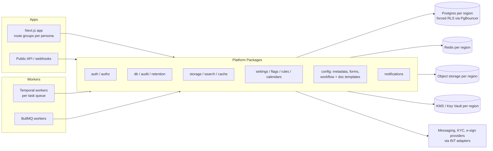

# 5 Platform Packages (shared libraries)

<!-- Generated layout: edit text between the markers; keep the markers and the front matter. -->

<!-- section:purpose -->
## Purpose and scope

The Platform Packages area holds the shared TypeScript libraries under `packages/*` in the Turborepo monorepo that every app (the Next.js app and its persona route groups), every Temporal worker and every BullMQ worker imports. They exist so that the hard, regulated and multi-tenant parts of the platform (identity, access, storage, audit, retention, notifications, configuration) are written once, reviewed once and behave the same for CORD, TERES and bespoke deployments such as the HKIAC Case Management Platform.

**In scope**
- Authentication, sessions, MFA and per-tenant SSO ([[PKG-authentication]] and children)
- Authorisation: roles, case- and party-level attributes, the policy engine, ethical walls and support access ([[PKG-authorization]] and children)
- Object storage, encryption at rest, signed URLs and malware scanning ([[PKG-storage]])
- Application-level encryption helpers, secrets client, input sanitisation, CSRF, rate limiting ([[PKG-security]])
- Caching, settings, feature flags, the rules and decision engine, calendars and deadline arithmetic
- Configuration and customisation: metadata and custom fields, forms, workflow templates, document and notification templates, branding, thresholds ([[PKG-configuration-and-customisation]])
- Audit trail, notifications, search, data access, data retention and legal hold
- UI design system ([[PKG-ui-design-system]]) — owned by the design-system team but governed by the same package rules

**Out of scope** (things someone might expect here)
- Tenant resolution and the tenant model — owned by [[MT-tenant-resolution]] and [[MT-tenant-model]]; packages consume the resulting context
- Durable orchestration and job runtimes — Temporal and BullMQ are specified in [[WF-workflow-engine]], [[WF-background-jobs-and-queues]] and [[INF-temporal]]; packages provide Activities and job handlers, not the engines
- Entity status lifecycles — [[WF-entity-state-machines]]
- Provider integrations (SES, SMS gateways, WhatsApp BSPs, KYC vendors) — [[INT-common-integrations]]; packages define the adapter interfaces those integrations implement
- Key stores and secret managers themselves — [[INF-secrets-and-keys]]; this area only ships the client utilities
- Compliance controls and evidence — [[SEC-isms-controls]] and [[SEC-privacy-controls]]; packages are the mechanisms those controls point at

<!-- section:goals -->
## Goals and non-goals

| # | Goal | Measure (proposed target) |
|---|---|---|
| G1 | No cross-tenant data exposure caused by a shared package | Zero cross-tenant findings in isolation tests ([[TST-multi-tenant-isolation-tests]]) and pen tests; every package with tenant data has an isolation test suite that runs on every PR |
| G2 | Consumers can code against a package before it is finished | Every package publishes a typed public API (`index.ts` only) and an in-memory fake within one sprint of its spec reaching Approved |
| G3 | No change to a package breaks a consumer in production | Zero production incidents per quarter traced to a package API change; API diff check blocks every unreviewed public-API change |
| G4 | Every state change with legal or security meaning leaves an audit record | 100% of operations listed as audited in each package spec emit events in the same transaction (checked by contract tests) |
| G5 | Data stays in the tenant's region | No package holds a hard-coded region endpoint; region resolution covered by tests in every package that does I/O |
| G6 | Packages are cheap to call | p95 overhead budgets met per package (for example authorisation check ≤ 5 ms in-process, settings read ≤ 2 ms warm) |

**Non-goals**
- Publishing these packages outside the monorepo or to npm
- Supporting a second ORM or database engine (Prisma and Postgres are fixed by [[ADR-orm]] and [[ADR-tenant-isolation]])
- Making packages usable from the browser, except the design system and explicitly marked client-safe types
- Per-tenant forks of package code; tenant variation goes through settings, rules and configuration, never code branches

<!-- section:principles -->
## Principles

1. **Tenant context is mandatory.** Every package function that touches tenant data reads the tenant from the active context ([[MT-tenant-resolution]]) and fails with `TenantContextMissingError` if there is none. A `tenantId` argument, where accepted, must match the context. Checked by: isolation test suite per package.
2. **Database access only through `@nomology/db`.** No package creates its own Prisma client. All tenant queries run inside the transaction-scoped tenant setting of [[MT-prisma-client-extension-wraps]]. Checked by: lint rule banning `new PrismaClient` outside `packages/db`.
3. **Server-only by default.** Every package except `@nomology/ui` and `*-types` imports `server-only`. Checked by: Turborepo boundaries tags and a build that fails if a server package lands in a client bundle.
4. **One public entry point.** Consumers import only from the package root; deep imports are blocked. Checked by: Turborepo boundaries and an ESLint `no-restricted-imports` rule.
5. **Region resolved, never hard-coded.** Endpoints, buckets, keys and queues come from the regional configuration ([[FND-environment-management]]); a mismatch between tenant region and service region is an error, never a fallback. Checked by: config schema and a region-mismatch test per package.
6. **Audit inside the operation.** Packages that change state or reveal sensitive data write their audit event through `@nomology/audit` in the same transaction, not as a caller's afterthought. Checked by: contract tests.
7. **Safe to retry.** Every side-effecting function takes or derives an idempotency key and is safe to call from a Temporal Activity or BullMQ job more than once. Retries happen in Temporal or BullMQ, not inside packages, except bounded retries on transport errors. Checked by: duplicate-call tests.
8. **No personal data in telemetry.** Packages log identifiers, not content; the shared logger redacts tagged fields. Checked by: log-redaction tests and the telemetry scanner in [[OBS-foundations]].
9. **Deny by default.** Any authorisation, feature or setting lookup that cannot be resolved returns the safe value (deny, flag off, platform default) and records why.
10. **Semver and deprecation.** Breaking public-API changes need a major version, a migration note and at least one release with both old and new forms. Checked by: API Extractor report diff in CI.

<!-- section:context -->
## Context and boundaries

| Neighbouring area | What flows | Contract |
|---|---|---|
| Multi-tenancy ([[MT-tenant-resolution]], [[MT-isolation-strategy]]) | Resolved tenant, region and actor into every call | `RequestContext` type and AsyncLocalStorage accessor |
| Workflows ([[WF-separation-of-concerns-temporal]]) | Packages run as Activities (rules evaluation, notifications, retention sweeps); workflow templates are run by the interpreter workflow | Activity signatures listed in each package's Public API |
| Domain modules ([[DOM-cases]], [[DOM-documents]], [[DOM-hearings]]) | Domains call authz, audit, storage, notifications, rules, calendars | Package public APIs only |
| Integrations ([[INT-integration-framework]], [[INT-messaging-providers]]) | Provider adapters implement package interfaces | Adapter interfaces in `adapters` sections |
| Infrastructure ([[INF-database]], [[INF-redis]], [[INF-secrets-and-keys]]) | Regional endpoints, roles, keys | Environment schema in [[FND-environment-management]] |
| Observability ([[OBS-foundations]], [[OBS-alerting]]) | Spans, metrics, structured logs, thresholds | OpenTelemetry names in each package's observability check |
| Security and compliance ([[SEC-isms-controls]], [[SEC-privacy-controls]]) | Evidence: audit exports, access reviews, retention reports | Export APIs of audit and retention packages |

<!-- section:decisions -->
## Key decisions

- [[ADR-tenant-isolation]] — shared database with `tenant_id` and forced RLS; every data package relies on `@nomology/db` rather than adding its own filtering.
- [[ADR-orm]] — Prisma; packages extend the single shared client and add raw SQL only in migrations (RLS, partitions, constraints).
- [[ADR-workflow-engine]] — packages expose Activities for Temporal and handlers for BullMQ; they never start their own schedulers.
- [[ADR-queue-technology]] — BullMQ on Redis; queue Redis must run with `noeviction`, which is why caching uses a separate Redis instance ([[PKG-caching]]).
- [[ADR-temporal]] — self-hosted per region; package Activities run on regional task queues only.
- [[ADR-next-js-hosting]] and [[ADR-container-orchestration]] — packages run in long-lived containers, so in-process caches and connection pools are acceptable but must be bounded.

**Open decisions that block children** (each should become an ADR node):
- Authentication core: in-house on vetted libraries vs a self-hosted identity server (blocks [[PKG-authentication]] children)
- Policy engine: typed TypeScript policies vs Cedar or OPA (blocks [[PKG-policy-engine-permission-matrix]])
- Rules engine: in-house JSON evaluator vs GoRules Zen vs FEEL/DMN (already raised in [[WF-separation-of-concerns-temporal#questions]])
- Search backend: Postgres full-text first vs OpenSearch per region (blocks [[PKG-search]])

<!-- section:map -->
## Capability map

| Child | Package | Owns |
|---|---|---|
| [[PKG-authentication]] | `@nomology/auth` | Identities, credentials, sessions, MFA, SSO connections, devices |
| [[PKG-authorization]] | `@nomology/authz` | Roles, case and party attributes, policy evaluation, ethical walls, support access |
| [[PKG-storage]] | `@nomology/storage` | Object storage abstraction, encryption at rest, signed URLs, malware scanning |
| [[PKG-security]] | `@nomology/crypto`, `@nomology/http-guard` | Field encryption, secrets client, input sanitisation, CSRF, rate limits |
| [[PKG-caching]] | `@nomology/cache` | Tenant-scoped cache keys, request memo, invalidation |
| [[PKG-rules-and-decision-engine]] | `@nomology/rules` | Versioned decision tables and their evaluation |
| [[PKG-settings]] | `@nomology/settings` | Settings resolved over eight scopes (platform, region, offering, tenant, unit, case type, case, user) with locks, hard bounds and case pinning ([[PKG-configuration-scope-hierarchy]], [[PKG-settings-catalogue]]) |
| [[PKG-configuration-and-customisation]] | `@nomology/config-core` and children | Shared lifecycle for tenant configuration artefacts |
| [[PKG-feature-flags]] | `@nomology/flags` | Release and operational flags (including `ai.killswitch`) per tenant, user and region; tenant choices such as AI enablement are settings, not flags |
| [[PKG-audit-trail]] | `@nomology/audit` | Append-only, tamper-evident audit events and exports |
| [[PKG-notifications]] | `@nomology/notifications` | Channel selection, sending, delivery tracking |
| [[PKG-search]] | `@nomology/search` | Tenant- and permission-scoped full-text and metadata search |
| [[PKG-data-access]] | `@nomology/db` | Prisma client, tenant transactions, repositories, migrations, seed data |
| [[PKG-ui-design-system]] | `@nomology/ui` | Components, tokens, Storybook |
| [[PKG-data-retention-legal-hold-and]] | `@nomology/retention` | Retention schedules, legal holds, deletion and anonymisation runs |
| [[PKG-calendars-and-deadline]] | `@nomology/calendars` | Holiday calendars, business days, deadline arithmetic |

Gaps and overlaps to watch: support access sits in authorisation but its audit view is in the audit trail; document templates (5.8.4) and notification copy ([[PKG-notification-copy]]) both touch notification text — templates own structure and versioning, copy owns wording.

<!-- section:phasing -->
## Phasing

| Phase ([[PLAN]]) | Packages that land | Exit condition before the next phase |
|---|---|---|
| 1. Core platform | `db` (tenant transactions, migrations, reference data), `auth` (email/password, magic link, OTP, sessions, MFA for staff), `authz` (roles, case participants, policy engine v1), `settings`, `audit` (events, sealing), `crypto` secrets client, `http-guard` | Isolation test suite green for every table; audit events sealed; staff MFA enforced |
| 2. Shared services | `storage` with scanning and signed URLs, `cache`, `notifications` (email, SMS, in-app), `flags`, `ui`, `search` v1 (Postgres full-text) | Upload-scan-view path proven end to end per region; notification delivery receipts stored |
| 3. First domain slice | `calendars` (deadline arithmetic needed by cases), `retention` schedules (no deletion yet), ethical walls v1 | Cases and documents use only package APIs; no direct Prisma outside `db` |
| 4. Extended domain | `rules`, configuration packages (metadata, forms, workflow templates, document templates), support access, SSO per tenant, WhatsApp channel | Tenant admin can configure a case type without code |
| 5–8 | Retention deletion runs, legal hold UI, search on OpenSearch if needed, thresholds | Retention dry-run reports reviewed by legal before enabling deletion |

Not deferrable from Phase 0–1 (per [[PLAN]]): audit logging, tenant isolation tests, structured logging with redaction.

<!-- section:risks -->
## Risks and open questions

- [ ] Authentication build-vs-host decision is not recorded; it affects residency of identity data and the SSO timeline. Owner: CTO.
- [ ] Policy engine and rules engine choices are open; both affect how tenant admins customise behaviour. Owner: platform engineering lead.
- [ ] Retention periods per record type are assumptions until legal confirms them per tenant type (arbitral institution, SEBI ODR institution, CORD). Owner: legal / DPO.
- [ ] Risk: packages grow into a "god library". Mitigation: each package has CODEOWNERS and a public-API size review at each phase boundary.
- [ ] Risk: one Redis per region shared by BullMQ (`noeviction`) and cache (needs eviction) is not workable; infrastructure must provision two. Owner: DevOps ([[INF-redis]]).
- [ ] Azure parity: storage, KMS and Redis adapters must be proven on Azure Container Apps deployments before a client requiring Azure goes live. Owner: DevOps.

<!-- checks -->
## Template checks

<!-- check:ownership -->
### Ownership and governance

- Accountable owner: the principal platform engineer for shared packages (to be named in CODEOWNERS for `packages/*`).
- Specialist reviewers by concern: security lead for `auth`, `authz`, `crypto`, `http-guard`; DPO / legal for `retention`, `audit` retention periods and `notifications` legal-service rules; design-system lead for `ui`; DevOps for region configuration.
- Changes to this area's scope or principles go through a pull request to this node plus an ADR when a principle changes; approval by the platform engineering lead and CTO.

<!-- check:boundaries -->
### Scope and boundaries

Each capability has one home in the capability map. The flows that cross the boundary have named contracts: `RequestContext` from [[MT-tenant-resolution]], Activity signatures for Temporal ([[WF-separation-of-concerns-temporal]]), adapter interfaces implemented by [[INT-common-integrations]], and regional configuration from [[FND-environment-management]]. Known overlaps are called out in the capability map (support access vs audit view; document templates vs notification copy) with the split stated.

<!-- check:principles -->
### Principles and enforcement

Each of the ten principles names its check: lint rules (no `new PrismaClient` outside `packages/db`, no deep imports), Turborepo boundaries tags (server-only packages), API Extractor diff in CI, the per-package isolation test suite, duplicate-call tests, and log-redaction tests. Principle 9 (deny by default) is checked through the negative tests in each security node.

<!-- check:decisions -->
### Decisions linked

Shaping decisions are linked: [[ADR-tenant-isolation]], [[ADR-orm]], [[ADR-workflow-engine]], [[ADR-queue-technology]], [[ADR-temporal]], [[ADR-next-js-hosting]], [[ADR-container-orchestration]]. Four open decisions that block children are listed under Key decisions (authentication core, policy engine, rules engine, search backend); each needs its own ADR node before the dependent child can be Approved.

<!-- check:regions -->
### Tenancy and residency

All packages are deployed with the app in each region (India, Singapore, US, and Azure where a client requires it); no package has a global runtime component. Region-level resources (Postgres, Redis for queues, Redis for cache, object storage, KMS, search) are resolved from regional configuration. The only global data the packages read is the tenant directory routing record owned by [[MT-data-residency-2]]. Tenant isolation inside a region is by `tenant_id` and forced RLS; across regions, by separate stacks.

<!-- check:quality -->
### Quality targets

Proposed area-wide targets that children inherit: authorisation check p95 ≤ 5 ms in-process; settings and flag reads p95 ≤ 2 ms warm; audit write adds ≤ 3 ms p95 to a transaction; signed URL issue p95 ≤ 50 ms; package-caused cross-tenant exposure: zero tolerance; every package with I/O has a region-mismatch test. These are proposed and must be confirmed against [[OBS-performance]] SLOs.

<!-- check:phase -->
### Phasing

The phasing table maps every child to a [[PLAN]] phase and gives an exit condition. Audit, isolation tests and log redaction are marked non-deferrable. Retention deletion is deliberately held until legal has reviewed dry-run reports.

<!-- end -->
