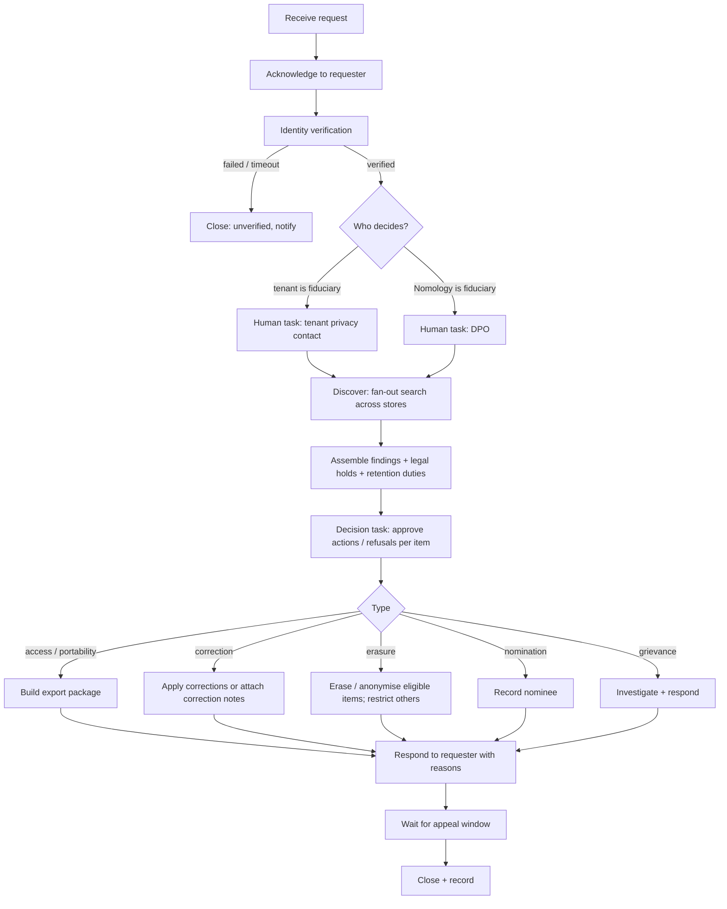

# 13.2.2 Data principal rights requests

<!-- Generated layout: edit text between the markers; keep the markers and the front matter. -->

> Access, correction, erasure, nomination and grievance requests: intake, identity check, fan-out to every store, legal-retention refusals, response deadlines

<!-- section:purpose -->
## Purpose and outcome

Handles requests from people to exercise their privacy rights — access, correction, completion, updating, erasure, nomination (DPDP), objection, restriction and portability (GDPR), access and correction (PDPA) — and grievances about how their data is handled. "Done" means: the requester's identity is verified, every store holding their data in the tenant's region has been searched and acted on (or a lawful reason for not acting is recorded), the requester has received a clear response within the deadline, and the whole trail is recorded.

Where Nomology is a processor (most tenant case data), the request is routed to the tenant (the fiduciary / controller), and the platform provides the tenant with the tools to answer it; where Nomology is the fiduciary (for example CORD, own customers), the DPO answers.

<!-- section:trigger -->
## Trigger and inputs

| Trigger | Channel |
|---|---|
| Signed-in user submits a request | "Privacy and consent" page in any persona (`/settings/privacy/requests`) |
| Non-user or unauthenticated person | Public form `/privacy/request` on the tenant's host, or email to the published grievance address |
| Tenant forwards a request (Nomology as processor) | Tenant admin console |
| Nominee acting for a deceased or incapacitated principal (DPDP s.14) | Public form with nomination evidence |

Inputs: request type, requester identity details, tenant (from host), scope (all data or specific case), preferred language. Workflow ID: `{tenantId}-dpr-{requestId}`; task queue `platform-ops` in the tenant's home region. For requests to Nomology as fiduciary not tied to a tenant, the CORD or platform tenant id is used.

<!-- section:actors -->
## Actors

| Actor | Interaction |
|---|---|
| Requester (data principal / data subject) | Submits, completes identity check (signal), receives response, may appeal |
| Tenant privacy contact (fiduciary) | Reviews and decides for tenant data (human task); approves response |
| DPO / Grievance Officer (Nomology) | Decides for fiduciary processing; reviews refusals; handles escalations |
| Secretariat of the case | Consulted when the request touches a live case record (human task) |
| Legal hold service | Reports holds ([[PKG-data-retention-legal-hold-and]]) |
| Store adapters | Search and act on each store |

<!-- section:steps -->
## Step sequence



| # | Step | Type |
|---|---|---|
| 1 | Create `privacy_request` row; send acknowledgement with reference and expected date | Activity |
| 2 | Identity verification: signed-in users re-authenticate (step-up MFA); others verify email / phone OTP and, if the request is for erasure or full access, match with case-specific details or ID document review | Activity + signal wait (`identityVerified`), timeout 14 days |
| 3 | Route to decision owner based on the roles register ([[SEC-privacy-controls]]) | Decision |
| 4 | Fan-out discovery: child workflow per store (Postgres tables via `@nomology/db` in tenant context, object storage by references, search index, vector store, audit trail, notification logs, Temporal visibility by search attribute, warehouse, support desk, sub-processors list for the requester's data) | Child workflows |
| 5 | Assemble findings with per-item legal status (legal hold, retention duty, part of a filed record) | Activity |
| 6 | Decision human task: approve, refuse with reason per item group | Human task ([[WF-human-tasks]]) |
| 7 | Execute: export / correct / erase / restrict / record nominee | Activities |
| 8 | Response: in the requester's language, listing what was done, what was not and why, how to escalate (tenant grievance, then the Data Protection Board in India; supervisory authority in the EU; PDPC in Singapore) | Activity |
| 9 | Appeal window (30 days, proposed) for internal review | Timer + signal `appeal` |
| 10 | Close; retention of the request record | Activity |

<!-- section:timers -->
## Timers and SLAs

| Deadline | Value | Source |
|---|---|---|
| Acknowledgement | Within 2 working days (target) | Internal |
| Identity verification wait | 14 days, then close as unverified | Internal |
| DPDP grievance response | Within a period not exceeding 90 days [R1] | DPDP Rules 2025, Rule 14(3) |
| DPDP rights (access, correction, erasure) | Platform target 30 days; statutory period as stated in the fiduciary's published policy (assumption: the 90-day grievance limit is the outer bound; legal to confirm) | DPDP Act ss.11–13 |
| GDPR | One month from receipt, extendable by two further months for complex requests with notice to the requester [R2] | GDPR Art. 12(3) |
| PDPA access / correction | As soon as reasonably possible; if not within 30 days, inform the individual of when it will respond (assumption, legal to confirm) | PDPA and regulations |
| Processor forwarding to tenant | Within 2 working days | Client DPA (typical; check contract) |
| Erasure propagation to backups | Backups age out within the backup retention period; restored data is re-erased via the erasure log | [[INF-backup-and-disaster-recovery]] |

Deadlines are computed by [[PKG-calendars-and-deadline]] using the applicable law of the requester and the tenant; the shortest applicable deadline wins. Breach of a deadline: escalation to the DPO at 75% of the period, and to the CTO at 100%.

<!-- section:signals -->
## Signals, updates and queries

| Input | Payload | Validation |
|---|---|---|
| `identityVerified` (signal) | `{ method, evidenceRef }` | From the verification service only |
| `decision` (update) | `{ items: [{ ref, action: 'erase'|'restrict'|'retain'|'correct'|'export', reason }], approverMembershipId }` | Approver holds the tenant privacy role or DPO role |
| `extendDeadline` (update) | `{ newDue, reason }` | Allowed only where law permits (GDPR two-month extension) and requester notified |
| `appeal` (signal) | `{ text }` | Within appeal window |
| `withdraw` (signal) | `{}` | From the requester |
| Query `status` | — | Stage, due date, pending task, for the requester page and admin console |

<!-- section:activities -->
## Activities

| Activity | Side effect | Idempotency key | Timeout / retry |
|---|---|---|---|
| `createRequest` | Row in `privacy_request` | `requestId` | 30 s, 5 |
| `sendMessage` (ack, response) | Notification | `requestId` + message kind | 60 s, 5 |
| `discoverStore` (per store) | Read-only | `requestId` + store | Heartbeat, 30 min |
| `buildExport` | JSON + PDF summary + documents the requester is entitled to; signed URL 7 days | `requestId` | 1 h |
| `applyCorrections` | Updates with audit events; correction notes on filed records | `requestId` + item | 60 s, 5 |
| `eraseItems` | Hard delete or anonymise via retention package; write erasure log | `requestId` + item (deletes idempotent) | Heartbeat, 2 h |
| `restrictItems` | Sets restriction flag that hides data from non-essential processing | `requestId` + item | 60 s, 5 |
| `recordNominee` | Nomination row | `requestId` | 30 s, 5 |

<!-- section:failure -->
## Failure, cancellation and compensation

- A store adapter failing after retries marks that store "not completed"; the decision task shows it, and the response cannot be sent until it is resolved or the DPO approves a partial response explaining the gap.
- Erasure partially applied: the erasure log records each item; reruns skip completed items.
- Cancellation on `withdraw`: stops before execution; if execution has begun, completed actions stand and the response says so.
- No compensation for erasure (irreversible) — hence the explicit decision step before it.

<!-- section:versioning -->
## Versioning

Long-running for up to 3 months; changes use `patched()`; store adapters are versioned so a running request uses the adapter set it started with, unless a new store is added, in which case the DPO can trigger a supplementary discovery.

<!-- section:observability -->
## Visibility and monitoring

Search attributes: `tenantId`, `requestType`, `dueAt`, `stage`, `jurisdiction`. Metrics: open requests by stage and age, percentage within deadline, time to verify identity, refusals by reason. Alerts: request at 75% of deadline without decision; store adapter failures; any request past deadline (to DPO and CTO).

<!-- section:questions -->
## Open questions

- [ ] Statutory response periods for DPDP access, correction and erasure (beyond the 90-day grievance limit) — legal to confirm and set in the published policy.
- [ ] Identity verification for unrepresented parties without accounts (SEBI ODR investors): is matching case reference plus OTP to the registered phone enough? DPO to decide.
- [ ] What an access request returns from case records: the person's own data only, or case documents they are entitled to as a party anyway? Proposed: personal data summary plus pointers to case documents already available to them.
- [ ] Appeal window length (30 days proposed).
- [ ] Whether tenants want the workflow to send responses in their name (white-label) when they are the fiduciary.

<!-- checks -->
## Template checks

<!-- check:tenancy -->
### Tenancy and residency

Workflow ID prefixed with tenant id; runs in the tenant's home region; every discovery and action runs in that tenant's context, so a request in tenant A cannot touch tenant B's data even if the same person is a party in both — the person files a separate request per tenant (the response says so).

<!-- check:security -->
### Access to workflow controls

Requesters can only start requests and send identity and appeal signals; decisions require the tenant privacy role or DPO role checked against the permission matrix before the update reaches Temporal; exports are delivered via short-lived signed URLs after step-up verification.

<!-- check:idempotency -->
### Side effects and idempotency

Each activity has a request-scoped key; erasure and export are tracked per item, so retries and replays do not double-send responses or re-erase restored data incorrectly.

<!-- check:audit -->
### Audit and legal record

Each step (receipt, verification, decision per item, actions, response) is written to the platform audit trail and the request record, retained for 3 years after closure (proposed), because Temporal history is short-lived.

<!-- check:compliance -->
### Regulatory timelines

Deadlines come from DPDP Rule 14(3) (grievances within 90 days) [R1], GDPR Art. 12(3) [R2] and PDPA; they are configured per jurisdiction and computed by the calendar package; breaches are detected at 75% and 100% of the period.

<!-- check:humantasks -->
### Human tasks

Decision tasks go to the tenant privacy contact (or DPO) with a due date at 50% of the deadline; reminders at 2 and 5 days; escalation to the DPO if unassigned for 5 working days.

<!-- check:testing -->
### Testing

Time-skipping tests for each request type, identity timeout, appeal, store failure and partial response; an integration test seeds a person in every store and checks discovery finds all of them.

<!-- citations -->
## Citations

```json
[
  {
    "excerpt": "Rule 1: Rules 3 and 5–16 come into force eighteen months after publication, Rule 4 after one year. Rule 3 notice; Rule 6 security safeguards including keeping logs for one year; Rule 7 breach intimation to the Board with a detailed report within seventy-two hours; Rule 14(3) grievances answered within a period not exceeding ninety days.",
    "id": "R1",
    "issuer": "Government of India (MeitY)",
    "jurisdiction": "India",
    "kind": "regulation",
    "ref": "Digital Personal Data Protection Rules, 2025",
    "title": "Digital Personal Data Protection Rules, 2025 (Gazette notification)",
    "url": "https://www.meity.gov.in/static/uploads/2025/11/53450e6e5dc0bfa85ebd78686cadad39.pdf"
  },
  {
    "excerpt": "Art. 12(3) one month to respond to requests (extendable by two months); Arts 13–14 information; Arts 15–22 rights; Art. 28 processors; Art. 30 records; Art. 32 security; Art. 33 notify the supervisory authority within 72 hours; Art. 34 communicate to data subjects; Chapter V transfers.",
    "id": "R2",
    "issuer": "European Parliament and Council",
    "jurisdiction": "EU / EEA",
    "kind": "regulation",
    "ref": "Regulation (EU) 2016/679",
    "title": "General Data Protection Regulation",
    "url": "https://eur-lex.europa.eu/eli/reg/2016/679/oj/eng"
  }
]
```

<!-- end -->
