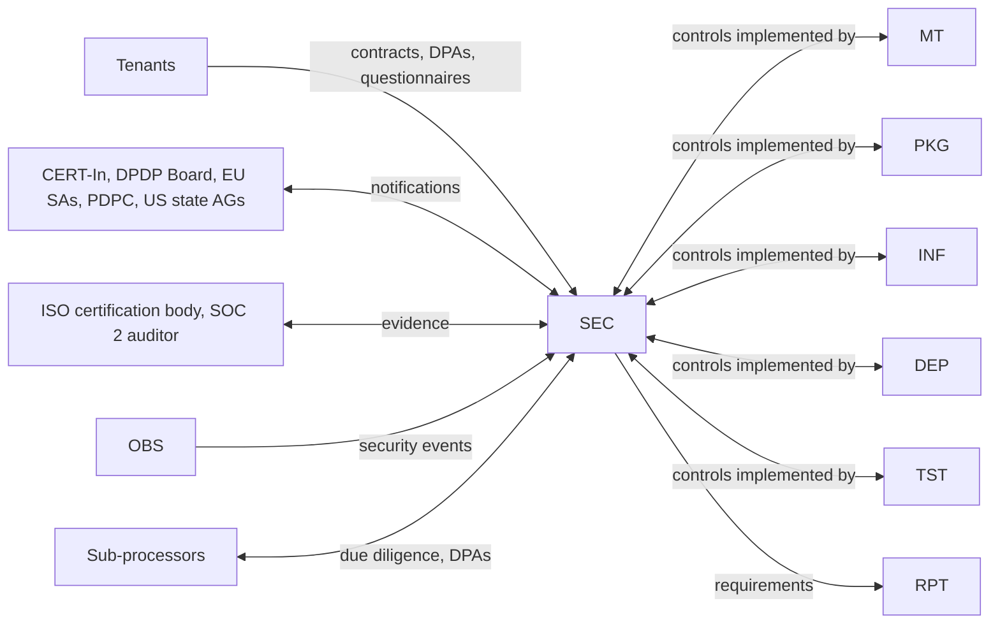

# 13 Security and Compliance (controls)

<!-- Generated layout: edit text between the markers; keep the markers and the front matter. -->

> The ISMS and privacy control set for NTPL, TAPL and the US entity: controls mapped to ISO 27001:2022, SOC 2 and DPDP / GDPR / PDPA, each with an owner, frequency and evidence

<!-- section:purpose -->
## Purpose and scope

This area holds the organisational and technical **controls** that make the platform trustworthy to institutions, regulators and auditors: the information security management system (ISMS), privacy operations, classification, vulnerability management, access reviews, supplier management, incident response and business continuity. Each child is written as a control an auditor can test: objective, framework mapping, owner, frequency, evidence.

**In scope**

- ISMS scope, risk assessment, Statement of Applicability and control mapping to ISO/IEC 27001:2022 Annex A and SOC 2 Trust Services Criteria ([[SEC-isms-controls]])
- Privacy controls for India DPDP Act and Rules, GDPR, Singapore PDPA and US state laws: notices, consent, rights requests, retention ([[SEC-privacy-controls]] and children)
- Data classification and confidentiality tiers ([[SEC-data-classification]])
- Vulnerability management: SAST, DAST, dependency and container scanning, penetration tests ([[SEC-vulnerability-management]])
- Access reviews, least privilege and break-glass ([[SEC-access-reviews]])
- Vendor and sub-processor management, transfer records ([[SEC-vendor-sub-processor-management]])
- Security incident response and all regulatory notification clocks ([[SEC-security-incident-response-and]])
- Business continuity per region and entity ([[SEC-business-continuity]])

**Out of scope** (and where it lives)

| Might be expected here | Lives in |
|---|---|
| The technical mechanisms (RLS, authentication, encryption utilities, CSP) | [[MT]], [[PKG-authentication]], [[PKG-authorization]], [[PKG-security]], [[APP-security-headers-csp-cors]] |
| Security event telemetry and alert plumbing | [[OBS-security-events]], [[OBS-alerting]] |
| Regulator filing formats and submission mechanics | [[RPT-privacy-and-confidentiality]] |
| Backup and DR infrastructure | [[INF-backup-and-disaster-recovery]] |
| Security test standards in CI | [[TST-security-testing]] |
| AI governance (ISO 42001) | [[AI-ai-governance-and-impact]] |
| Accessibility legal obligations | [[APP-accessibility-legal-obligations]] |

<!-- section:goals -->
## Goals and non-goals

Proposed targets, to be confirmed by the CTO and ISMS lead:

1. **ISO/IEC 27001:2022 certification** of the ISMS covering NTPL (India), TAPL (Singapore) and the US entity's platform operations, with the Stage 2 audit after Phase 8 ([[PLAN]]).
2. **SOC 2 Type II** report (Security, Availability, Confidentiality; Privacy criteria to be decided) covering a 6–12 month observation period starting no later than production launch.
3. **Every control has evidence produced by the system or the workflow**, not recreated for audits: at least 70% of control evidence collected automatically (CI runs, access review records, scanner exports, ticket histories).
4. **Regulatory clocks are never missed**: 100% of notifiable incidents reported within the applicable deadline (CERT-In 6 hours, DPDP Board within 72 hours for the detailed report, GDPR 72 hours, PDPC 3 calendar days after assessment, contract clocks).
5. **Rights requests answered on time**: 100% within the statutory or contractual deadline, median under 15 days.
6. **No critical or high vulnerability older than its SLA** in production (critical 7 days, high 30 days, proposed).

**Non-goals**

- Certifying every Nomology business function (sales, HR) in the first ISMS scope; scope starts with the platform and its operations.
- PCI DSS scope: card data is handled only by payment gateways ([[BIL-payment-gateway-integration]]); the platform never stores card numbers.
- Acting as legal adviser to tenants on their own obligations; we provide features and evidence, tenants decide.

<!-- section:principles -->
## Principles

| # | Principle | Enforced by |
|---|---|---|
| SEC-P1 | One control, many frameworks: each control node lists every framework clause it satisfies; no duplicate controls per framework. | Control mapping register in [[SEC-isms-controls]] |
| SEC-P2 | Evidence is a by-product of doing the work (tickets, CI artefacts, system logs), stored in the evidence repository with retention of at least 3 years (proposed). | Evidence index reviewed quarterly |
| SEC-P3 | Every control has a named owning role, a backup and a frequency. | Control register completeness check |
| SEC-P4 | Regulatory clocks are owned in one place ([[SEC-security-incident-response-and]]) and start from the moment of awareness. | Incident runbook; tabletop exercises |
| SEC-P5 | Know the role you play: for tenant case data Nomology is normally a processor / data processor for the institution; for its own customers' contacts and for the CORD tenant it may be the controller / data fiduciary. Every privacy control states which. | Records of processing |
| SEC-P6 | Least privilege by default; standing privileged access is the exception and expires. | [[SEC-access-reviews]] |
| SEC-P7 | Data stays in the tenant's region; any transfer is a recorded decision. | [[MT-data-residency-2]], [[SEC-vendor-sub-processor-management]] |
| SEC-P8 | Exceptions are written, approved, time-limited and visible on the risk register. | Exception register |

<!-- section:context -->
## Context and boundaries



| Neighbour | Flow | Contract |
|---|---|---|
| [[MT]] | Isolation controls and their evidence | [[MT-safeguards]] |
| [[PKG-audit-trail]] | Tamper-evident activity records used as evidence and in investigations | [[PKG-audit-log-schema]] |
| [[OBS-security-events]], [[OBS-alerting]] | Detection signals feeding incident triage | Severity mapping in [[SEC-security-incident-response-and]] |
| [[PKG-data-retention-legal-hold-and]] | Retention and erasure execution | [[PKG-retention-and-deletion-schedule]] |
| [[RPT-privacy-and-confidentiality]] | Regulator filings | Incident record fields |
| [[DEP-ci-cd-pipelines-build-test]] | Scanners and gates | [[SEC-vulnerability-management]] |
| [[INF-backup-and-disaster-recovery]] | RPO / RTO and restore drills | [[SEC-business-continuity]] |

<!-- section:decisions -->
## Key decisions

| Decision | Effect on this area |
|---|---|
| [[ADR-tenant-isolation]] | Tenant segregation evidence comes from RLS tests rather than separate databases |
| [[ADR-next-js-hosting]] / [[ADR-container-orchestration]] | Shared-responsibility split with AWS (and Azure where used) defines which controls are inherited from the cloud provider's own SOC 2 / ISO reports |
| [[ADR-temporal]] | Self-hosting means Temporal security (payload encryption, UI access) is our control, not a vendor's |
| Pending | ISMS scope statement (entities, locations, products) and whether Privacy criteria are in the first SOC 2 report |

<!-- section:map -->
## Capability map

| Child | Owns |
|---|---|
| [[SEC-isms-controls]] | ISMS scope, risk method, SoA, control register and framework mapping, internal audit and management review |
| [[SEC-privacy-controls]] | Privacy programme: records of processing, roles (fiduciary / processor), DPIAs, minimisation and retention oversight |
| [[SEC-consent-and-notice-management]] | Notices, consent capture and withdrawal, legitimate-use records, consent manager integration |
| [[SEC-data-principal-rights-requests]] | Workflow for access, correction, erasure, nomination and grievance requests |
| [[SEC-privacy-notice-copy]] | The notice text per journey and language |
| [[SEC-data-classification]] | Classification scheme, confidentiality tiers, labelling and handling rules |
| [[SEC-vulnerability-management]] | Scanning, triage, SLAs, pen tests, disclosure |
| [[SEC-access-reviews]] | Joiner / mover / leaver, periodic reviews, privileged and break-glass access |
| [[SEC-vendor-sub-processor-management]] | Supplier due diligence, DPAs, sub-processor list and notices, transfer records |
| [[SEC-security-incident-response-and]] | Classification, roles, evidence, regulatory and contractual notification clocks |
| [[SEC-business-continuity]] | BIA, continuity plans per region and entity, exercises |

<!-- section:phasing -->
## Phasing

| Phase | Delivered | Gate |
|---|---|---|
| 0–1 | ISMS scope draft, risk method, classification scheme, access control policy, vulnerability scanning in CI, incident runbook v1 with regulatory clocks | Incident runbook tabletop held before any production tenant |
| 2–4 | Vendor register and DPAs for all sub-processors used, privacy notices per journey, consent records, rights-request workflow | DPIA completed for each new processing activity before launch |
| 5–7 | Access reviews running quarterly, evidence automation, business continuity plans per region | First internal audit and management review |
| 8 | External pen test, DR exercise, ISO 27001 Stage 1/2, SOC 2 observation period started | No open high-risk items without accepted treatment |

Not deferrable: incident response with regulatory clocks, vulnerability scanning, access control and classification must exist before the first production tenant.

<!-- section:risks -->
## Risks and open questions

- [ ] DPDP Rules come into force in stages (most obligations eighteen months after publication of the Rules); exact applicability dates for NTPL's obligations to be confirmed by legal [R1].
- [ ] Whether NTPL could be notified as a Significant Data Fiduciary (adds DPIA and audit duties) — legal to monitor.
- [ ] Fiduciary / processor role per product (TERES, CORD, enterprise) not yet documented; drives notices, breach duties and contracts.
- [ ] Applicability of SEBI cybersecurity requirements (for example the Cybersecurity and Cyber Resilience Framework) to Nomology as a technology provider to SEBI-regulated tenants or MIIs — to be confirmed with those clients.
- [ ] Small team: segregation of duties for control operation vs. review may need compensating controls.

<!-- checks -->
## Template checks

<!-- check:ownership -->
### Ownership and governance

Accountable owner: CTO (as ISMS top-management sponsor). Operational owner: ISMS lead. Specialist reviewers: DPO / Grievance Officer for privacy children, platform engineering lead for technical controls, legal counsel for regulatory clocks and contracts, finance for vendor contracts. Changes to scope or principles go through the management review (at least annually) or an ad-hoc change approved by the CTO and recorded in the ISMS change log.

<!-- check:compliance -->
### Regulatory and control mapping

| Framework | Carried by |
|---|---|
| ISO/IEC 27001:2022 clauses 4–10 and Annex A | [[SEC-isms-controls]] (with children for A.5.12, A.5.15–5.18, A.5.19–5.23, A.5.24–5.28, A.5.29–5.30, A.8.8) |
| SOC 2 TSC CC1–CC9, A1, C1, P (if in scope) | Same children; mapping in [[SEC-isms-controls]] |
| DPDP Act 2023 and Rules 2025 | [[SEC-privacy-controls]], [[SEC-consent-and-notice-management]], [[SEC-data-principal-rights-requests]], [[SEC-security-incident-response-and]] |
| GDPR (where EU personal data is processed, for example EU parties in an arbitration) | Same |
| Singapore PDPA | Same, plus transfer limitation in [[SEC-vendor-sub-processor-management]] |
| CERT-In Directions (2022) | [[SEC-security-incident-response-and]], log retention in [[OBS-foundations]] |
| Client contracts (DPAs, security schedules) | Contract register in [[SEC-vendor-sub-processor-management]] (inbound obligations) |

<!-- check:regions -->
### Tenancy and residency

Controls are mostly global (one ISMS, one policy set) and operated per region where the system is regional: vulnerability scanning, access reviews and backups run per regional stack; incident notification clocks depend on where affected people and tenants are (India, Singapore, US, EU); business continuity has a plan per region and per entity. Azure deployments are in scope as their own region.

<!-- check:quality -->
### Quality targets

Inherited targets: vulnerability SLAs (critical 7 days, high 30 days), access review completion within 10 working days of the quarter start, incident notification within statutory clocks, rights requests within deadline, RPO / RTO per [[INF-backup-and-disaster-recovery]]. All measured in the KPI section of each control and reviewed monthly by the ISMS lead.

<!-- check:phase -->
### Phasing

See Phasing: incident response, vulnerability scanning, access control and classification before the first production tenant; privacy operations before Phase 3 goes live with real parties; certification activities in Phase 8.

<!-- citations -->
## Citations

```json
[
  {
    "excerpt": "Rule 1: Rules 3 and 5–16 come into force eighteen months after publication, Rule 4 after one year. Rule 3 notice; Rule 6 security safeguards including keeping logs for one year; Rule 7 breach intimation to the Board with a detailed report within seventy-two hours; Rule 14(3) grievances answered within a period not exceeding ninety days.",
    "id": "R1",
    "issuer": "Government of India (MeitY)",
    "jurisdiction": "India",
    "kind": "regulation",
    "ref": "Digital Personal Data Protection Rules, 2025",
    "title": "Digital Personal Data Protection Rules, 2025 (Gazette notification)",
    "url": "https://www.meity.gov.in/static/uploads/2025/11/53450e6e5dc0bfa85ebd78686cadad39.pdf"
  }
]
```

<!-- end -->
