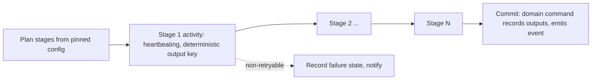

# 7.4 Long-running pipelines (transcription, OCR, bundling, AI processing)

<!-- Generated layout: edit text between the markers; keep the markers and the front matter. -->

> Durable multi-stage pipelines for document processing and OCR, transcription (ASR and diarisation), bundling and AI processing, with heartbeating stages, in-region models and per-tenant fairness

<!-- section:purpose -->
## Purpose and outcome

Run multi-stage processing of large inputs reliably: a 4,000-page exhibit set needs PDF renditions and OCR; an 8-hour hearing recording needs transcoding, segmentation, speech recognition and speaker diarisation; AI features need extraction or summarisation over many documents. This node defines the shared pipeline pattern and the three pipelines built on it. eBundling uses the same pattern and is specified in [[DOM-ebundling]].

**Done** means every stage has produced its output (stored in object storage with a deterministic key and recorded on the subject), the subject's domain state reflects completion (for example document version `available`, transcription job `ready_for_assignment`), and a completion event is emitted; or the pipeline ends in a recorded failure state with a reason the user or operator can act on.

<!-- section:trigger -->
## Trigger and inputs

| Pipeline | Trigger | Workflow ID | Task queues |
|---|---|---|---|
| Document pipeline | `files.scan` clean verdict for a document version (BullMQ handler does signal-with-start) | `{tenantId}-doc-pipeline-{documentVersionId}` | `documents` (orchestration), `documents-render` (PDF, OCR) |
| Transcription pipeline | `recording.available` from Hearings, or `transcription.ordered` if later | `{tenantId}-transcription-{recordingId}` | `ai-pipelines` |
| AI processing pipeline | User request for an AI feature (case summary, document extraction) | `{tenantId}-ai-{feature}-{subjectId}-{inputHash8}` | `ai-pipelines` |

Inputs are IDs, tool and model selections resolved at start (pinned), and the tenant's AI settings snapshot (enabled features, budget key). ID reuse policy: *allow duplicate failed only*, so a failed run can be retried with the same ID; a successful run is not repeated.

<!-- section:actors -->
## Actors

| Actor | Interaction |
|---|---|
| Domain services | Start (via outbox or signal-with-start); receive completion through domain commands called by activities |
| Workers on `documents-render` and `ai-pipelines` | Execute stages |
| [[AI-ai-gateway]] | ASR, diarisation and LLM calls, routed to in-region models |
| [[AI-cost-controls]] | Budget check before AI stages |
| Operators | Query `pipelineStatus`; update `retryStage` after fixing an external cause |
| Users | See progress (query through API); may cancel AI runs |

<!-- section:steps -->
## Step sequence

**Common pattern**



Rules: each stage reads inputs from object storage and writes outputs to `{tenantId}/pipelines/{workflowId}/{stage}/...`; fan-out stages (per page range, per audio segment) run in parallel with a per-workflow cap; the final commit is the only stage that changes domain state.

**Document pipeline**

| # | Stage | Notes |
|---|---|---|
| 1 | `probe` | Media type, page count, encryption, text layer present? |
| 2 | `renderPdf` | Office formats and images to PDF rendition (`documents-render`) |
| 3 | `ocr` (if no text layer) | Per 50-page range in parallel, max 8 ranges at once; language hints from case language |
| 4 | `extractText` | For search; stored as `ocr_text` rendition |
| 5 | `thumbnails` | First page and page images for the viewer |
| 6 | `commit` | `documents.recordProcessing` → version `available` or `available_with_warnings`; enqueue `search.index` |

**Transcription pipeline**

| # | Stage | Notes |
|---|---|---|
| 1 | `ingest` | Verify recording hash, transcode to a standard audio format |
| 2 | `segment` | Cut at silences into roughly 15-minute segments; write segment manifest |
| 3 | `asr` | Per segment in parallel (cap 6), via AI gateway in-region; heartbeat per segment |
| 4 | `diarise` | Speaker labels; map to hearing participants where voice enrolment is not used (manual mapping later) |
| 5 | `assembleDraft` | ASR draft transcript version (`asr_draft`) in [[DOM-hearings]] |
| 6 | `commit` | `transcribers.markReadyForAssignment` → job `ready_for_assignment` |

**AI processing pipeline**

| # | Stage | Notes |
|---|---|---|
| 1 | `checkPolicy` | Tenant AI setting, feature permission, budget ([[AI-cost-controls]]) – non-retryable on refusal |
| 2 | `retrieve` | Inputs through [[AI-rag]] with visibility filters (no without-prejudice content for tribunal users) |
| 3 | `generate` | Model call through [[AI-ai-gateway]] with prompt version from [[AI-prompt-management]] |
| 4 | `ground` | Citation and grounding checks ([[AI-guardrails]]) |
| 5 | `commit` | Store as an AI output awaiting review ([[AI-human-in-the-loop]]); never as a case document |

<!-- section:timers -->
## Timers and SLAs

| Timer / SLA | Source | At breach |
|---|---|---|
| Document pipeline p95 under 5 minutes for 100 pages (proposed SLO) | Platform SLO | Metric breach alert; no change to the run |
| ASR draft within 0.5 × audio duration for `same_day` and `realtime` tiers, 2 × for others (proposed) | Transcription tier policy | Alert to transcription manager; job flagged at risk ([[DOM-transcribers]] TRN-BR-9) |
| AI run interactive timeout (proposed 2 minutes) | Product setting | Run continues in background; user notified on completion |
| Stage heartbeat timeout 60 s | Engineering | Activity retried on another worker |

<!-- section:signals -->
## Signals, updates and queries

| Message | Kind | Payload | Validation |
|---|---|---|---|
| `pipelineStatus` | Query | `{ stage, completedUnits, totalUnits, warnings }` | |
| `cancelRun` | Update | `{ membershipId, reason }` | AI pipelines: requester or admin; document and transcription pipelines: platform ops only |
| `retryStage` | Update | `{ stage, operatorId, reason }` | Platform ops role; run in failed-awaiting-operator state |

<!-- section:activities -->
## Activities

| Activity | Side effect | Idempotency | Timeout / retry |
|---|---|---|---|
| `probe` | Read | — | 2 min, 5 attempts |
| `renderPdf` | Writes rendition object | Deterministic key; overwrite is safe | 30 min, heartbeat 60 s, 5 attempts |
| `ocrRange` | Writes text layer chunk | Key per range | 20 min, heartbeat 60 s, 5 attempts |
| `transcodeAudio` | Writes audio object | Deterministic key | 60 min, heartbeat 60 s, 3 attempts |
| `asrSegment` | Model call, writes segment draft | Key per segment; gateway idempotency key `{workflowId}:{segmentId}` | 30 min, heartbeat 60 s, 5 attempts, backoff from 30 s |
| `generate` | Model call, token usage recorded | `{workflowId}:generate` usage record unique | 5 min, 3 attempts |
| `commit` | Domain command | Workflow ID as idempotency key | 30 s, 10 attempts |

Non-retryable: `EncryptedSource`, `UnsupportedMedia`, `NoInRegionModel`, `AIDisabledForTenant`, `BudgetExceeded`, `PermissionDenied`.

<!-- section:failure -->
## Failure, cancellation and compensation

- Stage failure after retries: the workflow records `failed_awaiting_operator` on the run, alerts operations and waits up to 7 days (proposed) for `retryStage`; then ends as failed and the subject shows a user-facing state (document `available_with_warnings` without OCR; transcription job `ready_for_assignment` from audio only, without ASR draft).
- No in-region model for a language: fail closed (`NoInRegionModel`), never route to another region.
- Cancellation: intermediate objects are deleted by a cleanup activity; committed outputs are untouched.
- Compensation is not needed because only `commit` changes domain state.

<!-- section:versioning -->
## Versioning

Tool, model and prompt versions are resolved at start and recorded on outputs, so re-running gives an explainable result. Pipelines complete in hours; code changes use `patched()`, removed after one week. Large changes (new stage order) use a new workflow type name (`documentPipelineV2`) and new runs start on it.

<!-- section:observability -->
## Visibility and monitoring

- Search attributes: `tenantId`, `pipeline`, `subjectId`, `stage`, `caseId`.
- Metrics: duration per stage and per input size bucket; failures by error code; queue schedule-to-start latency for `documents-render` and `ai-pipelines`; tokens and audio minutes per tenant ([[OBS-ai-usage]]).
- Alerts: schedule-to-start above 5 minutes on `ai-pipelines` for 10 minutes; any run in `failed_awaiting_operator` for more than 4 hours in business hours.

<!-- section:questions -->
## Open questions

- [ ] Which ASR and diarisation models are available in-region for each language we need (English, Hindi, other Indian languages, Mandarin, Cantonese)? Determines `NoInRegionModel` exposure. Owner: AI lead.
- [ ] Separate `documents-render` worker pool (proposed) — confirm sizing and whether it also serves eBundling heavy stages.
- [ ] Per-tenant concurrency caps for pipelines (proposed: 20 document pipelines and 4 transcription pipelines per tenant at once), configurable for large tenants?

<!-- checks -->
## Template checks

<!-- check:tenancy -->
### Tenancy and residency

Workflow IDs start with the tenant ID; `tenantId` is a search attribute; runs use the tenant's home-region namespace. Every activity receives tenant ID explicitly and uses tenant-prefixed object keys and tenant-scoped transactions. Starts are rate-limited per tenant and per-tenant concurrency caps apply, so a 10,000-document aggregator import queues behind its own cap rather than starving other tenants. Payloads hold IDs; outputs live in the tenant's regional bucket.

<!-- check:security -->
### Access to workflow controls

Only system components start document and transcription pipelines; AI pipelines are started by users with the feature permission, checked in the API and again in `checkPolicy`. Operator actions (`retryStage`, cancel) need the platform-ops role in that region and are audited. Model calls use the tenant's AI configuration; filed documents are untrusted input for prompt-injection purposes.

<!-- check:idempotency -->
### Side effects and idempotency

Each stage writes to a deterministic object key, so retries overwrite; model calls carry `{workflowId}:{unit}` keys so usage is recorded once; `commit` uses the workflow ID as its idempotency key. Long stages heartbeat with progress so a retry resumes from the last completed unit. Short single side effects (search indexing) are handed to BullMQ with job IDs.

<!-- check:audit -->
### Audit and legal record

Pipeline runs are mostly operational, but outputs that become evidence are recorded: rendition and OCR tool versions on each rendition; ASR model version on transcription segments; AI outputs with model, prompt version and inputs referenced ([[AI-human-in-the-loop]]). Commit steps write audit events.

<!-- check:compliance -->
### Regulatory timelines

Residency: models and storage in-region only, failing closed. AI processing only where the tenant has opted in, with the governance records in [[AI-ai-governance-and-impact]]. Turnaround tiers come from the transcription tier decision table.

<!-- check:observability -->
### Observability and operations

Stage-level metrics and the `failed_awaiting_operator` alert identify stuck runs per tenant and region; `pipelineStatus` feeds progress bars for users.

<!-- check:testing -->
### Testing

Golden-input tests per pipeline (scanned PDF in Hindi, rotated pages, encrypted PDF, 8-hour audio fixture shortened, mixed-language audio); failure injection (worker killed mid-stage, model endpoint down, no in-region model); replay tests before merge [R1].

<!-- citations -->
## Citations

```json
[
  {
    "excerpt": "Replay testing and patching let workflow code change safely while executions are running.",
    "id": "R1",
    "kind": "vendor",
    "title": "Temporal docs: Versioning (TypeScript)",
    "url": "https://docs.temporal.io/develop/typescript/versioning",
    "vendor": "Temporal Technologies"
  }
]
```

<!-- end -->
