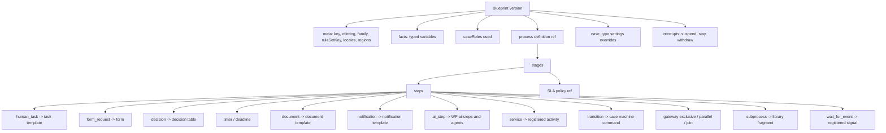
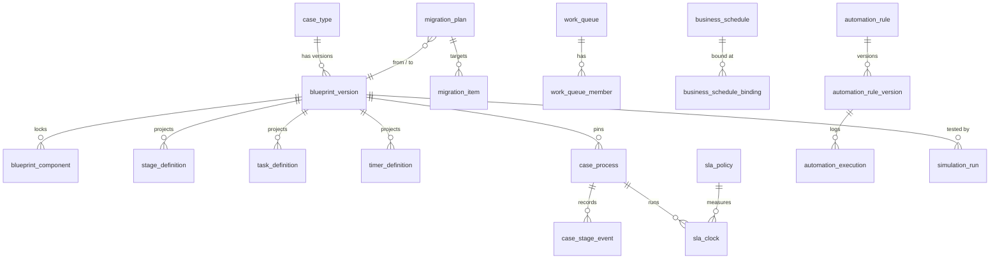

# 7.9 Process definition model (case-type blueprints)

<!-- Generated layout: edit text between the markers; keep the markers and the front matter. -->

> Structure, storage, pinning and runtime records of tenant-authored case-type blueprints (stages, tasks, forms, rules, timers, documents, notifications, AI step references) interpreted by Nomology's generic Temporal workflows

<!-- section:purpose -->
## Scope and ownership

This node specifies the **process definition model**: how a tenant's **case-type blueprint** is structured, stored, versioned and pinned to running cases, and the runtime tables that record where each case is in its blueprint. It is the data contract between the authoring side ([[WF-workflow-authoring-studio]], the tenant admin API, configuration packages) and the execution side (the generic Temporal interpreter written by Nomology, see [[WF-separation-of-concerns-temporal]] and [[PKG-workflow-templates]]).

| Item | Value |
|---|---|
| Bounded context | Tasks and Workflows ([[WF]]) |
| Owning team | Platform engineering, workflow squad |
| Prisma schema file | `packages/db/prisma/schema/wf.prisma` |
| Postgres schema | `wf` (per regional database) |
| Artefact storage | Blueprint bodies are `config.artefact_version` rows of kind `case_type_blueprint` and `workflow_template` ([[PKG-configuration-and-customisation]]); this node adds the `wf.*` projection, pin and runtime tables |
| Readers by foreign key | `DOM-cases` (case → `wf.case_process`), [[WF-human-tasks]] (`human_tasks.blueprint_task_key`), reporting replicas ([[RPT-cases]]) |
| Readers by ID or API only | [[PKG-rules-and-decision-engine]], [[PKG-forms-and-form-builder]], [[PKG-document-and-notification]], [[WF-ai-steps-and-agents]] (they own their artefacts; the blueprint references them by key and pinned version) |

**What a blueprint is.** A case-type blueprint is the tenant-authored, declarative definition of one kind of matter (for example "SEBI ODR conciliation", "Institutional arbitration (expedited)", "CORD tenancy mediation"). It bundles, at exact versions:

- one **process definition** (stages, steps, gateways, timers, events) interpreted by the generic Temporal workflow;
- the **forms** used for filings, intake and task outcomes;
- the **decision tables** that give deadlines, fees, eligibility and routing;
- **document templates** and **notification templates**;
- **SLA policies** ([[WF-sla-and-business-calendars]]) and **human task templates** ([[WF-human-tasks]]);
- references to **AI steps** whose behaviour is owned by [[WF-ai-steps-and-agents]];
- **case-type settings overrides** from [[PKG-settings-cases-and-workflows]] at scope `case_type`.

**Not in this node:** automation rules (tenant-wide, not pinned, see [[WF-automation-rules]]; their tables are listed here only so the `wf` schema is complete), entity status (code-defined, [[WF-entity-state-machines]]), and the scope and lifecycle mechanics ([[PKG-configuration-scope-hierarchy]], [[PKG-configuration-lifecycle]]).

Requirements in this node use the prefix `PDM-FR-`.

- **PDM-FR-1** A blueprint is configuration, never code: every element is declarative JSON validated against the blueprint JSON Schema (`schemaVersion` 2); no element may hold scripts, SQL, URLs that the platform calls, or HTML beyond the sanitised rich-text subset.
- **PDM-FR-2** Every published blueprint version is immutable and content-addressed (`content_sha256` over the canonical JSON of the body and its locked component list).
- **PDM-FR-3** A case is pinned to exactly one blueprint version at creation; the pin changes only through an approved migration ([[WF-workflow-versioning]]).
- **PDM-FR-4** Every stage maps to one case status from the code-defined case machine; a blueprint cannot add, rename or bypass statuses.
- **PDM-FR-5** Every external reference in a blueprint (form, decision table, template, SLA policy, task template, AI step, registered activity or signal) resolves at publish time to a published version in the same tenant, or to a platform library item, and is locked in `wf.blueprint_component`.

<!-- section:entities -->
## Entities and relationships

#### Logical structure of a blueprint body (`case_type_blueprint`, schemaVersion 2)



#### Element catalogue

| Element | Meaning | References (pinned) | Executed by |
|---|---|---|---|
| `meta` | Key, display name per locale, offering (`cord` / `teres`), procedure family (`arbitration`, `mediation`, `conciliation`, `odr`), `ruleSetKey`, allowed regions, default locale | `ref.case_type` code | — |
| `facts` | Typed variables the process reads (`string`, `number`, `money`, `date`, `datetime`, `boolean`, `enum`, `party_ref`, `document_ref`), each with a source: case field, custom field ([[PKG-metadata-management-entity]]), form output, decision output, event payload | Custom field definitions | Interpreter state |
| `caseRoles` | Case-level roles the blueprint assigns work to (`case_manager`, `presiding_neutral`, `claimant`, `respondent_counsel` …) from the shared role list | [[PKG-rbac-abac-case-level-party]] | Assignment resolution |
| `stage` | A named phase with entry actions, exit criteria, a mapped case status, an optional SLA policy and a milestone flag | SLA policy | Interpreter (`enterStage`, `exitStage`) |
| `human_task` | Work for a person or queue, with an outcome form and outcome-to-branch mapping | Task template, form | [[WF-human-tasks]] `awaitHumanTask` |
| `form_request` | Ask a participant to file something (statement of claim, response, consent) with a procedural deadline | Form, timer | Party portal + interpreter |
| `decision` | Evaluate a decision table and write outputs to facts (decision-table vocabulary such as hit policy is borrowed from DMN [R1]; we do not import DMN files) | Decision table | `evaluateDecision` activity |
| `timer` | Wait until an instant or for a duration; `kind: procedural` (creates a `case_deadlines` row, seat calendar) or `kind: service_level` (internal, business schedule) | Decision output or literal | Temporal timer via calendars activity |
| `document` | Generate a document from a template (notice, procedural order draft, receipt) | Document template | Documents activity |
| `notification` | Send a templated notice to roles or parties | Notification template | `notifications.send` queue via activity |
| `ai_step` | Invoke a tenant-configured AI step (classify, extract, summarise, draft); output is a suggestion until a human accepts it, except the `accepted_by_policy` state for calibrated internal `classify` and `extract` steps, which is off by default (`ai.workflow_steps.allow_auto_accept`) and never used for outputs that affect the merits or parties' rights ([[AI-human-in-the-loop]]; decision D8, flagged for CTO decision) | AI step definition owned by [[WF-ai-steps-and-agents]] | AI activity on `ai-pipelines` |
| `service` | Call a registered activity (for example `requestKycCheck`, `assessFee`) | Registered activity name and contract version | Domain activity |
| `transition` | Run a case machine command (`register`, `close_case`) | Command name | [[WF-entity-state-machines]] via domain command |
| `gateway` | Exclusive (first true condition), parallel split, or join (`all`, `any`, `n_of_m`) | Expressions over facts | Interpreter |
| `subprocess` | Call a reusable fragment (for example "Constitute tribunal", "Serve notice") | Library fragment version | Child workflow |
| `wait_for_event` | Wait for a registered domain event or signal (`document.filed`, `payment.settled`), with timeout branch | Registered signal | Interpreter |
| `interrupts` | Case-wide event handlers: `suspend` (pause timers), `stay_deadlines`, `withdraw`, `terminate` | Machine commands | Interpreter, non-interrupting or interrupting |
| `settingsOverrides` | Values for settings that allow scope `case_type` | Setting keys in [[PKG-settings-cases-and-workflows]] | `@nomology/settings` resolver |

#### Relational model (`wf` schema)



| Relationship | Cardinality | Owner | Notes |
|---|---|---|---|
| `case_type` → `blueprint_version` | 1 : n | `case_type` (aggregate root) | At most one version per case type has `status = 'published'` and `is_current = true` at a time |
| `blueprint_version` → `blueprint_component` | 1 : n | `blueprint_version` | The dependency lock; written once at publish |
| `blueprint_version` → `stage_definition`, `task_definition`, `timer_definition` | 1 : n | `blueprint_version` | Read-optimised projections of the JSON body for validation, reporting and queues; rebuilt from the body, never edited directly |
| `blueprint_version` → `case_process` | 1 : n | `case_process` (aggregate root at runtime) | One row per case; `DOM-cases` holds the case, this holds its process position |
| `case_process` → `case_stage_event` | 1 : n | `case_process` | Append-only history of stage entries, exits, skips, migrations |
| `migration_plan` → `migration_item` | 1 : n | `migration_plan` | See [[WF-workflow-versioning]] |
| `sla_policy`, `sla_clock`, `business_schedule` | — | [[WF-sla-and-business-calendars]] | Listed here for one schema view |
| `automation_rule*`, `automation_execution` | — | [[WF-automation-rules]] | Not pinned to cases |
| `work_queue`, `work_queue_member` | — | [[WF-human-tasks]] | Queue configuration |
| `simulation_run` | — | [[WF-workflow-simulation]] | Test evidence for a version |

All `wf.*` tables are **tenant-owned**. Platform library items (Nomology-authored starter blueprints, fragments and tenant blueprints such as "SEBI ODR institution blueprint") live in reference data (`ref.blueprint_template`, [[PKG-reference-and-seed-data]]) and are **copied** into a tenant through [[PKG-configuration-packages]]; they are never shared live rows.

<!-- section:tables -->
## Tables and columns

Conventions (stated once): IDs are `uuid` (UUIDv7) generated by the application; every table has `tenant_id uuid NOT NULL` and `created_at timestamptz NOT NULL DEFAULT now()`; mutable tables also have `updated_at timestamptz NOT NULL` and `version integer NOT NULL DEFAULT 1` (optimistic lock). Keys authored by tenants (`case_type_key`, `stage_key`, `step_id`) are `text` matching `^[a-z][a-z0-9_]{1,62}$`. Localised labels are `jsonb` maps of BCP 47 tag to string. Durations are ISO 8601 strings validated by the application. Classification codes: P public, I internal, PD personal, C confidential, SPD sensitive personal.

#### Definition tables

**wf.case_type**

| Column | Type | Null | Default | Meaning | Class |
|---|---|---|---|---|---|
| id | uuid | no | | PK | I |
| tenant_id | uuid | no | | Owning tenant | I |
| case_type_key | text | no | | Stable key, e.g. `sebi_odr_conciliation` | I |
| ref_case_type_code | text | no | | Platform family code from `ref.case_type` (`ODR_SEBI`, `ARB_INSTITUTIONAL` …) | I |
| offering | text | no | | `cord` or `teres` | I |
| name | jsonb | no | | Localised display name | I |
| unit_ids | uuid[] | no | `'{}'` | Units allowed to open this case type; empty = all units | I |
| status | text | no | `'draft'` | `draft`, `active`, `closed_to_new_cases`, `archived` | I |
| current_version_id | uuid | yes | | The published version new cases pin | I |
| locked_by_scope | text | yes | | `platform` or `offering` when a regulator-driven blueprint is locked (e.g. SEBI ODR timelines) | I |
| owner_membership_id | uuid | yes | | Accountable workflow designer | I |
| version | integer | no | 1 | Optimistic lock | I |

**wf.blueprint_version**

| Column | Type | Null | Default | Meaning | Class |
|---|---|---|---|---|---|
| id | uuid | no | | PK | I |
| tenant_id | uuid | no | | | I |
| case_type_id | uuid | no | | FK `wf.case_type` | I |
| version_no | integer | no | | 1, 2, 3 … per case type | I |
| artefact_version_id | uuid | no | | FK `config.artefact_version` (kind `case_type_blueprint`), holds the JSON body | I |
| process_artefact_version_id | uuid | no | | FK `config.artefact_version` (kind `workflow_template`) | I |
| schema_version | smallint | no | 2 | Blueprint JSON Schema version | I |
| status | text | no | `'draft'` | `draft`, `in_review`, `approved`, `published`, `superseded`, `retired` ([[PKG-configuration-lifecycle]]) | I |
| change_class | text | yes | | Computed by diff against predecessor: `cosmetic`, `additive`, `structural`, `procedural` | I |
| based_on_version_id | uuid | yes | | Predecessor version | I |
| content_sha256 | bytea | yes | | Set at approval; canonical JSON hash of body plus component lock | I |
| interpreter_contract | text | no | | Minimum interpreter contract the body needs, e.g. `interp/2.3` | I |
| effective_from | timestamptz | yes | | Scheduled go-live; null = on publish | I |
| authored_by_membership_id | uuid | no | | Author | I |
| approved_by_membership_id | uuid | yes | | Checker; must differ from author (CHECK) | I |
| published_at | timestamptz | yes | | | I |
| publish_reason | text | yes | | Free text, required on publish | C |
| ai_assisted | boolean | no | false | True if any part was drafted by the admin copilot ([[APP-admin-copilot]]) | I |
| simulation_run_id | uuid | yes | | The passing gate run ([[WF-workflow-simulation]]) | I |
| version | integer | no | 1 | | I |

**wf.blueprint_component** (written once at approval; immutable)

| Column | Type | Null | Meaning |
|---|---|---|---|
| blueprint_version_id | uuid | no | FK |
| tenant_id | uuid | no | |
| component_kind | text | no | `form`, `decision_table`, `document_template`, `notification_template`, `sla_policy`, `task_template`, `ai_step`, `fragment`, `registered_activity`, `registered_signal`, `business_schedule` |
| component_key | text | no | Key of the referenced artefact or registry entry |
| component_version | text | no | Pinned version (`7`, or contract version `assessFee@2`) |
| artefact_version_id | uuid | yes | FK `config.artefact_version` where the component is a config artefact |
| content_follows_latest | boolean | no | True only for `notification_template` and `document_template` when `workflow.versioning.content_follows_latest` allows it |
| locked_source | text | yes | `platform` / `offering` when the component is regulator-locked |

**wf.stage_definition** (projection)

| Column | Type | Null | Meaning |
|---|---|---|---|
| blueprint_version_id | uuid | no | FK |
| tenant_id | uuid | no | |
| stage_key | text | no | e.g. `scrutiny`, `awaiting_response`, `conciliation_meeting` |
| position | smallint | no | Order on the canvas |
| name | jsonb | no | Localised |
| case_status | text | no | Case machine status this stage sits in (CHECK against the generated list of statuses, refreshed by migration when the machine changes) |
| sla_policy_key | text | yes | |
| is_milestone | boolean | no | Reported in [[RPT-cases]] and to aggregators |
| visible_to_parties | boolean | no | Whether parties see the stage name on their timeline |
| reporting_code | text | yes | Code used in regulator / aggregator reports (e.g. SEBI ODR status mapping, [[RPT-example]]) |

**wf.task_definition** (projection): `blueprint_version_id`, `tenant_id`, `step_id text`, `stage_key text`, `task_template_key text`, `task_template_version integer`, `assignment jsonb` (rule, see [[WF-human-tasks#config]]), `outcome_form_key text NULL`, `permission text` (e.g. `case.task:update`), `sla_policy_key text NULL`, `queue_key text NULL`.

**wf.timer_definition** (projection): `blueprint_version_id`, `tenant_id`, `step_id text`, `kind text` (`procedural`, `service_level`, `reminder`), `deadline_rule_key text` (case deadline rule key written to `case_deadlines.rule_key`), `duration_source text` (`literal`, `decision`), `duration_literal text NULL`, `decision_key text NULL`, `calendar_basis text` (`seat`, `business_schedule`, `calendar_days`), `stays_on_suspend boolean`.

#### Runtime tables

**wf.case_process**

| Column | Type | Null | Default | Meaning | Class |
|---|---|---|---|---|---|
| case_id | uuid | no | | PK with tenant_id; FK `cases` | I |
| tenant_id | uuid | no | | | I |
| blueprint_version_id | uuid | no | | Pinned version | I |
| workflow_id | text | no | | `{tenantId}-process-{caseId}` | I |
| run_state | text | no | `'starting'` | `starting`, `running`, `waiting`, `suspended`, `migrating`, `completed`, `failed_config`, `cancelled` | I |
| current_stage_key | text | yes | | | I |
| active_step_ids | text[] | no | `'{}'` | Steps currently waiting (parallel branches) | I |
| facts_snapshot_ref | uuid | yes | | Object-store key of the last fact snapshot (encrypted; for support and migration preview, not evidence) | C |
| migrated_from_version_id | uuid | yes | | Last version before migration | I |
| is_test | boolean | no | false | True for sandbox test runs ([[WF-workflow-simulation]]) | I |
| started_at | timestamptz | no | | | I |
| completed_at | timestamptz | yes | | | I |
| version | integer | no | 1 | | I |

**wf.case_stage_event** (append-only): `id`, `tenant_id`, `case_id`, `event text` (`entered`, `exited`, `skipped`, `reopened`, `migrated`, `step_failed_config`), `stage_key text`, `step_id text NULL`, `blueprint_version_id uuid`, `actor_kind text` (`system`, `user`, `automation`, `ai_agent`), `actor_id uuid NULL`, `reason text NULL` (C), `workflow_run_id text`, `idempotency_key text NOT NULL`, `occurred_at timestamptz NOT NULL`.

**wf.migration_plan** and **wf.migration_item**: specified in [[WF-workflow-versioning#design]]; columns: plan (`id`, `tenant_id`, `case_type_id`, `from_version_id`, `to_version_id`, `mapping jsonb`, `timer_policy text`, `task_policy text`, `selection jsonb`, `legal_basis text`, `status`, `dry_run_report_ref uuid`, `authored_by`, `approved_by`, `executed_at`), item (`plan_id`, `tenant_id`, `case_id`, `status` (`pending`, `skipped`, `migrated`, `failed`, `reverted`), `reason`, `attempted_at`).

**wf.work_queue** / **wf.work_queue_member**: `key`, `unit_id NULL`, `name jsonb`, `strategy text` (`pull`, `round_robin`, `least_loaded`, `skills`), `skills_required text[]`, `capacity_default smallint`, `business_schedule_key text NULL`; members (`queue_id`, `membership_id` or `group_id`, `capacity smallint NULL`, `skills text[]`, `active boolean`). Behaviour in [[WF-human-tasks]].

**wf.sla_policy**, **wf.sla_clock**, **wf.business_schedule**, **wf.business_schedule_binding**: columns in [[WF-sla-and-business-calendars#statement]].

**wf.automation_rule**, **wf.automation_rule_version**, **wf.automation_execution**: columns in [[WF-automation-rules#tenant]].

**wf.simulation_scenario**, **wf.simulation_run**: columns in [[WF-workflow-simulation#statement]].

<!-- section:keys -->
## Keys and constraints

| Table | Primary key | Unique | Foreign keys (all include `tenant_id`) | Checks |
|---|---|---|---|---|
| `wf.case_type` | `(tenant_id, id)` | `(tenant_id, case_type_key)` | `current_version_id` → `blueprint_version` (DEFERRABLE, ON DELETE RESTRICT) | `offering IN ('cord','teres')`; status list |
| `wf.blueprint_version` | `(tenant_id, id)` | `(tenant_id, case_type_id, version_no)`; partial unique `(tenant_id, case_type_id) WHERE status = 'published'` | `case_type_id` → `case_type` RESTRICT; `artefact_version_id`, `process_artefact_version_id` → `config.artefact_version` RESTRICT | `approved_by_membership_id IS NULL OR approved_by_membership_id <> authored_by_membership_id`; `status <> 'published' OR content_sha256 IS NOT NULL` |
| `wf.blueprint_component` | `(tenant_id, blueprint_version_id, component_kind, component_key)` | — | `blueprint_version_id` → `blueprint_version` CASCADE only from draft deletion (trigger blocks deletes once approved) | `component_kind` list |
| `wf.stage_definition` | `(tenant_id, blueprint_version_id, stage_key)` | `(tenant_id, blueprint_version_id, position)` | → `blueprint_version` CASCADE (projection) | `case_status` in generated status list |
| `wf.task_definition` / `wf.timer_definition` | `(tenant_id, blueprint_version_id, step_id)` | — | → `blueprint_version` CASCADE | kind lists |
| `wf.case_process` | `(tenant_id, case_id)` | `(tenant_id, workflow_id)` | `case_id` → `cases` RESTRICT; `blueprint_version_id` → `blueprint_version` RESTRICT; `(tenant_id, case_id)` → `config.case_config_pin` RESTRICT (the pin is keyed by case) | `run_state` list |
| `wf.case_stage_event` | `(tenant_id, id)` | `(tenant_id, idempotency_key)` | `case_id` → `wf.case_process` RESTRICT | event list |
| `wf.migration_item` | `(tenant_id, plan_id, case_id)` | — | → `migration_plan`, → `case_process` | status list |

**Enforced by the database:** one published version per case type (partial unique index); author ≠ approver; immutability of approved versions and component locks (a `BEFORE UPDATE OR DELETE` trigger rejects changes to `blueprint_version` rows in `approved`, `published`, `superseded` or `retired` except the status column moving forward, and to all `blueprint_component` rows of those versions); a version referenced by any `case_process` cannot be deleted (RESTRICT); idempotent stage events (unique key).

**Left to application code, with reason:**

| Rule | Where | Why not in the database |
|---|---|---|
| Body validates against the JSON Schema and semantic rules (reachability, no cycle without a wait, every reference resolvable, stage-status mapping legal for the machine) | `@nomology/workflow-templates` `validate()` at save and publish | Needs the schema, the machine catalogue and other artefacts; too rich for CHECK constraints |
| Status transitions of `blueprint_version` follow the lifecycle | `@nomology/config-core` lifecycle | Shared with all artefact kinds ([[PKG-configuration-lifecycle]]) |
| Pins never change outside a migration | Migration service is the only writer of `case_process.blueprint_version_id`; enforced by a column-level `GRANT UPDATE` that excludes this column for the `nomo_app` role, and a trigger requiring `app.wf_migration = 'on'` set by the migration activity | Defence in depth: both grant and trigger |
| `stage_definition.case_status` values stay legal when the case machine changes | Migration generated from `caseMachine.states` | Machine is code ([[WF-entity-state-machines]]) |

<!-- section:tenancy -->
## Tenancy and RLS policies

Every `wf.*` table is **tenant-owned**. No `wf` table is platform-level; Nomology library blueprints are reference data (`ref.blueprint_template`, no tenant rows, no personal data) copied into tenants.

Standard policy, applied to every table in this node in the same migration that creates it ([[MT-prisma-migrations-include-rls]]):

```sql
ALTER TABLE wf.blueprint_version ENABLE ROW LEVEL SECURITY;
ALTER TABLE wf.blueprint_version FORCE ROW LEVEL SECURITY;

CREATE POLICY tenant_select ON wf.blueprint_version FOR SELECT
  USING (tenant_id = current_setting('app.tenant_id', true)::uuid);
CREATE POLICY tenant_insert ON wf.blueprint_version FOR INSERT
  WITH CHECK (tenant_id = current_setting('app.tenant_id', true)::uuid);
CREATE POLICY tenant_update ON wf.blueprint_version FOR UPDATE
  USING (tenant_id = current_setting('app.tenant_id', true)::uuid)
  WITH CHECK (tenant_id = current_setting('app.tenant_id', true)::uuid);
CREATE POLICY tenant_delete ON wf.blueprint_version FOR DELETE
  USING (tenant_id = current_setting('app.tenant_id', true)::uuid);

GRANT SELECT, INSERT, UPDATE ON wf.blueprint_version TO nomo_app, nomo_worker;
GRANT SELECT ON wf.blueprint_version TO nomo_reporting;
```

With `current_setting(..., true)` an unset tenant yields `NULL`, so every predicate is false and queries return nothing; the Prisma extension ([[MT-prisma-client-extension-wraps]]) always sets it per transaction.

Tables with an extra predicate:

| Table | Extra policy | Why |
|---|---|---|
| `wf.case_process`, `wf.case_stage_event` | `AND (current_setting('app.include_test', true) = 'on' OR is_test = false)` on SELECT for `nomo_app` and `nomo_reporting` | Sandbox test runs never appear in production queues or reports |
| `wf.blueprint_component`, `wf.blueprint_version` | DELETE policy additionally requires `status = 'draft'` | Approved artefacts are evidence |
| `wf.case_stage_event` | No UPDATE or DELETE grant to any runtime role | Append-only |

Roles that bypass RLS: only `nomo_migrator` (owner, used by migrations per region) and the platform-admin job role defined in [[MT-separate-privileged-role-used]]; neither is used by Temporal or BullMQ workers. Workers use `nomo_worker` and `app_bullmq_worker`, which are non-owner and subject to forced RLS. Case-participant visibility (which stage a party may see) is applied in the API from `stage_definition.visible_to_parties`, not by RLS.

<!-- section:indexes -->
## Indexes and access patterns

| Query (consumer) | Index |
|---|---|
| Resolve current version for a case type at case creation (`pinForCase`) | `case_type (tenant_id, case_type_key)` unique, plus `current_version_id` |
| List versions of a case type in the studio | `blueprint_version (tenant_id, case_type_id, version_no DESC)` |
| Find draft or in-review versions awaiting approval (admin inbox) | partial `blueprint_version (tenant_id, status) WHERE status IN ('in_review','approved')` |
| Which versions use form / decision table X (impact analysis before retiring an artefact) | `blueprint_component (tenant_id, component_kind, component_key, component_version)` |
| Running cases per version (studio overview, migration selection) | `case_process (tenant_id, blueprint_version_id, run_state)` |
| Secretariat queue "cases in stage S" | `case_process (tenant_id, current_stage_key) WHERE run_state IN ('running','waiting')` |
| Cases stuck in `failed_config` (ops alert) | partial `case_process (tenant_id, updated_at) WHERE run_state = 'failed_config'` |
| Stage duration reports | `case_stage_event (tenant_id, stage_key, occurred_at)`; reporting replica builds aggregates |
| Stage history of one case | `case_stage_event (tenant_id, case_id, occurred_at)` |

No GIN index on blueprint bodies: search inside bodies is served by the projection tables. The `active_step_ids` array is not indexed; it is read per case only.

<!-- section:history -->
## Status, history and concurrency

- **Definition history** is the version chain itself: every version row is kept with its author, approver, reason, diff class and simulation evidence. Rollback publishes an earlier version as a new version number (it never re-activates an old row), so history stays linear ([[WF-workflow-versioning]]).
- **Runtime history**: `wf.case_stage_event` is the system of record for stage movements. Entity status remains in `case_status_events` ([[DOM-cases-schema]]); the interpreter writes a stage event and, when the stage maps to a new status, calls the machine command in the same activity transaction, so a stage change that implies a status change cannot commit without it.
- **Temporal history** is operational only and expires after the namespace retention window ([[WF]] risks); nothing here depends on it.
- **Concurrency**: definitions use `version` optimistic locking; the studio also takes a soft edit lock per draft (`config.artefact.edit_lock_by`, 15-minute lease renewed by activity). `case_process` is updated only by the interpreter activities for that case (single writer per workflow ID) and by the migration activity under the migration trigger.
- **Deletes**: drafts may be hard-deleted; anything approved is retired, never deleted, while any case or stored outcome references it.

<!-- section:protection -->
## Data classification and protection

Blueprints are configuration and must not contain personal data. The validator rejects literal email addresses, phone numbers and names in expressions, defaults and notification recipients (recipients are roles or fact references, never addresses). Classification of the definition tables is internal (I).

Runtime tables hold IDs and keys only, except:

| Column | Class | Protection |
|---|---|---|
| `case_process.facts_snapshot_ref` | C (may contain claim values, party references) | Object stored encrypted with the regional KMS key ([[PKG-encryption-at-rest-signed-urls]]); readable only by the interpreter role and by `platform_support` under approved support access ([[PKG-support-access-and-impersonation]]); kept 30 days after case closure |
| `case_stage_event.reason` | C | Free text entered by staff; never copied to Temporal payloads, logs or search |
| `blueprint_version.publish_reason` | C | Shown only to holders of `workflow.definition:read` |

Never copied: fact values into Temporal search attributes (only `tenantId`, `caseId`, `caseType`, `stage`, `status`, `nextDeadline`, `assigneeRole`), into BullMQ payloads, or into OpenTelemetry attributes ([[OBS-foundations]]).

<!-- section:retention -->
## Retention, archival and deletion

| Table | Clock starts | Kept | End of life |
|---|---|---|---|
| `case_type`, `blueprint_version`, `blueprint_component`, projections | Version superseded and no case pinned | Proposed 7 years after the last pinned case closes (evidence of the procedure applied); assumption to be confirmed against [[PKG-retention-and-deletion-schedule]] | Hard delete of unreferenced versions; drafts deleted after 180 days idle |
| `case_process`, `case_stage_event` | Case retention clock | Same as the case record | Deleted or anonymised with the case by [[PKG-data-retention-legal-hold-and]]; legal holds on the case block deletion |
| `migration_plan`, `migration_item` | Plan executed | Same as the longest-lived migrated case | Deleted with last case |
| Fact snapshots (object store) | Case closed | 30 days | Crypto-shred |

Tenant offboarding ([[MT-tenant-lifecycle]]): blueprints are exported as a configuration package ([[PKG-configuration-packages]]) on request, then all `wf` rows are deleted by tenant ID. `case_stage_event` is partitioned by month (`occurred_at`) so retention runs drop or anonymise partitions in bulk.

<!-- section:migrations -->
## Migrations and rollout

Ordered migrations (applied per region by the `nomo_migrator` role; each includes its RLS SQL):

1. `wf_0001_schema`: create schema `wf`, grants to runtime roles.
2. `wf_0002_case_type_and_versions`: `case_type`, `blueprint_version`, `blueprint_component`, immutability trigger, RLS.
3. `wf_0003_projections`: `stage_definition`, `task_definition`, `timer_definition`; generated CHECK for `case_status` from `caseMachine.states`.
4. `wf_0004_runtime`: `case_process`, `case_stage_event` (monthly partitions created ahead by a scheduled job), pin-protection trigger and column grants.
5. `wf_0005_queues_sla_calendars`: `work_queue*`, `sla_policy`, `sla_clock`, `business_schedule*`.
6. `wf_0006_automation`: `automation_rule*`, `automation_execution` (daily partitions).
7. `wf_0007_migration_and_simulation`: `migration_plan`, `migration_item`, `simulation_scenario`, `simulation_run`.
8. **Backfill for existing cases** (expand and contract): add nullable `case_process` rows for cases created before blueprints existed, pinned to a generated "legacy" blueprint version per tenant and case type that mirrors the code workflow in use (`interpreter_contract = 'legacy/1'`, `run_state = 'running'`). Backfill in batches of 1,000 per tenant with `lock_timeout = '2s'` and `statement_timeout = '30s'`; contract step (NOT NULL on `cases.case_type_key`) only after all regions report zero missing rows.

Settings for every migration: `SET lock_timeout = '2s'; SET statement_timeout = '60s';` New CHECK constraints are added `NOT VALID` then validated separately. Roll forward is the default; each migration ships a down script that is only used in non-production.

When the case machine gains a status (code change in [[WF-entity-state-machines]]), the generated CHECK on `stage_definition.case_status` is widened in the same release (expand); removal happens only after no stage definition in any region references the status (contract), checked by a query in the release pipeline.

<!-- section:prisma -->
## Prisma schema mapping

| Table | Prisma model | Notes |
|---|---|---|
| `wf.case_type` | `CaseType` | `@@schema("wf")`, `@@map("case_type")`, `@@id([tenantId, id])`, `@@unique([tenantId, caseTypeKey])` |
| `wf.blueprint_version` | `BlueprintVersion` | `status` as Prisma enum `BlueprintStatus`; relation to `ArtefactVersion` in schema `config` |
| `wf.blueprint_component` | `BlueprintComponent` | composite id |
| `wf.stage_definition`, `task_definition`, `timer_definition` | `StageDefinition`, `TaskDefinition`, `TimerDefinition` | read-mostly; generated by `@nomology/workflow-templates` `project()` |
| `wf.case_process` | `CaseProcess` | `@@id([tenantId, caseId])` |
| `wf.case_stage_event` | `CaseStageEvent` | partitioned table; Prisma sees the parent only |

Features that exist **only in raw SQL** (reviewers must not trust Prisma's view): RLS policies and FORCE; the immutability and pin-protection triggers; column-level grants on `case_process`; partial unique index on published versions; partial indexes on `run_state` and `status`; `NOT VALID` checks; monthly and daily partitions.

<!-- section:seed -->
## Seed and reference data

| Reference data | Source | Owner | Load |
|---|---|---|---|
| `ref.blueprint_template` (starter blueprints: "Institutional arbitration", "Expedited arbitration", "Mediation", "SEBI ODR conciliation and arbitration", "MSME conciliation", "CORD consumer mediation") | Authored by Nomology implementation team with legal review | Product + legal | Versioned dataset `blueprints-vN`, loaded per region by the reference loader ([[PKG-reference-and-seed-data]]) |
| `ref.blueprint_fragment` (library subprocesses: serve notice, constitute tribunal, collect deposit, schedule hearing) | Platform engineering | Platform | Same loader |
| Registered activities and signals catalogue | Generated from code (`registerActivity`, `registerSignal`) at build | Platform | Published as `ref.workflow_registry` per release |
| Case machine status list | Generated from `caseMachine` | Platform | Migration-generated CHECK |

Assumption: the SEBI ODR starter blueprint's stages and timelines are taken from the SEBI ODR master circular as amended, are marked `locked_by_scope = 'offering'`, and must be confirmed by legal before release. Development fixtures (`fixtures/blueprints/*.json`) are separate and never loaded in production.

<!-- section:volume -->
## Volume, growth and performance

| Table | Launch | 1 year | 5 years | Largest tenant share | Notes |
|---|---|---|---|---|---|
| `case_type` | 50 | 300 | 1,000 | 5% | Small |
| `blueprint_version` | 200 | 2,000 | 10,000 | 10% | Bodies average 60 KB in `config.artefact_version` |
| `stage_definition` + `task_definition` + `timer_definition` | 5,000 | 50,000 | 300,000 | 10% | |
| `case_process` | 20,000 | 400,000 | 3 million | 60% (SEBI ODR institution with bulk MII intake) | Hot table; one row per case |
| `case_stage_event` | 150,000 | 4 million | 40 million | 60% | Monthly partitions; archive to cold storage after case closure + retention |
| `automation_execution` | — | 20 million | 100 million (with 90-day retention, steady state about 5 million) | 50% | Daily partitions dropped after retention |

Thresholds: split `case_stage_event` partitions by tenant hash if a single month exceeds 20 million rows; move fact snapshots out of Postgres from day one (already object store).

<!-- section:questions -->
## Open questions

- [ ] Should `cases` carry `case_type_key` and `blueprint_version_id` directly (denormalised from `wf.case_process`) for simpler reporting joins? Owner: DOM cases team with [[DOM-cases-schema]].
- [ ] Retention of superseded blueprint versions: aligned with configuration versions in [[PKG-settings-data-model#retention]] (8 years after superseded), and never earlier than the record retention of the last case pinned to the version. Confirm with legal and [[PKG-retention-and-deletion-schedule]]. Owner: legal.
- [ ] Is a blueprint allowed to span offerings (one blueprint used by both CORD and TERES tenants)? Proposed: no; one offering per blueprint. Owner: product.
- [ ] Unit-specific variants: one blueprint with unit-scoped settings overrides (proposed) or separate case types per unit? Owner: product.
- [ ] Assumption: the SEBI ODR stages, timelines and status codes must be taken from the current SEBI circulars and NSE format; to be confirmed by legal before the starter blueprint is published. Owner: legal.
- [ ] Should library fragments be versioned independently and pinned (proposed) or inlined into the blueprint at publish? Owner: platform engineering.

<!-- checks -->
## Template checks

<!-- check:tenancy -->
### Tenant isolation in the schema

Every `wf.*` table is tenant-owned with `tenant_id NOT NULL`, ENABLE and FORCE RLS, and policies for SELECT, INSERT, UPDATE (USING and WITH CHECK) and DELETE using `current_setting('app.tenant_id', true)`, so an unset context returns nothing. All foreign keys are composite with `tenant_id`, including the cross-schema keys to `config.artefact_version`, `config.case_config_pin` and `cases`. Library blueprints are reference data copied into tenants, never shared rows. Only `nomo_migrator` and the platform job role bypass RLS; Temporal and BullMQ workers connect as non-owner roles. The CI catalogue lint from [[MT-lint-review-check-that-every]] (checks `relrowsecurity` and `relforcerowsecurity`) covers the `wf` schema. Test runs are hidden from production reads by an extra `is_test` predicate.

<!-- check:integrity -->
### Invariants enforced by the database

Database-enforced: one published version per case type (partial unique index), author differs from approver (CHECK), approved versions and component locks are immutable (trigger), referenced versions cannot be deleted (RESTRICT), pins change only under the migration trigger plus column grants, stage events are idempotent (unique key), and stage-to-status mapping is limited to the machine's statuses (generated CHECK). Application-enforced, because it needs the schema and other artefacts: JSON Schema and semantic validation, lifecycle transitions and reference resolution. Concurrent writers (studio, admin API, configuration package import, copilot drafts) all go through `@nomology/config-core`, which uses optimistic versions plus a soft edit lock.

<!-- check:migration-safety -->
### Zero-downtime and reversible migrations

Migrations are additive and per region with `lock_timeout` 2 s and `statement_timeout` 60 s; constraints are added `NOT VALID` then validated; the backfill of legacy cases runs in batches and the contract step waits for all regions. Machine status changes follow expand and contract with a release-pipeline query that blocks removal while any stage definition references the status. Roll forward is the default; down scripts are used only outside production.

<!-- check:privacy -->
### Personal data, erasure and the legal record

Definitions must not contain personal data; the validator rejects literal contact details and names. Runtime rows hold IDs; the only personal or confidential content is the encrypted fact snapshot (object store, 30 days after closure) and staff-entered reasons. Erasure follows the case: [[PKG-data-retention-legal-hold-and]] deletes or anonymises `case_process` and `case_stage_event` with the case unless a legal hold applies. Facts never enter search attributes, queue payloads or telemetry.

<!-- check:residency -->
### Region placement and cross-region references

All tables live in the tenant's regional database; blueprint bodies live in the regional `config` schema; there are no global `wf` tables. Library blueprints are reference data loaded per region from the same versioned dataset, so no runtime cross-region read exists. Configuration packages moved between regions contain no personal data and are imported as drafts ([[PKG-configuration-packages]]).

<!-- check:audit -->
### History, immutability and evidence

For any case we can show which blueprint version and component versions applied (`case_process` → `blueprint_version` → `blueprint_component`, all immutable and content-hashed), when each stage was entered and why (`case_stage_event`), and whether and why it was migrated (`migration_plan`, `migration_item`, legal basis). Lifecycle actions emit `admin.workflow.*` audit events into the hash-chained audit log ([[PKG-audit-log-schema]]), so tampering with the history is detectable.

<!-- check:performance -->
### Query performance under RLS and growth

The hot paths are `pinForCase` (two indexed lookups), stage queues (`case_process (tenant_id, current_stage_key)` partial index) and stage-duration reports (served from the reporting replica). At 3 million `case_process` rows and 40 million stage events over five years, with the largest tenant holding 60%, the partitioned event table and tenant-leading indexes keep p95 under 50 ms for per-case reads; re-assess when a monthly partition passes 20 million rows.

<!-- check:testing -->
### Schema verification

CI runs: the RLS catalogue lint for the `wf` schema; cross-tenant tests for every table ([[MT-automated-tests-that-prove-one]]); trigger tests (update of a published version fails, pin change outside migration fails); constraint tests (second published version fails, author = approver fails); migration apply test from a snapshot of production schema per region; and a schema-drift check that the Prisma models and raw SQL agree with this node's tables.

<!-- citations -->
## Citations

```json
[
  {
    "body": "Object Management Group",
    "excerpt": "Vocabulary only: decision tables and hit policies; we do not implement DMN XML.",
    "id": "R1",
    "ident": "DMN",
    "kind": "standard",
    "title": "Decision Model and Notation (DMN)",
    "url": "https://www.omg.org/spec/DMN/"
  }
]
```

<!-- end -->
