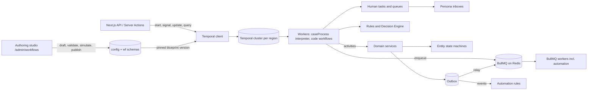

# 7 Tasks and Workflows

<!-- Generated layout: edit text between the markers; keep the markers and the front matter. -->

> Durable workflows (Temporal), short jobs and automation rules (BullMQ), human tasks, entity state machines, and tenant-authored case-type blueprints with studio, simulation, versioning and SLAs: how the platform runs processes that span minutes to years

<!-- section:purpose -->
## Purpose and scope

The Tasks and Workflows area provides the machinery that runs dispute-resolution processes over time, and the means for tenants to configure those processes without code: cases that last months or years, hearings with reminders, deadlines that start on service, pipelines that turn a recording into a certified transcript, the inbox of things a person must do next, and the studio where an institution designs its own case types.

Tenants author **case-type blueprints** as configuration (stages, human tasks, forms, deadlines, decision tables, document and notification templates, SLA policies, automation rules and AI steps). Nomology engineers write the generic Temporal workflows that interpret them. Running cases stay on the blueprint version they started with unless migrated through an approved plan.

**In scope**

- Choice of execution mechanism per scenario ([[WF-workflow-engine]]) and the layering of process, decisions, work and runtime ([[WF-separation-of-concerns-temporal]])
- The process definition model for case-type blueprints ([[WF-process-definition-model]]) and its interpreter contract ([[PKG-workflow-templates]])
- The no-code authoring studio ([[WF-workflow-authoring-studio]]), simulation and test runs ([[WF-workflow-simulation]]), versioning, publishing and in-flight migration ([[WF-workflow-versioning]])
- Automation rules on BullMQ ([[WF-automation-rules]])
- SLAs, timers and business calendars per tenant, unit and region ([[WF-sla-and-business-calendars]])
- BullMQ queues, workers, retries and dead-letter handling ([[WF-background-jobs-and-queues]])
- Human tasks: queues, assignment rules, SLAs, reminders, escalation, completion ([[WF-human-tasks]])
- Pipeline pattern for transcription, OCR, bundling and AI processing ([[WF-long-running-pipelines]])
- The state-machine library that guards entity status ([[WF-entity-state-machines]])
- The case and workflow settings catalogue ([[PKG-settings-cases-and-workflows]])
- Conventions every workflow follows: IDs, task queues, search attributes, tenant propagation, payload encryption

**Out of scope**

| Expected here, but owned elsewhere | Owner |
|---|---|
| Specific code-defined domain processes (service of notices, eBundling) | Workflow children of [[DOM]] |
| Decision tables and their engine | [[PKG-rules-and-decision-engine]] |
| Forms and the form builder | [[PKG-forms-and-form-builder]] |
| Document and notification templates | [[PKG-document-and-notification]] |
| AI steps and agents inside workflows (behaviour, guardrails, review) | [[WF-ai-steps-and-agents]] |
| Business-day and holiday arithmetic | [[PKG-calendars-and-deadline]] |
| Configuration scopes, lifecycle and packages shared by all artefacts | [[PKG-configuration-scope-hierarchy]], [[PKG-configuration-lifecycle]], [[PKG-configuration-packages]] |
| Who may author, approve and publish | [[PKG-permission-catalogue]], [[PKG-separation-of-duties]] |
| Running the Temporal cluster and Redis | [[INF-temporal]], [[INF-redis]] |
| Data subject request and tenant lifecycle workflows | [[SEC-data-principal-rights-requests]], [[MT-tenant-lifecycle]] |

<!-- section:goals -->
## Goals and non-goals

**Goals**

1. No case step is lost or duplicated across deploys, worker crashes or a full regional restart: every legally significant side effect is idempotent and every waiting process survives restarts (proved by chaos tests in staging per region).
2. A change to a deadline, reminder, routing rule or procedure reaches new cases without a deploy and leaves running cases on their pinned version, unless an approved migration moves them.
3. A trained tenant designer can build, test and publish a new case type (about 10 stages, 30 steps) in under two working days without Nomology engineering, with every published version backed by passing simulation evidence.
4. Operators can find any running process by tenant, case, stage and blueprint version within seconds (search attributes on every execution).
5. Proposed SLOs: Temporal schedule-to-start latency p95 under 2 s for interactive task queues (`cases`, `hearings`); BullMQ `notifications.send` and `automation.execute` wait p95 under 30 s; zero workflows stuck for more than 24 h without an open alert.
6. One tenant's bulk load (for example 10,000 matters from an aggregator, or a 10,000-case migration) cannot delay another tenant's hearing reminders by more than the stated SLO.

**Non-goals**

- A general BPMN modeller or scripting environment for tenants. Tenants compose the reviewed element types of [[WF-process-definition-model]]; BPMN and DMN are used for vocabulary only.
- Cross-region workflows. A workflow always runs in its tenant's home region.
- Replacing the state machine with Temporal for entity status: the database is the source of truth for status, and blueprints map stages onto code-defined statuses.
- Automation rules with procedural effect; those belong in blueprints.

<!-- section:principles -->
## Principles

1. **Pick the mechanism by duration and durability**: durable multi-step or waiting processes in Temporal; short independent side effects and automation rules in BullMQ; status rules in state machines. Recorded in [[WF-workflow-engine]].
2. **Workflows contain flow only**: no I/O, no clock reads, no database calls outside activities (enforced by the Temporal TypeScript sandbox plus a lint rule on workflow files).
3. **Tenant in the ID and the context**: workflow IDs are `{tenantId}-{process}-{entityId}`; tenantId is a search attribute and is passed to every activity, which opens its Prisma transaction with that tenant.
4. **Every side effect has an idempotency key** derived from the workflow ID and activity identity, or a business key.
5. **Pin versions at start**: blueprint, process-definition, decision-table, form and template versions are workflow inputs and recorded on the case (`wf.case_process`, `config.case_config_pin`).
6. **Legal evidence lives in the platform audit trail, not in Temporal history**, which is retained only briefly.
7. **Payloads are encrypted** with the regional payload codec; operators decrypt only through the codec server with role checks.
8. **Region-local**: Temporal namespaces (`prod-in`, `prod-sg`, `prod-us`), Redis and workers are per region; a start request for a tenant is routed to its home region and rejected elsewhere.
9. **Configuration, never code, from tenants**: tenants change procedures only through declarative, schema-validated artefacts that reference registered building blocks.
10. **Test before publish, approve before effect**: no blueprint, SLA policy or automation rule takes effect without passing validation and its configured approval; procedural changes need simulation evidence ([[WF-workflow-simulation]]).
11. **Two clocks**: procedural deadlines use seat calendars; service-level targets use business schedules; neither uses BullMQ delays ([[WF-sla-and-business-calendars]]).
12. **AI proposes, people decide**: AI steps and copilot drafts produce suggestions or drafts that a person accepts ([[WF-ai-steps-and-agents]], [[APP-admin-copilot]]).

<!-- section:context -->
## Context and boundaries

| Neighbour | What flows | Contract |
|---|---|---|
| [[DOM]] | Domain events start workflows; activities call domain commands | Domain commands and events per context |
| [[PKG-configuration-and-customisation]] | Blueprint artefacts, lifecycle, pins | `@nomology/config-core` |
| [[PKG-rules-and-decision-engine]] | `evaluateDecision` activity | Decision table versions |
| [[PKG-forms-and-form-builder]] | Forms used by filing and task steps | Form versions |
| [[PKG-notifications]] | Reminder, escalation and automation messages | BullMQ `notifications.send` queue |
| [[PKG-calendars-and-deadline]] | Due-date computation | Pure function called inside activities |
| [[WF-ai-steps-and-agents]] | AI step execution and review | AI step contract |
| [[APP-tenant-admin-console]] | Studio screens | `admin.workflows.*` tRPC, `/admin/v1/workflows` |
| [[INF-temporal]], [[INF-redis]] | Runtime | Per-region clusters |
| [[OBS]] | Metrics, traces, stuck-workflow alerts | [[OBS-performance]], [[OBS-alerting]] |

<!-- section:decisions -->
## Key decisions

- [[ADR-workflow-engine]]: the three-mechanism split that this area implements.
- [[ADR-temporal]]: self-hosted per region; namespaces per environment and region, tenant carried in context rather than per-tenant namespaces.
- [[ADR-queue-technology]]: BullMQ on Redis for short jobs; per-region Redis.
- [[ADR-tenant-isolation]]: every activity and job sets the tenant on its transaction under forced RLS.
- [[WF-workflow-versioning]] (design note, proposed for its own ADR): case-process workflows use Temporal Auto-Upgrade with patching; blueprint content is pinned by data; migrations apply through a validated Update and Continue-As-New.

<!-- section:map -->
## Capability map

| Child | Owns |
|---|---|
| [[WF-workflow-engine]] | Which mechanism to use for which scenario, and the hand-offs between them |
| [[WF-separation-of-concerns-temporal]] | Layer model: process, decisions, work, runtime, integration |
| [[WF-process-definition-model]] | Blueprint structure, `wf` schema, pins and runtime records |
| [[WF-workflow-authoring-studio]] | `/admin/workflows`: canvas and outline editor, preview, review, publish, migration screens |
| [[WF-workflow-versioning]] | Version lifecycle, change classes, interpreter versioning, in-flight migration |
| [[WF-workflow-simulation]] | Static validation, scenario simulation, history what-if, sandbox test runs, publish gate |
| [[WF-automation-rules]] | `packages/automation`: trigger, condition, action rules on BullMQ |
| [[WF-sla-and-business-calendars]] | Procedural deadlines vs service-level targets; SLA policies; business schedules |
| [[WF-ai-steps-and-agents]] | AI steps inside blueprints (owned by the AI group) |
| [[WF-background-jobs-and-queues]] | `packages/jobs`: BullMQ queue catalogue, tenant-aware enqueue and worker wrappers, retries, dead letters, rate limits |
| [[WF-human-tasks]] | `packages/human-tasks`: task records, queues, assignment rules, SLA timers, reminders, escalation, inbox queries |
| [[WF-long-running-pipelines]] | The pipeline workflow pattern used by transcription, OCR, bundling and AI processing |
| [[WF-entity-state-machines]] | `packages/state-machines`: code-defined lifecycles for cases, documents, invoices and others |
| [[PKG-settings-cases-and-workflows]] | Settings catalogue for the `case` and `workflow` domains (under the settings catalogue) |

<!-- section:phasing -->
## Phasing

| Phase | Children | Exit condition |
|---|---|---|
| 2. Shared services | Background jobs and queues (notifications, scans, search indexing) | Queue workers running per region with tenant-aware wrapper; DLQ alert wired |
| 3. First domain slice | Entity state machines; Temporal client, interceptors and codec; human tasks (basic: assign, complete, remind); procedural deadlines on seat calendars; process definition model tables and the interpreter running Nomology-authored library blueprints | Case and document lifecycles enforced; first case workflow and notice service workflow running in staging per region; library blueprints pinned per case |
| 4. Extended domain | Long-running pipelines; human-task queues, assignment rules and escalation; authoring studio with validation, scenario simulation and publish gate; versioning lifecycle; SLA policies and business schedules; automation rules (event and manual triggers) | A tenant designer publishes a blueprint without engineering help; replay tests mandatory in CI; automation loop protection proven |
| 5. Scale and change | In-flight migration; history what-if; sandbox test runs; scheduled automation rules; copilot drafting | First approved migration executed in staging with dry-run evidence; migration flag enabled per tenant |

<!-- section:risks -->
## Risks and open questions

- [ ] Visibility store per region: Postgres or OpenSearch (carried from [[WF-separation-of-concerns-temporal]]). Owner: platform / DevOps.
- [ ] BullMQ per-tenant fairness: BullMQ's group rate limiting is a BullMQ Pro feature; decide between buying Pro or our own per-tenant token bucket. Owner: platform engineering.
- [ ] Temporal closed-workflow retention per namespace (proposed 30 days) needs sign-off so that support can investigate, while legal evidence lives in the audit trail. Owner: CTO.
- [ ] Risk: workflow code drifts into business logic. Mitigation: guardrails in [[WF-separation-of-concerns-temporal]] plus review checklist.
- [ ] Risk: tenants build blueprints that are valid but procedurally wrong (for example a missing right to respond). Mitigation: library blueprints reviewed by legal, required simulation scenarios, two approvers for procedural changes in SEBI ODR and court tenants. Owner: product with legal.
- [ ] Risk: the interpreter becomes a second programming language as tenants ask for more constructs. Mitigation: closed element catalogue, interpreter contract versions, revisit trigger in [[ADR-workflow-engine]]. Owner: CTO.
- [ ] Interpreter versioning strategy (Auto-Upgrade with patching, pure core shared with the simulator) should be recorded as its own ADR; [[ADR-workflow-engine]] is approved and not edited. Owner: CTO.
- [x] Ownership of business-schedule tables is settled (decision D13: [[PKG-calendars-and-deadline]] owns calendar computation (seat calendars, business-day arithmetic); [[WF-sla-and-business-calendars]] owns the configuration of business schedules and SLA policies).

<!-- checks -->
## Template checks

<!-- check:ownership -->
### Ownership and governance

Accountable owner: CTO until a workflow squad lead is named. Reviewers: platform engineering (Temporal, BullMQ), legal (procedural rules, locked components, migration legal basis), accessibility lead (studio), security (automation principals, copilot). Changes to principles go through an ADR or this area node with CTO approval.

<!-- check:boundaries -->
### Scope and boundaries

The area provides mechanisms and the authoring surface; [[DOM]] children define code processes and tenants define blueprints. Overlaps resolved: notifications are sent by [[PKG-notifications]] (via `notifications.send`), while timing and escalation belong to the workflow, task or SLA policy that asked; deadline arithmetic belongs to [[PKG-calendars-and-deadline]]; artefact lifecycle and scopes belong to the configuration nodes; AI step behaviour belongs to [[WF-ai-steps-and-agents]]; automation rules may not have procedural effect, which keeps them separate from blueprints. The Temporal cluster and Redis are infrastructure ([[INF-temporal]], [[INF-redis]]).

<!-- check:principles -->
### Principles and enforcement

Enforcement per principle: Temporal sandbox and an ESLint rule banning imports of Prisma, `fetch` and `Date.now` in `workflows/**` (P2); a client wrapper that refuses to start a workflow whose ID does not start with the active tenant ID (P3); an activity base wrapper that fails if `tenantId` is missing (P3); a lint rule that activities with external side effects declare an idempotency key (P4); pins stored in `wf.case_process` protected by trigger and column grants (P5); review checklist item for audit events (P6); codec installed in shared client and worker factories (P7); regional router rejects foreign-region starts (P8); blueprint JSON Schema and closed registries (P9); submit gate in the admin API and maker-checker in config-core (P10); BullMQ registration rejects long delays and procedural deadlines live in `case_deadlines` with Temporal timers (P11); AI outputs typed as suggestions requiring an accepting user (P12).

<!-- check:compliance -->
### Regulatory and control mapping

The area carries procedural-fairness evidence (which procedure version applied, who changed it, with what approval), audit-trail obligations under ISO 27001 change management (A.8.32) and SOC 2 change criteria through maker-checker publishing, WCAG 2.2 AA for the studio and the forms it produces, and data-minimisation obligations (DPDP, GDPR, PDPA) through ID-only payloads. Assumption: SEBI ODR timelines are fixed by SEBI circulars and are encoded as offering-locked components; to be confirmed by legal. Evidence: [[WF-process-definition-model#tenancy]], [[WF-workflow-versioning]], [[WF-workflow-simulation]], [[PKG-audit-trail]].

<!-- check:regions -->
### Tenancy and residency

All parts are per region: Temporal clusters and namespaces (`prod-in`, `prod-sg`, `prod-us`), Redis, workers and codec keys (regional KMS). The tenant directory tells the API which region to call; a worker only polls its own region's cluster, so it can never process another region's tenant. Tenant variation is through decision tables and process definitions, not code. On Azure the same containers run on Azure Container Apps against a self-hosted Temporal in that region; nothing in this area changes.

<!-- check:quality -->
### Quality targets

Proposed targets, to be confirmed with [[OBS-performance]]: schedule-to-start latency p95 under 2 s on `cases` and `hearings` queues and under 60 s on `ai-pipelines`; BullMQ notification wait p95 under 30 s; no workflow task failure rate above 0.1% per hour; recovery after a regional Temporal restart with zero lost timers (tested in DR drills under [[INF-backup-and-disaster-recovery]]).

<!-- check:phase -->
### Phasing

See Phasing: queues in Phase 2; state machines, Temporal plumbing, basic human tasks, procedural deadlines and library blueprints in Phase 3; studio, simulation gate, SLAs and automation in Phase 4; migration and history what-if in Phase 5. Payload encryption, tenant interceptors, search attributes and the pin tables are part of the first workflow and cannot be added later without migrating running histories.

<!-- end -->
